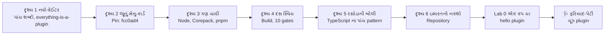
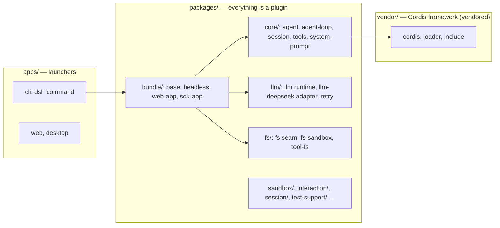

# પ્રકરણ 0 — પાયો અને પ્રથમ run

> **Level 0 · વાર્તાનો દિવસ 2.**
> આજે DeepSeek Harness તમારા computer પર આવે છે, બરાબર એ જ ફોટા (commit) પર જેના પર આખું પુસ્તક લખાયું છે, અને તેમાં તમારો પહેલો plugin ચાલે છે — **API key વગર**.
> દરેક દૃશ્ય: 🎬 ઘટના → ❓ આરવનો પ્રશ્ન → 💻 code માં → 🔬 expert નજર.
> પહેલાં: [પ્રવેશ પ્રકરણ](pravesh-shunya-thi-shuruaat.md). આખો નકશો: [સમગ્ર નકશો](overview-samagra-naksho.md).

## 🎬 સવારે સાત વાગ્યે: ચાવીનો ઝૂડો

ભોજનાલય હજી બંધ છે. પપ્પા આરવના હાથમાં ચાવીનો ઝૂડો મૂકે છે: "આજથી સવારે તું ખોલીશ."

પહેલા દિવસે રસોઈ નથી. ફક્ત ચાર કામ: **સાચી શાખા અને સાચો દિવસ, ત્રણ ચાવી, બધી લાઈટ ચાલુ, અને એક કપ ચા.** મીરાદીદી laptop ખોલે છે: "Software નું ભોજનાલય ખોલવામાં પણ આ જ ચાર કામ છે."

## 🎯 આ પ્રકરણ પછી તમે શું કરી શકશો

- AI model, model provider, agent, harness અને plugin વચ્ચેનો તફાવત એક-એક ઉદાહરણથી સમજાવી શકશો.
- DeepSeek Harness નું repository clone કરી, તેની pinned commit પર checkout કરી, dependencies install અને build કરી શકશો.
- API key વગર પહેલો Cordis plugin ચલાવી શકશો અને output ની આગાહી કરી શકશો.
- આ repository ના TypeScript માં વારંવાર આવતા પાંચ pattern ઓળખી શકશો.
- Linux અને Windows + WSL2 બંને માટે setup નો માર્ગ જાણી શકશો.
- "Exit 0 છતાં કંઈ થયું નહીં" જેવી ચૂપ નિષ્ફળતાનું નિદાન કરી શકશો.

## 🗺️ આજના દિવસનો નકશો



---

## દૃશ્ય 1 — રમેશભાઈ રજા પર: દરેક જણ બદલી શકાય

🎬 આજે રમેશભાઈ રજા પર છે. તેમની જગ્યાએ બીજી શાખામાંથી એક વેઈટર આવ્યો છે. તે ઓર્ડર થોડી જુદી રીતે લે છે, પણ ભોજનાલય ચાલે છે: દીવાલો એ જ, ચોપડો એ જ, કોઠાર એ જ, મહારાજ એ જ.

❓ "વેઈટર તો ભોજનાલયનું હૃદય છે. એ બદલાય અને કશું ન તૂટે, એ કેવી રીતે?"

"કારણ કે અહીં કોઈ 'ખાસ' નથી. દરેક જણ એક **ખુરશી** પર બેસે છે, અને ખુરશીના નિયમ નક્કી છે. ખુરશી પર કોણ બેઠું છે તે બદલાઈ શકે."

💻 પ્રવેશ પ્રકરણના પાંચ શબ્દો, હવે DeepSeek Harness ના નક્કર ઉદાહરણ સાથે:

| English term | અર્થ | DeepSeek Harness માં ઉદાહરણ | ભોજનાલયમાં |
|---|---|---|---|
| **AI model** | text વાંચીને આગલો text (અથવા tool call) બનાવતું ગણિતીય મોડેલ | `deepseek-flash` નામનું model | મહારાજ |
| **Model provider** | model ને network પર ઉપલબ્ધ કરાવતી સેવા, જેનું પોતાનું HTTP API હોય | DeepSeek નું official API (`https://api.deepseek.com`) | રસોઈ-સેવા agency |
| **Agent** | એક loop જે model ને પૂછે, model કહે તે tool ચલાવે, અને પરિણામ પાછું model ને આપે — કામ પૂરું ન થાય ત્યાં સુધી | "README વાંચો" કહ્યું તો `read` tool ચલાવી પછી સાર લખે | રમેશભાઈ |
| **Harness** | agent ને ચલાવવા માટેનું આખું તંત્ર: loop, tools, session log, permissions, UI, provider adapter | DeepSeek Harness (`dsh`) | આખું ભોજનાલય |
| **Plugin** | harness માં ઉમેરાતો એક સ્વતંત્ર ભાગ, જે service, tool કે event listener ઉમેરે અને unload થતાં પોતાની નોંધણી પાછી ખેંચી લે | `@deepseek-ai/dsh-tool-fs` જે `read`, `write`, `edit` tools ઉમેરે છે | એક કાઉન્ટર/કર્મચારી |

એક વાક્યમાં: **model** વિચારે છે, **provider** તેને પહોંચાડે છે, **agent** loop ચલાવે છે, **harness** આખું ઘર છે, અને **plugin** એ ઘરની દરેક ઈંટ છે.

આજની ઘટના એ DeepSeek Harness ની સૌથી ખાસ વાત છે: **agent loop પોતે પણ plugin છે.** README તેને *everything-is-a-plugin* architecture કહે છે, જે [Cordis](https://github.com/cordiverse/cordis) framework પર બનેલું છે ([README.md](https://github.com/deepseek-ai/deepseek-harness/blob/fcc0ad462172522aaf5c93a7b2e01f6b9f0b0159/README.md)). ✅ *source-verified*

**Cordis** = plugins ને જોડતું framework: કોણ ક્યારે કામ શરૂ કરે, કોણ કોને સેવા આપે, અને કોઈ જાય ત્યારે તેની બધી નોંધણી કેવી રીતે પાછી ખેંચાય — મેનેજર કાંતિકાકા. પ્રકરણ 2 આખું તેના વિશે છે.

> **Verification marks.** ✅ = pinned source વાંચીને ચકાસ્યું, 🧪 = આ પુસ્તક લખતી વખતે ખરેખર ચલાવીને ચકાસ્યું,
> ⚠️ = ચકાસ્યું નથી (docs પર આધારિત). વિગત: [પરિશિષ્ટ G](../appendix/G-verification-log.md).

🔬 **Expert નજર.** Plugin ની વ્યાખ્યાનો બીજો અડધો ભાગ ફરી વાંચો: "unload થતાં પોતાની નોંધણી **પાછી ખેંચી લે**." રજા પર જતો વેઈટર પોતાના અધૂરા ટેબલ, ચાવી અને નામની તકતી પાછળ છોડી જાય, તો નવો વેઈટર આવીને ગૂંચવાય. "ઉમેરવું" સહેલું છે; **સાફ નીકળવું** એ plugin system ની ખરી કસોટી છે. પ્રકરણ 2 માં તમે આ જાતે ચલાવીને જોશો.

## દૃશ્ય 2 — ગયા મહિનાનું મેનુ-કાર્ડ: pin

🎬 આરવ ગ્રાહકને ટેબલ પરનું મેનુ-કાર્ડ આપે છે. ગ્રાહક "ઊંધિયું" માંગે છે. રસોડું: "ઊંધિયું તો ગયા મહિને બંધ કર્યું." કાર્ડ જૂનું હતું. કાર્ડ એક વાત કહે, રસોડું બીજી.

પપ્પા: "કાર્ડ પર તારીખ લખ. અને ગ્રાહકને એ જ તારીખનું રસોડું બતાવ."

❓ "Harness તો રોજ બદલાય છે. પુસ્તક અને software એક વાત કેવી રીતે કહે?"

💻 Repository README માં જ લખે છે કે તે *developer preview* છે અને "THERE WILL BE COMPATIBILITY-BREAKING CHANGES." તેથી આખું પુસ્તક એક જ commit (ફોટા) પર બંધાયેલું છે.

**Pin** = "આ જ version વાપરો" એવું નક્કી કરી દેવું.

| વિગત | મૂલ્ય |
|---|---|
| Repository | `https://github.com/deepseek-ai/deepseek-harness` |
| Branch | `master` |
| Commit SHA | `fcc0ad462172522aaf5c93a7b2e01f6b9f0b0159` |
| Commit date | 2026-11-04 16:40 +0800 ("Merge pull request #7873 … release-dsh-0.2.2-rc.1-to-master") |
| Root package version | `0.2.2-rc.1` |
| Inspection date | 2026-11-04 |
| Node.js used | v24.22.2 (repository માંગે છે `>=24.9.0`) |
| pnpm used | 11.28.5 (Corepack દ્વારા, `packageManager` field મુજબ) |
| Git used | 2.43.0 |
| TypeScript / Vitest / tsx (lockfile) | 6.0.3 / 4.1.11 / 4.23.13 |
| Cordis (vendored) | `4.0.0-rc.11`, upstream commit `0b96d9fd517b998e44e2209560c9e5f0671ce933` ([vendor/README.md][vendor-manifest]) |
| Machine | Linux x64, 4 CPU, 15 GB RAM |

દરેક source link `blob/fcc0ad46…/path#Lx-Ly` સ્વરૂપની **permalink** છે: કદી ન બદલાતી link, એ ફોટાની ચોક્કસ lines. `#L327-L433` એટલે "line 327 થી 433". Upstream `master` આગળ વધે તો પણ આ link એ જ lines બતાવશે.

એ ફોટામાં ઊભા રહેવા ત્રણ Git command પૂરતા છે:

```bash
git clone https://github.com/deepseek-ai/deepseek-harness.git
```

```bash
git -C deepseek-harness checkout --detach fcc0ad462172522aaf5c93a7b2e01f6b9f0b0159
```

```bash
git -C deepseek-harness log -1 --format='%H %ci %s'
```

| Command | શું કરે | ભોજનાલયમાં |
|---|---|---|
| `git clone <url>` | આખું repository + ઇતિહાસ તમારા computer પર | આખા ભોજનાલયની નકલ |
| `git -C <dir> checkout --detach <sha>` | એ folder માં, એ ફોટા પર જાઓ | "4 નવેમ્બરના ફોટામાં ઊભા રહો" |
| `git -C <dir> log -1 --format=…` | હું કયા ફોટા પર છું તે બતાવો | ફોટાની પાછળનો નંબર વાંચો |

`-C <dir>` એટલે "આ command એ folder ની અંદર ચલાવો". ત્રીજા command નું output `fcc0ad46…` થી શરૂ થવું જોઈએ. ન થાય તો બાકીનું પુસ્તક બીજા code પર ચાલશે, અને line numbers ખોટા પડશે — જૂનું મેનુ-કાર્ડ.

`--detach` નો અર્થ: કોઈ branch પર નહીં, સીધા commit પર ઊભા રહો. તમે ફેરફાર કરશો તો તે કોઈ branch માં નહીં જાય — શીખવા માટે એ જ સારું. **"પ્રવાસી, રહેવાસી નહીં."**

🔬 **Expert નજર.** Table માં ફક્ત SHA નથી; Node, pnpm, TypeScript અને Cordis ના versions પણ છે. "એ જ code" પૂરતું નથી; **એ જ code, એ જ સાધનો** જોઈએ. કોઈ પરિણામ ફરી મેળવી શકાય (reproducible) તે માટે expert આખું વાતાવરણ નોંધે છે. આ પુસ્તકનો દરેક 🧪 દાવો આ table પર ઊભો છે.

## દૃશ્ય 3 — ત્રણ ચાવી: Node.js, Corepack, pnpm

🎬 ઝૂડામાં ત્રણ ચાવી છે: **મુખ્ય દરવાજો**, **કોઠાર**, અને **ગલ્લાનો ચોપડો**. ચોપડાની ચાવી (Git) દૃશ્ય 2 માં વપરાઈ ગઈ. હવે બાકીની બે.

કોઠાર ખોલતાં આરવ જુએ છે કે ભીખાભાઈ પાસે એક યાદી છે: કઈ વસ્તુ, કઈ દુકાનથી, **કઈ brand**. ગયા વર્ષે કોઈ બીજી brand નું તેલ લઈ આવ્યું હતું, અને ફરસાણનો સ્વાદ બદલાઈ ગયો. ત્યારથી યાદીમાં brand લખેલી છે, અને ખરીદી **કોણ** કરશે તે પણ.

❓ "Software માં 'બીજી brand' જેવું કંઈ હોય?"

💻 હોય. દરેક project બીજાઓના code પર ઊભો છે, અને તે code નો version બદલાય તો વર્તન બદલાય.

- **Node.js** = browser વગર JavaScript ચલાવતું runtime — મુખ્ય દરવાજો. ઉદાહરણ: `node --version` → `v24.22.2`.
- **Dependency** = બીજાનો code જે આપણો project વાપરે — બહારથી આવતો સામાન. ઉદાહરણ: `vitest`, `tsx`.
- **Package manager** = dependencies download કરી ગોઠવતું tool — ખરીદી કરનાર કોઠારી.

આ repository **pnpm** વાપરે છે, અને ખરીદી કરનારનો ચોક્કસ version પણ root `package.json` માં લખેલો છે: `"packageManager": "pnpm@11.28.5"`, `"engines": { "node": ">=24.9.0" }`. ✅

- **Corepack** = Node સાથે આવતું નાનું tool, જે `packageManager` field વાંચીને સાચો pnpm version જાતે લાવે છે. ઉદાહરણ: `corepack enable` પછી `pnpm --version` → `11.28.5`.
- **Workspace** = એક repository માં ઘણાં package — એક ઇમારતમાં ઘણાં કાઉન્ટર. અહીં `packages/<group>/<pkg>/` નીચે 50 થી વધુ group છે, અને દરેક package નું નામ `@deepseek-ai/dsh-<name>` છે ([AGENTS.md][agents-conventions]). ✅

| સ્તર | શું કરે છે | ભૂલ થાય તો દેખાય |
|---|---|---|
| Node.js 24 | JavaScript/TypeScript ચલાવે | જૂનું Node: install/build નિષ્ફળ (`engines >=24.9.0`) |
| Corepack | `package.json` નું `packageManager` વાંચી સાચો pnpm લાવે | `pnpm --version` ખોટો version બતાવે |
| pnpm 11.28.5 | 1,400+ dependencies લાવી workspace ગોઠવે | install અટકે; અમારા sandbox માં એક CDN blocked હતું (નીચે જુઓ) |

### Linux પર setup (🧪 આ પુસ્તક માટે ચલાવ્યું)

1. Node 24 install કરો (nodejs.org નું official tarball, અથવા તમારું version manager). પછી:

```bash
node --version
```

`v24.9.0` કે તેથી નવું હોવું જોઈએ.

2. Corepack ચાલુ કરો:

```bash
corepack enable
```

3. Clone, pin, install:

```bash
git clone https://github.com/deepseek-ai/deepseek-harness.git && cd deepseek-harness
```

```bash
git checkout --detach fcc0ad462172522aaf5c93a7b2e01f6b9f0b0159
```

```bash
pnpm install
```

> **અમારા sandbox ની એક ખાસ વાત (તમને કદાચ નહીં નડે).** અમારા cloud sandbox નું network `cdn.sheetjs.com` ને block કરે છે.
> Client package `ui-sidebar-documentpreview` ત્યાંથી `xlsx-0.20.3.tgz` માંગે છે, તેથી `pnpm install` નિષ્ફળ ગયું.
> અમે ફક્ત અમારી scratch copy માં `pnpm-workspace.yaml` ના `overrides` માં `'xlsx': '0.18.5'` (npm નું) અને એક `.d.ts` shim ઉમેર્યા.
> આ Host/agent code ને સ્પર્શતું નથી. તમારું network એ CDN સુધી પહોંચતું હોય તો આવું કંઈ ન કરશો. વિગત: [પરિશિષ્ટ G](../appendix/G-verification-log.md).

### Windows + WSL2 (⚠️ આ પુસ્તક માટે ચલાવ્યું નથી)

**WSL2** = Windows ની અંદર ચાલતું સાચું Linux kernel — "ઘરમાં બીજું ઘર". ઉદાહરણ: PowerShell માં `wsl --install` પછી Ubuntu terminal મળે.

Repository નો development guide કહે છે કે Windows પર native tools અથવા WSL 2 બંને ચાલે, અને WSL વૈકલ્પિક છે ([docs/development.md](https://github.com/deepseek-ai/deepseek-harness/blob/fcc0ad462172522aaf5c93a7b2e01f6b9f0b0159/docs/development.md)). તેના મુખ્ય નિયમો:

- checkout, dependencies અને toolchain **એક જ OS environment** માં રાખો. WSL માટે checkout ને Linux filesystem (`~/…`) માં રાખો, `/mnt/c/…` માં નહીં; બંને filesystem વચ્ચેની I/O ધીમી છે.
- દરેક environment માં dependencies અલગથી install કરો, કારણ કે native binaries OS પ્રમાણે જુદી હોય.
- WSL માં ચાલેલા tests Linux વર્તન સાબિત કરે છે; Windows-specific વર્તન માટે native Windows validation જોઈએ.

WSL ની અંદર ઉપરના Linux steps જ ચાલે. અમે Windows પર આ ચલાવ્યું નથી, તેથી કોઈ output નો દાવો કરતા નથી.

🔬 **Expert નજર.** Setup નિષ્ફળ જાય ત્યારે table ની ત્રીજી column જુઓ: લક્ષણ પરથી **સ્તર** ઓળખાય. `pnpm --version` ખોટો છે? તો સમસ્યા Corepack ની છે; pnpm ને દોષ ન આપો. ત્રણ ચાવી અલગ ઓળખતાં આવડે, તો "install નથી થતું" જેવી ધૂંધળી ફરિયાદ એક ચોક્કસ પ્રશ્ન બની જાય.

## દૃશ્ય 4 — દસ સ્વિચ: build

🎬 દરવાજો ખોલ્યા પછી પપ્પા સીધા ગ્રાહક નથી લેતા. દીવાલ પર એક પાટિયું છે: ગેસ, ફ્રિજ, લાઈટ, પાણી, exhaust… **દસ સ્વિચ**. દરેક ચાલુ કરીને તપાસે. એક પણ ન ચાલે, તો ભોજનાલય ખૂલતું નથી.

❓ "નવ ચાલે અને એક ન ચાલે, તો પણ બંધ?"

"ગ્રાહક બેઠા પછી ખબર પડે કે ફ્રિજ બંધ હતું, એના કરતાં સવારે ખબર પડે એ સારું."

💻

- **Build** = source code ને ચલાવી શકાય તેવા રૂપમાં ફેરવવો + તપાસ કરવી.
- **Gate** = build નું એક તપાસ-પગલું — એક સ્વિચ. બધા pass થાય તો જ build સફળ.

```bash
pnpm run build
```

અમારા machine પર આ command એ 10 gates ચલાવ્યા: native addon, Host Typert, host compiler, Host bundle, Desktop bundle, client compiler, Client bundle, Web build, host aggregate check, client aggregate check — `10 passed, 0 failed, 0 skipped in 129.74s` ([evidence/build.log](../evidence/build.log)). 🧪 આશરે બે મિનિટ — ચા મૂકીને રાહ જુઓ.

🔬 **Expert નજર.** Build log ની છેલ્લી line માં ત્રણ આંકડા છે: passed, failed, **skipped**. શિખાઉ ફક્ત "failed = 0" જુએ છે. Expert "skipped = 0" પણ જુએ છે: જે સ્વિચ તપાસી જ નથી, તે "ચાલુ" નથી ગણાતી.

## દૃશ્ય 5 — રસોડાની બોલી: TypeScript ના પાંચ pattern

🎬 રસોડામાં આરવને અડધી વાત સમજાતી નથી. "બે નંબર ધીમો", "ચાર પર ડબલ", "સાતનું રદ". દીદી: "દરેક રસોડાની પોતાની બોલી હોય. પાંચ-છ શબ્દ શીખી લે, પછી બધું સમજાશે."

❓ "Harness ના code ની પણ આવી બોલી છે?"

💻 પ્રવેશ પ્રકરણ (દૃશ્ય 6) માં type, union અને `satisfies never` જોયા. Harness ના code માં આ પાંચ pattern વારંવાર દેખાય છે.

**(1) `import type`** — ફક્ત type લાવે; runtime પર કંઈ import ન થાય. મહેમાનની યાદી, મહેમાન પોતે નહીં.

```ts
import type { Context } from '@deepseek-ai/cordis'
```

**(2) Declaration merging** — બીજા package ના interface માં નવા field ઉમેરવા. (**Interface** = object નો આકાર જણાવતું વર્ણન — ખુરશીના નિયમ: "અહીં બેસનાર `register` કરી શકશે.") Cordis ના `Context` પર `ctx.tools`, `ctx.llm` જેવા services આ રીતે type મેળવે છે. એક વિચિત્ર દેખાતી line ખરેખર આ જ કરે છે:

```ts
import type {} from '@deepseek-ai/dsh-tools' // dsh-tools ના merge (દા.ત. 'tools/result' event) types માં લાવે
```

**(3) Discriminated union** — એક `kind`/`type` field પરથી કયો આકાર છે તે નક્કી થાય. ઉદાહરણ: `{ kind: 'enter' } | { kind: 'reject' }`. Repository નો નિયમ: closed union ના અંતે `assertNever` ([AGENTS.md][agents-conventions]).

**(4) `satisfies never`** — "બધા કેસ handle થયા" એવું compiler પાસે સાબિત કરાવવું. CLI entry point માં:

```ts
    default:
      invocation satisfies never
      throw new Error(`dsh: unhandled invocation mode ${JSON.stringify(invocation)}`)
```

(repository code, [apps/cli/src/bin.ts][cli-runCli]) — પ્રવેશ પ્રકરણના `types.ts` માં તમે આ જ pattern ચલાવી જોયો હતો.

**(5) `async`/`await` અને `AbortSignal`** — લાંબું ચાલતું કામ અને તેને રદ કરવાનો signal (લાલ દીવો). Agent loop દરેક await પછી `signal.throwIfAborted()` ચલાવે છે; પ્રકરણ 5 માં interruption આ જ રીતે પકડીશું. (પ્રવેશ પ્રકરણનો `rasoi-async.mjs` આનું રમકડું છે.)

🔬 **Expert નજર.** Pattern (2) એ દૃશ્ય 1 નો technical પાયો છે. "દરેક જણ બદલી શકાય" ત્યારે જ સલામત બને જ્યારે ખુરશીના નિયમ (interface) compiler તપાસે. એક plugin `ctx.tools` ઉમેરે અને બીજો વાપરે, તો બંનેને એક જ આકાર દેખાય — declaration merging ને કારણે. Plugin system ઢીલી છે; types તેને કડક રાખે છે.

## દૃશ્ય 6 — ઇમારતનો નકશો: repository

🎬 આરવ પહેલી વાર આખી ઇમારત ફરે છે: આગળ **દરવાજો**, પાછળ **મેનેજરની ઓફિસ**, વચ્ચે **કાઉન્ટરો**. દીદી: "હજારો files છે. બધી ન વાંચ. પહેલાં ઓરડા ઓળખ."

💻



Arrows "આ layer એ layer પર બનેલું છે" બતાવે છે — call direction નહીં.

**Vendored** = બીજા project નો code પોતાના repository માં નકલ કરીને રાખવો (download ને બદલે). Cordis અહીં `vendor/` માં vendored છે.

| ઓરડો | Folder | ભોજનાલયમાં | પહેલું ખોલવાનું file |
|---|---|---|---|
| cli | `apps/cli/` | મુખ્ય દરવાજો | `apps/cli/src/bin.ts` ([`runCli`][cli-runCli]) |
| cordis | `vendor/cordis/` | મેનેજરની ઓફિસ | `vendor/cordis/bin.js` ([launcher][cordis-bin]) |
| bundle | `packages/bundle/` | તૈયાર મેનુ-પાનાં | `packages/bundle/base/cordis.patch.yml` ([rows][bundle-base]) |
| core | `packages/core/` | વેઈટર, ચોપડો, કોઠારનો મુખ્ય | `packages/core/agent-loop/src/agent.ts` ([`ReactLoopAgent`][loop-class]) |
| llm | `packages/llm/` | ફોન અને દુભાષિયો | `packages/llm/llm-deepseek/src/adapter.ts` ([`DeepSeekAdapter`][deepseek-adapter]) |
| fs | `packages/fs/` | કોઠાર | `packages/fs/tool-fs/src/read.ts` ([`applyReadTool`][read-tool]) |

**Source map: આ ક્રમમાં ખોલો.**

| ક્રમ | File | Symbol | કેમ |
|---|---|---|---|
| 1 | `README.md` | Run from source | સત્તાવાર commands |
| 2 | `package.json` | `engines`, `packageManager`, `scripts.dsh` | `pnpm dsh` = `node --import tsx/esm apps/cli/src/bin.ts` |
| 3 | `vendor/cordis/bin.js` | [launcher][cordis-bin] | સૌથી નાનું Cordis app |
| 4 | `docs/cordis-tutorial/01-first-plugin.md` | ch. 1 | Lab નો સ્રોત |
| 5 | `apps/cli/src/bin.ts` | [`runCli`][cli-runCli] | `dsh` નો દરવાજો |

🔬 **Expert નજર.** મોટું codebase વાંચવાની expert રીત: ઉપરથી નીચે આખું નહીં, પણ **એક પગદંડી**. દરેક પ્રકરણમાં "Source map" table એ પગદંડી છે: એક પછી એક file, ફક્ત એ symbol. બાકીનું જરૂર પડે ત્યારે.

---

## 🧪 Lab 0 — એક કપ ચા: પહેલો plugin, key વગર

🎬 દસ સ્વિચ ચાલુ છે. પપ્પા: "હવે ગ્રાહક લેતા પહેલાં **એક કપ ચા** બનાવ. ચા બને, તો ગેસ, પાણી, વાસણ — બધું ખરેખર ચાલે છે."

આ lab repository ના પોતાના tutorial નું પહેલું પ્રકરણ છે. તે repository ના `tmp/` folder માં કામ કરે છે. `tmp/` **gitignored** છે: Git તેની નોંધ નથી રાખતું. ત્યાં ગમે તે કરો, repository નો ઇતિહાસ સ્વચ્છ રહે — રસોડાનો પ્રયોગ-ખૂણો.

```bash
mkdir -p tmp/cordis-tutorial && cd tmp/cordis-tutorial
```

`hello.ts` બનાવો:

```ts
import type { Context } from '@deepseek-ai/cordis'

export const name = 'hello'

export function apply(ctx: Context) {
  console.log('hello from my first plugin')
}
```

`cordis.yml` બનાવો:

```yaml
- name: './hello.ts'
```

ચલાવો:

```bash
node --import tsx ../../vendor/cordis/bin.js
```

**અપેક્ષિત અવલોકન** (🧪 exit code 0):

```text
hello from my first plugin
```

### ચા કેવી રીતે બની? — ત્રણ ભાગ, ત્રણ પગલાં

**Plugin ના ત્રણ ભાગ:**

| ભાગ | અર્થ | ભોજનાલયમાં |
|---|---|---|
| `name` | plugin ની ઓળખ | કર્મચારીનું નામ |
| `apply(ctx)` | Cordis plugin ને ચાલુ કરે ત્યારે બોલાવે; `ctx` એટલે **Context** — services રાખતો કેન્દ્રીય object | "કામ પર હાજર થાઓ" — અને ઇમારતની ચાવી (`ctx`) હાથમાં |
| `cordis.yml` | કયા plugins mount કરવા તેની યાદી; YAML ની દરેક row એક plugin | આજનું મેનુ |

**Launcher ના ત્રણ પગલાં:** [`vendor/cordis/bin.js`][cordis-bin] એ (1) root `Context` બનાવ્યો, (2) `Loader` plugin mount કર્યો, અને (3) `@deepseek-ai/cordis-plugin-include` ને `./cordis.yml` વાંચવા કહ્યું. Loader એ `./hello.ts` import કરી `apply(ctx)` બોલાવ્યું.

- **Mount** = plugin ને ચાલતા તંત્રમાં જોડવો (પછી તેનું `apply` ચાલે). Unmount/unload = તેને કાઢવો, અને તેની બધી નોંધણી પાછી ખેંચવી (દૃશ્ય 1).
- **Plugin ના ત્રણ આકાર — "ફ-ઓ-ક":** Cordis plugin **ફ**ંક્શન, `apply` વાળો **ઓ**બ્જેક્ટ (અહીં module), કે **ક**્લાસ હોઈ શકે. ક્લાસ ત્યારે વપરાય જ્યારે plugin બીજાને **service** આપતો હોય (પ્રકરણ 2, 3).
- **tsx** = TypeScript ને build કર્યા વગર સીધું ચલાવતું tool. `--import tsx` એટલે: Node ને TypeScript file સીધી ચલાવવા દો. tsx repository ના `tsconfig` `paths` (package-નામ → folder નકશો) પણ વાંચે છે, તેથી `tmp/` ની અંદરથી `@deepseek-ai/dsh-tools` જેવા workspace package source માંથી મળી જાય છે. 🧪 આ પુસ્તકની બધી labs આ જ કારણે `<harness>/tmp/` માં ચાલે છે.

## 🔮 આગાહી કસોટી: ચા ઢોળાય તો?

`apply` ને આ રીતે બદલો અને **ચલાવતા પહેલાં** લખો: process નો exit code શું હશે, અને "hello" છપાશે કે નહીં?

```ts
export function apply(ctx: Context) {
  throw new Error('apply exploded')
}
```

જવાબ [પરિશિષ્ટ D](../appendix/D-lab-solutions.md#lab-0) માં છે. પહેલાં પોતે ચલાવો.

## 🩺 નિષ્ફળતા: ફરિયાદ-પેટી, જે કોઈ ખોલતું નથી

🎬 ઉત્સાહમાં આરવ બીજો plugin બનાવે છે, પણ `cordis.yml` માં `./helo.ts` લખી નાખે છે (એક `l` ઓછો). ચલાવે છે — કંઈ છપાતું નથી. `echo $?` કહે છે `0`.

"દીદી, exit 0 એટલે સફળ ને? તો મારો plugin ક્યાં ગયો?"

દીદી દરવાજા પાસેની **ફરિયાદ-પેટી** બતાવે છે. તેના પર ધૂળ જામી છે. "ગ્રાહકો ફરિયાદ નાખે છે. પણ પેટી કોઈ ખોલતું નથી. ફરિયાદ **છે**; જોનાર નથી."

💻 **લક્ષણ.** `cordis.yml` માં `- name: './helo.ts'` (spelling ભૂલ) લખ્યું, અથવા `apply` અંદર exception ફેંકાયો. બંને કિસ્સામાં process **exit code 0** સાથે, કંઈ છાપ્યા વગર પૂરું થાય છે. 🧪

**Docs અને code નો તફાવત.** Tutorial નું પ્રકરણ 1 ("Try breaking it") કહે છે કે `apply` throw કરે તો "the process dies with your error." Pinned commit પર અમે આ ત્રણ વાર ચલાવ્યું: exit 0, stdout/stderr ખાલી. 🧪
કારણ source માં દેખાય છે: Loader entry ની નિષ્ફળતા `this.ctx.logger.error(error)` થી log કરે છે ([vendor/loader/src/config/entry.ts][loader-entry-error]), અને [`vendor/cordis/bin.js`][cordis-bin] કોઈ log exporter mount કરતું નથી. **Log છે, પણ જોનાર કોઈ નથી.** ✅

- **Logger** = સંદેશા ભેગા કરનાર — ફરિયાદ-પેટી.
- **Log exporter** = સંદેશાને ક્યાંક (screen, file) બતાવનાર — પેટી ખોલનાર. ન હોય તો સંદેશા ખોવાઈ જાય.

**નિદાન:**

1. Loader પહેલાં console exporter mount કરતો નાનો launcher વાપરો. પુસ્તકનો [`labs/cordis-basics/bin-with-logs.ts`](../labs/cordis-basics/bin-with-logs.ts) બરાબર આ કરે છે, અને અંતે દરેક entry ની `FiberState` (plugin ની હાજરી-સ્થિતિ) છાપે છે:

```bash
node --import tsx ../book-labs/cordis-basics/bin-with-logs.ts
```

2. Throw વાળા `hello.ts` માટે અમને આ મળ્યું (path ટૂંકાવ્યો છે):

```text
2026-11-04 18:39:07 [E] hello Error: apply exploded
                            at new apply (…/tmp/cordis-tutorial/hello.ts:6:9)
[entry] @deepseek-ai/cordis-plugin-include -> ACTIVE
[entry] ./hello.ts -> FAILED
```

3. Typo વાળા path માટે: `[E] include Error [ERR_MODULE_NOT_FOUND]: Cannot find module '…/helo.ts'`. (પ્રવેશ પ્રકરણની `Cannot find module` — "બીજું ખાનું" — યાદ છે?)
4. સાચા `dsh` launcher માં આ સમસ્યા નથી: તે boot દરમિયાન પોતાનો diagnostics exporter રાખે છે અને અંતે startup audit ચલાવે છે ([`boot`][boot-boot], [`auditStartupEntries`][boot-audit]) — પ્રકરણ 2 માં તેનું output ખરેખર જોઈશું.

🔬 **Expert નજર.** આ પ્રકરણની સૌથી મોંઘી શીખ: **"exit 0 નો અર્થ હંમેશા 'બધું બરાબર' નથી."** Exit code ફક્ત process નો ચુકાદો છે; process ની અંદરનો એક plugin નિષ્ફળ ગયો કે નહીં તે logs કહે છે. અને બીજી શીખ: docs એક વાત કહેતા હતા, code બીજી. Expert બંને વાંચે છે, અને ફરક પડે ત્યારે **ચલાવીને** નક્કી કરે છે — પછી એ ફરક નોંધે છે (આપણે [પરિશિષ્ટ G](../appendix/G-verification-log.md) માં નોંધ્યો છે).

<a id="saral-samaj"></a>

## ✅ સાર — આરવની નોટબુક, દિવસ 2

**એક વાક્યમાં:** ભોજનાલયનું તાળું ખોલવું = સાચો ફોટો (pinned commit `fcc0ad4`), ત્રણ ચાવી (Git, Node 24, Corepack + pnpm), દસ સ્વિચ (`pnpm run build`, 10 gates), અને એક કપ ચા (`hello.ts` plugin) — API key વગર.

### પાંચ ઘટના, પાંચ નિયમ

| ઘટના | નિયમ |
|---|---|
| રમેશભાઈ રજા પર | Everything is a plugin — agent loop પણ; plugin unload થતાં પોતાની નોંધણી પાછી ખેંચે |
| ગયા મહિનાનું મેનુ-કાર્ડ | Pin: એક commit, એક વાતાવરણ; દરેક link permalink |
| તેલની brand | `packageManager` અને `engines` pinned; Corepack સાચો pnpm લાવે |
| દસ સ્વિચ | Build = 10 gates; passed, failed, skipped ત્રણેય જુઓ |
| ધૂળવાળી ફરિયાદ-પેટી | Exit 0 ≠ plugin ચાલ્યો; log exporter વગર error ખોવાય |

### નવા ટેકનિકલ શબ્દો

| શબ્દ | અર્થ | ઉદાહરણ | ભોજનાલયમાં |
|---|---|---|---|
| Repository | project ની બધી files + ઇતિહાસ | `deepseek-harness` folder | આખી ઇમારત + આલ્બમ |
| Clone | repository ની પૂરી નકલ પોતાના machine પર | `git clone …` | નકલ |
| Commit / SHA | ઇતિહાસનો એક નામવાળો ફોટો | `fcc0ad4` | ફોટાની પાછળનો નંબર |
| Detached checkout | branch વગર સીધા commit પર ઊભા રહેવું | `git checkout --detach …` | પ્રવાસી, રહેવાસી નહીં |
| Dependency | બીજાનો code જે આપણો project વાપરે | `vitest`, `tsx` | બહારથી આવતો સામાન |
| Package manager | dependencies લાવી ગોઠવતું tool | pnpm | ખરીદી કરનાર કોઠારી |
| Workspace | એક repository માં ઘણાં packages | `packages/*/*` | એક ઇમારત, ઘણાં કાઉન્ટર |
| Build / gate | source ને ચલાવી શકાય તેવું કરવું + તપાસ | `pnpm run build`, 10 gates | દસ સ્વિચ |
| Runtime | code ચાલતી વખતનું વાતાવરણ | Node.js | રસોડું ચાલુ હોય તે સમય |
| Plugin | `apply(ctx)` વાળો નાનો module | `hello.ts` | એક કર્મચારી |
| Context (`ctx`) | services રાખતો Cordis નો કેન્દ્રીય object | `ctx.tools` | ઇમારતની ચાવી |
| `cordis.yml` | કયા plugins ચલાવવા તેની યાદી | `- name: './hello.ts'` | આજનું મેનુ |
| Logger / exporter | સંદેશા ભેગા કરનાર / બતાવનાર | `bin-with-logs.ts` | ફરિયાદ-પેટી / ખોલનાર |
| WSL2 | Windows ની અંદર સાચું Linux | `wsl --install` | ઘરમાં બીજું ઘર |

### યાદ-ચાવીઓ

- **"ત્રણ ચાવી લો, એક ફોટામાં ઊભા રહો":** Node + Corepack/pnpm + Git; `fcc0ad4`.
- **"પેટી છે, ખોલનાર નથી":** exit 0 નો અર્થ હંમેશા "બધું બરાબર" નથી.
- **"ફ-ઓ-ક":** plugin ના ત્રણ આકાર — ફંક્શન, ઓબ્જેક્ટ, ક્લાસ (service આપવી હોય ત્યારે ક્લાસ).
- **"મો-પ્રો-એ-હા-પ્લ":** model, provider, agent, harness, plugin — અંદરથી બહાર.

### સામાન્ય ગેરસમજો

| ગેરસમજ | સાચું |
|---|---|
| "Model પોતે README ખોલે છે." | Model ફક્ત `read` tool ચલાવવાની માંગણી લખે છે; file harness ખોલે છે (પ્રકરણ 1). |
| "Exit 0 એટલે plugin ચાલ્યો." | Pinned commit પર throw થતો plugin પણ exit 0 આપે છે; logger જોવો પડે. |
| "Pin વગર પણ પુસ્તક ચાલશે." | Line numbers અને વર્તન બદલાઈ શકે; permalinks ખોટી જગ્યાએ દોરી જાય. |
| "API key વગર કંઈ ચલાવી નહીં શકાય." | આખું પુસ્તક key વગર mock provider સાથે ચાલે છે. |

### પુનરાવર્તન કાર્ડ

<details><summary>1. Harness અને agent માં શું ફરક?</summary>

Agent = model ↔ tools નો loop. Harness = loop + tools + session log + sandbox + UI + adapters; અને DeepSeek Harness માં loop પોતે પણ એક plugin છે.
</details>

<details><summary>2. `pnpm dsh` ખરેખર શું ચલાવે?</summary>

`node --import tsx/esm apps/cli/src/bin.ts` (root `package.json` નો `scripts.dsh`).
</details>

<details><summary>3. `tmp/` માં labs કેમ ચાલે છે?</summary>

`tsx` repository ના tsconfig `paths` વાપરીને `@deepseek-ai/*` packages ને source માંથી શોધે છે; અને `tmp/` gitignored છે, એટલે ઇતિહાસ સ્વચ્છ રહે.
</details>

<details><summary>4. `apply` throw કરે ત્યારે pinned commit પર શું થાય?</summary>

Exit 0, કોઈ output નહીં; error ફક્ત logger માં જાય છે. `bin-with-logs.ts` વડે `FAILED` દેખાય છે.
</details>

### મિત્રને સમજાવો (2 મિનિટ)

પહેલાં ત્રણ ઘટના કહો: રજા પર ગયેલા રમેશભાઈ, જૂનું મેનુ-કાર્ડ, ધૂળવાળી ફરિયાદ-પેટી. પછી એ જ ત્રણ વાત વાર્તા વગર: everything-is-a-plugin, pin, અને "exit 0 પણ plugin `FAILED`".

## 🧠 Mastery check

1. "Harness" અને "agent" વચ્ચેનો તફાવત એક ઉદાહરણથી લખો.
2. `pnpm dsh` ખરેખર કયો Node command ચલાવે છે? (સંકેત: root `package.json`)
3. `import type {} from '@deepseek-ai/dsh-tools'` runtime પર શું import કરે છે, અને compile વખતે શું આપે છે?
4. WSL2 માં checkout `/mnt/c/` ને બદલે `~/` માં કેમ રાખવું?
5. Lab 0 માં `--import tsx` કાઢી નાખો તો શું થશે એવી તમારી ધારણા છે, અને કેમ?

જવાબો: [પરિશિષ્ટ D — પ્રકરણ 0](../appendix/D-lab-solutions.md#ch0).

## 🎬 આગળ શું

બપોરે ગ્રાહક આવવા લાગે છે. ટેબલ 4 પરથી ઓર્ડર આવે છે, અને આરવ જુએ છે કે રમેશભાઈની જગ્યાએ આવેલો વેઈટર ઓર્ડર લઈ, મહારાજ પાસે જઈ, કોઠારમાં દોડી, **ફરી** મહારાજ પાસે જાય છે. "બે વાર કેમ?" મીરાદીદી: "કાલે રમેશભાઈ પાછા આવશે. તું આખો દિવસ તેમની પાછળ ફરજે. આપણે **એક ઓર્ડર** દરવાજાથી થાળી સુધી અનુસરીશું — 'આ repository નું README વાંચીને ગુજરાતી સાર આપો.' દરેક પગલું, દરેક ચોપડા-લીટી, દરેક file સાથે. આજનું `tmp/` + `tsx` જ્ઞાન ત્યાં દરેક lab માં વપરાશે."

---

પાછળ: [પ્રવેશ પ્રકરણ](pravesh-shunya-thi-shuruaat.md) · આગળ: [પ્રકરણ 1 — એક requestની આખી મુસાફરી](01-request-ni-musafari.md)

<!-- citations:begin (generated by tools/refdefs.py) -->
[agents-conventions]: https://github.com/deepseek-ai/deepseek-harness/blob/fcc0ad462172522aaf5c93a7b2e01f6b9f0b0159/AGENTS.md#L130-L142
[boot-audit]: https://github.com/deepseek-ai/deepseek-harness/blob/fcc0ad462172522aaf5c93a7b2e01f6b9f0b0159/packages/boot/app-boot/src/index.ts#L1153-L1167
[boot-boot]: https://github.com/deepseek-ai/deepseek-harness/blob/fcc0ad462172522aaf5c93a7b2e01f6b9f0b0159/packages/boot/app-boot/src/index.ts#L1200-L1266
[bundle-base]: https://github.com/deepseek-ai/deepseek-harness/blob/fcc0ad462172522aaf5c93a7b2e01f6b9f0b0159/packages/bundle/base/cordis.patch.yml#L15-L18
[cordis-bin]: https://github.com/deepseek-ai/deepseek-harness/blob/fcc0ad462172522aaf5c93a7b2e01f6b9f0b0159/vendor/cordis/bin.js#L7-L16
[deepseek-adapter]: https://github.com/deepseek-ai/deepseek-harness/blob/fcc0ad462172522aaf5c93a7b2e01f6b9f0b0159/packages/llm/llm-deepseek/src/adapter.ts#L22
[loader-entry-error]: https://github.com/deepseek-ai/deepseek-harness/blob/fcc0ad462172522aaf5c93a7b2e01f6b9f0b0159/vendor/loader/src/config/entry.ts#L230
[loop-class]: https://github.com/deepseek-ai/deepseek-harness/blob/fcc0ad462172522aaf5c93a7b2e01f6b9f0b0159/packages/core/agent-loop/src/agent.ts#L112
[read-tool]: https://github.com/deepseek-ai/deepseek-harness/blob/fcc0ad462172522aaf5c93a7b2e01f6b9f0b0159/packages/fs/tool-fs/src/read.ts#L68-L163
[vendor-manifest]: https://github.com/deepseek-ai/deepseek-harness/blob/fcc0ad462172522aaf5c93a7b2e01f6b9f0b0159/vendor/README.md#L19
<!-- citations:end -->
