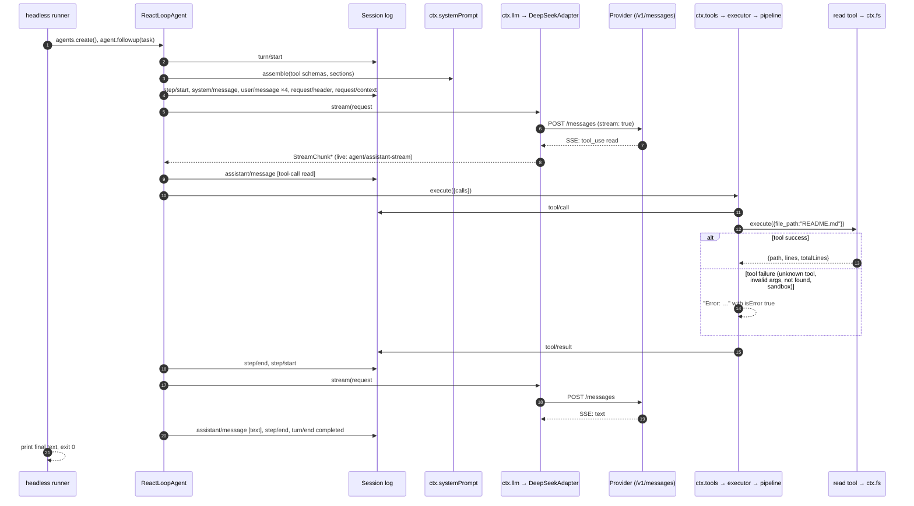
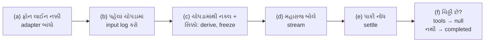

# પ્રકરણ 1 — એક requestની આખી મુસાફરી

> **Level 1 · વાર્તાનો દિવસ 3–4.**
> આખા પ્રકરણમાં એક જ ઓર્ડર: **"આ repositoryનું README વાંચીને ગુજરાતી સાર આપો."**
> આ પ્રકરણમાં વાર્તા અને technical અલગ નથી. ભોજનાલયમાં જે ઘટના બને છે તે જ harness નો નિયમ છે, અને દરેક ઘટના પછી આરવ એ જ નિયમ ખરા code માં ખોલીને જુએ છે.
> પહેલાં: [પ્રવેશ પ્રકરણ](pravesh-shunya-thi-shuruaat.md) નો રમકડા-agent. આખો નકશો: [સમગ્ર નકશો](overview-samagra-naksho.md).

**વાંચવાની રીત.** દરેક દૃશ્ય ચાર પગથિયાંમાં ચાલે છે:

1. 🎬 **ઘટના** — ભોજનાલયમાં કંઈક બને છે.
2. ❓ **આરવનો પ્રશ્ન** — "આવું કેમ?"
3. 💻 **Code માં** — એ જ વાત harness ની કઈ file અને કયા function માં છે.
4. 🔬 **Expert નજર** — આ નિયમ કેમ બનાવ્યો, અને તે તૂટે તો શું બગડે.

## 🎯 આ પ્રકરણ પછી તમે શું કરી શકશો

- `pnpm dsh --profile headless "…"` થી final answer સુધીના દરેક પગલાનો **માલિક file અને symbol** બતાવી શકશો.
- **Turn** અને **step** નો તફાવત સમજાવી, બતાવી શકશો કે README ઓર્ડરમાં એક turn અને બે steps કેમ છે.
- કઈ માહિતી **session log માં stored** થાય છે અને કઈ ફક્ત **live streamed** થાય છે તે અલગ કરી શકશો.
- API key વગર, scripted mock provider સામે આખી મુસાફરી ચલાવી, દરેક event ને timestamp સાથે જોઈ શકશો.

## 🗺️ નકશો: એક ઓર્ડરના દસ સ્ટેશન

આરવની નોટબુકનું પહેલું પાનું. આખું પ્રકરણ આ table ને ડાબેથી જમણે ભરે છે.

| # | ભોજનાલયમાં | Harness માં | દૃશ્ય |
|---|---|---|---|
| 1 | ગ્રાહક દરવાજે આવ્યો | `pnpm dsh` → `apps/cli/src/bin.ts` ચાલે | 3 |
| 2 | ભોજનાલય ખૂલ્યું, સ્ટાફ હાજર | Profile boot: ~100 plugins mount થાય | 3 (વિગત પ્રકરણ 2) |
| 3 | ઓર્ડર પેટીમાં પડ્યો | Headless runner: Agent બને, task inbox માં જાય | 4 |
| 4 | ચોપડામાં ઓર્ડર નંબર પડ્યો | `turn/start` | 5 |
| 5 | રમેશભાઈ મહારાજને પહેલી વાર પૂછે | Step 1: model call #1 (system + 4 user messages + 25 tools) | 6, 7 |
| 6 | મહારાજની ચિઠ્ઠી: "રેસીપી-ચોપડી લાવો" | Tool call `read` | 7 |
| 7 | ભીખાભાઈ કોઠારમાંથી લાવે | Tool pipeline: policy → tool body → `tool/result` | 8 (વિગત પ્રકરણ 3) |
| 8 | રમેશભાઈ મહારાજને બીજી વાર પૂછે | Step 2: model call #2, tool result સાથે | 7 |
| 9 | ચોપડામાં ઓર્ડર બંધ | `turn/end completed` | 5 |
| 10 | થાળી અને બિલ | stdout + exit 0 | 4 |

**યાદ-ચાવી "2-1-25-4":** **2** model calls, **1** tool call, **25** tools model ને દેખાય, **4** user messages.

---

## દૃશ્ય 1 — ટેબલ 4: મહારાજ પાસે બે વાર કેમ જવું પડ્યું?

🎬 બપોરે એક વાગ્યે ટેબલ 4 પરથી ઓર્ડર આવે છે: "એક થાળી, પણ આજની ખાસ દાળની રેસીપી પ્રમાણે."

આરવ રમેશભાઈની પાછળ ફરે છે અને ગણે છે. રમેશભાઈ મહારાજ પાસે **બે વાર** જાય છે.

- પહેલી વાર મહારાજ રાંધતા નથી. તે ચિઠ્ઠી લખે છે: **"ખાસ દાળની રેસીપી-ચોપડી લાવો."**
- રમેશભાઈ કોઠારમાંથી ચોપડી લાવે છે.
- બીજી વાર, ચોપડી હાથમાં આવ્યા પછી, મહારાજ રાંધે છે. નવી ચિઠ્ઠી નથી.

❓ "દીદી, મહારાજ પહેલી વારમાં જ કોઠારમાં જઈને ચોપડી કેમ ન લઈ આવે? એક ધક્કો બચે."

મીરાદીદી: "કારણ કે મહારાજ રસોડાની બહાર **પગ મૂકી શકતા જ નથી**. તે ફક્ત બે કામ કરી શકે: બોલવું, અથવા ચિઠ્ઠી લખવી. હાથ-પગ રમેશભાઈ છે."

💻 આ જ AI model ની સાચી મર્યાદા છે. Model file વાંચી શકતું નથી, command ચલાવી શકતું નથી. તે ફક્ત text આપે છે. એ text ક્યારેક જવાબ હોય, અને ક્યારેક "આ tool ચલાવો" એવી માંગ હોય, જેને **tool call** કહેવાય. Tool ખરેખર ચલાવે છે harness.

આરવે ગણેલી બે વસ્તુનાં નામ:

- **Turn** = એક ઓર્ડરનું આખું કામ, થાળી પીરસાય ત્યાં સુધી.
- **Step** = મહારાજ સાથેની એક વાતચીત, અને તેમાં તેમણે માંગેલો સામાન.

Harness ના architecture doc ની વ્યાખ્યા બરાબર આ જ છે: "A step is one model request plus the tools it calls. A turn is zero or more steps" ([docs/architecture.md — Turn flow][arch-turnflow]). ✅

README ઓર્ડરમાં:

1. **Step 1:** model ને પૂછ્યું → model એ text ને બદલે `read` tool call આપ્યો → harness એ `read({"file_path":"README.md"})` ચલાવ્યું.
2. **Step 2:** tool નું પરિણામ ઉમેરીને model ને **ફરી** પૂછ્યું → model એ ગુજરાતી સાર લખ્યો, tool call નથી → turn પૂરો.

એટલે **1 turn, 2 steps, 2 model calls**. પ્રવેશ પ્રકરણના રમકડા-agent માં પણ `modelCalls: 2` આ જ કારણે આવ્યું હતું.

🔬 **Expert નજર.** "Agent કેટલું મોંઘું પડશે?" એ પ્રશ્નનો જવાબ turn માં નથી, step માં છે. દરેક step એટલે એક model call, એટલે એક બિલ અને એક રાહ. Expert કોઈ પણ agent નું વર્તન જોતાં પહેલો પ્રશ્ન આ પૂછે છે: "આ turn માં કેટલા steps થયા, અને દરેક step કેમ જરૂરી હતો?"

## દૃશ્ય 2 — ફરજ-પત્રક: દરેક કામનો એક માલિક

🎬 ગલ્લા પાછળ પપ્પાનું **ફરજ-પત્રક** ચોંટાડેલું છે: કયું કામ, કોનું. પપ્પા કહે છે: "જે કામનો માલિક નથી, એ કામ બગડે ત્યારે બધા એકબીજા સામે જુએ."

❓ "તો software માં README ઓર્ડરના દરેક પગલાનો માલિક કોણ?"

💻 મીરાદીદી એ જ ફરજ-પત્રક harness માટે દોરે છે. આ ચિત્રને **sequence diagram** કહેવાય: દરેક ઊભી લીટી એક પાત્ર, સમય ઉપરથી નીચે વહે, solid arrow એટલે call, dashed arrow એટલે પાછો આવતો જવાબ.



| ભોજનાલયમાં | Harness માં | Owner file | Symbol |
|---|---|---|---|
| ઓર્ડર લેનાર parcel કાઉન્ટર | headless runner | `packages/bundle/headless/src/index.ts` | [`run`][headless-run], [`agents.create`][headless-create], [`agent.followup`][headless-followup] |
| રમેશભાઈ | ReactLoopAgent | `packages/core/agent-loop/src/agent.ts` | [`turn`][loop-turn], [`preStep`][loop-preStep], [`step`][loop-step] |
| ઓર્ડર-ચોપડો | Session log | `packages/core/session/src/index.ts` | [`Session.append`][session-append], [`deriveMessages`][session-derive] |
| નિયમોની પોથી | ctx.systemPrompt | `packages/core/system-prompt/src/index.ts` | `assemble` (called from [`preStep`][loop-preStep]) |
| ફોન અને દુભાષિયો | ctx.llm → DeepSeekAdapter | `packages/llm/llm/src/index.ts`, `packages/llm/llm-deepseek/src/adapter.ts` | [`prepareCall`][llm-prepareCall], [`stream`][llm-stream], [`fetch /messages`][deepseek-fetch] |
| કોઠારી ભીખાભાઈ | ctx.tools → executor → pipeline | `packages/core/tools/src/{index,batch,pipeline}.ts`, `packages/core/tool-executor-native/src/index.ts` | [`execute`][tools-execute], [`executeToolBatch`][batch-execute], [`prepare`][pipeline-prepare] / [`dispatch`][pipeline-dispatch] |
| કોઠારનું એક ખાનું | read tool | `packages/fs/tool-fs/src/read.ts` | [`applyReadTool`][read-tool] |

આરવ `alt` ખાના પર આંગળી મૂકે છે: "અને કોઠારમાં ચોપડી **ન મળે** તો?"

"તો ભીખાભાઈ 'નથી' ની ચિઠ્ઠી પાછી મોકલે. ભોજનાલય બંધ નથી થતું; મહારાજ એ ચિઠ્ઠી વાંચીને બીજો રસ્તો વિચારે." Harness માં પણ એમ જ: **નિષ્ફળતા પણ `tool/result` બને છે** (`isError: true`), અને step 2 ચાલે જ છે. 🧪 પ્રકરણ 5 માં ચાર નિષ્ફળતા ખરેખર ચલાવીશું.

🔬 **Expert નજર.** Bug આવે ત્યારે શિખાઉ આખો code વાંચવા બેસે છે. Expert પહેલાં આ table માં **માલિક** શોધે છે: "ખોટું ચોપડામાં લખાયું? તો `session`. ખોટું model ને મોકલાયું? તો `agent-loop` નું `buildRequest`. Tool ખોટો ચાલ્યો? તો `tools` pipeline." સાત માલિક યાદ હોય તો શોધ દસ ગણી નાની થાય.

## દૃશ્ય 3 — દરવાજો: ગ્રાહકના શબ્દો અંદર કેવી રીતે પહોંચે?

🎬 આજે હૉલ બંધ છે; ફક્ત **parcel કાઉન્ટર** ખુલ્લું છે. ગ્રાહક બારીએ આવે, એક ઓર્ડર આપે, parcel લે અને જાય. બેસવાનું નહીં, વાતચીત નહીં.

આરવ terminal માં પહેલી વાર લખે છે:

```bash
pnpm dsh --profile headless "આ repositoryનું README વાંચીને ગુજરાતી સાર આપો."
```

❓ "મેં જે શબ્દો લખ્યા, તે program ને કેવી રીતે મળે?"

💻 ત્રણ નામ, ત્રણેય આ એક line માં છે:

- **CLI** (Command-Line Interface) = terminal માંથી ચાલતો program. `dsh` એ harness નો CLI.
- **argv** = command સાથે લખેલા શબ્દોની યાદી. અહીં: `--profile`, `headless`, અને ઓર્ડર.
- **Profile** = કયા plugins સાથે harness ચાલે તેનું નામવાળું સંયોજન. `headless` = screen વગર, એક ઓર્ડર, પછી બંધ. એ જ parcel કાઉન્ટર.

`pnpm dsh …` એ root `package.json` નો script છે: `"dsh": "node --import tsx/esm apps/cli/src/bin.ts"`. ✅ ત્યાં [`runCli`][cli-runCli] argv વાંચે છે અને `invocation.mode` પર `switch` કરે છે; `'profile'` mode માં તે `runProfile(...)` બોલાવે છે.

આરવ: "`runCli` પાછું શું આપે છે?" — "કંઈ નહીં." — "તો કામ શું કર્યું?"

"ગ્રાહકને ટોકન આપવો એ દેખાતું કામ. પણ એ જ ક્ષણે રસોડામાં ચૂલો ચાલુ થયો — એ **side effect**." Function ના return value સિવાયની અસર: file લખવી, screen પર છાપવું, plugin mount કરવો. `runCli` નો return ખાલી છે; તેની side effect આખી app નું boot છે (સ્ટેશન 2; પ્રકરણ 2 તેને line-by-line ખોલશે).

Headless profile ના અંતે મેનુમાં એક લીટી ઉમેરાય છે — "parcel કાઉન્ટર ખોલો, અને ઓર્ડર એ જ જે ગ્રાહકે લખ્યો" ([headless patch][bundle-headless]):

```yaml
    - id: headless-runner
      name: '@deepseek-ai/dsh-headless'
      inject: [headlessStartup]
      config:
        task: !!js ctx.headlessStartup.task
```

(repository code; `!!js` એટલે YAML માં JavaScript expression, જે plugin context સામે evaluate થાય છે.)

🔬 **Expert નજર.** Harness માં "mode" જેવું કંઈ hard-coded નથી. Headless એ અલગ program નથી; તે એ જ plugins ઉપર **એક વધારાની config row** છે. એટલે નવું વર્તન જોઈએ ત્યારે expert code બદલવાને બદલે પહેલાં પૂછે છે: "આ row ઉમેરીને કે બદલીને થાય?"

## દૃશ્ય 4 — ઓર્ડર-પેટી: રમેશભાઈ વ્યસ્ત હોય તો ઓર્ડર ક્યાં જાય?

🎬 Parcel બારી પર લાકડાની **ઓર્ડર-પેટી** છે. ગ્રાહક ચિઠ્ઠી પેટીમાં નાખે અને ઘંટડી વગાડે. રમેશભાઈ નવરા હોય તો ઘંટડી સાંભળી પેટી ખોલે; વ્યસ્ત હોય તો ચિઠ્ઠી પેટીમાં રાહ જુએ. ખોવાતી નથી.

અને રમેશભાઈની એક શરત છે: "કોઠારની ચાવી અને ચોપડો હાથમાં ન આવે ત્યાં સુધી હું કાઉન્ટર ખોલતો નથી."

❓ "ચિઠ્ઠી સીધી રમેશભાઈના હાથમાં કેમ નહીં? પેટી કેમ?"

💻 **શરત = `inject`.** Headless plugin જાહેર કરે છે `inject = ['agentDefaultModel', 'agents', 'sessions']` ([source][headless-inject]). આ ત્રણ services હાજર ન હોય ત્યાં સુધી તે ચાલતો જ નથી. (વિગત પ્રકરણ 2.)

પછી [`run`][headless-run] ક્રમમાં પાંચ કામ કરે છે:

1. Task વાંચે છે. ખાલી હોય તો error: `a task is required, for example: dsh --profile headless "run the tests"`.
2. Default model selection લે છે (base bundle: provider `deepseek-official`, model `deepseek-flash`). ✅
3. નવો Session id `session-<uuid>` બનાવી [`agents.create({ sessionId, meta: { cwd }, … })`][headless-create] બોલાવે છે. (**UUID** = લગભગ ક્યારેય ફરી ન આવે તેવો લાંબો random id — દરેક ઓર્ડર-ચોપડાનો અલગ નંબર.)
4. ચિઠ્ઠી પેટીમાં નાખે છે ([source][headless-followup]):

```ts
      agent.followup(createUserMessage({
        content: [{ type: 'text', text: task }],
        source: { kind: 'user' },
      }))
```

5. `agent.whenIdle()` ની રાહ જુએ છે (રમેશભાઈ નવરા થાય), `sessions.flush(...)` કરે છે, final text છાપે છે, અને `io.exit(0 અથવા 1)` માંગે છે. **(સ્ટેશન 10.)**

**પેટી = inbox.** `followup` સંદેશને inbox માં મૂકે છે અને driver ને જગાડે છે (ઘંટડી). Driver એટલે [`kick`][loop-kick]: `while (await this.turn()) {}` — "પેટીમાં ચિઠ્ઠી હોય ત્યાં સુધી એક પછી એક ઓર્ડર લો."

**Flush** = memory માં રાહ જોતું બધું disk પર લખી દેવું. આરવ પૂછે છે કે એ કેમ જરૂરી. દીદી: "રમેશભાઈ દિવસભર કાચી ચિઠ્ઠીમાં લખે, અને દુકાન બંધ કરતાં પહેલાં પાકા ચોપડામાં ઉતારે. ઉતાર્યા વગર તાળું મારી દે, તો આજનો હિસાબ ગયો." એટલે `flush` પછી જ `exit`.

🔬 **Expert નજર.** Inbox ને કારણે "સંદેશ આવવો" અને "સંદેશ પર કામ થવું" બે અલગ ક્ષણ બને છે. ચાલતા turn ની વચ્ચે નવો સંદેશ આવે તો તે turn ને તોડતો નથી; તે પેટીમાં પડે છે અને loop તેને સલામત ક્ષણે ઉપાડે છે (દૃશ્ય 5 ના pseudocode માં `inbox.nextStep` જુઓ). સંદેશ ક્યારે **આવ્યો** અને ક્યારે **claim થયો** એ અલગ જોતાં આવડે, એ ઘણાં "મારો સંદેશ ક્યાં ગયો?" bugs નો જવાબ છે.

## દૃશ્ય 5 — લાઈટ ગઈ: અધૂરો ઓર્ડર અને પપ્પાનો નિયમ

🎬 ગયા મહિને બપોરે લાઈટ ગઈ. ટેબલ 7 નો ગ્રાહક ઊભો થઈને ચાલ્યો ગયો. રાત્રે પપ્પાએ ચોપડો મેળવ્યો: "ઓર્ડર 7 શરૂ" લખેલું છે, પણ પછી કંઈ નહીં. પીરસાયો? પૈસા આવ્યા? કોઈને ખબર નથી. બીજે દિવસે સવારે રમેશભાઈને એ પણ ખબર નહોતી કે એ ઓર્ડર ફરી શરૂ કરવાનો છે કે નહીં.

તે દિવસથી પપ્પાનો નિયમ: **"જે ઓર્ડર ચોપડામાં શરૂ થયો, તેનો અંત પણ લખાશે — પીરસાયો, ગ્રાહક ગયો, કે લાઈટ ગઈ. ગમે તે થાય."**

❓ "Software માં 'ગમે તે થાય' કેવી રીતે લખાય? Error આવે તો પછીની line તો ચાલતી જ નથી."

💻 JavaScript માં એ માટે એક શબ્દ છે: **`finally`**. `try` ની અંદર સફળતા મળે, error આવે, કે કોઈ રદ કરે — `finally` નો code દરેક રસ્તે ચાલે છે.

[`ReactLoopAgent.turn`][loop-turn] (lines 327–433) નું હાડપિંજર, **teaching pseudocode** તરીકે:

```ts
// teaching pseudocode — real code: packages/core/agent-loop/src/agent.ts#L327-L433
session.append('turn/start', { turn })                 // ઓર્ડર નંબર પડ્યો
while (true) {
  const decision = await preStep(target, { turn, step }) // પેટીમાંથી ચિઠ્ઠી + તૈયારી
  session.append('step/start', { turn, step })
  const stepEnd = await step(decision)                  // મહારાજને પૂછો + સામાન લાવો
  session.append('step/end', { turn, step })
  if (turnEnds && inbox.nextStep.length === 0) break    // કંઈ બાકી નથી
  target = 'next-step'
}
// finally:
session.append('turn/end', { turn, reason })            // અંત — error હોય તો પણ
```

રમકડા-agent ના `turn()` સાથે સરખાવો — એ જ આકાર: start → steps નો loop → end.

- **`turn/start`** [line 336][loop-turn-start] પર લખાય છે, પહેલો step શરૂ થાય **તે પહેલાં**.
- **`turn/end`** `finally` block માં ([line 422][loop-turn-end]) લખાય છે. તેની સાથે **કારણ** પણ લખાય છે.

પપ્પાના ચોપડામાં અંતનાં પાંચ કારણ છે; harness માં પણ પાંચ:

| ચોપડામાં | `turn/end` reason |
|---|---|
| પીરસાયો | `completed` |
| રસોડામાં ભૂલ થઈ | `error` |
| ગ્રાહકે રદ કર્યો | `aborted` |
| ચોકીદાર કે મેનેજરે ઓર્ડર દરવાજે જ રોક્યો (દૃશ્ય 6) | `blocked` |
| મહારાજનો જવાબ લંબાઈની મર્યાદાએ અટકી ગયો | `max-tokens` |

**યાદ-ચાવી "પૂ-ભૂ-ર-રો-મ":** **પૂ**ર્ણ, **ભૂ**લ, **ર**દ, **રો**ક, **મ**ર્યાદા.

આરવ આગળ વિચારે છે: "લાઈટ ગઈ ત્યારે રમેશભાઈ કોઠારમાં ચિઠ્ઠી આપી ચૂક્યા હતા. ચોપડામાં 'માંગ્યું' લખેલું છે, પણ 'મળ્યું' નથી. એનું શું?"

"સરસ પકડ્યું. અધૂરી જોડી ચોપડામાં રહેવા દેવાય નહીં." Step નિષ્ફળ જાય અને કોઈ tool call નું પરિણામ બાકી હોય, તો loop [`toolRecovery.results()`][loop-recovery] વડે ખૂટતા `tool/result` જાતે લખે છે, જેથી log માં દરેક `tool/call` ને તેનો જવાબ મળે.

🔬 **Expert નજર.** આને **invariant** કહેવાય: એવી વાત જે હંમેશા સાચી રહેવી જોઈએ. અહીં બે છે: (1) દરેક `turn/start` ની એક `turn/end`; (2) દરેક `tool/call` નું એક `tool/result`. કેમ આટલો આગ્રહ? કારણ કે **resume** — બંધ થયેલું session ફરી ચાલુ કરવું — ચોપડો વાંચીને જ નક્કી કરે છે કે ક્યાંથી આગળ વધવું. અધૂરી જોડી હોય તો resume પાસે ટેબલ 7 જેવો જ પ્રશ્ન રહે. પ્રકરણ 3 અને 5 માં Ctrl+C દબાવ્યા પછી પણ `turn/end {"kind":"aborted"}` તમે જાતે જોશો.

## દૃશ્ય 6 — રમેશભાઈની તૈયારી: મહારાજ પાસે ખાલી હાથે ન જવાય

🎬 આરવ નોંધે છે કે રમેશભાઈ પેટી ખોલ્યા પછી સીધા રસોડામાં નથી જતા. પહેલાં તે પાંચ વસ્તુ ભેગી કરે છે: ચિઠ્ઠી, આજે કયા મહારાજ છે તે, કોઠારમાં આજે શું ઉપલબ્ધ છે તેની યાદી, નિયમોની પોથી, અને છેલ્લે દરવાજે **ચોકીદાર અને મેનેજર** ની નજર — બેમાંથી કોઈ પણ ઓર્ડર રોકી શકે.

❓ "કોઠારની યાદી મહારાજને કેમ આપવી પડે? તેમને ખબર ન હોય?"

"ના. મહારાજ કોઠાર જોઈ શકતા નથી. જે ખાનાનું **લેબલ** તેમને વંચાવ્યું નથી, તે ખાનું તેમના માટે છે જ નહીં."

💻 [`preStep`][loop-preStep] દરેક step પહેલાં આ જ પાંચ કામ કરે છે:

| # | રમેશભાઈ | Code |
|---|---|---|
| 1 | પેટીમાંથી ચિઠ્ઠી લે | `this.inbox.claim(target, turn)` |
| 2 | આજે કયા મહારાજ | `this.model.current()` — model selection; ન હોય તો સ્પષ્ટ error |
| 3 | કોઠારની આજની યાદી | `this.loopCtx.tools.resolve({ agent, modelSelection, signal })` — આ step માં કયા tools દેખાશે |
| 4 | નિયમોની પોથી + ખાનાનાં લેબલ | `this.loopCtx.systemPrompt.assemble(...)` |
| 5 | ચોકીદાર અને મેનેજરની નજર | `this.dispatch.waterfall('agent/pre-step', …)` |

ત્રણ નવા શબ્દ:

- **System prompt** = model માટેના સ્થાયી નિયમો, દરેક call ની શરૂઆતમાં. ઉદાહરણ: "You are an AI agent powered by DeepSeek Harness…"
- **Tool schema** = tool નું નામ, વર્ણન અને arguments નું વર્ણન (JSON Schema માં) — ખાનાનું લેબલ. ઉદાહરણ: `read(file_path, offset, limit)`. README ઓર્ડરમાં આવાં **25** લેબલ model ને જાય છે.
- **Waterfall** = listeners ની સાંકળ, જેમાં દરેકે આગળ વધવા `next()` બોલાવવું પડે; ન બોલાવે તો સાંકળ ત્યાં જ અટકે ([Cordis primer — dispatch modes][primer-dispatch]). ✅ પ્રવેશ પ્રકરણના `waterfall.mjs` માં ચોકીદાર અને મેનેજર આ જ કરતા હતા.

સાંકળનો અંતિમ નિર્ણય બેમાંથી એક હોય: `{ kind: 'enter' }` (જવા દો — claimed messages અને runtime context સાથે) અથવા `{ kind: 'reject' }` (રોકો). આ રચનાને discriminated union કહેવાય: `kind` વાંચીને ખબર પડે કે બાકીનું object કેવું છે. `reject` આવે તો `turn()` તે ઓર્ડરને `blocked` કારણ સાથે બંધ કરે છે — દૃશ્ય 5 ના table ની ચોથી લીટી.

🔬 **Expert નજર.** પગલું 3 અને 4 **દરેક step** પહેલાં ફરી થાય છે, ફક્ત turn ની શરૂઆતમાં નહીં. એટલે step 1 અને step 2 વચ્ચે tools ની યાદી બદલાઈ શકે. અને પગલું 5 એ harness ની સૌથી મોટી ખુલ્લી બારી છે: તમારો plugin `agent/pre-step` સાંભળીને message બદલી શકે કે step નકારી શકે, loop ના code ને અડ્યા વગર.

## દૃશ્ય 7 — "લસણ વગર" નો ઝઘડો: step() ના છ ભાગ

🎬 ગઈ કાલે એક ગ્રાહકે બિલ વખતે ઝઘડો કર્યો: "મેં **લસણ વગર** કહ્યું હતું!" પપ્પાએ ચોપડો ખોલ્યો. તેમાં "લસણ વગર" ક્યાંય નથી. રમેશભાઈ: "મેં મહારાજને મોઢે કહ્યું હતું." મહારાજ: "મને યાદ નથી."

કોણ સાચું? કોઈ સાબિત કરી શકતું નથી.

આરવ: "પણ મહારાજને યાદ કેમ નથી? એક કલાક પહેલાંની વાત છે."

પપ્પા હસે છે: "મહારાજની એક ખાસિયત છે. દરેક વાતચીત પછી તે **બધું ભૂલી જાય છે**. તેમની સામે જે કાગળ હોય, એટલું જ તેમનું જગત."

તે દિવસથી બે નવા નિયમ:

1. **"જે મહારાજને કહેવાનું છે, તે પહેલાં ચોપડામાં લખો."**
2. **"મહારાજ પાસે જતી વખતે યાદશક્તિથી ન બોલો. ચોપડામાંથી આખા ઓર્ડરની નકલ ઉતારો, તેના પર સિક્કો મારો, અને એ જ કાગળ આપો."**

❓ "દર વખતે **આખી** નકલ? બીજી વાર તો ફક્ત રેસીપી-ચોપડી આપવાની છે."

"મહારાજ ભૂલી ગયા છે કે ઓર્ડર શું હતો. એટલે દર વખતે આખી વાત — શરૂઆતથી."

💻 આ ઝઘડો [`step`][loop-step] (lines 435–610) ને સમજવાની ચાવી છે. એક attempt માં છ ભાગ છે:



**(a) ફોન લાઈન નક્કી કરવી.** [`prepareRequest`][loop-prepareRequest] પહેલાં `agent/request` waterfall ચલાવે છે, પછી `this.loopCtx.llm.prepareCall(...)`. એક વાર લાઈન જોડાઈ પછી આ step માં provider/model બદલી શકાતો નથી; કોઈ બદલે તો loop error ફેંકે છે.

**(b) પહેલાં ચોપડામાં.** System prompt `system/message` તરીકે, અને પહેલા attempt માં દરેક entered message `user/message` તરીકે append થાય છે ([source][loop-admit]):

```ts
      if (firstAttempt) {
        for (const message of decision.messages) {
          if (message.source.kind === 'runtime-context') {
            if (context !== undefined && !contextAdmitted) {
              this.session.append('user/message', context, { surfaceOp: 'append' })
```

પપ્પાનો નિયમ 1 repository માં આ શબ્દોમાં લખેલો છે: "**Model-visible ⟺ logged**" — model સુધી પહોંચતું બધું session log માંથી ફરી બનાવી શકાય તેવું હોવું જોઈએ ([AGENTS.md][agents-conventions]). ✅ `⟺` એટલે "બંને દિશામાં સાચું": જે મોકલ્યું તે લખેલું છે, અને જે લખેલું છે તે જ મોકલાય છે.

**(c) નકલ અને સિક્કો.** [`buildRequest`][loop-buildRequest] પહેલાં `request/header` (provider, model, tools) અને `request/context` (context window) log કરે છે. પછી `session.deriveMessages()` ચોપડામાંથી model history બનાવે છે, અને `deepFreeze` તેને લૉક કરે છે ([source][loop-derive]).

- **Derive** = બીજી માહિતી પરથી ગણીને બનાવવું. History કોઈ અલગ યાદીમાં સચવાતી નથી; દર વખતે ચોપડામાંથી **ફરી બને** છે. એ નિયમ 2 છે.
- **deepFreeze** = object અને તેની અંદરનાં બધાં objects ને લૉક કરવું, જેથી કોઈ બદલી ન શકે (`Object.freeze` — રમકડા-agent માં પણ હતું). એ સિક્કો છે.

"આખી નકલ" નો પુરાવો આંકડામાં: call #1 માં **5** messages જાય છે, call #2 માં **7** — પહેલા પાંચ ફરીથી, અને બે નવા. (Lab માં જાતે ગણશો.)

**(d) મહારાજ બોલે છે.** [Source][loop-stream]:

```ts
        const stream = preparedCall?.stream(request) ?? this.loopCtx.llm.stream(request)
        signal.throwIfAborted()
        live.start()
        started = true
        for await (const chunk of stream) {
          signal.throwIfAborted()
          live.push(chunk)
        }
```

મહારાજ આખો જવાબ એકસાથે નથી આપતા; intercom પર વાક્યે વાક્યે બોલે છે. દરેક ટુકડો એક **chunk**, અને ટુકડે ટુકડે આવતા જવાબને **stream** કહેવાય. `for await` એ આવા ટુકડા આવે તેમ એક પછી એક લેવાનો loop છે. દરેક chunk `agent/assistant-stream` નામના **live** event તરીકે publish થાય છે — હૉલમાં બેઠેલા સાંભળી શકે, પણ ચોપડામાં નથી લખાતું.

અને દરેક `await` પછી `signal.throwIfAborted()`: રમેશભાઈ દરેક વાક્ય પછી બારી તરફ નજર કરે છે — "ગ્રાહકે રદ તો નથી કર્યું?" કર્યું હોય તો ત્યાં જ અટકે (પ્રકરણ 5).

**(e) પાકી નોંધ.** મહારાજ બોલી રહે પછી આખો જવાબ **એક** `assistant/message` event તરીકે ચોપડામાં જાય છે, compact stream સાથે ([source][loop-assistant-message]). વચ્ચેથી લાઈન કપાય તો `assistant/attempt` લખાય, અને `agent/request-error` waterfall નક્કી કરે કે ફરી પ્રયત્ન કરવો કે નહીં ([source][loop-request-error]). `step()` આખું `while (true)` છે એનું કારણ આ જ: ફરી પ્રયત્ન **એ જ step ની અંદર** થાય છે.

**(f) ચિઠ્ઠી છે કે નહીં?** [Source][loop-tools-execute]:

```ts
        const toolCalls = message.content.filter(block => block.type === 'tool-call')
        if (toolCalls.length === 0) return { kind: 'completed' }
        …
          const result = await this.loopCtx.tools.execute({
            calls: toolCalls, signal, agent: this, log: { turn, step },
            maxParallelToolCalls, toolSet: decision.toolSet,
          })
          …
          return result.concluded ? { kind: 'completed' } : null
```

દૃશ્ય 1 ના પ્રશ્નનો જવાબ હવે code માં વંચાય છે. મહારાજના જવાબમાં ચિઠ્ઠી (tool call) હોય, તો સામાન લવાય અને step `null` પાછું આપે — "ઓર્ડર હજી પૂરો નથી". `turn()` નો loop એટલે step 2 શરૂ કરે. Step 2 માં ચિઠ્ઠી નથી → `{ kind: 'completed' }` → turn બંધ. રમકડા-agent નું `continue` અને `return reply.text` બરાબર આ જ હતાં.

🔬 **Expert નજર.** આ દૃશ્યમાં આખા harness નો સૌથી ઊંડો design નિર્ણય છે: **ચોપડો એ જ એકમાત્ર સત્ય છે; memory નહીં.** તેનાથી ત્રણ શક્તિ મળે છે, અને ત્રણેય પછીનાં પ્રકરણોમાં વાપરીશું:

1. **Debugging:** "Model ને ખરેખર શું મોકલાયું હતું?" નો જવાબ અનુમાન નથી; ચોપડો ખોલો.
2. **Resume:** Process બંધ થાય તો પણ ચોપડામાંથી એ જ history ફરી બને.
3. **Retry સલામત:** નિષ્ફળ પ્રયત્ન `assistant/attempt` તરીકે સચવાય છે, પણ model history માં નથી જતો — એટલે ફરી પ્રયત્ન વખતે model અધૂરો જવાબ જોતું નથી.

અને `deepFreeze` આ નિયમનો ચોકીદાર છે: નકલ ઉતર્યા પછી કોઈ plugin તેમાં ચૂપચાપ એક શબ્દ ઉમેરી દે, તો model એ જોયું તે અને ચોપડામાં લખ્યું તે અલગ પડી જાય — ફરી "લસણ વગર" વાળો ઝઘડો.

## દૃશ્ય 8 — કોઠાર: ચિઠ્ઠીથી સામાન સુધી (ટૂંકમાં)

🎬 મહારાજની ચિઠ્ઠી લઈને રમેશભાઈ કોઠારી **ભીખાભાઈ** પાસે જાય છે. ભીખાભાઈ સીધો સામાન નથી આપતા. એક હાર છે: ચિઠ્ઠી વંચાય એવી છે? → ચોપડામાં "માંગ્યું" → નિયમ તપાસ → ખાનામાંથી સામાન → ચોપડામાં "મળ્યું".

💻 `ctx.tools.execute` પસંદ કરેલા **executor** ને કામ સોંપે છે ([`selectExecutor`][tools-selectExecutor]). Base bundle `tool-executor-native` mount કરે છે ([rows][bundle-base-tools]), જે [`executeToolBatch`][batch-execute] ચલાવે છે: arguments JSON parse, `tool/call` log, **pipeline** (`tools/pre-execute` → guards → `tools/execute` → tool body → `tools/post-execute`), અને છેલ્લે `tool/result` log.

`read` tool ([`applyReadTool`][read-tool]) `ctx.fs` પાસે path resolve કરાવે છે, file વાંચે છે, અને line-numbered text પાછું આપે છે.

આ હારનું દરેક પગથિયું પ્રકરણ 3 માં ખોલીશું. અત્યારે એક વાત યાદ રાખો: "માંગ્યું" (`tool/call`) સામાન લેવા **પહેલાં** લખાય છે, અને "મળ્યું" (`tool/result`) પછી — દૃશ્ય 5 ની જોડી.

## દૃશ્ય 9 — વાત હવામાં, હિસાબ ચોપડામાં

🎬 સાંજે આરવ ચોપડો ખોલીને બપોરનો ઓર્ડર શોધે છે. મહારાજ intercom પર જે વાક્યો બોલ્યા હતા તે તેને યાદ છે, પણ ચોપડામાં તે વાક્યો ટુકડે ટુકડે નથી. ફક્ત અંતિમ નોંધ છે.

❓ "તો શું સચવાયું, અને શું હવામાં ગયું?"

💻

| માહિતી | ક્યાં | ટકાઉ? |
|---|---|---|
| `turn/start`, `step/start`, `system/message`, `user/message`, `request/header`, `request/context`, `assistant/message`, `tool/call`, `tool/result`, `step/end`, `turn/end` | Session log (`session/event` દ્વારા broadcast, JSONL file માં persisted) | ✅ હા |
| `assistant/attempt` (નિષ્ફળ/retry થયેલ attempt નો stream) | Session log | ✅ હા, પણ model history માં નહીં |
| `agent/assistant-stream` start/chunk/end frames | process-local live event | ❌ ના; chunk frames transient છે |
| `agent/status`, `agent/inbox/*` live notifications | live event | ❌ ના |

સ્રોત: architecture doc નું turn flow ✅ અને અમારો ચલાવેલો trace 🧪. નિયમ: "Session events are durable facts appended to the log … Agent events (`agent/*`) carry a live `Agent`" ([architecture.md][arch-turnflow]).

- **Durable / persisted** = disk પર સચવાયેલું; process બંધ થાય તો પણ રહે.
- **Transient / live** = ફક્ત ચાલતા process માં; બંધ થતાં ગયું.

🔬 **Expert નજર.** નામ પરથી જ ઓળખો: `session/…` દ્વારા આવતી ઘટના ચોપડાની છે; `agent/…` live છે. Plugin લખતી વખતે આ ભેદ નિર્ણાયક છે. Progress bar બનાવવો હોય તો live chunks સાંભળો. Audit, હિસાબ, કે resume પછી પણ સાચું રહે તેવું કંઈ બનાવવું હોય તો **ફક્ત** durable events પર આધાર રાખો.

## Source map: આ ક્રમમાં ખોલો

આરવના ફરજ-પત્રકનું પાકું રૂપ. Source વાંચવા બેસો ત્યારે આ જ ક્રમમાં.

| ક્રમ | સ્ટેશન | File | Symbol | Input → Output (side effect) |
|---|---|---|---|---|
| 1 | 1 | `apps/cli/src/bin.ts` | [`runCli`][cli-runCli] | argv → (profile boot) |
| 2 | 3, 10 | `packages/bundle/headless/src/index.ts` | [`run`][headless-run] | task → stdout text, exit code |
| 3 | 4, 9 | `packages/core/agent-loop/src/agent.ts` | [`kick`][loop-kick] → [`turn`][loop-turn] | inbox → `turn/*` events |
| 4 | 5 | same | [`preStep`][loop-preStep] | claimed messages → enter/reject decision |
| 5 | 5, 6, 8 | same | [`step`][loop-step] | decision → `assistant/*`, `tool/*` events |
| 6 | 5 | same | [`buildRequest`][loop-buildRequest] | log → frozen `GenerateOptions` |
| 7 | 5 | `packages/llm/llm/src/index.ts` | [`stream`][llm-stream] | request → `llm/stream` waterfall → adapter |
| 8 | 5 | `packages/llm/llm-deepseek/src/adapter.ts` | [`fetch /messages`][deepseek-fetch] | body → HTTP SSE |
| 9 | 7 | `packages/core/tools/src/batch.ts` | [`executeToolBatch`][batch-execute] | tool calls → results |
| 10 | 7 | `packages/fs/tool-fs/src/read.ts` | [`applyReadTool`][read-tool] | `file_path` → numbered lines |

---

## 🧪 Lab 1 (દિવસ 4) — રિહર્સલ મહારાજ સાથે આખી મુસાફરી

🎬 સવારે મીરાદીદી કહે છે: "ગઈ કાલે તેં વાંચ્યું. આજે **સાબિત** કર. પણ ખરા મહારાજને ફોન કરીએ તો agency નું બિલ આવે અને key જોઈએ. એટલે આજે **રિહર્સલ મહારાજ** આવશે: તેમની પાસે બે લીટીની script છે. પહેલી વાર પૂછો તો કહે 'રેસીપી-ચોપડી લાવો', બીજી વાર કહે 'સાર તૈયાર'."

અને ખૂણામાં એક **નિરીક્ષક** બેસશે, જે કશું અડતો નથી; ફક્ત ઘડિયાળ જોઈને દરેક ઘટના લખે છે.

💻 ત્રણ નામ:

- **Mock server** = ખરા provider જેવો દેખાતો, script મુજબ જવાબ આપતો નકલી server. Repository માં `@deepseek-ai/dsh-llm-mock-server` છે: Messages-compatible HTTP/SSE server ([`tool_call_success`][mock-tool-call]). DeepSeek adapter ને `DEEPSEEK_BASE_URL` થી તેની તરફ વાળી શકાય છે ([`BASE_URL_ENV`][deepseek-baseurl]).
- **Observer plugin** = ફક્ત જોતો અને નોંધતો plugin; વર્તન બદલતો નથી.
- **Overlay / `--patch`** = ચાલુ configuration માં ઉમેરો કે બદલાવ કરતી YAML file — મેનુ પર ચોંટાડેલી ચિઠ્ઠી.

**ચલાવતા પહેલાં આરવની આગાહી.** દીદી નોટબુક આપે છે: "પહેલાં લખ, પછી ચલાવ." તમે પણ લખો:

1. `llm/stream` કેટલી વાર ચાલશે?
2. Call #1 અને call #2 માં કેટલા messages જશે?
3. `turn/end` નું reason શું હશે?

**તૈયારી** (harness checkout ના root માં, `pnpm install && pnpm run build` પછી):

```bash
cp -r <book>/labs tmp/book-labs
```

**ચલાવો:**

```bash
bash tmp/book-labs/request-trace/run-mock.sh
```

આ script ([labs/request-trace/run-mock.sh](../labs/request-trace/run-mock.sh)) ત્રણ કામ કરે છે:

1. mock server ને port 8000 પર `--sequence tool_call_success,success` સાથે શરૂ કરે છે;
2. એક overlay લખે છે જે observer plugin [`trace-events.ts`](../labs/request-trace/trace-events.ts) ને **absolute path** થી insert કરે છે અને `session-title-llm` row ને disable કરે છે;
3. પછી `pnpm dsh --profile headless --patch <overlay> "આ repositoryનું README વાંચીને ગુજરાતી સાર આપો."` ચલાવે છે.

**અપેક્ષિત stdout** (🧪 exit 0):

```text
README નો સાર: DeepSeek Harness એ plugin આધારિત agent harness છે.
```

આ text રિહર્સલ મહારાજની script (`--success-text`) માંથી છે. Lab **plumbing** (પાઇપ-લાઇન) ચકાસે છે, model ની ગુણવત્તા નહીં.

**અપેક્ષિત stderr** — નિરીક્ષકની નોંધ (અમારો run, [evidence/two-calls.err](../evidence/two-calls.err) માંથી ટૂંકાવીને):

```text
[trace +  132ms] session/event #4 turn/start {"turn":1}
[trace +  239ms] session/event #6 step/start {"turn":1,"step":1}
[trace +  243ms] session/event #7 system/message
[trace +  244ms] session/event #8 user/message
[trace +  245ms] session/event #9 user/message
[trace +  246ms] session/event #10 user/message
[trace +  246ms] session/event #11 user/message
[trace +  248ms] session/event #12 request/header
[trace +  249ms] session/event #13 request/context
[trace +  250ms] llm/stream call #1 deepseek-official/deepseek-flash messages=5 tools=[bash,create_goal,edit,…]
[trace +  250ms] live  stream start turn=1 step=1
[trace +  306ms] session/event #16 assistant/message
[trace +  307ms] live  stream end chunks=7 -> assistant/message #16
[trace +  308ms] session/event #17 tool/call name=read arguments={"file_path":"README.md"}
[trace +  319ms] tools/result read isError=false chars=3175
[trace +  321ms] session/event #18 tool/result
[trace +  321ms] session/event #19 step/end {"turn":1,"step":1}
[trace +  340ms] session/event #20 step/start {"turn":1,"step":2}
[trace +  342ms] llm/stream call #2 deepseek-official/deepseek-flash messages=7 tools=[bash,create_goal,edit,…]
[trace +  359ms] session/event #22 assistant/message
[trace +  359ms] live  stream end chunks=13 -> assistant/message #22
[trace +  359ms] session/event #23 step/end {"turn":1,"step":2}
[trace +  360ms] session/event #24 turn/end reason={"kind":"completed"}
[trace +  402ms] dispose: total llm/stream calls = 2
```

આરવ નોટબુકનાં દસ સ્ટેશન આ નોંધ પર મૂકે છે:

| Trace lines | સ્ટેશન | દૃશ્ય |
|---|---|---|
| `#4 turn/start` | 4 | 5 |
| `#6`–`#13`, `llm/stream call #1` | 5 | 6, 7 (b)(c) |
| `#16 assistant/message`, `#17 tool/call` | 6 | 7 (e)(f) |
| `tools/result`, `#18 tool/result` | 7 | 8 |
| `#20`, `llm/stream call #2`, `#22` | 8 | 7 |
| `#24 turn/end` | 9 | 5 |
| stdout line, exit 0 | 10 | 4 |

આખી મુસાફરી 0.4 સેકન્ડથી ઓછી, કારણ કે રિહર્સલ મહારાજ તરત જવાબ આપે છે.

### આરવની ત્રણ આગાહી, અને એક આશ્ચર્ય

**આગાહી 1 અને 3 સાચી:** `llm/stream call` બરાબર **2** વાર; reason `completed`.

**આગાહી 2 ખોટી.** આરવે call #1 માટે લખ્યું હતું "2 messages: નિયમો + મારો ઓર્ડર". Trace કહે છે `messages=5`.

"ચાર `user/message`? મેં તો એક જ ઓર્ડર લખ્યો હતો!"

દીદી: "અનુમાન ન કર. ચોપડો ખોલ."

```bash
node tmp/book-labs/request-trace/print-session.mjs "$(find tmp/book-home/sessions -name 'session.v*.jsonl*' | head -1)"
```

ચોપડામાં ચારેયનો `source` લખેલો છે ([evidence/two-calls.session.txt](../evidence/two-calls.session.txt)) 🧪:

| `source.kind` | શું છે | ભોજનાલયમાં |
|---|---|---|
| `user` | તમારું task | ગ્રાહકની ચિઠ્ઠી |
| `agent-instructions` | checkout ના `AGENTS.md` માંથી workspace instructions | આ શાખાના ઘરના નિયમ |
| `runtime-context` | current working directory વગેરે | આજની તારીખ, ટેબલ નંબર |
| `skill-catalog` | ઉપલબ્ધ skills ની યાદી | મહારાજને આવડતી ખાસ વાનગીઓની યાદી |

**યાદ-ચાવી "કા-નિ-સ્થ-કૌ":** **કા**મ, ઘરના **નિ**યમ, **સ્થ**ળ-સમય, **કૌ**શલ્ય-યાદી.

એટલે call #1 = 1 system + 4 user = **5**. Call #2 = એ પાંચ + assistant નો tool-call + tool result = **7**. દૃશ્ય 7 ની "આખી નકલ" આંકડામાં સાબિત થઈ.

આરવ ચોપડાની file વિશે બીજી બે વાત નોંધે છે:

- File નું નામ `session.v4.jsonl.zstd`: format version 4, JSONL (એક line = એક event), zstd થી દબાવેલી. Folder નું નામ cwd પરથી બને છે.
- `chunks=7` અને `chunks=13` live frames હતા; file માં ફક્ત committed `assistant/message` છે, જેમાં compact stream embedded છે. (દૃશ્ય 9.)

### ફોન પર ખરેખર શું બોલાયું? — Wire

"ચોપડામાં ચાર `user/message` છે," આરવ કહે છે, "તો ફોન પર પણ ચાર અલગ સંદેશ ગયા હશે."

"ચોપડો એ ચોપડો; ફોન એ ફોન. સાંભળી જો."

**Wire** = network પર ખરેખર જતો data. [`capture-wire.ts`](../labs/request-trace/capture-wire.ts) mock server ને in-process ચલાવી દરેક request body નો સાર લખે છે. પરિણામ ([evidence/wire.json](../evidence/wire.json)) 🧪:

- Call #1 માં `messageRoles: ["user"]` — ચારેય logged user messages **એક** wire `user` message ના ચાર text blocks બન્યા.
- Call #2 માં `["user","assistant","user"]`, અને છેલ્લા user message માં `tool_result` block.
- બંને request માં 25 tools અને `dsh_session_log` field હતાં. (પ્રકરણ 3 અને 5 માં આ field પર પાછા આવીશું.)

🔬 **Expert નજર.** અહીં ત્રણ અલગ સ્તર દેખાયા, અને expert તેમને કદી ભેળવતો નથી: **ચોપડો** (session events: 4 user messages), **model history** (`deriveMessages` નું પરિણામ: 5 અને 7), અને **wire** (adapter એ provider ના format માં ફેરવેલું: 1 અને 3 messages). ત્રણેય સાચા છે; ત્રણેય અલગ આકારના છે. "કેટલા messages ગયા?" પૂછનારને expert સામે પૂછે છે: "કયા સ્તરે?"

## 🔮 આગાહી કસોટી: ઓર્ડરને નામ આપવું

🎬 પપ્પાને ચોપડામાં "ઓર્ડર 1, ઓર્ડર 2" ગમતું નથી. તે ઇચ્છે છે કે દરેક ઓર્ડરને નામ મળે: "ટેબલ 4 — ખાસ દાળ". નામ કોણ પાડે? મહારાજ. એટલે તેમને **અલગથી એક વાર વધારે** પૂછવું પડે.

💻 આ **title generator** છે: નવા session ને ટૂંકું નામ આપવા model ને એક વધારાનો નાનો call કરતો plugin. Base bundle માં તે ચાલુ હોય છે; ઉપરના lab માં આપણે તેને બંધ કર્યો હતો. હવે ચાલુ કરો:

```bash
TITLE=on bash tmp/book-labs/request-trace/run-mock.sh
```

**ચલાવતા પહેલાં લખો:** (1) કુલ કેટલા `llm/stream` calls થશે? (2) stdout માં શું આવશે? (3) exit code? (4) run 1 સેકન્ડથી ઓછો લેશે કે વધુ?

સંકેત: રિહર્સલ મહારાજ પાસે ફક્ત **બે** લીટીની script છે. ત્રીજી વાર કોઈ પૂછે તો?

જવાબ અને અમારો trace: [પરિશિષ્ટ D — Lab 1](../appendix/D-lab-solutions.md#lab-1).

## 🩺 નિષ્ફળતા: "મહારાજ ગુસ્સે થયા?" — "ના, ફોન જ નથી લાગ્યો"

🎬 ઉત્સાહમાં આરવ lab script વગર સીધું `pnpm dsh --profile headless "…"` ચલાવે છે. થોડી વાર કંઈ થતું નથી. પછી stdout ખાલી, અને લાલ અક્ષર: `dsh: TRANSPORT: DeepSeek Messages transport failed`.

"દીદી, મહારાજે ના પાડી?"

"ના પાડવા માટે પણ ફોન લાગવો પડે. 'ના' સાંભળવી અને 'કંઈ ન સાંભળવું' અલગ નિષ્ફળતા છે. પહેલાં નક્કી કર કે આ કઈ છે."

💻 **નિદાન, ત્રણ પગલાંમાં:**

1. **Stderr ની પહેલી lines વાંચો.** અમારા sandbox માં: `model listing from https://api.deepseek.com/models failed … using the bundled catalog` અને પછી `dsh: TRANSPORT: DeepSeek Messages transport failed`. 🧪 ([evidence/nofs.err](../evidence/nofs.err) ના અંતે)
2. **Code કોણે આપ્યો?** `TRANSPORT` adapter ના [`generate`][deepseek-generate] માંથી આવે છે: `fetch` પોતે નિષ્ફળ ગયું; provider એ HTTP error આપી જ નથી. (આપી હોત તો `AUTH`, `SERVER` જેવો code હોત — પ્રકરણ 5.)
3. **ફોન નંબર ક્યાંથી આવે છે?** [`DEEPSEEK_BASE_URL`][deepseek-baseurl] env માંથી; ન હોય તો public API. આરવે env set કર્યું નહોતું, અને network public API સુધી પહોંચતું નથી. Lab માટે તેને mock તરફ વાળો — `run-mock.sh` આ જ કરે છે.

**Transport error** = network સ્તરે જ નિષ્ફળતા: connection થયું નહીં, જવાબ આવ્યો જ નહીં.

🔬 **Expert નજર.** Error code એ સરનામું છે. `TRANSPORT` વાંચતાં જ expert ને ખબર પડે કે model, prompt, tools — કશું તપાસવાની જરૂર નથી; પ્રશ્ન ફક્ત "આ machine થી એ URL સુધી પહોંચાય છે?" એટલો છે.

<a id="saral-samaj"></a>

## ✅ સાર — આરવની નોટબુકનું છેલ્લું પાનું

**એક વાક્યમાં:** એક ઓર્ડર દરવાજાથી થાળી સુધી — ચોપડામાં નંબર પડે (`turn/start`), મહારાજને બે વાર પૂછાય (2 steps = 2 model calls), વચ્ચે એક વાર કોઠારમાંથી ચોપડી લવાય (`read` tool), દરેક પગલું પહેલાં ચોપડામાં લખાય, અને `finally` ને કારણે અંત પણ લખાય.

### પાંચ ઘટના, પાંચ નિયમ

| ભોજનાલયની ઘટના | Harness નો નિયમ | Code |
|---|---|---|
| મહારાજ રસોડાની બહાર જઈ શકતા નથી | Model ફક્ત text/tool call આપે; tool harness ચલાવે → step `null` આપે, loop ફરે | [`step`][loop-step] (f) |
| લાઈટ ગઈ, ઓર્ડર 7 અધૂરો | દરેક `turn/start` ની `turn/end`; દરેક `tool/call` નું `tool/result` | `finally` ([line 422][loop-turn-end]), [`toolRecovery`][loop-recovery] |
| "લસણ વગર" નો ઝઘડો | Model-visible ⟺ logged | [`step`][loop-step] (b) |
| મહારાજ બધું ભૂલી જાય | History દર call માં ચોપડામાંથી derive થાય, પછી freeze | [`buildRequest`][loop-buildRequest] |
| Intercom ની વાત ચોપડામાં નથી | Chunks live; `assistant/message` durable | દૃશ્ય 9 |

### નવા ટેકનિકલ શબ્દો

| શબ્દ | અર્થ | ઉદાહરણ | ભોજનાલયમાં |
|---|---|---|---|
| Turn | એક user સંદેશનું આખું કામ | README ઓર્ડર | આખો ઓર્ડર |
| Step | એક model call + તેના tools | step 1 = `read` માંગ્યું | એક વાતચીત |
| Inbox | agent ને મળેલા, હજી ન લીધેલા સંદેશા | `agent.followup(...)` | ઓર્ડર-પેટી |
| System prompt | model માટેના સ્થાયી નિયમો | "You are an AI agent…" | નિયમોની પોથી |
| Tool schema | tool નું નામ, વર્ણન, arguments | `read(file_path, offset, limit)` | ખાનાનું લેબલ |
| Tool call | model ની "આ tool ચલાવો" માંગ | `read {"file_path":"README.md"}` | મહારાજની ચિઠ્ઠી |
| Session event | ચોપડાની એક entry | `#17 tool/call` | ચોપડાની લીટી |
| `seq` | event નો ક્રમાંક, 0 થી | `#24 turn/end` | પાના નંબર |
| Waterfall | `next()` વાળી listener સાંકળ | `agent/pre-step`, `llm/stream` | ચોકીદાર → મેનેજર |
| Stream / chunk | જવાબ ટુકડે ટુકડે આવવો | `chunks=13` | Intercom પર વાક્યો |
| Derive / freeze | ચોપડામાંથી બનાવવું / લૉક કરવું | `deriveMessages`, `deepFreeze` | નકલ અને સિક્કો |
| Invariant | હંમેશા સાચી રહેવી જોઈએ તેવી વાત | start ↔ end જોડી | પપ્પાનો નિયમ |
| Mock server | scripted નકલી provider | `tool_call_success,success` | રિહર્સલ મહારાજ |
| Overlay / `--patch` | config માં ઉમેરો કરતી YAML | trace plugin insert | મેનુ પર ચિઠ્ઠી |
| stdout / stderr | સામાન્ય output / ભૂલ-અને-માહિતી output | જવાબ stdout માં, trace stderr માં | થાળી / રસોડાની બૂમો |
| Wire | network પર ખરેખર જતો data | `messageRoles: ["user"]` | ફોન પર બોલાયેલા શબ્દો |

### યાદ-ચાવીઓ

- **"2-1-25-4":** 2 model calls, 1 tool call, 25 tools, 4 user messages. Title row ચાલુ હોય તો calls બદલાય (આગાહી કસોટી).
- **"કા-નિ-સ્થ-કૌ":** ચાર user messages — કામ, નિયમ, સ્થળ-સમય, કૌશલ્ય-યાદી.
- **"પૂ-ભૂ-ર-રો-મ":** turn ના પાંચ અંત — completed, error, aborted, blocked, max-tokens.
- **"વાત હવામાં, હિસાબ ચોપડામાં":** live chunks vs durable `assistant/message`.
- **"પહેલાં ચોપડો, પછી મહારાજ":** Model-visible ⟺ logged.
- **"ચોપડો, નકલ, ફોન":** ત્રણ સ્તર — session events, model history, wire.

### સામાન્ય ગેરસમજો

| ગેરસમજ | સાચું |
|---|---|
| "Model ને પાછલી વાત યાદ રહે છે." | દરેક call માં history ચોપડામાંથી ફરી બનીને જાય છે. |
| "Tool નિષ્ફળ જાય તો turn તૂટે." | નિષ્ફળતા પણ `tool/result` (`isError: true`) છે; step 2 ચાલે છે. |
| "Streamed chunks file માં સચવાય છે." | ફક્ત committed `assistant/message` (embedded compact stream સાથે). |
| "README ઓર્ડરમાં હંમેશા 2 calls." | Base bundle નો title generator ચાલુ હોય તો વધારાનો call થાય. |
| "ચોપડામાં 4 user messages, એટલે wire પર પણ 4." | Wire પર એક `user` message ના ચાર text blocks. |

### પુનરાવર્તન કાર્ડ

<details><summary>1. README ઓર્ડરમાં કેટલા turn અને step?</summary>

1 turn, 2 steps, 2 model calls (title row બંધ હોય ત્યારે).
</details>

<details><summary>2. Step 1 પછી `step()` શું return કરે અને કેમ?</summary>

`null`: tool calls હતા, તેથી turn પૂરો નથી; `turn()` step 2 શરૂ કરે છે.
</details>

<details><summary>3. Call #2 માં 7 messages કયા?</summary>

System, 4 user messages, assistant નો tool-call, અને tool result.
</details>

<details><summary>4. Model history કઈ function બનાવે છે?</summary>

`session.deriveMessages()`, `buildRequest` ની અંદર — ચોપડામાંથી.
</details>

<details><summary>5. Session file નું નામ અને format?</summary>

`session.v4.jsonl.zstd`: format version 4, એક line = એક event, zstd-compressed.
</details>

### મિત્રને સમજાવો (3 મિનિટ)

પહેલાં ફક્ત વાર્તા કહો: લાઈટ ગઈ, "લસણ વગર" નો ઝઘડો, ભૂલકણા મહારાજ. પછી એ જ ત્રણ વાત વાર્તા વગર, ફક્ત `finally`, `Model-visible ⟺ logged`, અને `deriveMessages` શબ્દોથી કહો. બંને રીતે કહી શકો, ત્યારે પ્રકરણ આવડ્યું.

## 🧠 Mastery check

1. Turn અને step ની વ્યાખ્યા લખો, અને README ઉદાહરણમાં બંનેની સંખ્યા કહો.
2. `turn/end` `finally` block માં કેમ છે? તેનાથી કઈ ખાતરી મળે છે?
3. Call #2 માં `messages=7` ના સાત messages કયા?
4. `agent/assistant-stream` chunk frames અને `assistant/message` વચ્ચે replay ની દૃષ્ટિએ શું ફરક છે?
5. Step 1 tool call પછી `step()` શું return કરે છે, અને `turn()` તેનો અર્થ શું કરે છે?
6. Model history કઈ function થી બને છે, અને તે memory ના કોઈ અલગ array ને બદલે log માંથી કેમ બને છે?

જવાબો: [પરિશિષ્ટ D — પ્રકરણ 1](../appendix/D-lab-solutions.md#ch1).

## 🎬 આગળ શું

રાત્રે આરવ નોટબુકમાં દસ સ્ટેશન ફરી લખે છે, અને સ્ટેશન 2 પર અટકે છે: "'ભોજનાલય ખૂલ્યું, સ્ટાફ હાજર.' પણ આ ~100 કર્મચારી **આવ્યા કેવી રીતે**? રમેશભાઈએ કહ્યું હતું કે ચાવી અને ચોપડો ન મળે ત્યાં સુધી તે કાઉન્ટર નથી ખોલતા. તો કોણ નક્કી કરે છે કે કોઠારી રમેશભાઈ પહેલાં હાજર હોય?"

મીરાદીદી: "કાલે સવારે છ વાગ્યે આવજે. ભોજનાલય **ખૂલતું** જોઈશું — કાંતિકાકા (Cordis) કોને ક્યારે કામ પર લે છે, આજનું મેનુ (profile + patches) કેવી રીતે બને છે, અને એક કર્મચારી રજા પર હોય તો શું થાય." આજનો `trace-events.ts` અને `run-mock.sh` ત્યાં અને પછીનાં બધાં પ્રકરણોમાં ફરી વપરાશે.

---

પાછળ: [પ્રકરણ 0](00-paayo-ane-pratham-run.md) · આગળ: [પ્રકરણ 2 — Cordis અને plugin architecture](02-cordis-plugin-architecture.md)

<!-- citations:begin (generated by tools/refdefs.py) -->
[agents-conventions]: https://github.com/deepseek-ai/deepseek-harness/blob/fcc0ad462172522aaf5c93a7b2e01f6b9f0b0159/AGENTS.md#L130-L142
[arch-turnflow]: https://github.com/deepseek-ai/deepseek-harness/blob/fcc0ad462172522aaf5c93a7b2e01f6b9f0b0159/docs/architecture.md#L81-L111
[batch-execute]: https://github.com/deepseek-ai/deepseek-harness/blob/fcc0ad462172522aaf5c93a7b2e01f6b9f0b0159/packages/core/tools/src/batch.ts#L50-L96
[bundle-base-tools]: https://github.com/deepseek-ai/deepseek-harness/blob/fcc0ad462172522aaf5c93a7b2e01f6b9f0b0159/packages/bundle/base/cordis.patch.yml#L511-L516
[bundle-headless]: https://github.com/deepseek-ai/deepseek-harness/blob/fcc0ad462172522aaf5c93a7b2e01f6b9f0b0159/packages/bundle/headless/cordis.patch.yml#L9-L46
[deepseek-baseurl]: https://github.com/deepseek-ai/deepseek-harness/blob/fcc0ad462172522aaf5c93a7b2e01f6b9f0b0159/packages/llm/llm-deepseek/src/config.ts#L119
[deepseek-fetch]: https://github.com/deepseek-ai/deepseek-harness/blob/fcc0ad462172522aaf5c93a7b2e01f6b9f0b0159/packages/llm/llm-deepseek/src/adapter.ts#L142-L170
[deepseek-generate]: https://github.com/deepseek-ai/deepseek-harness/blob/fcc0ad462172522aaf5c93a7b2e01f6b9f0b0159/packages/llm/llm-deepseek/src/adapter.ts#L65-L90
[headless-create]: https://github.com/deepseek-ai/deepseek-harness/blob/fcc0ad462172522aaf5c93a7b2e01f6b9f0b0159/packages/bundle/headless/src/index.ts#L389-L396
[headless-followup]: https://github.com/deepseek-ai/deepseek-harness/blob/fcc0ad462172522aaf5c93a7b2e01f6b9f0b0159/packages/bundle/headless/src/index.ts#L420-L433
[headless-inject]: https://github.com/deepseek-ai/deepseek-harness/blob/fcc0ad462172522aaf5c93a7b2e01f6b9f0b0159/packages/bundle/headless/src/index.ts#L45
[headless-run]: https://github.com/deepseek-ai/deepseek-harness/blob/fcc0ad462172522aaf5c93a7b2e01f6b9f0b0159/packages/bundle/headless/src/index.ts#L322-L455
[llm-stream]: https://github.com/deepseek-ai/deepseek-harness/blob/fcc0ad462172522aaf5c93a7b2e01f6b9f0b0159/packages/llm/llm/src/index.ts#L1170-L1185
[loop-admit]: https://github.com/deepseek-ai/deepseek-harness/blob/fcc0ad462172522aaf5c93a7b2e01f6b9f0b0159/packages/core/agent-loop/src/agent.ts#L463-L478
[loop-assistant-message]: https://github.com/deepseek-ai/deepseek-harness/blob/fcc0ad462172522aaf5c93a7b2e01f6b9f0b0159/packages/core/agent-loop/src/agent.ts#L566-L586
[loop-derive]: https://github.com/deepseek-ai/deepseek-harness/blob/fcc0ad462172522aaf5c93a7b2e01f6b9f0b0159/packages/core/agent-loop/src/agent.ts#L728-L745
[loop-kick]: https://github.com/deepseek-ai/deepseek-harness/blob/fcc0ad462172522aaf5c93a7b2e01f6b9f0b0159/packages/core/agent-loop/src/agent.ts#L268-L282
[loop-recovery]: https://github.com/deepseek-ai/deepseek-harness/blob/fcc0ad462172522aaf5c93a7b2e01f6b9f0b0159/packages/core/agent-loop/src/agent.ts#L376-L385
[loop-request-error]: https://github.com/deepseek-ai/deepseek-harness/blob/fcc0ad462172522aaf5c93a7b2e01f6b9f0b0159/packages/core/agent-loop/src/agent.ts#L549-L564
[loop-step]: https://github.com/deepseek-ai/deepseek-harness/blob/fcc0ad462172522aaf5c93a7b2e01f6b9f0b0159/packages/core/agent-loop/src/agent.ts#L435-L610
[loop-stream]: https://github.com/deepseek-ai/deepseek-harness/blob/fcc0ad462172522aaf5c93a7b2e01f6b9f0b0159/packages/core/agent-loop/src/agent.ts#L490-L498
[loop-tools-execute]: https://github.com/deepseek-ai/deepseek-harness/blob/fcc0ad462172522aaf5c93a7b2e01f6b9f0b0159/packages/core/agent-loop/src/agent.ts#L586-L601
[loop-turn]: https://github.com/deepseek-ai/deepseek-harness/blob/fcc0ad462172522aaf5c93a7b2e01f6b9f0b0159/packages/core/agent-loop/src/agent.ts#L327-L433
[loop-turn-end]: https://github.com/deepseek-ai/deepseek-harness/blob/fcc0ad462172522aaf5c93a7b2e01f6b9f0b0159/packages/core/agent-loop/src/agent.ts#L422
[loop-turn-start]: https://github.com/deepseek-ai/deepseek-harness/blob/fcc0ad462172522aaf5c93a7b2e01f6b9f0b0159/packages/core/agent-loop/src/agent.ts#L336
[mock-tool-call]: https://github.com/deepseek-ai/deepseek-harness/blob/fcc0ad462172522aaf5c93a7b2e01f6b9f0b0159/packages/test-support/llm-mock-server/src/index.ts#L586-L594
[pipeline-dispatch]: https://github.com/deepseek-ai/deepseek-harness/blob/fcc0ad462172522aaf5c93a7b2e01f6b9f0b0159/packages/core/tools/src/pipeline.ts#L295-L326
[pipeline-prepare]: https://github.com/deepseek-ai/deepseek-harness/blob/fcc0ad462172522aaf5c93a7b2e01f6b9f0b0159/packages/core/tools/src/pipeline.ts#L190-L236
[primer-dispatch]: https://github.com/deepseek-ai/deepseek-harness/blob/fcc0ad462172522aaf5c93a7b2e01f6b9f0b0159/docs/cordis-primer.md#L19-L25
[read-tool]: https://github.com/deepseek-ai/deepseek-harness/blob/fcc0ad462172522aaf5c93a7b2e01f6b9f0b0159/packages/fs/tool-fs/src/read.ts#L68-L163
[session-append]: https://github.com/deepseek-ai/deepseek-harness/blob/fcc0ad462172522aaf5c93a7b2e01f6b9f0b0159/packages/core/session/src/index.ts#L806-L836
[session-derive]: https://github.com/deepseek-ai/deepseek-harness/blob/fcc0ad462172522aaf5c93a7b2e01f6b9f0b0159/packages/core/session/src/index.ts#L999-L1021
[tools-execute]: https://github.com/deepseek-ai/deepseek-harness/blob/fcc0ad462172522aaf5c93a7b2e01f6b9f0b0159/packages/core/tools/src/index.ts#L375-L377
<!-- citations:end -->
