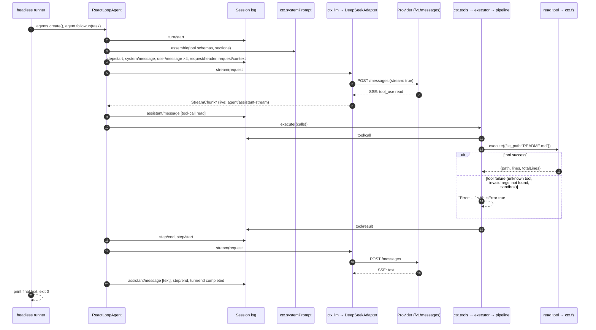
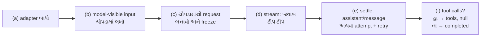

# પ્રકરણ 1 — એક requestની આખી મુસાફરી

> **Level 1 · 🟢 વાર્તા સૌ માટે, 🟡 code ધ્યાનથી.** વાર્તાનો દિવસ 3–4.
> આખા પ્રકરણમાં એક જ ઉદાહરણ: **"આ repositoryનું README વાંચીને ગુજરાતી સાર આપો."**
> આપણે તેને terminal થી લઈને બે model calls, એક `read` tool call અને final answer સુધી, code ની દરેક માલિકી સાથે અનુસરીશું.
> પ્રવેશ પ્રકરણનો [રમકડા-agent](pravesh-shunya-thi-shuruaat.md) યાદ છે? આ પ્રકરણ એ જ આકાર ખરા harness માં બતાવે છે. આખો નકશો: [સમગ્ર નકશો](overview-samagra-naksho.md).

## 🎬 વાર્તા: ટેબલ 4 નો ઓર્ડર

બપોરે એક વાગ્યે ટેબલ 4 પરથી ઓર્ડર આવે છે: "એક થાળી, પણ આજની ખાસ દાળની રેસીપી પ્રમાણે."

આરવ રમેશભાઈની પાછળ પાછળ ફરે છે અને નોટબુકમાં લખતો જાય છે:

1. રમેશભાઈ ઓર્ડર-ચોપડામાં લખે છે: "ઓર્ડર નં. 1 શરૂ."
2. મહારાજ પાસે જાય છે — સાથે ભોજનાલયના નિયમો, ગ્રાહકનો ઓર્ડર, અને "આજે કોઠારમાં શું શું છે" તેની યાદી.
3. મહારાજ રાંધતા નથી. તે ચિઠ્ઠી લખે છે: **"ખાસ દાળની રેસીપી-ચોપડી લાવો."**
4. રમેશભાઈ કોઠારમાં જાય છે, ચોપડી લાવે છે, ચોપડામાં લખે છે: "આ માંગ્યું, આ મળ્યું."
5. **ફરી** મહારાજ પાસે જાય છે — આ વખતે રેસીપી સાથે.
6. મહારાજ હવે રાંધે છે. કોઈ નવી ચિઠ્ઠી નથી.
7. રમેશભાઈ લખે છે: "ઓર્ડર નં. 1 પૂર્ણ," અને થાળી પીરસે છે.

મીરાદીદી નોટબુક જોઈને કહે છે: "તેં હમણાં એક **turn** અને બે **steps** લખ્યા. હવે આ જ મુસાફરી harness માં જોઈએ. ઓર્ડર હશે — 'આ repository નું README વાંચીને ગુજરાતી સાર આપો.' અને આપણે દરેક પગલાનો **માલિક** શોધીશું: કઈ file, કયું function."

## 🎯 આ પ્રકરણ પછી તમે શું કરી શકશો

- `pnpm dsh --profile headless "…"` થી final answer સુધીના દરેક પગલાનો **માલિક file અને symbol** બતાવી શકશો.
- **Turn** અને **step** વચ્ચેનો તફાવત સમજાવી, બતાવી શકશો કે README ઉદાહરણમાં એક turn અને બે steps કેમ છે.
- કઈ માહિતી **session log માં stored** થાય છે અને કઈ ફક્ત **live streamed** થાય છે તે અલગ કરી શકશો.
- API key વગર, scripted mock provider સામે આખી મુસાફરી ચલાવી, દરેક event ને timestamp સાથે જોઈ શકશો.

## 🗺️ આ પ્રકરણનો નકશો: એક request ના દસ સ્ટેશન

આ table આ પ્રકરણની કરોડરજ્જુ છે. દરેક વિભાગના શીર્ષકમાં સ્ટેશન નંબર લખેલો છે, જેથી તમને હંમેશા ખબર રહે કે મુસાફરીમાં ક્યાં છો.

| # | સ્ટેશન | શું થાય | 🍽️ ભોજનાલયમાં | વિભાગ |
|---|---|---|---|---|
| 1 | `pnpm dsh` | `apps/cli/src/bin.ts` ચાલે | ગ્રાહક દરવાજે આવ્યો | 1.3 |
| 2 | Profile boot | ~100 plugins mount થાય | ભોજનાલય ખૂલ્યું, સ્ટાફ હાજર | 1.3 (વિગત પ્રકરણ 2) |
| 3 | Headless runner | Agent બને, task inbox માં જાય | ઓર્ડર લખાયો | 1.4 |
| 4 | `turn/start` | Turn ચોપડામાં શરૂ | ઓર્ડર નંબર પડ્યો | 1.5 |
| 5 | Step 1: model call #1 | system + 4 user messages + 25 tools મોકલાય | રમેશભાઈ મહારાજને પૂછે | 1.6, 1.7 |
| 6 | Tool call `read` | model કહે: "README.md ખોલો" | મહારાજની ચિઠ્ઠી: "રેસીપી-ચોપડી લાવો" | 1.7 (f) |
| 7 | Tool pipeline | policy → tool body → `tool/result` | રમેશભાઈ કોઠારમાંથી લાવે | 1.8 (વિગત પ્રકરણ 3) |
| 8 | Step 2: model call #2 | tool result સાથે ફરી પૂછાય | મહારાજ રેસીપી વાંચીને રાંધે | 1.7 |
| 9 | `turn/end completed` | ચોપડામાં turn બંધ | થાળી પીરસાઈ | 1.5 |
| 10 | stdout + exit 0 | જવાબ છપાય | ગ્રાહકને બિલ | 1.4 |

**યાદ-ચાવી "2-1-25-4":** **2** model calls, **1** tool call, **25** tools model ને દેખાય, **4** user messages. (Title row ચાલુ હોય તો calls **3** થાય — એ આ પ્રકરણની આગાહી કસોટી છે.)

## 1.1 🟢 Turn, step, અને બે calls

> 📦 **Turn** — user ના એક સંદેશથી શરૂ થઈ "હવે કંઈ બાકી નથી" ત્યાં સુધીનું આખું કામ. ઉદાહરણ: README વાળું આખું કામ એક turn છે. 🍽️ એક ઓર્ડર, થાળી પીરસાય ત્યાં સુધી.
>
> 📦 **Step** — **એક model request + તે request એ માંગેલા tools**. 🍽️ મહારાજ સાથેની એક વાતચીત + તેમણે માંગેલો સામાન.

Architecture doc ની વ્યાખ્યા: "A step is one model request plus the tools it calls. A turn is zero or more steps" ([docs/architecture.md — Turn flow][arch-turnflow]). ✅

README ઉદાહરણમાં:

1. **Step 1:** model ને પૂછ્યું → model એ જવાબમાં text નહીં, `read` tool call આપ્યો → harness એ `read({"file_path":"README.md"})` ચલાવ્યું.
2. **Step 2:** tool નું પરિણામ ઉમેરીને model ને **ફરી** પૂછ્યું → model એ ગુજરાતી સાર લખ્યો, કોઈ tool નહીં → turn પૂરો.

તેથી **બે model calls**. (એક અપવાદ છે — base bundle ત્રીજો call પણ કરી શકે છે. તે આ પ્રકરણની આગાહી કસોટી છે.)

> 💡 **મીરાદીદીની ટીપ:** રમકડા-agent માં પણ બરાબર આ જ થયું હતું — `modelCalls: 2`. ફરક એટલો કે ત્યાં છેલ્લા call માં 3 messages ગયા, અહીં 7 જશે. કેમ? વિભાગ 1.7 અને Lab 1 માં જવાબ.

## 1.2 🟡 Sequence diagram: બંને model calls

> 📦 **Sequence diagram** — કોણ કોને ક્યારે સંદેશો મોકલે તેનું ચિત્ર. ઉપરથી નીચે સમય વહે છે; દરેક ઊભી લીટી એક પાત્ર. Solid arrow = call; dashed arrow = પાછો આવતો જવાબ.



| Diagram node | 🍽️ | Owner file | Symbol |
|---|---|---|---|
| headless runner | ઓર્ડર લેનાર કાઉન્ટર | `packages/bundle/headless/src/index.ts` | [`run`][headless-run], [`agents.create`][headless-create], [`agent.followup`][headless-followup] |
| ReactLoopAgent | રમેશભાઈ | `packages/core/agent-loop/src/agent.ts` | [`turn`][loop-turn], [`preStep`][loop-preStep], [`step`][loop-step] |
| Session log | ઓર્ડર-ચોપડો | `packages/core/session/src/index.ts` | [`Session.append`][session-append], [`deriveMessages`][session-derive] |
| ctx.systemPrompt | ભોજનાલયના નિયમોની પોથી | `packages/core/system-prompt/src/index.ts` | `assemble` (called from [`preStep`][loop-preStep]) |
| ctx.llm → DeepSeekAdapter | ફોન + દુભાષિયો | `packages/llm/llm/src/index.ts`, `packages/llm/llm-deepseek/src/adapter.ts` | [`prepareCall`][llm-prepareCall], [`stream`][llm-stream], [`fetch /messages`][deepseek-fetch] |
| ctx.tools → executor → pipeline | કોઠારી ભીખાભાઈ | `packages/core/tools/src/{index,batch,pipeline}.ts`, `packages/core/tool-executor-native/src/index.ts` | [`execute`][tools-execute], [`executeToolBatch`][batch-execute], [`prepare`][pipeline-prepare] / [`dispatch`][pipeline-dispatch] |
| read tool | કોઠારનું એક ખાનું | `packages/fs/tool-fs/src/read.ts` | [`applyReadTool`][read-tool] |

`alt` box બંને tool branch બતાવે છે: **નિષ્ફળતા પણ `tool/result` બને છે** અને step 2 ચાલે જ છે (પ્રકરણ 5 માં ચારેય નિષ્ફળતા ખરેખર ચલાવીશું). 🧪 🍽️ કોઠારમાં સામાન ન મળે તો ભીખાભાઈ "નથી" ની ચિઠ્ઠી પાછી મોકલે — ઝઘડો નહીં, ભોજનાલય બંધ નહીં.

## 1.3 🟢 સ્ટેશન 1–2 — Entry point: `dsh` નો દરવાજો

`pnpm dsh …` એ root `package.json` નો script છે: `"dsh": "node --import tsx/esm apps/cli/src/bin.ts"`. ✅

> 📦 **CLI** (Command-Line Interface) — terminal માંથી ચાલતો program. `dsh` એ DeepSeek Harness નો CLI.
>
> 📦 **argv** — command સાથે લખેલા શબ્દો (arguments) ની યાદી, જે program ને મળે. `dsh --profile headless "…"` માં `--profile`, `headless`, અને task.

[`runCli`][cli-runCli] arguments parse કરે છે અને `invocation.mode` પર `switch` કરે છે. `'profile'` mode માં તે `runProfile(...)` બોલાવે છે. Input: argv; output: કંઈ નહીં (side effect: આખી app boot થાય). પ્રકરણ 2 આ boot ને line-by-line ખોલશે.

> 📦 **Side effect** — function ના return value સિવાયની અસર: file લખવી, screen પર છાપવું, plugin mount કરવો. 🍽️ "ઓર્ડર લેવો" નો return એક ટોકન, પણ side effect: રસોડું ચાલુ.
>
> 📦 **Profile** — કયા plugins સાથે harness ચલાવવું તેનું નામવાળું સંયોજન. `headless` = screen/UI વગર, એક task ચલાવી પૂરું. 🍽️ "આજે ફક્ત parcel કાઉન્ટર — હૉલ બંધ."

અહીં એટલું જાણો કે **headless profile** ના અંતે `headless-runner` નામની config row mount થાય છે ([headless patch][bundle-headless]):

```yaml
    - id: headless-runner
      name: '@deepseek-ai/dsh-headless'
      inject: [headlessStartup]
      config:
        task: !!js ctx.headlessStartup.task
```

(repository code; `!!js` એટલે YAML માં JavaScript expression, જે plugin context સામે evaluate થાય છે.) 🍽️ મેનુની એક લીટી: "parcel કાઉન્ટર ખોલો, અને આજનો ઓર્ડર (`task`) ગ્રાહકે જે લખ્યો તે."

## 1.4 🟢 સ્ટેશન 3 અને 10 — Turn શરૂ થાય તે પહેલાં: Agent બનાવવો

Headless plugin `inject = ['agentDefaultModel', 'agents', 'sessions']` જાહેર કરે છે ([source][headless-inject]) — એટલે આ ત્રણ services ન હોય ત્યાં સુધી તે ચાલતો જ નથી.

> 📦 **`inject`** — plugin ની શરત: "આ services હાજર થાય પછી જ મને ચાલુ કરો." 🍽️ "કોઠારની ચાવી અને ચોપડો મળે તો જ હું કામ શરૂ કરીશ." વિગત પ્રકરણ 2 માં.

પછી [`run`][headless-run]:

1. task વાંચે છે (ખાલી હોય તો error: `a task is required, for example: dsh --profile headless "run the tests"`).
2. default model selection લે છે (base bundle: provider `deepseek-official`, model `deepseek-flash`). ✅
3. નવો Session id `session-<uuid>` બનાવી [`agents.create({ sessionId, meta: { cwd }, … })`][headless-create] બોલાવે છે.
4. Task ને user message તરીકે મોકલે છે ([source][headless-followup]):

```ts
      agent.followup(createUserMessage({
        content: [{ type: 'text', text: task }],
        source: { kind: 'user' },
      }))
```

5. `agent.whenIdle()` ની રાહ જુએ છે, `sessions.flush(...)` કરે છે, final text છાપે છે, અને `io.exit(0 અથવા 1)` માંગે છે. **(સ્ટેશન 10.)**

> 📦 **UUID** — લગભગ ક્યારેય પુનરાવર્તિત ન થાય તેવો લાંબો random id. ઉદાહરણ: `session-88908480-9ef3-…`.
>
> 📦 **Inbox** — agent ને મળેલા, હજી ન લીધેલા સંદેશા. 🍽️ ઓર્ડર-પેટી.
>
> 📦 **Flush** — memory માં રાહ જોતું બધું disk પર લખી દેવું. 🍽️ દિવસના અંતે કાચી નોંધો પાકા ચોપડામાં ઉતારવી.

`followup` input ને **inbox** માં મૂકે છે અને driver ને જગાડે છે. Driver એટલે [`kick`][loop-kick]: `while (await this.turn()) {}` — "જ્યાં સુધી નવો turn બને ત્યાં સુધી ચલાવો."

## 1.5 🟡 સ્ટેશન 4 અને 9 — `turn()`: turn ક્યાં શરૂ થાય અને ક્યાં પૂરો થાય

[`ReactLoopAgent.turn`][loop-turn] (lines 327–433) નું હાડપિંજર, **સરળ teaching pseudocode** તરીકે:

```ts
// teaching pseudocode — real code: packages/core/agent-loop/src/agent.ts#L327-L433
session.append('turn/start', { turn })                 // turn અહીં શરૂ
while (true) {
  const decision = await preStep(target, { turn, step }) // inbox claim + prompt + agent/pre-step
  session.append('step/start', { turn, step })
  const stepEnd = await step(decision)                  // model call + tools
  session.append('step/end', { turn, step })
  if (turnEnds && inbox.nextStep.length === 0) break    // કંઈ બાકી નથી
  target = 'next-step'
}
// finally:
session.append('turn/end', { turn, reason })            // turn અહીં પૂરો — error હોય તો પણ
```

રમકડા-agent ના `turn()` સાથે સરખાવો — એ જ આકાર: start → steps નો loop → end.

ત્રણ વાત ધ્યાનમાં રાખો:

- **`turn/start`** એ [line 336][loop-turn-start] પર, પહેલો step શરૂ થાય **તે પહેલાં** લખાય છે.
- **`turn/end`** એ `finally` block માં ([line 422][loop-turn-end]) લખાય છે, તેથી error, abort કે success — દરેક રસ્તે turn બંધ થાય છે. Reason `completed`, `error`, `aborted`, `blocked`, કે `max-tokens` હોય છે.
- Step નિષ્ફળ જાય અને કોઈ tool call નું પરિણામ બાકી હોય, તો loop [`toolRecovery.results()`][loop-recovery] વડે ખૂટતા `tool/result` લખે છે, જેથી log માં દરેક call ને જવાબ મળે.

> 🍽️ **ભોજનાલયમાં:** પપ્પાનો નિયમ છે — "ચોપડામાં જે ઓર્ડર શરૂ થયો, તેનો અંત પણ લખાવો જોઈએ: પીરસાયો, ગ્રાહક ચાલ્યો ગયો, કે લાઈટ ગઈ." `finally` એ જ નિયમ છે. પ્રકરણ 3 અને 5 માં Ctrl+C પછી પણ `turn/end {"kind":"aborted"}` દેખાશે, અને resume આ જ જોડ પર આધાર રાખે છે.

**Turn ના પાંચ અંત — યાદ-ચાવી "પૂ-ભૂ-ર-રો-મ":** **પૂ**ર્ણ (completed), **ભૂ**લ (error), **ર**દ (aborted), **રો**ક (blocked), **મ**ર્યાદા (max-tokens).

## 1.6 🟡 સ્ટેશન 5 (તૈયારી) — `preStep()`: prompt અને tools ભેગા કરવા

[`preStep`][loop-preStep] દરેક proposed step માટે પાંચ કામ કરે છે:

1. `this.inbox.claim(target, turn)` — inbox માંથી user message લે છે.
2. `this.model.current()` — model selection; ન હોય તો સ્પષ્ટ error.
3. `this.loopCtx.tools.resolve({ agent, modelSelection, signal })` — આ step માં કયા tools દેખાશે.
4. `this.loopCtx.systemPrompt.assemble(...)` — system prompt sections + tool schemas.
5. `this.dispatch.waterfall('agent/pre-step', …)` — plugins ને message બદલવાની કે step નકારવાની તક. Default (છેલ્લું) વર્તન: claimed messages + runtime context સાથે `{ kind: 'enter' }`.

> 📦 **System prompt** — model માટેના સ્થાયી નિયમો, દરેક call ની શરૂઆતમાં. ઉદાહરણ: "You are an AI agent powered by DeepSeek Harness…" 🍽️ ભોજનાલયના નિયમોની પોથી.
>
> 📦 **Tool schema** — tool નું નામ, વર્ણન અને arguments નું વર્ણન (JSON Schema માં), જેથી model ને ખબર પડે કે શું માંગી શકાય. ઉદાહરણ: `read(file_path, offset, limit)`. 🍽️ કોઠારના દરેક ખાના પરનું લેબલ.

**Waterfall** એટલે middleware ની જેમ listener ની સાંકળ; દરેક listener એ `next()` બોલાવવું પડે, નહીં તો સાંકળ ત્યાં જ અટકે ([Cordis primer — dispatch modes][primer-dispatch]). ✅ — પ્રવેશ પ્રકરણના `waterfall.mjs` માં તમે ચોકીદાર અને મેનેજરને આ જ કરતા જોયા હતા. `{ kind: 'enter' }` અને `{ kind: 'reject' }` એ discriminated union છે.

## 1.7 🟡 સ્ટેશન 5, 6, 8 — `step()`: model request બનાવવો, મોકલવો, પરિણામ સાચવવું

[`step`][loop-step] (lines 435–610) એક `while (true)` છે, કારણ કે retry એ જ step ની અંદર થાય છે (પ્રકરણ 5). એક attempt માં છ ભાગ છે — **(a)–(f)**:



**(a) 🔴 Adapter બાંધવો.** [`prepareRequest`][loop-prepareRequest] પહેલાં `agent/request` waterfall ચલાવે છે, પછી `this.loopCtx.llm.prepareCall(...)`. આ step નો provider/model અહીં બદલી શકાતો નથી — બદલે તો loop error ફેંકે છે.

**(b) Model-visible input log કરવો.** System prompt `system/message` તરીકે, અને પહેલા attempt માં દરેક entered message `user/message` તરીકે append થાય છે ([source][loop-admit]):

```ts
      if (firstAttempt) {
        for (const message of decision.messages) {
          if (message.source.kind === 'runtime-context') {
            if (context !== undefined && !contextAdmitted) {
              this.session.append('user/message', context, { surfaceOp: 'append' })
```

Repository નો નિયમ છે: "**Model-visible ⟺ logged**" — model સુધી પહોંચતું બધું session log માંથી ફરી બનાવી શકાય તેવું હોવું જોઈએ ([AGENTS.md][agents-conventions]). ✅

> 🍽️ **"જે મહારાજને કહ્યું, તે ચોપડામાં લખ્યું."** પછીથી કોઈ પૂછે "મહારાજને ખરેખર શું કહેવાયું હતું?" તો ચોપડો જવાબ આપે. Resume, fork, debugging — બધું આ નિયમ પર ટકે છે. `⟺` એટલે "બંને દિશામાં સાચું".

**(c) Request derive અને freeze.** [`buildRequest`][loop-buildRequest] `request/header` (provider, model, tools) અને `request/context` (context window) log કરે છે, પછી `session.deriveMessages()` થી model history બનાવી તેને `deepFreeze` કરે છે ([source][loop-derive]). એટલે model ને મોકલાતી history **log માંથી** આવે છે, memory ના કોઈ અલગ array માંથી નહીં.

> 📦 **Derive** — બીજી માહિતી પરથી ગણીને બનાવવું. અહીં: ચોપડામાંથી model history.
>
> 📦 **Freeze / deepFreeze** — object ને "લૉક" કરવું, જેથી કોઈ બદલી ન શકે (`Object.freeze` — રમકડા-agent માં પણ હતું). Deep = અંદરનાં બધાં objects પણ.

**(d) Stream.** [Source][loop-stream]:

```ts
        const stream = preparedCall?.stream(request) ?? this.loopCtx.llm.stream(request)
        signal.throwIfAborted()
        live.start()
        started = true
        for await (const chunk of stream) {
          signal.throwIfAborted()
          live.push(chunk)
        }
```

દરેક chunk `agent/assistant-stream` નામના **live** event તરીકે publish થાય છે, durable log માં નહીં. દરેક `await` પછી `signal.throwIfAborted()` — "રદ દબાયું છે? તો અહીં જ અટકો" (પ્રકરણ 5).

> 📦 **`for await`** — ટીપે ટીપે આવતા ટુકડા (stream) એક પછી એક, આવે તેમ લેવાનો loop.
>
> 📦 **Chunk** — streamed જવાબનો એક ટુકડો. 🍽️ ફોન પર મહારાજનું એક વાક્ય.

**(e) Settle.** Stream સફળ પૂરો થાય તો આખો compact stream એક `assistant/message` event માં embed થાય છે ([source][loop-assistant-message]). નિષ્ફળ થાય તો `assistant/attempt` લખાય અને `agent/request-error` waterfall retry નક્કી કરે ([source][loop-request-error]).

**(f) Tools.** [Source][loop-tools-execute]:

```ts
        const toolCalls = message.content.filter(block => block.type === 'tool-call')
        if (toolCalls.length === 0) return { kind: 'completed' }
        …
          const result = await this.loopCtx.tools.execute({
            calls: toolCalls, signal, agent: this, log: { turn, step },
            maxParallelToolCalls, toolSet: decision.toolSet,
          })
          …
          return result.concluded ? { kind: 'completed' } : null
```

Tool calls હોય તો step `null` પાછું આપે છે — "turn પૂરો નથી". તેથી `turn()` નો loop step 2 શરૂ કરે છે. Step 2 માં model text આપે અને tool call નહીં, એટલે `{ kind: 'completed' }` → turn બંધ. — રમકડા-agent નું `continue` અને `return reply.text` બરાબર આ જ હતાં.

## 1.8 🟢 સ્ટેશન 7 — Tool call ની અંદર (ટૂંકમાં; વિગત પ્રકરણ 3)

`ctx.tools.execute` પસંદ કરેલા **executor** ને કામ સોંપે છે ([`selectExecutor`][tools-selectExecutor]). Base bundle `tool-executor-native` mount કરે છે ([rows][bundle-base-tools]), જે [`executeToolBatch`][batch-execute] ચલાવે છે: arguments JSON parse, `tool/call` log, pipeline (`tools/pre-execute` → guards → `tools/execute` → tool body → `tools/post-execute`), અને છેલ્લે `tool/result` log.

> 📦 **Executor** — tool calls નો જથ્થો (batch) ખરેખર ચલાવનાર. 🍽️ કોઠારી ભીખાભાઈ.
>
> 📦 **Pipeline** — એક પછી એક તપાસ/પગલાંની હાર. 🍽️ ચિઠ્ઠી → તપાસ → નિયમ → સામાન → લેબલ → ચોપડો.

`read` tool ([`applyReadTool`][read-tool]) `ctx.fs` પાસે path resolve કરાવે છે, file વાંચે છે, અને line-numbered text પાછું આપે છે.

## 1.9 🟡 શું stored થાય છે અને શું ફક્ત streamed?

| માહિતી | ક્યાં | ટકાઉ? |
|---|---|---|
| `turn/start`, `step/start`, `system/message`, `user/message`, `request/header`, `request/context`, `assistant/message`, `tool/call`, `tool/result`, `step/end`, `turn/end` | Session log (`session/event` દ્વારા broadcast, JSONL file માં persisted) | ✅ હા |
| `assistant/attempt` (નિષ્ફળ/retry થયેલ attempt નો stream) | Session log | ✅ હા, પણ model history માં નહીં |
| `agent/assistant-stream` start/chunk/end frames | process-local live event | ❌ ના; chunk frames transient છે |
| `agent/status`, `agent/inbox/*` live notifications | live event | ❌ ના |

સ્રોત: architecture doc નું turn flow ✅ અને અમારો ચલાવેલો trace 🧪. Durable/live નો નિયમ: "Session events are durable facts appended to the log … Agent events (`agent/*`) carry a live `Agent`" ([architecture.md][arch-turnflow]).

> 📦 **Durable / persisted** — disk પર સચવાયેલું; process બંધ થાય તો પણ રહે. 📦 **Transient / live** — ફક્ત ચાલતા process માં; બંધ થતાં ગયું.
>
> 🍽️ **યાદ-ચાવી: "વાત હવામાં, હિસાબ ચોપડામાં."** મહારાજ ફોન પર જે વાક્યો બોલે (chunks) તે હવામાં; અંતે નક્કી થયેલો ઓર્ડર (`assistant/message`) ચોપડામાં.

## Source map: આ ક્રમમાં ખોલો

| ક્રમ | સ્ટેશન | File | Symbol | Input → Output (side effect) |
|---|---|---|---|---|
| 1 | 1 | `apps/cli/src/bin.ts` | [`runCli`][cli-runCli] | argv → (profile boot) |
| 2 | 3, 10 | `packages/bundle/headless/src/index.ts` | [`run`][headless-run] | task → stdout text, exit code |
| 3 | 4, 9 | `packages/core/agent-loop/src/agent.ts` | [`kick`][loop-kick] → [`turn`][loop-turn] | inbox → `turn/*` events |
| 4 | 5 | same | [`preStep`][loop-preStep] | claimed messages → enter/reject decision |
| 5 | 5, 6, 8 | same | [`step`][loop-step] | decision → `assistant/*`, `tool/*` events |
| 6 | 5 | same | [`buildRequest`][loop-buildRequest] | log → frozen `GenerateOptions` |
| 7 | 5 | `packages/llm/llm/src/index.ts` | [`stream`][llm-stream] | request → `llm/stream` waterfall → adapter |
| 8 | 5 | `packages/llm/llm-deepseek/src/adapter.ts` | [`fetch /messages`][deepseek-fetch] | body → HTTP SSE |
| 9 | 7 | `packages/core/tools/src/batch.ts` | [`executeToolBatch`][batch-execute] | tool calls → results |
| 10 | 7 | `packages/fs/tool-fs/src/read.ts` | [`applyReadTool`][read-tool] | `file_path` → numbered lines |

## 🧪 Lab 1 — key વગર આખી મુસાફરી જુઓ

**વિચાર.** Repository માં `@deepseek-ai/dsh-llm-mock-server` છે: Messages-compatible HTTP/SSE server, જે દરેક request માટે scripted વર્તન આપે છે ([`tool_call_success`][mock-tool-call]). DeepSeek adapter ને `DEEPSEEK_BASE_URL` થી તેની તરફ વાળી શકાય છે ([`BASE_URL_ENV`][deepseek-baseurl]). Script: પહેલો request → `read` tool call; બીજો → ગુજરાતી text.

> 📦 **Mock server** — ખરા server જેવો દેખાતો, પણ script મુજબ જવાબ આપતો નકલી server. 🍽️ **"રિહર્સલ મહારાજ"** — પહેલી વાર "રેસીપી-ચોપડી લાવો" કહે, બીજી વાર "સાર તૈયાર". Agency ને ફોન નથી, બિલ નથી, key નથી.
>
> 📦 **Observer plugin** — ફક્ત જોતો અને નોંધતો plugin; વર્તન બદલતો નથી. 🍽️ ખૂણામાં બેઠેલો નિરીક્ષક, જે દરેક ઘટના ઘડિયાળ જોઈને લખે.
>
> 📦 **Overlay / `--patch`** — ચાલુ configuration માં ઉમેરો/બદલાવ કરતી YAML file. 🍽️ મેનુ પર ચોંટાડેલી ચિઠ્ઠી.

**તૈયારી** (harness checkout ના root માં, `pnpm install && pnpm run build` પછી):

```bash
cp -r <book>/labs tmp/book-labs
```

**ચલાવો:**

```bash
bash tmp/book-labs/request-trace/run-mock.sh
```

આ script ([labs/request-trace/run-mock.sh](../labs/request-trace/run-mock.sh)) ત્રણ કામ કરે છે:

1. mock server ને port 8000 પર `--sequence tool_call_success,success` સાથે શરૂ કરે છે;
2. એક overlay લખે છે જે observer plugin [`trace-events.ts`](../labs/request-trace/trace-events.ts) ને **absolute path** થી insert કરે છે અને `session-title-llm` row ને disable કરે છે;
3. પછી `pnpm dsh --profile headless --patch <overlay> "આ repositoryનું README વાંચીને ગુજરાતી સાર આપો."` ચલાવે છે.

**અપેક્ષિત stdout** (🧪 exit 0):

```text
README નો સાર: DeepSeek Harness એ plugin આધારિત agent harness છે.
```

ધ્યાન: આ text mock server એ `--success-text` થી આપ્યો છે. Lab **plumbing** (પાઇપ-લાઇન) ચકાસે છે, model ની ગુણવત્તા નહીં.

**અપેક્ષિત stderr** (અમારો run, [evidence/two-calls.err](../evidence/two-calls.err) માંથી ટૂંકાવીને) — દરેક line ની ડાબી બાજુ સ્ટેશન નંબર ઉમેરીને વાંચો:

```text
[trace +  132ms] session/event #4 turn/start {"turn":1}
[trace +  239ms] session/event #6 step/start {"turn":1,"step":1}
[trace +  243ms] session/event #7 system/message
[trace +  244ms] session/event #8 user/message
[trace +  245ms] session/event #9 user/message
[trace +  246ms] session/event #10 user/message
[trace +  246ms] session/event #11 user/message
[trace +  248ms] session/event #12 request/header
[trace +  249ms] session/event #13 request/context
[trace +  250ms] llm/stream call #1 deepseek-official/deepseek-flash messages=5 tools=[bash,create_goal,edit,…]
[trace +  250ms] live  stream start turn=1 step=1
[trace +  306ms] session/event #16 assistant/message
[trace +  307ms] live  stream end chunks=7 -> assistant/message #16
[trace +  308ms] session/event #17 tool/call name=read arguments={"file_path":"README.md"}
[trace +  319ms] tools/result read isError=false chars=3175
[trace +  321ms] session/event #18 tool/result
[trace +  321ms] session/event #19 step/end {"turn":1,"step":1}
[trace +  340ms] session/event #20 step/start {"turn":1,"step":2}
[trace +  342ms] llm/stream call #2 deepseek-official/deepseek-flash messages=7 tools=[bash,create_goal,edit,…]
[trace +  359ms] session/event #22 assistant/message
[trace +  359ms] live  stream end chunks=13 -> assistant/message #22
[trace +  359ms] session/event #23 step/end {"turn":1,"step":2}
[trace +  360ms] session/event #24 turn/end reason={"kind":"completed"}
[trace +  402ms] dispose: total llm/stream calls = 2
```

| Trace lines | સ્ટેશન |
|---|---|
| `#4 turn/start` | 4 |
| `#6`–`#13`, `llm/stream call #1` | 5 |
| `#16 assistant/message`, `#17 tool/call` | 6 |
| `tools/result`, `#18 tool/result` | 7 |
| `#20`, `llm/stream call #2`, `#22` | 8 |
| `#24 turn/end` | 9 |
| stdout line, exit 0 | 10 |

આખી મુસાફરી 0.4 સેકન્ડથી ઓછી — કારણ કે રિહર્સલ મહારાજ તરત જવાબ આપે છે.

**અવલોકનો જે તમારે જાતે ચકાસવાના છે:**

1. `llm/stream call` બરાબર **2** વાર. Call #1 માં `messages=5` (1 system + 4 user), call #2 માં `messages=7` (+ assistant tool-call + tool result).
2. ચાર `user/message` કેમ? Stored session ખોલો:

```bash
node tmp/book-labs/request-trace/print-session.mjs "$(find tmp/book-home/sessions -name 'session.v*.jsonl*' | head -1)"
```

અમને મળ્યું ([evidence/two-calls.session.txt](../evidence/two-calls.session.txt)): `source={"kind":"user"}` (તમારું task), `agent-instructions` (checkout ના `AGENTS.md` માંથી workspace instructions), `runtime-context` (current working directory વગેરે), અને `skill-catalog`. 🧪

**યાદ-ચાવી "કા-નિ-સ્થ-કૌ":** **કા**મ (task), ઘરના **નિ**યમ (agent-instructions), **સ્થ**ળ-સમય (runtime-context), **કૌ**શલ્ય-યાદી (skill-catalog).

3. Session file નું નામ `session.v4.jsonl.zstd` — format version 4, zstd-compressed JSONL (એક line = એક event, દબાવેલી પોટલીમાં). Folder નામ cwd પરથી બને છે.
4. `chunks=7` અને `chunks=13` એ live frames છે; file માં ફક્ત committed `assistant/message` છે, જેમાં compact stream embedded છે.

**Wire પર ખરેખર શું ગયું?** [`capture-wire.ts`](../labs/request-trace/capture-wire.ts) એ mock server ને in-process ચલાવી દરેક request body નો સાર લખે છે. અમારું પરિણામ ([evidence/wire.json](../evidence/wire.json)): call #1 માં `messageRoles: ["user"]` — ચારેય logged user messages **એક** wire `user` message ના ચાર text blocks બન્યા; call #2 માં `["user","assistant","user"]`, અને છેલ્લા user message માં `tool_result` block. બંને request માં 25 tools અને `dsh_session_log` field હતાં. 🧪 (પ્રકરણ 3 અને 5 માં આ field પર પાછા આવીશું.)

> 📦 **Wire** — network પર ખરેખર જતો data, byte-byte. 🍽️ ફોન પર ખરેખર બોલાયેલા શબ્દો — ચોપડાની નોંધ નહીં.

## 🔮 આગાહી કસોટી

`TITLE=on` (base bundle નો LLM title generator ચાલુ) અને default script `tool_call_success,success` સાથે ચલાવો:

```bash
TITLE=on bash tmp/book-labs/request-trace/run-mock.sh
```

> 📦 **Title generator** — નવા session ને ટૂંકું નામ આપવા model ને એક વધારાનો નાનો call કરતો plugin. 🍽️ ઓર્ડરને "ટેબલ 4 — ખાસ દાળ" જેવું નામ આપવા મહારાજને અલગથી પૂછવું.

**ચલાવતા પહેલાં લખો:** (1) કુલ કેટલા `llm/stream` calls થશે? (2) stdout માં શું આવશે? (3) exit code? (4) run કેટલો સમય લેશે — 1 સેકન્ડથી ઓછો કે વધુ? (સંકેત: રિહર્સલ મહારાજ પાસે ફક્ત **બે** જવાબ લખેલા છે.)

જવાબ અને અમારો trace: [પરિશિષ્ટ D — Lab 1](../appendix/D-lab-solutions.md#lab-1).

## 🩺 નિષ્ફળતા: stdout ખાલી, `dsh: TRANSPORT: DeepSeek Messages transport failed`

**વાર્તામાં.** આરવ lab script વગર સીધું `pnpm dsh` ચલાવે છે. થોડી વાર કંઈ થતું નથી, પછી લાલ અક્ષર. "દીદી, મહારાજ ગુસ્સે થયા?" — "ના, ફોન જ નથી લાગ્યો."

**લક્ષણ.** Lab script વગર સીધું `pnpm dsh --profile headless "…"` ચલાવ્યું, `DEEPSEEK_BASE_URL` set કર્યું નથી, અને network public API સુધી પહોંચતું નથી.

**ટૂંકો નિદાન માર્ગ.**

1. Stderr ની પહેલી lines જુઓ. અમારા sandbox માં: `model listing from https://api.deepseek.com/models failed … using the bundled catalog` અને પછી `dsh: TRANSPORT: DeepSeek Messages transport failed`. 🧪 ([evidence/nofs.err](../evidence/nofs.err) ના અંતે)
2. `TRANSPORT` code adapter ના [`generate`][deepseek-generate] માંથી આવે છે: `fetch` પોતે નિષ્ફળ ગયું, provider એ HTTP error આપી નથી. (HTTP error હોત તો `AUTH`, `SERVER` જેવો code — પ્રકરણ 5.)
3. Base URL ક્યાંથી આવે છે? [`DEEPSEEK_BASE_URL`][deepseek-baseurl] env, નહીં તો public API. Lab માટે તેને mock તરફ વાળો — `run-mock.sh` આ જ કરે છે.

> 📦 **Transport error** — network સ્તરે જ નિષ્ફળતા (connection ન થયું), જવાબ આવ્યો જ નહીં. 🍽️ ફોનનો તાર જ કપાયેલો — agency એ "ના" નથી કહ્યું, કંઈ સાંભળ્યું જ નથી.

<a id="saral-samaj"></a>

## ✅ સાર — પ્રકરણ 1 એક પાનામાં

**એક વાક્યમાં:** એક ઓર્ડર દરવાજાથી થાળી સુધી — ઓર્ડર લખાય (`turn/start`), મહારાજને બે વાર પૂછાય (2 model calls = 2 steps), વચ્ચે એક વાર કોઠારમાંથી રેસીપી-ચોપડી લવાય (`read` tool), અને દરેક પગલું ચોપડામાં નોંધાય — `finally` ને કારણે અંત પણ.

> ⚠️ **ઉપમા અહીં તૂટે છે:** સાચો વેઈટર મહારાજને દરેક વખતે આખી કહાની નથી કહેતો. અહીં **દરેક model call માં આખો ઇતિહાસ** (ચોપડામાંથી ફરી બનાવેલો) જાય છે — call #1 માં 5 messages, call #2 માં 7. Model ને "યાદ" નથી રહેતું; યાદ ચોપડો રાખે છે.

### Turn અને step — ઘડિયાળ અને મિનિટ-કાંટો

- **Turn** = એક ઓર્ડરનું આખું કામ. શરૂ: `turn/start`. અંત: `turn/end`, કારણ સાથે.
- **Step** = મહારાજ સાથેની એક વાતચીત + તેમણે માંગેલા સાધનો. એક turn માં શૂન્ય, એક, કે ઘણા steps હોઈ શકે. README ઉદાહરણમાં **1 turn = 2 steps**.
- **કેમ બે steps?** Step 1 ના અંતે model એ text ને બદલે tool call આપ્યો; `step()` એ `null` ("હજી પૂરું નથી") આપ્યું; `turn()` એ બીજો step શરૂ કર્યો. Step 2 માં tool call નથી → `{ kind: 'completed' }`.

### નવા ટેકનિકલ શબ્દો — એક નજરે

| શબ્દ | સરળ અર્થ | ઉદાહરણ | યાદ-ચાવી |
|---|---|---|---|
| Turn | એક user સંદેશનું આખું કામ | README ઓર્ડર | "આખો ઓર્ડર" |
| Step | એક model call + તેના tools | step 1 = `read` માંગ્યું | "એક વાતચીત" |
| Inbox | agent ને મળેલા, હજી ન લીધેલા સંદેશા | `agent.followup(...)` | "ઓર્ડર-પેટી" |
| System prompt | model માટેના સ્થાયી નિયમો | "You are an AI agent…" | "ભોજનાલયના નિયમો" |
| Tool schema | tool નું નામ, વર્ણન, arguments નું વર્ણન | `read(file_path, offset, limit)` | "ખાનાનું લેબલ" |
| Tool call | model ની "આ tool ચલાવો" માંગ | `read {"file_path":"README.md"}` | "કોઠારની ચિઠ્ઠી" |
| Session event | ચોપડાની એક entry | `#17 tool/call` | "ચોપડાની લીટી" |
| `seq` | event નો ક્રમાંક, 0 થી | `#24 turn/end` | "પાના નંબર" |
| Waterfall event | `next()` વાળી listener સાંકળ | `agent/pre-step`, `llm/stream` | "ધોધ" |
| Stream / chunk | જવાબ ટુકડે-ટુકડે આવવો | `chunks=13` | "ટીપે ટીપે" |
| Mock server | scripted નકલી provider | `tool_call_success,success` | "રિહર્સલ મહારાજ" |
| Overlay / `--patch` | config માં ઉમેરો/બદલાવ કરતી YAML | trace plugin insert | "મેનુ પર ચિઠ્ઠી" |
| stdout / stderr | સામાન્ય output / ભૂલ-અને-માહિતી output | જવાબ stdout માં, trace stderr માં | "થાળી / રસોડાની બૂમો" |

### યાદ રાખવાની રીતો

- **"2-1-25-4":** 2 model calls, 1 tool call, 25 tools, 4 user messages. Title row ચાલુ → 3 calls.
- **"કા-નિ-સ્થ-કૌ":** ચાર user messages — કામ, નિયમ, સ્થળ-સમય, કૌશલ્ય-યાદી.
- **"પૂ-ભૂ-ર-રો-મ":** turn ના પાંચ અંત — completed, error, aborted, blocked, max-tokens.
- **"વાત હવામાં, હિસાબ ચોપડામાં":** live chunks vs durable `assistant/message`.
- **"જે મહારાજને કહ્યું, તે ચોપડામાં લખ્યું":** Model-visible ⟺ logged.
- **દસ સ્ટેશનની વાર્તા:** ઉપરનું table મોઢે બોલો — દરવાજો, ભોજનાલય ખૂલે, ઓર્ડર લખાય, નંબર પડે, પહેલી વાતચીત, ચિઠ્ઠી, કોઠાર, બીજી વાતચીત, પીરસાય, બિલ.

### સામાન્ય ગેરસમજો

| ગેરસમજ | સાચું |
|---|---|
| "Model ને પાછલી વાત યાદ રહે છે." | દરેક call માં history ચોપડામાંથી ફરી મોકલાય છે. |
| "Tool નિષ્ફળ જાય તો turn તૂટે." | નિષ્ફળતા પણ `tool/result` (`isError: true`) છે; step 2 ચાલે છે. |
| "Streamed chunks file માં સચવાય છે." | ફક્ત committed `assistant/message` (embedded compact stream સાથે). |
| "README ઉદાહરણમાં હંમેશા 2 calls." | Base bundle નો title generator ચાલુ હોય તો 3. |

### પુનરાવર્તન કાર્ડ

<details><summary>1. README ઉદાહરણમાં કેટલા turn અને step?</summary>

1 turn, 2 steps, 2 model calls (title row બંધ હોય ત્યારે).
</details>

<details><summary>2. Step 1 પછી `step()` શું return કરે અને કેમ?</summary>

`null`: tool calls હતા, તેથી turn પૂરો નથી; `turn()` step 2 શરૂ કરે છે.
</details>

<details><summary>3. Call #2 માં 7 messages કયા?</summary>

System, 4 user messages, assistant નો tool-call, અને tool result.
</details>

<details><summary>4. Model history કઈ function બનાવે છે?</summary>

`session.deriveMessages()`, `buildRequest` ની અંદર — ચોપડામાંથી.
</details>

<details><summary>5. Session file નું નામ અને format?</summary>

`session.v4.jsonl.zstd`: format version 4, એક line = એક event, zstd-compressed.
</details>

### મિત્રને સમજાવો (3 મિનિટ)

ભોજનાલયની ઉપમા વાપરીને મિત્રને સમજાવો કે README ઉદાહરણમાં મહારાજને **બે વાર** કેમ પૂછવું પડ્યું. પછી એ જ વાત ઉપમા વગર, ફક્ત `turn`, `step`, `tool call` શબ્દોથી કહો.

## 🧠 Mastery check

1. Turn અને step ની વ્યાખ્યા લખો, અને README ઉદાહરણમાં બંનેની સંખ્યા કહો.
2. `turn/end` `finally` block માં કેમ છે? તેનાથી કઈ ખાતરી મળે છે?
3. Call #2 માં `messages=7` ના સાત messages કયા?
4. `agent/assistant-stream` chunk frames અને `assistant/message` વચ્ચે replay ની દૃષ્ટિએ શું ફરક છે?
5. Step 1 tool call પછી `step()` શું return કરે છે, અને `turn()` તેનો અર્થ શું કરે છે?
6. Model history કઈ function થી બને છે, અને તે memory ના કોઈ અલગ array ને બદલે log માંથી કેમ બને છે?

જવાબો: [પરિશિષ્ટ D — પ્રકરણ 1](../appendix/D-lab-solutions.md#ch1).

## 🎬 આગળ શું

રાત્રે આરવ નોટબુકમાં દસ સ્ટેશન ફરી લખે છે, અને એક પ્રશ્ન પર અટકે છે: "સ્ટેશન 2 — 'ભોજનાલય ખૂલ્યું, સ્ટાફ હાજર.' પણ આ ~100 કર્મચારી **આવ્યા કેવી રીતે**? કોણે નક્કી કર્યું કે રમેશભાઈ પહેલાં કોઠારી હાજર હોવા જોઈએ?"

મીરાદીદી: "કાલે સવારે છ વાગ્યે આવજે. ભોજનાલય **ખૂલતું** જોઈશું — કાંતિકાકા (Cordis) કોને ક્યારે કામ પર લે છે, આજનું મેનુ (profile + patches) કેવી રીતે બને છે, અને એક કર્મચારી રજા પર હોય તો શું થાય." આજનો `trace-events.ts` અને `run-mock.sh` ત્યાં અને પછીનાં બધાં પ્રકરણોમાં ફરી વપરાશે.

---

પાછળ: [પ્રકરણ 0](00-paayo-ane-pratham-run.md) · આગળ: [પ્રકરણ 2 — Cordis અને plugin architecture](02-cordis-plugin-architecture.md)

<!-- citations:begin (generated by tools/refdefs.py) -->
[agents-conventions]: https://github.com/deepseek-ai/deepseek-harness/blob/fcc0ad462172522aaf5c93a7b2e01f6b9f0b0159/AGENTS.md#L130-L142
[arch-turnflow]: https://github.com/deepseek-ai/deepseek-harness/blob/fcc0ad462172522aaf5c93a7b2e01f6b9f0b0159/docs/architecture.md#L81-L111
[batch-execute]: https://github.com/deepseek-ai/deepseek-harness/blob/fcc0ad462172522aaf5c93a7b2e01f6b9f0b0159/packages/core/tools/src/batch.ts#L50-L96
[bundle-base-tools]: https://github.com/deepseek-ai/deepseek-harness/blob/fcc0ad462172522aaf5c93a7b2e01f6b9f0b0159/packages/bundle/base/cordis.patch.yml#L511-L516
[bundle-headless]: https://github.com/deepseek-ai/deepseek-harness/blob/fcc0ad462172522aaf5c93a7b2e01f6b9f0b0159/packages/bundle/headless/cordis.patch.yml#L9-L46
[deepseek-baseurl]: https://github.com/deepseek-ai/deepseek-harness/blob/fcc0ad462172522aaf5c93a7b2e01f6b9f0b0159/packages/llm/llm-deepseek/src/config.ts#L119
[deepseek-fetch]: https://github.com/deepseek-ai/deepseek-harness/blob/fcc0ad462172522aaf5c93a7b2e01f6b9f0b0159/packages/llm/llm-deepseek/src/adapter.ts#L142-L170
[deepseek-generate]: https://github.com/deepseek-ai/deepseek-harness/blob/fcc0ad462172522aaf5c93a7b2e01f6b9f0b0159/packages/llm/llm-deepseek/src/adapter.ts#L65-L90
[headless-create]: https://github.com/deepseek-ai/deepseek-harness/blob/fcc0ad462172522aaf5c93a7b2e01f6b9f0b0159/packages/bundle/headless/src/index.ts#L389-L396
[headless-followup]: https://github.com/deepseek-ai/deepseek-harness/blob/fcc0ad462172522aaf5c93a7b2e01f6b9f0b0159/packages/bundle/headless/src/index.ts#L420-L433
[headless-inject]: https://github.com/deepseek-ai/deepseek-harness/blob/fcc0ad462172522aaf5c93a7b2e01f6b9f0b0159/packages/bundle/headless/src/index.ts#L45
[headless-run]: https://github.com/deepseek-ai/deepseek-harness/blob/fcc0ad462172522aaf5c93a7b2e01f6b9f0b0159/packages/bundle/headless/src/index.ts#L322-L455
[llm-stream]: https://github.com/deepseek-ai/deepseek-harness/blob/fcc0ad462172522aaf5c93a7b2e01f6b9f0b0159/packages/llm/llm/src/index.ts#L1170-L1185
[loop-admit]: https://github.com/deepseek-ai/deepseek-harness/blob/fcc0ad462172522aaf5c93a7b2e01f6b9f0b0159/packages/core/agent-loop/src/agent.ts#L463-L478
[loop-assistant-message]: https://github.com/deepseek-ai/deepseek-harness/blob/fcc0ad462172522aaf5c93a7b2e01f6b9f0b0159/packages/core/agent-loop/src/agent.ts#L566-L586
[loop-derive]: https://github.com/deepseek-ai/deepseek-harness/blob/fcc0ad462172522aaf5c93a7b2e01f6b9f0b0159/packages/core/agent-loop/src/agent.ts#L728-L745
[loop-kick]: https://github.com/deepseek-ai/deepseek-harness/blob/fcc0ad462172522aaf5c93a7b2e01f6b9f0b0159/packages/core/agent-loop/src/agent.ts#L268-L282
[loop-recovery]: https://github.com/deepseek-ai/deepseek-harness/blob/fcc0ad462172522aaf5c93a7b2e01f6b9f0b0159/packages/core/agent-loop/src/agent.ts#L376-L385
[loop-request-error]: https://github.com/deepseek-ai/deepseek-harness/blob/fcc0ad462172522aaf5c93a7b2e01f6b9f0b0159/packages/core/agent-loop/src/agent.ts#L549-L564
[loop-step]: https://github.com/deepseek-ai/deepseek-harness/blob/fcc0ad462172522aaf5c93a7b2e01f6b9f0b0159/packages/core/agent-loop/src/agent.ts#L435-L610
[loop-stream]: https://github.com/deepseek-ai/deepseek-harness/blob/fcc0ad462172522aaf5c93a7b2e01f6b9f0b0159/packages/core/agent-loop/src/agent.ts#L490-L498
[loop-tools-execute]: https://github.com/deepseek-ai/deepseek-harness/blob/fcc0ad462172522aaf5c93a7b2e01f6b9f0b0159/packages/core/agent-loop/src/agent.ts#L586-L601
[loop-turn]: https://github.com/deepseek-ai/deepseek-harness/blob/fcc0ad462172522aaf5c93a7b2e01f6b9f0b0159/packages/core/agent-loop/src/agent.ts#L327-L433
[loop-turn-end]: https://github.com/deepseek-ai/deepseek-harness/blob/fcc0ad462172522aaf5c93a7b2e01f6b9f0b0159/packages/core/agent-loop/src/agent.ts#L422
[loop-turn-start]: https://github.com/deepseek-ai/deepseek-harness/blob/fcc0ad462172522aaf5c93a7b2e01f6b9f0b0159/packages/core/agent-loop/src/agent.ts#L336
[mock-tool-call]: https://github.com/deepseek-ai/deepseek-harness/blob/fcc0ad462172522aaf5c93a7b2e01f6b9f0b0159/packages/test-support/llm-mock-server/src/index.ts#L586-L594
[pipeline-dispatch]: https://github.com/deepseek-ai/deepseek-harness/blob/fcc0ad462172522aaf5c93a7b2e01f6b9f0b0159/packages/core/tools/src/pipeline.ts#L295-L326
[pipeline-prepare]: https://github.com/deepseek-ai/deepseek-harness/blob/fcc0ad462172522aaf5c93a7b2e01f6b9f0b0159/packages/core/tools/src/pipeline.ts#L190-L236
[primer-dispatch]: https://github.com/deepseek-ai/deepseek-harness/blob/fcc0ad462172522aaf5c93a7b2e01f6b9f0b0159/docs/cordis-primer.md#L19-L25
[read-tool]: https://github.com/deepseek-ai/deepseek-harness/blob/fcc0ad462172522aaf5c93a7b2e01f6b9f0b0159/packages/fs/tool-fs/src/read.ts#L68-L163
[session-append]: https://github.com/deepseek-ai/deepseek-harness/blob/fcc0ad462172522aaf5c93a7b2e01f6b9f0b0159/packages/core/session/src/index.ts#L806-L836
[session-derive]: https://github.com/deepseek-ai/deepseek-harness/blob/fcc0ad462172522aaf5c93a7b2e01f6b9f0b0159/packages/core/session/src/index.ts#L999-L1021
[tools-execute]: https://github.com/deepseek-ai/deepseek-harness/blob/fcc0ad462172522aaf5c93a7b2e01f6b9f0b0159/packages/core/tools/src/index.ts#L375-L377
<!-- citations:end -->
