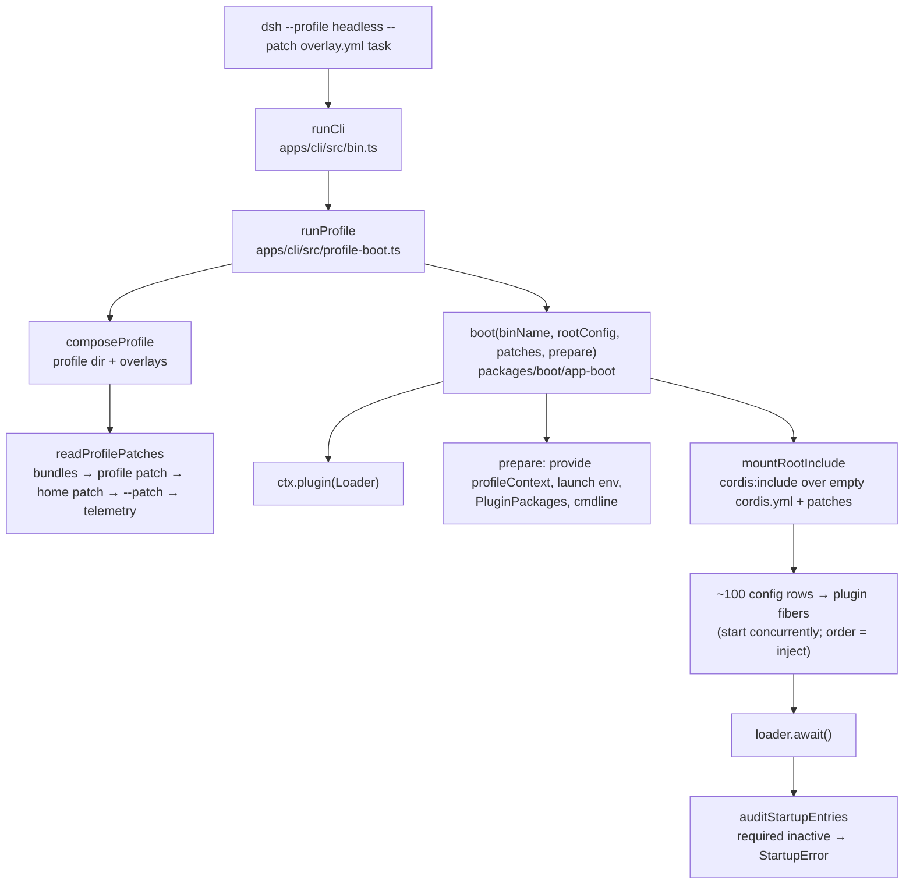

# પ્રકરણ 2 — Cordis અને plugin architecture

> 🧭 **નવું:** આ પ્રકરણ અઘરું લાગે તો પહેલાં નીચેનો [સરળ સમજ](#saral-samaj) વિભાગ વાંચો (ઉપમા, નવા શબ્દો, યાદ રાખવાની રીતો). આખા પુસ્તકનો નકશો: [સમગ્ર નકશો](overview-samagra-naksho.md).

> **Level 2.** પ્રકરણ 1 માં *request* ચાલતો જોયો. અહીં તેના પહેલાનો સમય જોઈએ: **startup**.
> Profile અને configuration કેવી રીતે ચાલતા plugin graph માં ફેરવાય છે, અને Cordis શું સંભાળે છે તથા Harness ઉપર શું બનાવે છે.

## આ પ્રકરણ પછી તમે શું કરી શકશો

- Startup (એક વાર, process શરૂ થતાં) અને request execution (દરેક turn) ને અલગ ઓળખી, બંનેના માલિક code બતાવી શકશો.
- `profile → bundles → patch layers → cordis.yml rows → plugin fibers` ની સાંકળ `--dump-config` થી ખરેખર જોઈ શકશો.
- Context, service registration, dependency injection, effects, events, scope અને cleanup ને vendored Cordis source માં બતાવી શકશો.
- Required service ખૂટે ત્યારે શું થાય — warning કે fatal — તે આગાહી કરી, ચલાવીને સાબિત કરી શકશો.
- Tutorial ના એક race ને ઓળખી, તેને deterministic બનાવી શકશો.

## 2.1 સરળ સમજ: startup અને request બે અલગ સમય છે

| | Startup | Request execution |
|---|---|---|
| ક્યારે | process શરૂ થાય ત્યારે, એક વાર | દરેક user message પર, દરેક turn માં |
| કોણ ચલાવે | `apps/cli` launcher + Cordis Loader | `ReactLoopAgent` (agent-loop plugin) |
| શું બને | plugin tree, services, event listeners | session events, model requests, tool calls |
| નિષ્ફળતા | entry `PENDING`/`FAILED`; required હોય તો process exit 1 | turn `error`/`aborted`; tool `isError` |
| આ પુસ્તકમાં | આ પ્રકરણ | પ્રકરણ 1, 3, 5 |

**Context** એટલે Cordis નો કેન્દ્રીય object, જેના પર services રહે છે. ઉદાહરણ: `ctx.tools`, `ctx.llm`, `ctx.sessions`.

**Service** એટલે context પર એક સ્થિર નામે મુકાયેલી capability. ઉદાહરણ: `ToolsService` પોતાને `tools` નામે register કરે છે.

**Dependency Injection** એટલે plugin ને જરૂરી service runtime દ્વારા મળવી. ઉદાહરણ: `export const inject = ['tools']` લખો, એટલે `ctx.tools` હાજર થાય ત્યારે જ `apply` ચાલે.

**Effect** એટલે undo કરી શકાય તેવી નોંધણી: plugin unload થાય ત્યારે તે આપોઆપ પાછી ખેંચાય. ઉદાહરણ: `ctx.tools.register(...)` એ disposer પાછો આપે છે, અને plugin unload થતાં tool registry માંથી ગાયબ થાય છે.

## 2.2 Startup ની સાંકળ, code સાથે



| Node | Owner | Symbol |
|---|---|---|
| runCli | `apps/cli/src/bin.ts` | [`runCli`][cli-runCli] |
| runProfile | `apps/cli/src/profile-boot.ts` | [`runProfile`][cli-runProfile] |
| composeProfile | same | [`composeProfile`][cli-composeProfile] |
| readProfilePatches | `packages/boot/app-boot/src/profile-context.ts` | [`readProfilePatches`][boot-readProfilePatches] |
| boot | `packages/boot/app-boot/src/index.ts` | [`boot`][boot-boot] |
| mountRootInclude | same | [`mountRootInclude`][boot-mountRootInclude] |
| auditStartupEntries | same | [`auditStartupEntries`][boot-audit], [`requiredStartupEntryIds`][boot-required] |

આ diagram **lifecycle** બતાવે છે (શું પછી શું થાય), data flow નહીં.

### Layers નો ક્રમ (repository code)

[`readProfilePatches`][boot-readProfilePatches]:

```ts
  const patches = structuredClone([
    ...readBundlePatches(binName, context, initialProfile),
    ...(initialProfile?.patches ?? loadOptionalPatches(binName, context.patchPath) ?? []),
    ...(loadOptionalPatches(binName, join(context.home, PROFILE_PATCH_FILENAME)) ?? []),
    ...context.overlays,
  ])
```

એટલે ક્રમ: (1) profile ના `package.json` માં `dsh.profile.bundles` મુજબ bundle patches, (2) profile નું પોતાનું `cordis.patch.yml`, (3) `$DSH_HOME/cordis.patch.yml`, (4) `--patch` overlays argv ક્રમમાં, (5) telemetry switch. Patch row ને **id** થી પકડે છે અને આખો `config` બદલે છે, અથવા `insert` થી નવી rows ઉમેરે છે ([architecture.md](https://github.com/deepseek-ai/deepseek-harness/blob/fcc0ad462172522aaf5c93a7b2e01f6b9f0b0159/docs/architecture.md#profiles-and-bundles)). ✅

Headless profile ના પહેલા boot પર Harness આ file બનાવે છે (અમારા `$DSH_HOME/profiles/headless/package.json` માંથી) 🧪:

```json
  "dsh": {
    "profile": {
      "bundles": [
        "@deepseek-ai/dsh-base",
        "@deepseek-ai/dsh-headless"
      ]
    }
  }
```

### Root config ખાલી કેમ છે?

[`prepareProfile`](https://github.com/deepseek-ai/deepseek-harness/blob/fcc0ad462172522aaf5c93a7b2e01f6b9f0b0159/apps/cli/src/profile-boot.ts#L194-L200) દરેક boot પર profile નું `cordis.yml` ફરી `[]` લખે છે. આખું composition patches છે; ખાલી file ફક્ત Loader ને એક સાચું include root (અને `baseUrl`) આપે છે. ✅ — આ જ કારણે overlay માં local plugin નો path **absolute** હોવો જોઈએ: patch file module ને profile directory સામે resolve કરે છે, patch file ની જગ્યા સામે નહીં ([docs/user/develop/basic/index.md](https://github.com/deepseek-ai/deepseek-harness/blob/fcc0ad462172522aaf5c93a7b2e01f6b9f0b0159/docs/user/develop/basic/index.md)). ✅

## 2.3 Cordis અંદરથી: પાંચ ઘટક

Harness નું Cordis `vendor/cordis` માં vendored છે: version `4.0.0-rc.11`, upstream commit `0b96d9fd…` ([manifest][vendor-manifest]). Vendored copy માં લોગ કરેલા local modifications છે, જેમ કે V6 lifecycle hardening ([vendor/README.md][vendor-mods]). નીચે અમે **vendored copy** વાંચી છે; upstream repository અલગથી inspect કરી નથી. ✅/⚠️

**(1) Service registration.** [`Service` constructor][cordis-service] અંતે `self.ctx.reflect.provide(name, self, this[symbols.check])` બોલાવે છે. [`ReflectService.provide`][cordis-provide] આખું કામ `this.ctx.fiber.effect(...)` માં કરે છે, એટલે registration પોતે જ effect છે:

```ts
  provide(name: string, value?: any, check?: () => boolean) {
    return this.ctx.fiber.effect(() => {
      …
      if (this.store[key]) {
        throw new Error(`service "${name}" has been registered at <${this.store[key].ctx.fiber.name}>`)
      }
      this.store[key] = impl
```

એક જ નામે બીજો provider આવે તો સ્પષ્ટ error — "last one wins" નહીં. ✅

**(2) Fiber અને state.** દરેક mounted plugin નું runtime એક **Fiber** છે. [`FiberState`][cordis-fiberstate]: `PENDING` (જરૂરી services ની રાહ), `LOADING`, `ACTIVE`, `FAILED`, `DISPOSED`, `UNLOADING`. [`RegistryService.plugin`][cordis-plugin] `new Fiber(this.ctx, config, Inject.resolve(plugin.inject), runtime, …)` બનાવે છે — `inject` ની યાદી અહીં fiber ને સોંપાય છે.

**(3) Effects અને cleanup.** [`Fiber.effect`][cordis-effect] setup ચલાવે છે અને disposers ભેગા કરે છે; unload વખતે તેમને **ઊંધા ક્રમમાં** ચલાવે છે (`disposables.splice(0).reverse()`). `UNLOADING` દરમિયાન નવું effect બનાવવું `INACTIVE_EFFECT` error આપે છે. ✅

**(4) Events.** [`EventsService.on`][cordis-on] listener ઉમેરે છે (પોતે effect તરીકે), અને `emit`/`waterfall`/`serial`/`parallel`/`bail` dispatch modes આપે છે ([primer table][primer-dispatch]). Event નો dispatch mode તેના public contract નો ભાગ છે; harness events `@mode` JSDoc tag થી જાહેર કરે છે, જેમ કે `agent/pre-step` એ `@mode waterfall` ([runtime-types.ts][agent-events]). ✅

**(5) Loader અને Include.** Loader YAML rows ને entries બનાવે છે; Include file વાંચે છે અને patches લાગુ કરે છે; `!!js` expressions `config` અને `disabled` માં જ evaluate થાય છે ([primer — Loader configuration](https://github.com/deepseek-ai/deepseek-harness/blob/fcc0ad462172522aaf5c93a7b2e01f6b9f0b0159/docs/cordis-primer.md#loader-configuration)). ✅

## 2.4 Cordis શું સંભાળે છે, Harness શું બનાવે છે

| Cordis (vendor/) | Harness (packages/, apps/) |
|---|---|
| `Context`, service store, `provide`/`inject` | **કયા** services: `tools`, `llm`, `sessions`, `agents`, `fs`, `sandboxPolicy`, … |
| Fiber lifecycle, effects, ઊંધા ક્રમમાં disposal | "Registrations are effects" નિયમ: દરેક `register()` disposer પાછો આપે ([AGENTS.md][agents-conventions]) |
| Event dispatch modes | Event vocabulary: `session/event`, `agent/*`, `tools/*`, `llm/stream`, દરેક `@mode` સાથે |
| Loader, Include, patches by id, `!!js` | Profiles, bundles, layer ક્રમ, `--dump-config`, ખાલી root config |
| Entry fails/pends — logger દ્વારા report | Startup audit: required entry inactive → `StartupError`, exit 1 ([`boot-required`][boot-required]) |
| `isolate` realms (group rows) | Agent presets, per-agent **scope**: [`createScope`][scope-create], [`scopeTarget`][scope-target], [`scopeChainOf`][scope-chain] |

**Scope** એટલે એક context જેની નોંધણીઓ એક opaque identity (દા.ત. એક Agent) સાથે tag થાય. ઉદાહરણ: `ctx.tools` નું executor selection પહેલાં agent ના scope chain માં શોધે છે, પછી root default ([`selectExecutor`][tools-selectExecutor]):

```ts
    for (const key of scopeChainOf(scope)) {
      record = this.scoped.get(key)
      if (record !== undefined) break
    }
    record ??= this.root
    const executor = record?.executor
    if (executor === undefined) throw new ToolExecutorUnavailableError()
```

## Source map: આ ક્રમમાં ખોલો

| ક્રમ | File | Symbol | Input → Output (side effect) |
|---|---|---|---|
| 1 | `apps/cli/src/profile-boot.ts` | [`runProfile`][cli-runProfile] | options → root `Context` (signals, fail-loud) |
| 2 | `packages/boot/app-boot/src/profile-context.ts` | [`readProfilePatches`][boot-readProfilePatches] | profile → ordered `PatchOptions[]` |
| 3 | `packages/boot/app-boot/src/index.ts` | [`boot`][boot-boot] | config path + patches → settled tree |
| 4 | same | [`mountRootInclude`][boot-mountRootInclude] | → bootstrap `cordis:include` entry |
| 5 | same | [`auditStartupEntries`][boot-audit] | settled tree → throw / warn |
| 6 | `vendor/cordis/src/service.ts` | [`Service`][cordis-service] | → `reflect.provide` |
| 7 | `vendor/cordis/src/reflect.ts` | [`provide`][cordis-provide] | → service store (effect) |
| 8 | `vendor/cordis/src/fiber.ts` | [`FiberState`][cordis-fiberstate], [`effect`][cordis-effect] | lifecycle, disposal |
| 9 | `packages/core/scope/src/index.ts` | [`createScope`][scope-create] | per-agent tagging |

## Lab 2 — plugin graph જુઓ, service તોડો, race પકડો

### 2a. Composition dump

```bash
DSH_HOME=$PWD/tmp/book-home pnpm dsh --profile headless --dump-config > tmp/dump.yml
```

🧪 અમારું પરિણામ: exit 0, 395 lines, **101** top-level rows ([evidence/dump.yml](../evidence/dump.yml)). દરેક block ઉપર તેનું મૂળ layer લખેલું છે:

```yaml
# == @deepseek-ai/dsh-base
- id: timer
  name: '@deepseek-ai/cordis-plugin-timer'
# == @deepseek-ai/dsh-base, patched by @deepseek-ai/dsh-headless
- id: hmr
  name: '@deepseek-ai/dsh-hmr'
  disabled: true
```

તપાસો: `tools`, `tool-executor-native`, `agent-loop`, `fs-sandbox`, `llm-deepseek`, `session-title-llm`, `session-log-deepseek` rows શોધો અને દરેકનું મૂળ layer લખો.

### 2b. Optional service ખૂટે: warning, app ચાલુ

`fs` service નો provider `fs-sandbox` row છે. તેને disable કરતું overlay:

```yaml
- id: fs-sandbox
  disabled: true
```

ચલાવો (કોઈ પણ task):

```bash
DSH_HOME=$PWD/tmp/book-home pnpm dsh --profile headless --patch /abs/path/nofs.yml "hi"
```

🧪 Stderr ([evidence/nofs.err](../evidence/nofs.err)):

```text
dsh: warning: 18 entries did not activate
working-directory (@deepseek-ai/dsh-working-directory): pending (waiting for service: fs)
tool-working-directory (@deepseek-ai/dsh-tool-working-directory): pending (waiting for service: workingDirectory)
tool-bash (@deepseek-ai/dsh-tool-bash): pending (waiting for service: workingDirectory)
tool-fs (@deepseek-ai/dsh-tool-fs): pending (waiting for services: fs, workingDirectory)
…
```

એક ખૂટતી service ની **cascade**: `fs` નથી → `working-directory` pending → જે-જે `workingDirectory` inject કરે તે બધા pending. આમાં એકેય entry required યાદીમાં નથી, તેથી ફક્ત warning; app ચાલુ રહે છે — પણ file tools વગર. (આ run પછી network ન હોવાથી `TRANSPORT` error થી પૂરો થયો; તે અલગ વાત છે.)

### 2c. Required service ખૂટે: startup fatal

હવે `system-prompt` row disable કરો. 🧪 Exit 1, stderr ([evidence/nosp.err](../evidence/nosp.err)):

```text
dsh: startup failed: 2 required plugins did not activate

Plugins waiting for services (29):
  Plugin                           Missing services
  tool-executor-native (required)  tools
  agent-loop (required)            tools, systemPrompt
  …
```

કેમ? `tools` પોતે `systemPrompt` inject કરે છે, તેથી `tools` આવતું નથી; અને [`AgentLoop` `static inject = ['agents', 'sessions', 'llm', 'tools', 'systemPrompt', 'sessionProjections']`][agentloop-inject]. `agent-loop` અને `tool-executor-native` બંને [`requiredStartupEntryIds`][boot-required] માં છે, એટલે [`auditStartupEntries`][boot-audit] `StartupError` ફેંકે છે. Process exit 1 પહેલાં headless runner પણ એક line છાપે છે: `dsh: no agent factory registered (load an agent-loop plugin)`. 🧪

### 2d. Tutorial નો race (docs અને code નો તફાવત)

Cordis tutorial ના પ્રકરણ 7 ની composition ([source][tutorial-07]):

```yaml
- name: '@deepseek-ai/dsh-system-prompt'
- name: '@deepseek-ai/dsh-tools'
- name: './tool-logger.ts'
- name: './greet-tool.ts'
```

Pinned commit પર આ **નિષ્ફળ** જાય છે 🧪:

```text
ToolExecutorUnavailableError: The selected tool executor is unavailable. Load an executor in this composition before running the agent.
  code: 'TOOL_EXECUTOR_UNAVAILABLE'
```

કારણ: `ctx.tools.execute` executor ને સોંપે છે ([`execute`][tools-execute] → [`selectExecutor`][tools-selectExecutor]), અને tutorial ની yml કોઈ executor mount કરતી નથી. ઉપાય: `- name: '@deepseek-ai/dsh-tool-executor-native'` row ઉમેરો.

પણ ધ્યાન: તે row `greet-tool.ts` **પછી** મૂકો તો ફરી એ જ error 🧪, અને **પહેલાં** મૂકો તો સફળ 🧪. Tutorial પોતે કહે છે કે rows concurrently start થાય છે અને list position કંઈ guarantee કરતી નથી. `greet-tool` ફક્ત `tools` inject કરે છે; executor service નથી, તેથી `inject` તેની રાહ જોઈ શકતું નથી, અને `apply` અંદરનો demo call race જીતે કે હારે.

Deterministic ઉપાય (book lab code, [labs/cordis-basics/greet-tool-settled.ts](../labs/cordis-basics/greet-tool-settled.ts)) — demo call પહેલાં Loader ના આખા tree ના settle થવાની રાહ:

```ts
  void (async () => {
    // changed: wait until every config row has settled, so an executor row listed
    // later in cordis.yml has activated before the demo call selects it.
    await ctx.get('loader')?.await()
    const result = await ctx.tools.execute({ … })
```

Executor row **છેલ્લે** હોય તો પણ 3/3 runs સફળ, Gujarati greeting સાથે 🧪:

```text
[tool-logger] greet -> નમસ્તે, Cordis!
tool replied: [{"type":"text","text":"નમસ્તે, Cordis!"}]
```

ચલાવવા માટે (harness root થી):

```bash
cd tmp/book-labs/cordis-basics && cp cordis.executor-last.yml cordis.yml && node --import tsx ../../../vendor/cordis/bin.js
```

## આગાહી કસોટી

2b માં `fs-sandbox` ને બદલે `working-directory` row disable કરો. **ચલાવતા પહેલાં લખો:** (1) warning માં કેટલી entries હશે — 18 કરતાં વધુ, ઓછી, કે સરખી? (2) `tool-fs` ની "missing services" યાદીમાં શું હશે? (3) Exit startup પર fatal થશે?

જવાબ: [પરિશિષ્ટ D — Lab 2](../appendix/D-lab-solutions.md#lab-2).

## નિષ્ફળતા: નવો plugin dsh માં દેખાતો જ નથી

**લક્ષણ.** Overlay માં `name: './src/my-plugin.ts'` (relative path) લખ્યું. Web/headless શરૂ થાય છે, plugin નું કંઈ દેખાતું નથી.

**ટૂંકો નિદાન માર્ગ.**

1. Startup stderr માં `dsh: warning: N entries did not activate` શોધો — `dsh` launcher inactive entries નું વર્ણન છાપે છે ([`auditStartupEntries`][boot-audit]).
2. Path absolute છે? Relative path profile directory સામે resolve થાય છે, overlay file સામે નહીં (2.2 જુઓ).
3. `--dump-config --patch <overlay>` થી તમારી row અંતિમ tree માં છે અને `disabled` નથી તે ચકાસો.
4. Plugin ની `inject` યાદીની દરેક service ને `--dump-config` માં provider row છે કે નહીં તે જુઓ.

## Mastery check

1. Startup અને request execution ના માલિક symbols એક-એક લખો.
2. Patch layers નો ક્રમ લખો. એક જ row ને base અને તમારું `--patch` બંને બદલે તો કોણ જીતે?
3. એક જ નામની બે services register થાય તો Cordis શું કરે છે? Source line બતાવો.
4. `fs` ખૂટે તો warning, પણ `systemPrompt` ખૂટે તો fatal — કેમ?
5. Tutorial race માં `inject` કેમ મદદ ન કરી શક્યું?
6. Effect disposers કયા ક્રમમાં ચાલે છે, અને તે કેમ મહત્વનું છે?

જવાબો: [પરિશિષ્ટ D — પ્રકરણ 2](../appendix/D-lab-solutions.md#ch2).

<a id="saral-samaj"></a>

## સરળ સમજ — પ્રકરણ 2 સાદી ગુજરાતીમાં

> આ વિભાગ નવો ઉમેરેલો છે; ઉપરનું પ્રકરણ જેમ હતું તેમ જ છે. આખો નકશો: [સમગ્ર નકશો](overview-samagra-naksho.md).

### એક વાક્યમાં

**પ્રકરણ 2 = ભોજનાલય સવારે કેવી રીતે ખૂલે છે: "આજનું મેનુ" (profile + patches) નક્કી થાય, મેનેજર (Cordis) દરેક કર્મચારીને (plugin) ત્યારે જ કામ પર લે જ્યારે તેને જોઈતાં સાધનો (services) હાજર હોય, અને અંતે હાજરીપત્રક (startup audit) તપાસાય.**

### ભોજનાલયની ઉપમામાં

- **Profile** = "આજે કયું ભોજનાલય?" — `headless` (ફક્ત એક ઓર્ડર, ગ્રાહક-હૉલ વગર), `web` (હૉલ સાથે), `sdk`, `acp`.
- **Bundle** = તૈયાર મેનુ-પાનું: `dsh-base` (દરેક શાખામાં જોઈએ તે બધું) + `dsh-headless` (આ શાખાના ફેરફાર).
- **Patch / overlay** = મેનુ પર ચોંટાડેલી ચિઠ્ઠી: "આજે title-બનાવનાર કર્મચારી રજા પર" (`- id: session-title-llm  disabled: true`).
- **Row** = મેનુની એક લીટી = એક plugin.
- **Service** = સાધન જે એક કર્મચારી બીજાને આપે: `tools` (સાધન-ઘર), `fs` (કોઠાર), `llm` (રસોઇયાનો ફોન).
- **`inject`** = કર્મચારીની શરત: "કોઠારની ચાવી (`fs`) મળે તો જ હું કામ શરૂ કરીશ."
- **Startup audit** = મેનેજરનું હાજરીપત્રક: કોણ આવ્યું (`ACTIVE`), કોણ રાહ જુએ છે (`PENDING`), કોણ બીમાર પડ્યું (`FAILED`). જરૂરી કર્મચારી (agent loop, executor) ગેરહાજર હોય તો ભોજનાલય ખૂલે જ નહીં (exit 1).

**ઉપમા ક્યાં તૂટે છે:** મેનુમાં ઉપર લખેલી વાનગી પહેલાં બને એવું **નથી**. બધી rows **એક સાથે** શરૂ થાય છે; ક્રમ ફક્ત `inject` થી આવે છે. Tutorial નો race આ જ ભૂલથી થયો.

### વિષય-વાર ઊંડી સમજ

#### (1) Startup અને request — બે અલગ ઘડિયાળ

| | Startup | Request |
|---|---|---|
| ક્યારે | process શરૂ થાય ત્યારે, **એક** વાર | દરેક user સંદેશ પર |
| કોણ | launcher + Cordis Loader | agent loop |
| ભૂલ | entry pending/failed, required હોય તો exit 1 | turn error/aborted, tool isError |

**યાદ-ચાવી:** "**સવારે દુકાન ખૂલે (startup), આખો દિવસ ઓર્ડર (request).**"

#### (2) Layers નો ક્રમ — "પાછળ આવે તે જીતે"

1. Bundles (`dsh.profile.bundles` નો ક્રમ: base, પછી headless)
2. Profile નું પોતાનું `cordis.patch.yml`
3. `$DSH_HOME/cordis.patch.yml`
4. તમારા `--patch` overlays, argv ના ક્રમમાં
5. Telemetry switch

એક જ row (id) ને બે layers બદલે તો **પાછળનું layer જીતે**. એટલે તમારું `--patch` base ની ઉપર હોય છે.

**યાદ-ચાવી "બ-પ્રો-ઘ-પે-ટે":** **બ**ંડલ, **પ્રો**ફાઇલ, **ઘ**ર (home), **પે**ચ, **ટે**લિમેટ્રી — "બપોરે ઘરે પેટી ટેબલ પર".

#### (3) Root config ખાલી `[]` કેમ?

આખું composition patches માં છે. ખાલી `cordis.yml` ફક્ત Loader ને "ઘરનું સરનામું" (`baseUrl`) આપે છે. તેની આડઅસર: overlay માં તમારા plugin નો path **absolute** જોઈએ, કારણ કે relative path profile directory સામે શોધાય છે, overlay file ની જગ્યા સામે નહીં.

#### (4) Cordis ના પાંચ ઘટક — "સે-ફા-ઈ-ઇ-લો"

1. **Service registration (સે)** — `Service` constructor અંતે `ctx.reflect.provide(name, self)` બોલાવે. એક જ નામે બીજો provider આવે તો error: "service … has been registered at …". **"એક ખુરશી, એક જ માણસ."**
2. **Fiber (ફા)** — દરેક plugin નું જીવન: `PENDING → LOADING → ACTIVE`, અથવા `FAILED`; unload પર `UNLOADING → DISPOSED`.
3. **Effect (ઈ)** — undo થઈ શકે તેવી નોંધણી. Unload વખતે **ઊંધા ક્રમમાં** undo થાય: છેલ્લે બનેલું પહેલાં જાય, કારણ કે તે પહેલાંના પર આધાર રાખી શકે. **"પાછળથી ચડ્યો, પહેલો ઊતરે."**
4. **Events (ઇ)** — `emit` (ફક્ત જાણ), `waterfall` (`next()` વાળી સાંકળ), `parallel`, `serial`, `bail`. દરેક event નો mode તેના contract નો ભાગ છે.
5. **Loader/Include (લો)** — YAML rows વાંચે, patches લગાવે, `!!js` expressions ચલાવે.

#### (5) Cordis શું આપે, Harness શું બનાવે

Cordis = ખાલી ભોજનાલયનું **માળખું**: ખુરશીઓ (services), હાજરી (fibers), ચોપડા-નિયમ (effects), ઘંટડીઓ (events), મેનુ-વાચક (Loader).
Harness = **ખરું ભોજનાલય**: કયા કર્મચારી (`tools`, `llm`, `sessions`, `fs`…), કયું મેનુ (profiles/bundles), હાજરીનો નિયમ (required entries), અને agent દીઠ અલગ ખૂણો (**scope**).

#### (6) Pending vs fatal — લેબનો મુખ્ય પાઠ

- `fs-sandbox` બંધ → `fs` નથી → `working-directory` pending → જેને `workingDirectory` જોઈએ તે બધા pending → **18 entries pending**, પણ એકેય required નથી → **ફક્ત warning**, app ચાલે (file tools વગર).
- `system-prompt` બંધ → `tools` આવતું નથી (તે `systemPrompt` inject કરે છે) → `agent-loop` અને `tool-executor-native` (બંને required) pending → **startup failed, exit 1**.

**યાદ-ચાવી:** "**એક ઈંટ ખેંચો, દીવાલ જુઓ:** ઈંટ શણગારની હોય તો ખૂણો ખાલી, પાયાની હોય તો ઘર પડે."

#### (7) Tutorial race — કેમ `inject` બચાવી ન શક્યું

`greet-tool` ફક્ત `tools` inject કરે છે. **Executor service નથી**; તે `ctx.tools.setExecutor(...)` થી નોંધાય છે. `inject` ફક્ત services ની રાહ જોઈ શકે. તેથી `apply` ની અંદરનો demo call executor row પહેલાં ચાલે તો હારે. ઉપાય: demo call પહેલાં `await ctx.get('loader')?.await()` — "બધા કર્મચારી આવી જાય પછી પહેલો ઓર્ડર." 3/3 runs સફળ.

### નવા ટેકનિકલ શબ્દો — સરળ ગુજરાતીમાં

| શબ્દ | સરળ અર્થ | ઉદાહરણ | યાદ-ચાવી |
|---|---|---|---|
| Startup | process શરૂ થતાં plugin tree બનવું | `boot()` | "દુકાન ખૂલવી" |
| Profile | bundles + patches નું નામવાળું composition | `headless` | "શાખા" |
| Bundle | config rows નું તૈયાર પેકેજ | `dsh-base` | "તૈયાર મેનુ-પાનું" |
| Patch / overlay | row ને id થી બદલતી/ઉમેરતી YAML | `disabled: true` | "ચિઠ્ઠી" |
| Row / entry | config ની એક લીટી = એક plugin | `- id: tools` | "મેનુ લીટી" |
| `--dump-config` | અંતિમ composition છાપવું | 101 rows | "આજનું પૂરું મેનુ" |
| Context (`ctx`) | services રાખતો Cordis object | `ctx.tools` | "ભોજનાલયની ઇમારત" |
| Service | `ctx` પર નામવાળી સેવા | `ctx.fs` | "ખુરશી પરનો કર્મચારી" |
| Dependency Injection | plugin ને જરૂરી service runtime આપે | `inject = ['tools']` | "સાધન મળે તો કામ" |
| Fiber | plugin નું runtime અને જીવનચક્ર | `FAILED` | "હાજરી કાર્ડ" |
| Effect / disposer | undo થઈ શકે તેવી નોંધણી / તેને undo કરતી function | `register()` નો return | "ઉધારની પહોંચ" |
| Pending | જરૂરી service ની રાહ | `waiting for service: fs` | "રાહ જોતો કર્મચારી" |
| Required entry | inactive હોય તો startup fail | `agent-loop` | "પાયાની ઈંટ" |
| Scope | agent દીઠ registrations નો અલગ ખૂણો | `createScope` | "અલગ ટેબલ" |
| Race condition | પરિણામ ચાલવાના ક્રમ પર આધાર રાખે | tutorial ch.7 | "દોડની સ્પર્ધા" |
| `!!js` | YAML માં JavaScript expression | `!!js process.cwd()` | "મેનુમાં ગણતરી" |

### યાદ રાખવાની રીતો

- **"સવારે દુકાન, દિવસે ઓર્ડર"** — startup vs request.
- **"બપોરે ઘરે પેટી ટેબલ પર"** — layers નો ક્રમ (બંડલ, પ્રોફાઇલ, ઘર, પેચ, ટેલિમેટ્રી).
- **"સે-ફા-ઈ-ઇ-લો"** — Cordis ના પાંચ ઘટક.
- **"એક ખુરશી, એક માણસ"** — duplicate service error.
- **"પાછળથી ચડ્યો, પહેલો ઊતરે"** — effects નો LIFO disposal.
- **ચિત્ર:** એક વૃક્ષ, જેના મૂળમાં `systemPrompt` છે; મૂળ કાપો તો `tools`, પછી `agent-loop` સુકાય.

### સામાન્ય ગેરસમજો

| ગેરસમજ | સાચું |
|---|---|
| "YAML માં ઉપરની row પહેલાં load થાય." | Rows concurrently શરૂ થાય; ક્રમ `inject` થી. |
| "Plugin load ન થાય તો હંમેશા crash." | Optional entry ફક્ત warning આપે; required જ fatal. |
| "Overlay માં relative path ચાલે." | Absolute path જોઈએ. |
| "Cordis = DeepSeek Harness." | Cordis માળખું છે; services, profiles, audit Harness બનાવે છે. |

### પુનરાવર્તન કાર્ડ

<details><summary>1. Layers નો ક્રમ અને કોણ જીતે?</summary>

Bundles → profile patch → home patch → `--patch` → telemetry; પાછળનું જીતે.
</details>

<details><summary>2. `fs` ખૂટે તો શું, `systemPrompt` ખૂટે તો શું?</summary>

`fs`: 18 entries pending, warning, app ચાલે. `systemPrompt`: required `agent-loop` અને `tool-executor-native` pending, exit 1.
</details>

<details><summary>3. Duplicate service પર Cordis શું કરે?</summary>

`ReflectService.provide` error ફેંકે: `service "<name>" has been registered at <fiber>`.
</details>

<details><summary>4. Tutorial race નો deterministic ઉપાય?</summary>

Executor row ઉમેરો, અને demo call પહેલાં `await ctx.get('loader')?.await()`.
</details>

### મિત્રને સમજાવો (3 મિનિટ)

"એક કર્મચારી રજા પર હોય તો ભોજનાલય ક્યારે ચાલે અને ક્યારે બંધ રહે?" — આ પ્રશ્નનો જવાબ `fs` અને `systemPrompt` ના બે ઉદાહરણથી આપો.

### આગલા પ્રકરણ સાથે જોડાણ

હવે તમે જાણો છો કે કર્મચારીઓ કેવી રીતે આવે છે. પ્રકરણ 3 માં ત્રણ મુખ્ય કર્મચારીઓના **રૂમ અંદરથી** ખોલીશું: `read` tool (કોઠાર), DeepSeek adapter (રસોઇયાનો ફોન), અને session log (ચોપડો). `inject`, effect અને waterfall ત્યાં દરેક લીટીમાં દેખાશે.

---

પાછળ: [પ્રકરણ 1](01-request-ni-musafari.md) · આગળ: [પ્રકરણ 3 — Tools, sessions અને model adapters](03-tools-sessions-adapters.md)

<!-- citations:begin (generated by tools/refdefs.py) -->
[agent-events]: https://github.com/deepseek-ai/deepseek-harness/blob/fcc0ad462172522aaf5c93a7b2e01f6b9f0b0159/packages/core/agent/src/runtime-types.ts#L309-L419
[agentloop-inject]: https://github.com/deepseek-ai/deepseek-harness/blob/fcc0ad462172522aaf5c93a7b2e01f6b9f0b0159/packages/core/agent-loop/src/index.ts#L291
[agents-conventions]: https://github.com/deepseek-ai/deepseek-harness/blob/fcc0ad462172522aaf5c93a7b2e01f6b9f0b0159/AGENTS.md#L130-L142
[boot-audit]: https://github.com/deepseek-ai/deepseek-harness/blob/fcc0ad462172522aaf5c93a7b2e01f6b9f0b0159/packages/boot/app-boot/src/index.ts#L1153-L1167
[boot-boot]: https://github.com/deepseek-ai/deepseek-harness/blob/fcc0ad462172522aaf5c93a7b2e01f6b9f0b0159/packages/boot/app-boot/src/index.ts#L1200-L1266
[boot-required]: https://github.com/deepseek-ai/deepseek-harness/blob/fcc0ad462172522aaf5c93a7b2e01f6b9f0b0159/packages/boot/app-boot/src/index.ts#L946-L957
[cordis-effect]: https://github.com/deepseek-ai/deepseek-harness/blob/fcc0ad462172522aaf5c93a7b2e01f6b9f0b0159/vendor/cordis/src/fiber.ts#L424-L448
[cordis-fiberstate]: https://github.com/deepseek-ai/deepseek-harness/blob/fcc0ad462172522aaf5c93a7b2e01f6b9f0b0159/vendor/cordis/src/fiber.ts#L147-L154
[cordis-on]: https://github.com/deepseek-ai/deepseek-harness/blob/fcc0ad462172522aaf5c93a7b2e01f6b9f0b0159/vendor/cordis/src/events.ts#L294
[cordis-plugin]: https://github.com/deepseek-ai/deepseek-harness/blob/fcc0ad462172522aaf5c93a7b2e01f6b9f0b0159/vendor/cordis/src/registry.ts#L316-L330
[cordis-provide]: https://github.com/deepseek-ai/deepseek-harness/blob/fcc0ad462172522aaf5c93a7b2e01f6b9f0b0159/vendor/cordis/src/reflect.ts#L291-L311
[cordis-service]: https://github.com/deepseek-ai/deepseek-harness/blob/fcc0ad462172522aaf5c93a7b2e01f6b9f0b0159/vendor/cordis/src/service.ts#L42-L59
[primer-dispatch]: https://github.com/deepseek-ai/deepseek-harness/blob/fcc0ad462172522aaf5c93a7b2e01f6b9f0b0159/docs/cordis-primer.md#L19-L25
[scope-chain]: https://github.com/deepseek-ai/deepseek-harness/blob/fcc0ad462172522aaf5c93a7b2e01f6b9f0b0159/packages/core/scope/src/index.ts#L98
[scope-create]: https://github.com/deepseek-ai/deepseek-harness/blob/fcc0ad462172522aaf5c93a7b2e01f6b9f0b0159/packages/core/scope/src/index.ts#L137-L153
[scope-target]: https://github.com/deepseek-ai/deepseek-harness/blob/fcc0ad462172522aaf5c93a7b2e01f6b9f0b0159/packages/core/scope/src/index.ts#L170
[tools-execute]: https://github.com/deepseek-ai/deepseek-harness/blob/fcc0ad462172522aaf5c93a7b2e01f6b9f0b0159/packages/core/tools/src/index.ts#L375-L377
[tutorial-07]: https://github.com/deepseek-ai/deepseek-harness/blob/fcc0ad462172522aaf5c93a7b2e01f6b9f0b0159/docs/cordis-tutorial/07-into-the-harness.md#L79-L82
[vendor-manifest]: https://github.com/deepseek-ai/deepseek-harness/blob/fcc0ad462172522aaf5c93a7b2e01f6b9f0b0159/vendor/README.md#L19
[vendor-mods]: https://github.com/deepseek-ai/deepseek-harness/blob/fcc0ad462172522aaf5c93a7b2e01f6b9f0b0159/vendor/README.md#L39
<!-- citations:end -->
