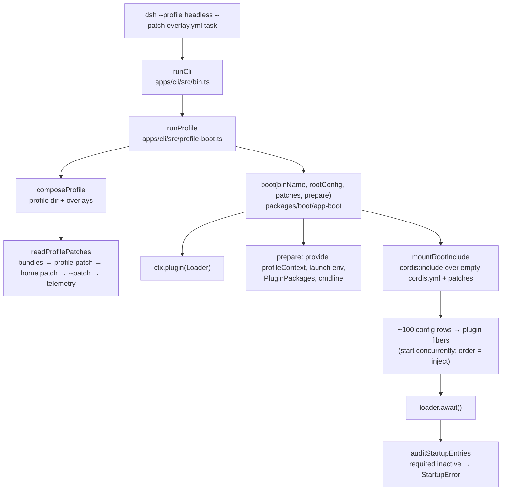
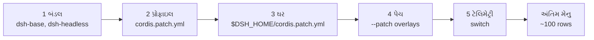
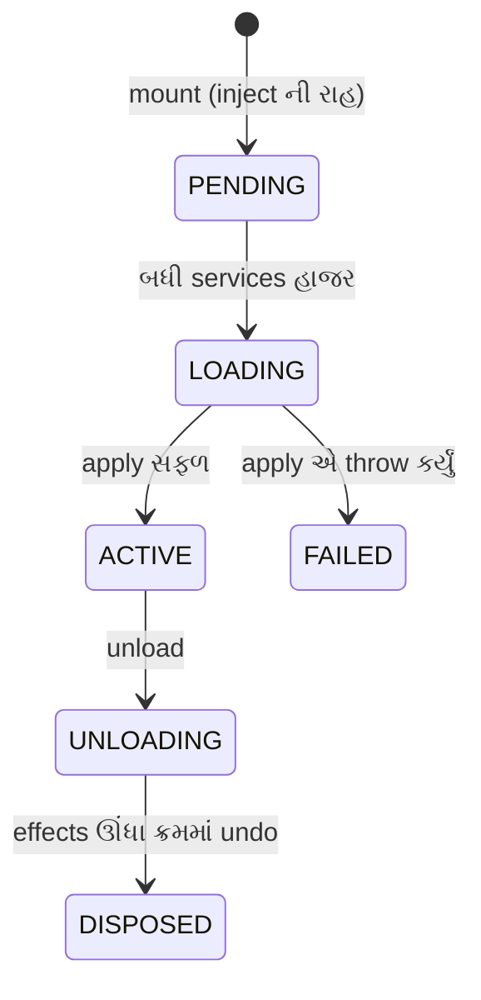
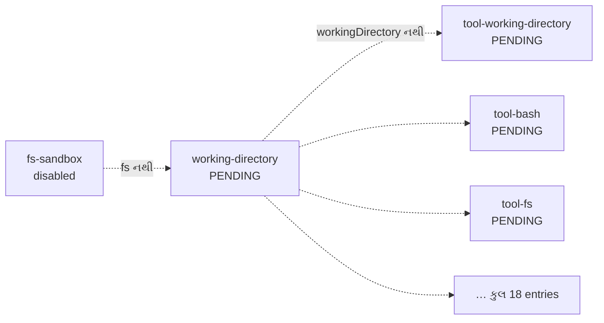

# પ્રકરણ 2 — Cordis અને plugin architecture

> **Level 2 · વાર્તાનો દિવસ 5–6.**
> પ્રકરણ 1 માં એક ઓર્ડર ચાલતો જોયો. આજે તેના પહેલાનો સમય: **startup** — ભોજનાલય ખૂલે છે કેવી રીતે.
> કાંતિકાકા સવારે જે નિયમોથી સ્ટાફને કામ પર લે છે, તે જ નિયમોથી Cordis plugins ને ચાલુ કરે છે. દરેક દૃશ્ય: 🎬 ઘટના → ❓ પ્રશ્ન → 💻 code માં → 🔬 expert નજર.
> આખો નકશો: [સમગ્ર નકશો](overview-samagra-naksho.md).

## 🎯 આ પ્રકરણ પછી તમે શું કરી શકશો

- Startup (એક વાર, process શરૂ થતાં) અને request execution (દરેક turn) ને અલગ ઓળખી, બંનેના માલિક code બતાવી શકશો.
- `profile → bundles → patch layers → cordis.yml rows → plugin fibers` ની સાંકળ `--dump-config` થી ખરેખર જોઈ શકશો.
- Context, service registration, dependency injection, effects, events, scope અને cleanup ને vendored Cordis source માં બતાવી શકશો.
- Required service ખૂટે ત્યારે શું થાય — warning કે fatal — તે આગાહી કરી, ચલાવીને સાબિત કરી શકશો.
- Tutorial ના એક race ને ઓળખી, તેને deterministic બનાવી શકશો.

## 🗺️ આજના બે દિવસનો નકશો

```mermaid
flowchart LR
  A["દૃશ્ય 1 બે ઘડિયાળ<br/>startup vs request"] --> B["દૃશ્ય 2 ક્રમ નહીં, શરત<br/>context, service, inject"]
  B --> C["દૃશ્ય 3 મેનુના પાંચ થર<br/>profile → patches → rows"]
  C --> D["દૃશ્ય 4–7 કાંતિકાકાના નિયમ<br/>Cordis ના પાંચ ઘટક"]
  D --> E["દૃશ્ય 8 માળખું vs ભોજનાલય<br/>Cordis vs Harness, scope"]
  E --> F["Lab 2a મેનુ છાપો"]
  F --> G["2b સામાન્ય રજા<br/>warning"]
  G --> H["2c પાયાની રજા<br/>fatal"]
  H --> I["2d ઉતાવળિયો ગ્રાહક<br/>race"]
```



---

## દૃશ્ય 1 — સવારે છ વાગ્યે: બે ઘડિયાળ

🎬 સવારે છ વાગ્યે શટર અડધું ખુલ્લું છે. ગ્રાહક એક પણ નથી, છતાં ભોજનાલયમાં દોડધામ છે: સ્ટાફ આવે છે, ચાવીઓ વહેંચાય છે, ચૂલા સળગે છે. આરવ ગઈ કાલની નોટબુક ખોલે છે — દસ સ્ટેશન — અને જુએ છે કે આજની દોડધામ એ દસમાંથી **એક જ લીટી** છે: સ્ટેશન 2, "ભોજનાલય ખૂલ્યું".

❓ "સવારની ભૂલ અને બપોરની ભૂલ એક જ જાતની હોય?"

"ના. સવારે રસોઇયો ન આવે તો **ભોજનાલય ખૂલે જ નહીં**. બપોરે એક ઓર્ડર બગડે તો **એ ઓર્ડર** બગડે; ભોજનાલય ચાલુ રહે. એટલે bug જોતાં પહેલો પ્રશ્ન: આ કઈ ઘડિયાળની ભૂલ છે?"

💻

| | Startup (સવાર) | Request execution (આખો દિવસ) |
|---|---|---|
| ક્યારે | process શરૂ થાય ત્યારે, એક વાર | દરેક user message પર, દરેક turn માં |
| કોણ ચલાવે | `apps/cli` launcher + Cordis Loader | `ReactLoopAgent` (agent-loop plugin) |
| શું બને | plugin tree, services, event listeners | session events, model requests, tool calls |
| નિષ્ફળતા | entry `PENDING`/`FAILED`; required હોય તો process exit 1 | turn `error`/`aborted`; tool `isError` |
| આ પુસ્તકમાં | આ પ્રકરણ | પ્રકરણ 1, 3, 5 |

**યાદ-ચાવી: "સવારે દુકાન ખૂલે (startup), આખો દિવસ ઓર્ડર (request)."**

🔬 **Expert નજર.** Table ની "નિષ્ફળતા" લીટી આખા પ્રકરણનું બીજ છે. Startup ની નિષ્ફળતા **structural** છે: કોઈ ભાગ હાજર જ નથી. Request ની નિષ્ફળતા **operational** છે: ભાગ હાજર છે, પણ આ વખતે કામ ન થયું. બંનેના નિદાનના સાધન જુદાં છે — સવાર માટે હાજરીપત્રક (startup audit), દિવસ માટે ચોપડો (session log).

## દૃશ્ય 2 — ક્રમ નથી, ફક્ત શરત: context, service, inject

🎬 મેનેજર **કાંતિકાકા** દરવાજે હાજરીપત્રક લઈને ઊભા છે. આરવ ધારે છે કે તે બોલશે: "પહેલા કોઠારી, પછી વેઈટર, પછી…". પણ કાંતિકાકા કોઈ ક્રમ નથી આપતા. બધા એકસાથે આવે છે. ફરક એટલો કે દરેકની એક **શરત** છે:

- રમેશભાઈ (વેઈટર): "નિયમોની પોથી, કોઠારી, અને ફોન — ત્રણેય હાજર હોય તો જ હું ઓર્ડર લઈશ."
- ભીખાભાઈ (કોઠારી): "કોઠારની ચાવી મળે તો જ."
- હિસાબનીશ: "ચોપડો હોય તો જ."

જેની શરત પૂરી થાય તે કામ પર ચડે; બાકીના બાંકડે બેસી રાહ જુએ. અને દીવાલ પર ખુરશીઓની હાર છે, દરેક પર તકતી: "કોઠારી", "ફોન", "ચોપડો". ખુરશી પર જે બેઠું હોય તે એ કામ કરે.

❓ "કાકા, ક્રમ લખી દો તો સહેલું ન પડે? 'પહેલા આ, પછી પેલો.'"

કાંતિકાકા: "સો જણનો ક્રમ કોણ યાદ રાખે? અને કાલે નવો માણસ આવે તો આખી યાદી ફરી લખવી? દરેકને પોતાની શરત ખબર છે. ક્રમ **આપોઆપ** નીકળી આવે."

💻 ચાર પાયાના શબ્દ, ચારેય આ દૃશ્યમાં:

- **Context** (`ctx`) = Cordis નો કેન્દ્રીય object, જેના પર services રહે છે — ખુરશીઓવાળી દીવાલ. ઉદાહરણ: `ctx.tools`, `ctx.llm`, `ctx.sessions`.
- **Service** = context પર એક સ્થિર નામે મુકાયેલી capability — તકતીવાળી ખુરશી. ઉદાહરણ: `ToolsService` પોતાને `tools` નામે register કરે છે.
- **Dependency Injection** = plugin ને જરૂરી service runtime દ્વારા મળવી — કર્મચારીની શરત. ઉદાહરણ: `export const inject = ['tools']` લખો, એટલે `ctx.tools` હાજર થાય ત્યારે જ `apply` ચાલે.
- **Effect** = undo કરી શકાય તેવી નોંધણી: plugin unload થાય ત્યારે તે આપોઆપ પાછી ખેંચાય. ઉદાહરણ: `ctx.tools.register(...)` એક **disposer** (undo-function) પાછો આપે છે. (દૃશ્ય 6 માં આખી ઘટના.)

રમેશભાઈની શરત source માં અક્ષરશઃ લખેલી છે: [`AgentLoop` `static inject = ['agents', 'sessions', 'llm', 'tools', 'systemPrompt', 'sessionProjections']`][agentloop-inject].

🔬 **Expert નજર.** આ design ને **declarative** કહેવાય: તમે "કેવી રીતે" (ક્રમ) નથી લખતા, "શું જોઈએ" (શરત) લખો છો; ક્રમ runtime કાઢે છે. ફાયદો: ~100 plugins માં કોઈ કેન્દ્રીય ક્રમ-યાદી નથી જે તૂટે. કિંમત: ક્રમ ફક્ત એ જ વસ્તુનો મળે જે **service** છે. જે service નથી, તેની રાહ `inject` જોઈ શકતું નથી — Lab 2d નો race બરાબર આ તિરાડમાંથી આવે છે.

## દૃશ્ય 3 — આજનું મેનુ: પાંચ થર

🎬 દરવાજાની બાજુમાં "આજનું મેનુ" ચોંટાડેલું છે. નજીકથી જોતાં આરવને દેખાય છે કે તે એક કાગળ નથી; **થર પર થર** છે:

1. સૌથી નીચે મુખ્ય કચેરીનાં છાપેલાં પાનાં.
2. તેના પર આ શાખાનું પાનું.
3. તેના પર પપ્પાની પોતાની કાયમી ચિઠ્ઠી.
4. તેના પર આજ સવારની ચિઠ્ઠીઓ — "આજે title લખનાર રજા પર."
5. અને ખૂણામાં એક નાની સ્વિચ-ચિઠ્ઠી.

છાપેલા પાનામાં લખ્યું છે "title લખનાર: હાજર". ઉપરની ચિઠ્ઠી કહે છે "રજા પર".

❓ "બે કાગળ ઊલટી વાત કહે છે. કોણ સાચું?"

"**સૌથી ઉપરનો** કાગળ. નીચેનાને કોઈ ફાડતું નથી; ઉપરનો તેને ઢાંકે છે."

💻 Startup ની આખી સાંકળ:



| Node | ભોજનાલયમાં | Owner | Symbol |
|---|---|---|---|
| runCli | દરવાજો | `apps/cli/src/bin.ts` | [`runCli`][cli-runCli] |
| runProfile | "આજે કઈ શાખા?" | `apps/cli/src/profile-boot.ts` | [`runProfile`][cli-runProfile] |
| composeProfile | શાખાનું folder + ચિઠ્ઠીઓ ભેગાં | same | [`composeProfile`][cli-composeProfile] |
| readProfilePatches | મેનુના થર ક્રમમાં ગોઠવવા | `packages/boot/app-boot/src/profile-context.ts` | [`readProfilePatches`][boot-readProfilePatches] |
| boot | ભોજનાલય ખોલવું | `packages/boot/app-boot/src/index.ts` | [`boot`][boot-boot] |
| mountRootInclude | મેનુ-વાચકને મેનુ આપવું | same | [`mountRootInclude`][boot-mountRootInclude] |
| auditStartupEntries | હાજરીપત્રક | same | [`auditStartupEntries`][boot-audit], [`requiredStartupEntryIds`][boot-required] |

આ diagram **lifecycle** બતાવે છે (શું પછી શું થાય), data flow નહીં.

થરનાં નામ:

- **Bundle** = config rows નું તૈયાર પેકેજ — મુખ્ય કચેરીનું છાપેલું પાનું. `dsh-base` = દરેક શાખામાં જોઈએ તે બધું; `dsh-headless` = parcel-શાખાના ફેરફાર.
- **Patch / overlay** = row ને **id** થી પકડી બદલતી, અથવા `insert` થી નવી row ઉમેરતી YAML — ચોંટાડેલી ચિઠ્ઠી.
- **Row / entry** = config ની એક લીટી = એક plugin.
- **Fiber** = mounted plugin નું ચાલતું રૂપ અને તેનું જીવનચક્ર — હાજરી-કાર્ડ (દૃશ્ય 5).

થરનો ક્રમ code માં એક જ જગ્યાએ લખેલો છે (repository code, [`readProfilePatches`][boot-readProfilePatches]):

```ts
  const patches = structuredClone([
    ...readBundlePatches(binName, context, initialProfile),
    ...(initialProfile?.patches ?? loadOptionalPatches(binName, context.patchPath) ?? []),
    ...(loadOptionalPatches(binName, join(context.home, PROFILE_PATCH_FILENAME)) ?? []),
    ...context.overlays,
  ])
```

(`...` એટલે "આ યાદીની બધી વસ્તુઓ અહીં પાથરો" — ચાર યાદીઓ એક લાંબી યાદીમાં, આ જ ક્રમે.)

એટલે ક્રમ: (1) profile ના `package.json` માં `dsh.profile.bundles` મુજબ bundle patches, (2) profile નું પોતાનું `cordis.patch.yml`, (3) `$DSH_HOME/cordis.patch.yml`, (4) `--patch` overlays argv ક્રમમાં, (5) telemetry switch. Patch row ને **id** થી પકડે છે અને આખો `config` બદલે છે, અથવા `insert` થી નવી rows ઉમેરે છે ([architecture.md](https://github.com/deepseek-ai/deepseek-harness/blob/fcc0ad462172522aaf5c93a7b2e01f6b9f0b0159/docs/architecture.md#profiles-and-bundles)). ✅



એક જ row (id) ને બે થર બદલે તો **પાછળનો થર જીતે**. એટલે તમારું `--patch` base ની ઉપર હોય છે.

**યાદ-ચાવી "બ-પ્રો-ઘ-પે-ટે" — "બપોરે ઘરે પેટી ટેબલ પર":** **બ**ંડલ, **પ્રો**ફાઇલ, **ઘ**ર (home), **પે**ચ, **ટે**લિમેટ્રી.

Headless profile ના પહેલા boot પર Harness આ file બનાવે છે (અમારા `$DSH_HOME/profiles/headless/package.json` માંથી) 🧪:

```json
  "dsh": {
    "profile": {
      "bundles": [
        "@deepseek-ai/dsh-base",
        "@deepseek-ai/dsh-headless"
      ]
    }
  }
```

### ખાલી પાટિયું, અને ફરી "બીજું ખાનું"

🎬 આરવ બધા થર ઉંચકીને નીચેનું પાટિયું જુએ છે. તે **ખાલી** છે. તેના પર ફક્ત ભોજનાલયનું સરનામું લખેલું છે.

💻 [`prepareProfile`](https://github.com/deepseek-ai/deepseek-harness/blob/fcc0ad462172522aaf5c93a7b2e01f6b9f0b0159/apps/cli/src/profile-boot.ts#L194-L200) દરેક boot પર profile નું `cordis.yml` ફરી `[]` લખે છે. આખું composition patches છે; ખાલી file ફક્ત Loader ને એક સાચું include root (અને `baseUrl`) આપે છે. ✅

આ જ કારણે overlay માં local plugin નો path **absolute** હોવો જોઈએ: patch file module ને **profile directory** સામે resolve કરે છે, patch file ની જગ્યા સામે નહીં ([docs/user/develop/basic/index.md](https://github.com/deepseek-ai/deepseek-harness/blob/fcc0ad462172522aaf5c93a7b2e01f6b9f0b0159/docs/user/develop/basic/index.md)). ✅ પ્રવેશ પ્રકરણની બિલ-બુક — "**કોના** બીજા ખાનામાંથી?" — નો જવાબ અહીં: પાટિયાના સરનામાથી, ચિઠ્ઠી જ્યાં પડી છે ત્યાંથી નહીં.

🔬 **Expert નજર.** "થર, અને ઉપરનો જીતે" એ design ને કારણે તમે harness નું વર્તન બદલવા **તેની એક પણ file બદલતા નથી**. આ પુસ્તકની દરેક lab એક ચિઠ્ઠી (`--patch`) છે. અને bug આવે ત્યારે expert અનુમાન નથી કરતો કે કયો થર જીત્યો; તે `--dump-config` થી **અંતિમ મેનુ છાપે** છે (Lab 2a), જેમાં દરેક row ઉપર તેનું મૂળ થર લખેલું હોય છે.

## દૃશ્ય 4 — એક ખુરશી પર બે જણ: service registration

🎬 આજે ભૂલથી બે કોઠારી આવી ગયા: ભીખાભાઈ, અને બીજી શાખાથી મોકલેલા એક ભાઈ. બંને "કોઠારી" ની ખુરશી તરફ જાય છે. આરવ ધારે છે કે જે પછી આવ્યો તે બેસી જશે. પણ કાંતિકાકા **તરત બૂમ પાડે છે** અને નામ દઈને કહે છે: "આ ખુરશી પર ભીખાભાઈ બેઠા છે!"

❓ "ચૂપચાપ એકને બેસવા દે તો શું વાંધો?"

"તો રમેશભાઈને ખબર જ ન પડે કે આજે સામાન કોણ આપે છે. અડધો દિવસ એક આપે, અડધો બીજો. આવી ભૂલ બપોરે પકડાય, એના કરતાં સવારે બૂમ સારી."

💻 Harness નું Cordis `vendor/cordis` માં vendored છે: version `4.0.0-rc.11`, upstream commit `0b96d9fd…` ([manifest][vendor-manifest]). Vendored copy માં લોગ કરેલા local modifications છે, જેમ કે V6 lifecycle hardening ([vendor/README.md][vendor-mods]). દૃશ્ય 4–7 માં અમે **vendored copy** વાંચી છે; upstream repository અલગથી inspect કરી નથી. ✅/⚠️

[`Service` constructor][cordis-service] અંતે `self.ctx.reflect.provide(name, self, this[symbols.check])` બોલાવે છે. [`ReflectService.provide`][cordis-provide]:

```ts
  provide(name: string, value?: any, check?: () => boolean) {
    return this.ctx.fiber.effect(() => {
      …
      if (this.store[key]) {
        throw new Error(`service "${name}" has been registered at <${this.store[key].ctx.fiber.name}>`)
      }
      this.store[key] = impl
```

એક જ નામે બીજો provider આવે તો સ્પષ્ટ error — "last one wins" નહીં. ✅ અને error માં પહેલા provider નું નામ છે — કાંતિકાકાની બૂમ.

🔬 **Expert નજર.** બીજી line ફરી વાંચો: આખું કામ `this.ctx.fiber.effect(...)` ની **અંદર** છે. એટલે ખુરશી પર બેસવું પોતે એક effect છે: plugin unload થાય, તો ખુરશી આપોઆપ ખાલી થાય. અને દૃશ્ય 3 સાથે સરખાવો: config rows માં "ઉપરનો થર જીતે", પણ services માં "બીજો આવે તો error". બે જગ્યા, બે જુદા નિયમ — કારણ કે મેનુ બદલવું ઇરાદાપૂર્વક હોય છે, જ્યારે બે જણ એક ખુરશી પર લગભગ હંમેશા ભૂલ હોય છે.

## દૃશ્ય 5 — હાજરી-કાર્ડ: fiber

🎬 કાંતિકાકાના હાથમાં દરેક કર્મચારીનું એક **હાજરી-કાર્ડ** છે, અને કાર્ડ પર એક ખાનું વારંવાર બદલાય છે: "બાંકડે" → "તૈયાર થાય છે" → "કામ પર". એક છોકરો યુનિફોર્મ પહેરતાં લપસી પડ્યો; તેના કાર્ડ પર લખાયું "બીમાર".

❓ "'નથી આવ્યો' અને 'બીમાર પડ્યો' — બંને ગેરહાજર જ છે ને?"

"ના. **બાંકડે** બેઠેલો કોઈકની રાહ જુએ છે — સાધન આવે તો તરત ચડે. **બીમાર** ને રાહ જોવાથી કંઈ નહીં થાય; તેને સારવાર જોઈએ. હું કાર્ડ વાંચીને નક્કી કરું છું કે રાહ જોવી કે દવા કરવી."

💻 દરેક mounted plugin નું runtime એક **Fiber** છે. [`FiberState`][cordis-fiberstate]:



(⚠️ teaching ચિત્ર: છ states સાચાં છે ✅, પણ transitions સરળ કર્યાં છે — દા.ત. reload અને service ફરી જાય ત્યારે `ACTIVE` થી પાછા `PENDING` નો માર્ગ અહીં બતાવ્યો નથી. ખરું વર્તન [`FiberState`][cordis-fiberstate] અને [`effect`][cordis-effect] ની આસપાસના source માં.)

| State | કાર્ડ પર | અર્થ |
|---|---|---|
| `PENDING` | બાંકડે | જરૂરી services ની રાહ |
| `LOADING` | તૈયાર થાય છે | `apply` ચાલે છે |
| `ACTIVE` | કામ પર | `apply` સફળ |
| `FAILED` | બીમાર | `apply` એ throw કર્યું |
| `UNLOADING` | જાય છે | effects undo થઈ રહ્યા છે |
| `DISPOSED` | ગયો | બધું પાછું ખેંચાયું |

[`RegistryService.plugin`][cordis-plugin] `new Fiber(this.ctx, config, Inject.resolve(plugin.inject), runtime, …)` બનાવે છે — `inject` ની યાદી (શરત) અહીં fiber ને સોંપાય છે.

🔬 **Expert નજર.** "Plugin ચાલતો નથી" એ ફરિયાદ નથી, અધૂરી માહિતી છે. `PENDING` હોય તો પ્રશ્ન "**કઈ service** ની રાહ છે?" અને જવાબ configuration માં છે. `FAILED` હોય તો પ્રશ્ન "`apply` માં **શું ફેંકાયું**?" અને જવાબ તમારા code માં છે. પ્રકરણ 0 ની ફરિયાદ-પેટીમાં તમે `./hello.ts -> FAILED` જોયું હતું; Lab 2b માં `pending (waiting for service: fs)` જોશો.

## દૃશ્ય 6 — નોકરી છોડતો કર્મચારી: effects અને cleanup

🎬 ફરસાણવાળા ભાઈ આજે બપોરે નોકરી છોડે છે. સવારે આવીને તેમણે ક્રમમાં ત્રણ કામ કર્યાં હતાં: કાઉન્ટર લીધું, કાઉન્ટર પર તવો ગોઠવ્યો, તવા પર તેલ ચડાવ્યું. જતી વખતે કાંતિકાકા તેમના કાર્ડની પાછળ લખેલી **ઉધાર-પહોંચો** ઊંધા ક્રમમાં ઉતારે છે: પહેલાં તેલ ઉતાર્યું, પછી તવો, પછી કાઉન્ટર પાછું.

❓ "ઊંધો ક્રમ કેમ? જે ક્રમે લીધું એ ક્રમે પાછું ન અપાય?"

"પહેલાં કાઉન્ટર પાછું લઈ લઉં, તો તવો ક્યાં ઊભો રહે? પછીની વસ્તુ પહેલાંની પર ટકેલી છે."

અને જતાં જતાં એ ભાઈ બોલ્યા: "એક નવી કડાઈ લઈ લઉં?" કાંતિકાકા: "જતા માણસને નવો ઉધાર નહીં."

💻 [`Fiber.effect`][cordis-effect] setup ચલાવે છે અને disposers ભેગા કરે છે; unload વખતે તેમને **ઊંધા ક્રમમાં** ચલાવે છે (`disposables.splice(0).reverse()`). `UNLOADING` દરમિયાન નવું effect બનાવવું `INACTIVE_EFFECT` error આપે છે. ✅

**LIFO** (Last In, First Out) = છેલ્લે આવ્યું તે પહેલાં જાય. **યાદ-ચાવી: "પાછળથી ચડ્યો, પહેલો ઊતરે."**

🔬 **Expert નજર.** પ્રકરણ 0 નું વાક્ય — "plugin unload થતાં પોતાની નોંધણી પાછી ખેંચી લે" — અહીં mechanism બને છે. Plugin લખનારે cleanup **યાદ રાખવાનું નથી**; નોંધણી કરતી વખતે જ પહોંચ બને છે, અને unload વખતે runtime પોતે ઉતારે છે. Harness આને નિયમ બનાવે છે: "Registrations are effects" — દરેક `register()` disposer પાછો આપે ([AGENTS.md][agents-conventions]). તમારો plugin effect ની બહાર કંઈ નોંધે (દા.ત. સીધો global array માં ઉમેરે), તો તે આ સલામતીની બહાર છે, અને unload પછી "ભૂત" રહી જાય.

## દૃશ્ય 7 — પાંચ ઘંટડી: events

🎬 ભોજનાલયમાં પાંચ જુદી ઘંટડી છે, અને દરેકનો અર્થ જુદો. આરવ એક દિવસ ખોટી ઘંટડી વગાડે છે: "કોને ખબર છે ખાંડ ક્યાં છે?" માટે તેણે "બધા આવો" વાળી ઘંટડી વગાડી. આખો સ્ટાફ દોડી આવ્યો.

❓ "ઘંટડી તો ઘંટડી. ફરક શું?"

"ઘંટડી કહે છે કે **જવાબ કેવી રીતે ભેગો થશે**. એક જણનો જવાબ પૂરતો છે? બધાનો જોઈએ? કે જવાબ જોઈતો જ નથી?"

💻 [`EventsService.on`][cordis-on] listener ઉમેરે છે (પોતે effect તરીકે), અને પાંચ dispatch modes આપે છે ([primer table][primer-dispatch]):

| Mode | અર્થ | ભોજનાલયમાં |
|---|---|---|
| `emit` | ફક્ત જાણ; જવાબની રાહ નહીં | "નવો ઓર્ડર!" ની બૂમ |
| `waterfall` | `next()` વાળી સાંકળ (પ્રવેશ પ્રકરણનું `waterfall.mjs`) | ચિઠ્ઠી હાથોહાથ: ચોકીદાર → મેનેજર → રસોડું |
| `serial` | એક પછી એક, બધાની રાહ | વારાફરતી |
| `parallel` | બધા એકસાથે | બધા એકસાથે દોડે |
| `bail` | પહેલો જવાબ આપે ત્યાં અટકો | "કોઈને ખબર છે?" — પહેલો જવાબ પૂરતો |

Event નો dispatch mode તેના public contract નો ભાગ છે; harness events `@mode` JSDoc tag થી જાહેર કરે છે, જેમ કે `agent/pre-step` એ `@mode waterfall` ([runtime-types.ts][agent-events]). ✅

અને પાંચમો ઘટક, **Loader અને Include** — મેનુ-વાચક: Loader YAML rows ને entries બનાવે છે; Include file વાંચે છે અને patches લાગુ કરે છે; `!!js` expressions `config` અને `disabled` માં જ evaluate થાય છે ([primer — Loader configuration](https://github.com/deepseek-ai/deepseek-harness/blob/fcc0ad462172522aaf5c93a7b2e01f6b9f0b0159/docs/cordis-primer.md#loader-configuration)). ✅

**Cordis ના પાંચ ઘટક — યાદ-ચાવી "સે-ફા-ઈ-ઇ-લો":** **સે**વા નોંધણી (દૃશ્ય 4), **ફા**ઇબર (5), **ઈ**ફેક્ટ (6), **ઇ**વેન્ટ (7), **લો**ડર (7).

🔬 **Expert નજર.** Listener લખતાં પહેલાં event નો `@mode` વાંચો — તે નક્કી કરે છે કે તમારી **જવાબદારી** શું છે. `emit` માં તમે ફક્ત સાંભળો છો; કશું બગાડી શકતા નથી. `waterfall` માં તમે સાંકળની એક કડી છો: `next()` ભૂલો, તો પાછળનું બધું અટકે (પ્રવેશ પ્રકરણનો ભૂલકણો ચોકીદાર). એક જ `ctx.on(...)` syntax, પણ જોખમ જમીન-આસમાન.

## દૃશ્ય 8 — ખાલી ઇમારત અને ચાલતું ભોજનાલય: Cordis vs Harness

🎬 બાજુની ગલીમાં એ જ chain ની નવી શાખા બને છે. ઇમારત તૈયાર છે: ખુરશીઓ, હાજરી-કાર્ડનું ખાનું, ઉધાર-ચોપડી, ઘંટડીઓ, મેનુનું પાટિયું. પણ એક પણ કર્મચારી નથી, એક પણ વાનગી નથી.

❓ "એ ઇમારત ભોજનાલય છે?"

"ના. એ **માળખું** છે — ગમે તે ધંધો તેમાં ચાલી શકે. ભોજનાલય ત્યારે બને જ્યારે નક્કી થાય કે **કયા** કર્મચારી, **કયું** મેનુ, અને કોણ ન આવે તો તાળું."

💻

| Cordis (vendor/) — માળખું | Harness (packages/, apps/) — ભોજનાલય |
|---|---|
| `Context`, service store, `provide`/`inject` | **કયા** services: `tools`, `llm`, `sessions`, `agents`, `fs`, `sandboxPolicy`, … |
| Fiber lifecycle, effects, ઊંધા ક્રમમાં disposal | "Registrations are effects" નિયમ: દરેક `register()` disposer પાછો આપે ([AGENTS.md][agents-conventions]) |
| Event dispatch modes | Event vocabulary: `session/event`, `agent/*`, `tools/*`, `llm/stream`, દરેક `@mode` સાથે |
| Loader, Include, patches by id, `!!js` | Profiles, bundles, થરનો ક્રમ, `--dump-config`, ખાલી root config |
| Entry fails/pends — logger દ્વારા report | Startup audit: required entry inactive → `StartupError`, exit 1 ([`boot-required`][boot-required]) |
| `isolate` realms (group rows) | Agent presets, per-agent **scope**: [`createScope`][scope-create], [`scopeTarget`][scope-target], [`scopeChainOf`][scope-chain] |

છેલ્લી લીટીની ઘટના: ટેબલ 4 પર આજે ખાસ મહેમાન છે, અને પપ્પાએ તેમના માટે **અલગ કોઠારી** રાખ્યો છે. રમેશભાઈ ટેબલ 4 નો ઓર્ડર લે ત્યારે પહેલાં પૂછે: "આ ટેબલનો ખાસ કોઠારી છે?" હોય તો તે; ન હોય તો ભીખાભાઈ; એ પણ ન હોય તો ઓર્ડર અટકે.

**Scope** = એક context જેની નોંધણીઓ એક opaque identity (દા.ત. એક Agent) સાથે tag થાય — "ટેબલ 4 માટે ખાસ". `ctx.tools` નું executor selection પહેલાં agent ના scope chain માં શોધે છે, પછી root default ([`selectExecutor`][tools-selectExecutor]):

```ts
    for (const key of scopeChainOf(scope)) {
      record = this.scoped.get(key)
      if (record !== undefined) break
    }
    record ??= this.root
    const executor = record?.executor
    if (executor === undefined) throw new ToolExecutorUnavailableError()
```

(`??=` એટલે "હજી કંઈ ન મળ્યું હોય તો આ મૂકો.") છેલ્લી line યાદ રાખો — Lab 2d માં આ જ error આવશે.

🔬 **Expert નજર.** "આ વર્તન Cordis નું છે કે Harness નું?" એ પ્રશ્ન ફક્ત જિજ્ઞાસા નથી. Bug Cordis માં હોય તો તે `vendor/` માં છે, અને ત્યાંના local ફેરફાર [vendor/README.md][vendor-mods] માં નોંધાયેલા છે. Harness માં હોય તો `packages/` માં. સુધારો ક્યાં મોકલવો, કોને પૂછવું, કયા tests ચલાવવા — બધું આ એક જવાબ પર નક્કી થાય. પ્રકરણ 6 માં maintainer તરીકે આ ભેદ રોજ કામ આવશે.

## Source map: આ ક્રમમાં ખોલો

| ક્રમ | File | Symbol | Input → Output (side effect) |
|---|---|---|---|
| 1 | `apps/cli/src/profile-boot.ts` | [`runProfile`][cli-runProfile] | options → root `Context` (signals, fail-loud) |
| 2 | `packages/boot/app-boot/src/profile-context.ts` | [`readProfilePatches`][boot-readProfilePatches] | profile → ordered `PatchOptions[]` |
| 3 | `packages/boot/app-boot/src/index.ts` | [`boot`][boot-boot] | config path + patches → settled tree |
| 4 | same | [`mountRootInclude`][boot-mountRootInclude] | → bootstrap `cordis:include` entry |
| 5 | same | [`auditStartupEntries`][boot-audit] | settled tree → throw / warn |
| 6 | `vendor/cordis/src/service.ts` | [`Service`][cordis-service] | → `reflect.provide` |
| 7 | `vendor/cordis/src/reflect.ts` | [`provide`][cordis-provide] | → service store (effect) |
| 8 | `vendor/cordis/src/fiber.ts` | [`FiberState`][cordis-fiberstate], [`effect`][cordis-effect] | lifecycle, disposal |
| 9 | `packages/core/scope/src/index.ts` | [`createScope`][scope-create] | per-agent tagging |

---

## 🧪 Lab 2 (દિવસ 6) — ચાર પ્રયોગ

🎬 બીજા દિવસે મીરાદીદી કહે છે: "ગઈ કાલે તેં કાંતિકાકાને જોયા. આજે તું કાંતિકાકાને **પરીક્ષામાં મૂકીશ**. ચાર પ્રયોગ: મેનુ છાપ, એક સામાન્ય કર્મચારીને રજા આપ, એક પાયાના કર્મચારીને રજા આપ, અને છેલ્લે એક ઉતાવળિયો ગ્રાહક મોકલ."

### 2a. આજનું પૂરું મેનુ છાપો — composition dump

```bash
DSH_HOME=$PWD/tmp/book-home pnpm dsh --profile headless --dump-config > tmp/dump.yml
```

(`DSH_HOME=…` = ફક્ત આ command માટે environment variable — પ્રવેશ દૃશ્ય 2; `$PWD` = હાલનું folder; `>` = output file માં.)

🧪 અમારું પરિણામ: exit 0, 395 lines, **101** top-level rows ([evidence/dump.yml](../evidence/dump.yml)). દરેક block ઉપર તેનું મૂળ થર લખેલું છે:

```yaml
# == @deepseek-ai/dsh-base
- id: timer
  name: '@deepseek-ai/cordis-plugin-timer'
# == @deepseek-ai/dsh-base, patched by @deepseek-ai/dsh-headless
- id: hmr
  name: '@deepseek-ai/dsh-hmr'
  disabled: true
```

બીજો block દૃશ્ય 3 નો પુરાવો છે: base પાનામાં `hmr` હતું; headless થરે તેને `disabled: true` કર્યું — "parcel શાખામાં આ કાઉન્ટર બંધ". અને comment કહે છે કોણે ઢાંક્યું.

**તપાસો:** `tools`, `tool-executor-native`, `agent-loop`, `fs-sandbox`, `llm-deepseek`, `session-title-llm`, `session-log-deepseek` rows શોધો અને દરેકનું મૂળ થર લખો.

### 2b. સામાન્ય રજા — optional service ખૂટે: warning, app ચાલુ

🎬 આરવ કોઠારની **ચાવી રાખનાર** ને રજા આપે છે. **પહેલાં ધારો:** કેટલા જણ બાંકડે બેસશે? એક? બે?

💻 `fs` service (કોઠારની ચાવી) નો provider `fs-sandbox` row છે. તેને disable કરતું overlay:

```yaml
- id: fs-sandbox
  disabled: true
```

ચલાવો (કોઈ પણ task):

```bash
DSH_HOME=$PWD/tmp/book-home pnpm dsh --profile headless --patch /abs/path/nofs.yml "hi"
```

🧪 Stderr ([evidence/nofs.err](../evidence/nofs.err)):

```text
dsh: warning: 18 entries did not activate
working-directory (@deepseek-ai/dsh-working-directory): pending (waiting for service: fs)
tool-working-directory (@deepseek-ai/dsh-tool-working-directory): pending (waiting for service: workingDirectory)
tool-bash (@deepseek-ai/dsh-tool-bash): pending (waiting for service: workingDirectory)
tool-fs (@deepseek-ai/dsh-tool-fs): pending (waiting for services: fs, workingDirectory)
…
```

**અઢાર.** આરવ ચોંકે છે: "મેં એક જ જણને રજા આપી હતી!"



આ **cascade** છે: નીચે તરફ ફેલાતી અસર. `fs` નથી → `working-directory` બાંકડે → જે-જે `workingDirectory` inject કરે તે બધા બાંકડે. ચાવીવાળો નથી, તો જેને ચાવી જોઈએ તે બેઠા; અને જેને **એ બેઠેલા** જોઈએ તે પણ બેઠા.

પણ આ અઢારમાં એકેય required યાદીમાં નથી, તેથી ફક્ત warning; app ચાલુ રહે છે — file tools વગર. (આ run પછી network ન હોવાથી `TRANSPORT` error થી પૂરો થયો; તે અલગ વાત છે — પ્રકરણ 1 નું 🩺.)

### 2c. પાયાની રજા — required service ખૂટે: startup fatal

🎬 હવે આરવ **નિયમોની પોથી રાખનાર** ને રજા આપે છે. કાંતિકાકા હાજરીપત્રક જોઈને શટર પાછું પાડી દે છે: "રમેશભાઈ બાંકડે છે. આજે ભોજનાલય ખૂલે નહીં."

💻 `system-prompt` row disable કરો. 🧪 Exit 1, stderr ([evidence/nosp.err](../evidence/nosp.err)):

```text
dsh: startup failed: 2 required plugins did not activate

Plugins waiting for services (29):
  Plugin                           Missing services
  tool-executor-native (required)  tools
  agent-loop (required)            tools, systemPrompt
  …
```

કેમ? `tools` પોતે `systemPrompt` inject કરે છે, તેથી `tools` આવતું નથી; અને દૃશ્ય 2 માં જોયેલી રમેશભાઈની શરતમાં `tools` અને `systemPrompt` બંને છે ([`inject`][agentloop-inject]). `agent-loop` અને `tool-executor-native` બંને [`requiredStartupEntryIds`][boot-required] માં છે, એટલે [`auditStartupEntries`][boot-audit] `StartupError` ફેંકે છે. Process exit 1 પહેલાં headless runner પણ એક line છાપે છે: `dsh: no agent factory registered (load an agent-loop plugin)`. 🧪

**Required entry** = inactive હોય તો startup નિષ્ફળ જાય તેવી row — પાયાની ઈંટ: રમેશભાઈ (agent-loop) અને ભીખાભાઈ (executor).

**યાદ-ચાવી: "એક ઈંટ ખેંચો, દીવાલ જુઓ."** ઈંટ શણગારની હોય તો ખૂણો ખાલી (warning); પાયાની હોય તો ઘર પડે (exit 1).

🔬 **Expert નજર (2b + 2c).** બંને પ્રયોગમાં mechanism **એક જ** છે: ખૂટતી service → pending cascade. ફરક ફક્ત એટલો કે cascade કોઈ required entry સુધી પહોંચ્યો કે નહીં. અને Cordis ને "required" ની ખબર જ નથી — તે ફક્ત pending નોંધે છે. "કોણ ન આવે તો તાળું" એ **Harness નો નિર્ણય** છે (દૃશ્ય 8 ની table, પાંચમી લીટી). 2b નું વર્તન પણ ધ્યાનથી જુઓ: harness અધૂરી હાલતમાં **ચાલુ થયું**, ચેતવણી સાથે. એ સગવડ છે અને જોખમ પણ: warning ન વાંચો, તો "file tools કેમ નથી?" શોધવામાં કલાક જાય.

### 2d. ઉતાવળિયો ગ્રાહક — tutorial નો race

🎬 શટર ઊંચું થતાં જ એક ગ્રાહક અંદર ધસી આવે છે અને ઓર્ડર આપે છે. રમેશભાઈ હાજર છે, ઓર્ડર લે છે, કોઠાર તરફ જાય છે — પણ ભીખાભાઈ હજી રસ્તામાં છે. ઓર્ડર નિષ્ફળ. બીજા દિવસે એ જ ગ્રાહક, એ જ સમયે: ભીખાભાઈ બે મિનિટ વહેલા આવી ગયા હતા. ઓર્ડર સફળ.

❓ "એક જ ઓર્ડર, એક દિવસ નિષ્ફળ, એક દિવસ સફળ?"

💻

- **Race condition** = પરિણામ "કોણ પહેલાં પહોંચ્યું" તેના પર આધાર રાખે; ક્યારેક સફળ, ક્યારેક નિષ્ફળ.
- **Deterministic** = એ જ input → હંમેશા એ જ પરિણામ; નસીબ પર કંઈ નહીં.

Cordis tutorial ના પ્રકરણ 7 ની composition ([source][tutorial-07]):

```yaml
- name: '@deepseek-ai/dsh-system-prompt'
- name: '@deepseek-ai/dsh-tools'
- name: './tool-logger.ts'
- name: './greet-tool.ts'
```

Pinned commit પર આ **નિષ્ફળ** જાય છે 🧪:

```text
ToolExecutorUnavailableError: The selected tool executor is unavailable. Load an executor in this composition before running the agent.
  code: 'TOOL_EXECUTOR_UNAVAILABLE'
```

દૃશ્ય 8 ના code ની છેલ્લી line. કારણ: `ctx.tools.execute` executor ને સોંપે છે ([`execute`][tools-execute] → [`selectExecutor`][tools-selectExecutor]), અને tutorial ની yml કોઈ executor mount કરતી નથી. ઉપાય: `- name: '@deepseek-ai/dsh-tool-executor-native'` row ઉમેરો.

પણ ધ્યાન: તે row `greet-tool.ts` **પછી** મૂકો તો ફરી એ જ error 🧪, અને **પહેલાં** મૂકો તો સફળ 🧪. Tutorial પોતે કહે છે કે rows concurrently start થાય છે અને list position કંઈ guarantee કરતી નથી.

આરવ: "પણ `greet-tool` ની શરત (`inject`) છે ને? તે કોઠારીની રાહ કેમ ન જુએ?"

"તેની શરત `tools` છે — **કોઠાર**, કોઠારી નહીં. અને કોઠારી ખુરશી પર બેસતો જ નથી." `greet-tool` ફક્ત `tools` inject કરે છે; executor **service નથી** (તે `ctx.tools.setExecutor(...)` થી નોંધાય છે), તેથી `inject` તેની રાહ જોઈ શકતું નથી, અને `apply` અંદરનો demo call race જીતે કે હારે.

⚠️ **વાર્તા અને technical વચ્ચે ફરક:** કાગળના મેનુમાં ઉપર લખેલી વાનગી પહેલાં વંચાય. `cordis.yml` માં ઉપર લખેલી row પહેલાં load થાય એવું **નથી**. બધી rows **એકસાથે** શરૂ થાય છે; ક્રમ ફક્ત `inject` થી આવે છે — અને `inject` ફક્ત **services** ની રાહ જોઈ શકે.

Deterministic ઉપાય: **"બધા આવી જાય પછી જ પહેલો ઓર્ડર."** (book lab code, [labs/cordis-basics/greet-tool-settled.ts](../labs/cordis-basics/greet-tool-settled.ts)) — demo call પહેલાં Loader ના આખા tree ના settle થવાની રાહ:

```ts
  void (async () => {
    // changed: wait until every config row has settled, so an executor row listed
    // later in cordis.yml has activated before the demo call selects it.
    await ctx.get('loader')?.await()
    const result = await ctx.tools.execute({ … })
```

Executor row **છેલ્લે** હોય તો પણ 3/3 runs સફળ, Gujarati greeting સાથે 🧪:

```text
[tool-logger] greet -> નમસ્તે, Cordis!
tool replied: [{"type":"text","text":"નમસ્તે, Cordis!"}]
```

ચલાવવા માટે (harness root થી):

```bash
cd tmp/book-labs/cordis-basics && cp cordis.executor-last.yml cordis.yml && node --import tsx ../../../vendor/cordis/bin.js
```

🔬 **Expert નજર.** Race નો ખોટો ઉપાય "row ઉપર ખસેડો" છે: આજે ચાલે, કાલે machine ધીમું હોય તો તૂટે. ("મારા machine પર તો ચાલે છે" એ race ની સહી છે.) સાચો ઉપાય નસીબ કાઢી નાખે છે: કાં તો જેની જરૂર છે તેને service બનાવી `inject` કરો, કાં તો સ્પષ્ટ **settle point** ની રાહ જુઓ (`loader.await()`). અને ઉપાય સાબિત કરવા **ખરાબમાં ખરાબ ગોઠવણ** (executor છેલ્લે) માં ઘણી વાર ચલાવો — 3/3. એક વાર ચાલ્યું એ race માટે પુરાવો નથી. સાચું launcher પણ settle point વાપરે છે: દૃશ્ય 3 ના diagram માં `loader.await()` **પછી** જ હાજરીપત્રક (audit) તપાસાય છે.

## 🔮 આગાહી કસોટી

2b માં `fs-sandbox` (ચાવી) ને બદલે `working-directory` row disable કરો — cascade ની **વચ્ચેની** કડી.

**ચલાવતા પહેલાં લખો:** (1) warning માં કેટલી entries હશે — 18 કરતાં વધુ, ઓછી, કે સરખી? (2) `tool-fs` ની "missing services" યાદીમાં શું હશે? (3) Startup fatal થશે? (સંકેત: 2b ના cascade ચિત્રમાં કઈ ઈંટ હવે ખેંચી?)

જવાબ: [પરિશિષ્ટ D — Lab 2](../appendix/D-lab-solutions.md#lab-2).

## 🩺 નિષ્ફળતા: "મારા કર્મચારીને દરવાજેથી પાછો કાઢ્યો?"

🎬 આરવ પોતાનો નાનો plugin એક ચિઠ્ઠી (overlay) થી ઉમેરે છે. Harness શરૂ થાય છે, બધું સામાન્ય લાગે છે — પણ plugin નું નામોનિશાન નથી. કોઈ error નથી.

💻 **લક્ષણ.** Overlay માં `name: './src/my-plugin.ts'` (relative path) લખ્યું. Web/headless શરૂ થાય છે, plugin નું કંઈ દેખાતું નથી.

**નિદાન — ચાર પ્રશ્નો: "હાજરી, સરનામું, મેનુ, શરત":**

1. **હાજરીપત્રકમાં શું લખ્યું?** Startup stderr માં `dsh: warning: N entries did not activate` શોધો — `dsh` launcher inactive entries નું વર્ણન છાપે છે ([`auditStartupEntries`][boot-audit]).
2. **સરનામું absolute છે?** Relative path profile directory સામે resolve થાય છે, overlay file સામે નહીં (દૃશ્ય 3).
3. **મેનુમાં લીટી છે?** `--dump-config --patch <overlay>` થી તમારી row અંતિમ tree માં છે અને `disabled` નથી તે ચકાસો.
4. **શરત પૂરી થઈ શકે?** Plugin ની `inject` યાદીની દરેક service ને `--dump-config` માં provider row છે કે નહીં તે જુઓ.

🔬 **Expert નજર.** ચારેય પ્રશ્ન આ પ્રકરણના એક-એક દૃશ્ય છે: હાજરી = fiber state (5), સરનામું = ખાલી પાટિયું (3), મેનુ = થર (3), શરત = inject (2). નિદાન એ યાદ રાખેલી checklist નથી; તે system નું mental model છે, પ્રશ્નના રૂપમાં.

<a id="saral-samaj"></a>

## ✅ સાર — આરવની નોટબુક, દિવસ 5–6

**એક વાક્યમાં:** ભોજનાલય સવારે આમ ખૂલે છે — "આજનું મેનુ" પાંચ થરમાંથી બને (ઉપરનો જીતે), કાંતિકાકા (Cordis) દરેક કર્મચારીને (plugin) ત્યારે જ કામ પર લે જ્યારે તેની શરત (`inject`) પૂરી થાય, અને અંતે હાજરીપત્રક (startup audit) તપાસાય — પાયાનો કર્મચારી ગેરહાજર તો તાળું.

### આઠ ઘટના, આઠ નિયમ

| ઘટના | નિયમ | Code |
|---|---|---|
| બે ઘડિયાળ | Startup અને request અલગ સમય, અલગ નિષ્ફળતા | `boot` vs `ReactLoopAgent` |
| ક્રમ નહીં, શરત | ક્રમ ફક્ત `inject` થી; rows એકસાથે શરૂ થાય | [`inject`][agentloop-inject] |
| મેનુના પાંચ થર | બંડલ → પ્રોફાઇલ → ઘર → પેચ → ટેલિમેટ્રી; પાછળનો જીતે | [`readProfilePatches`][boot-readProfilePatches] |
| એક ખુરશી પર બે જણ | Duplicate service = error, નામ સાથે | [`provide`][cordis-provide] |
| હાજરી-કાર્ડ | `PENDING` (રાહ) ≠ `FAILED` (throw) | [`FiberState`][cordis-fiberstate] |
| નોકરી છોડતો કર્મચારી | Registrations are effects; disposal LIFO | [`effect`][cordis-effect] |
| પાંચ ઘંટડી | Dispatch mode = event નો contract | [primer][primer-dispatch] |
| ટેબલ 4 નો ખાસ કોઠારી | Scope chain પહેલાં, root પછી, નહીં તો error | [`selectExecutor`][tools-selectExecutor] |

### નવા ટેકનિકલ શબ્દો

| શબ્દ | અર્થ | ઉદાહરણ | ભોજનાલયમાં |
|---|---|---|---|
| Startup | process શરૂ થતાં plugin tree બનવું | `boot()` | દુકાન ખૂલવી |
| Profile | bundles + patches નું નામવાળું composition | `headless` | શાખા |
| Bundle | config rows નું તૈયાર પેકેજ | `dsh-base` | છાપેલું મેનુ-પાનું |
| Patch / overlay | row ને id થી બદલતી/ઉમેરતી YAML | `disabled: true` | ચિઠ્ઠી |
| Row / entry | config ની એક લીટી = એક plugin | `- id: tools` | મેનુ લીટી |
| `--dump-config` | અંતિમ composition છાપવું | 101 rows | આજનું પૂરું મેનુ |
| Context (`ctx`) | services રાખતો Cordis object | `ctx.tools` | ખુરશીઓવાળી દીવાલ |
| Service | `ctx` પર નામવાળી સેવા | `ctx.fs` | તકતીવાળી ખુરશી |
| Dependency Injection | plugin ને જરૂરી service runtime આપે | `inject = ['tools']` | શરત |
| Fiber | plugin નું runtime અને જીવનચક્ર | `FAILED` | હાજરી-કાર્ડ |
| Effect / disposer | undo થઈ શકે તેવી નોંધણી / undo-function | `register()` નો return | ઉધારની પહોંચ |
| Pending | જરૂરી service ની રાહ | `waiting for service: fs` | બાંકડે બેઠેલો |
| Cascade | ખૂટતી service ની નીચે ફેલાતી અસર | 18 entries | એક ગેરહાજર, અઢાર બાંકડે |
| Required entry | inactive હોય તો startup fail | `agent-loop` | પાયાની ઈંટ |
| Scope | agent દીઠ registrations નો અલગ ખૂણો | `createScope` | ટેબલ 4 માટે ખાસ |
| Race condition | પરિણામ ચાલવાના ક્રમ પર આધાર રાખે | tutorial ch.7 | ઉતાવળિયો ગ્રાહક |
| `!!js` | YAML માં JavaScript expression | `!!js process.cwd()` | મેનુમાં ગણતરી |

### યાદ-ચાવીઓ

- **"સવારે દુકાન, દિવસે ઓર્ડર"** — startup vs request.
- **"બપોરે ઘરે પેટી ટેબલ પર"** — થરનો ક્રમ; પાછળનો જીતે.
- **"સે-ફા-ઈ-ઇ-લો"** — Cordis ના પાંચ ઘટક.
- **"એક ખુરશી, એક માણસ"** — duplicate service error.
- **"પાછળથી ચડ્યો, પહેલો ઊતરે"** — effects નો LIFO disposal.
- **"એક ઈંટ ખેંચો, દીવાલ જુઓ"** — pending vs fatal.
- **"બધા આવી જાય પછી પહેલો ઓર્ડર"** — race નો ઉપાય `loader.await()`.
- **"હાજરી, સરનામું, મેનુ, શરત"** — ખોવાયેલા plugin ના ચાર પ્રશ્ન.

### સામાન્ય ગેરસમજો

| ગેરસમજ | સાચું |
|---|---|
| "YAML માં ઉપરની row પહેલાં load થાય." | Rows concurrently શરૂ થાય; ક્રમ `inject` થી. |
| "Plugin load ન થાય તો હંમેશા crash." | Optional entry ફક્ત warning આપે; required જ fatal. |
| "Overlay માં relative path ચાલે." | Absolute path જોઈએ — relative profile directory સામે શોધાય. |
| "Cordis = DeepSeek Harness." | Cordis માળખું છે; services, profiles, audit Harness બનાવે છે. |
| "`inject` દરેક વસ્તુની રાહ જોઈ શકે." | ફક્ત services ની; executor service નથી, તેથી race. |

### પુનરાવર્તન કાર્ડ

<details><summary>1. Layers નો ક્રમ અને કોણ જીતે?</summary>

Bundles → profile patch → home patch → `--patch` → telemetry; પાછળનું જીતે.
</details>

<details><summary>2. `fs` ખૂટે તો શું, `systemPrompt` ખૂટે તો શું?</summary>

`fs`: 18 entries pending, warning, app ચાલે. `systemPrompt`: required `agent-loop` અને `tool-executor-native` pending, exit 1.
</details>

<details><summary>3. Duplicate service પર Cordis શું કરે?</summary>

`ReflectService.provide` error ફેંકે: `service "<name>" has been registered at <fiber>`.
</details>

<details><summary>4. Tutorial race નો deterministic ઉપાય?</summary>

Executor row ઉમેરો, અને demo call પહેલાં `await ctx.get('loader')?.await()`.
</details>

### મિત્રને સમજાવો (3 મિનિટ)

"એક કર્મચારી રજા પર હોય તો ભોજનાલય ક્યારે ચાલે અને ક્યારે બંધ રહે?" પહેલાં ચાવીવાળા અને પોથીવાળાની વાર્તા કહો. પછી એ જ વાત `fs`, `systemPrompt`, pending cascade અને required entry શબ્દોથી.

## 🧠 Mastery check

1. Startup અને request execution ના માલિક symbols એક-એક લખો.
2. Patch layers નો ક્રમ લખો. એક જ row ને base અને તમારું `--patch` બંને બદલે તો કોણ જીતે?
3. એક જ નામની બે services register થાય તો Cordis શું કરે છે? Source line બતાવો.
4. `fs` ખૂટે તો warning, પણ `systemPrompt` ખૂટે તો fatal — કેમ?
5. Tutorial race માં `inject` કેમ મદદ ન કરી શક્યું?
6. Effect disposers કયા ક્રમમાં ચાલે છે, અને તે કેમ મહત્વનું છે?

જવાબો: [પરિશિષ્ટ D — પ્રકરણ 2](../appendix/D-lab-solutions.md#ch2).

## 🎬 આગળ શું

હવે આરવ જાણે છે કે કર્મચારીઓ કેવી રીતે આવે છે. પણ તેની નોટબુકમાં ત્રણ જગ્યાએ "વિગત પછી" લખેલું છે: કોઠારની અંદર ભીખાભાઈ ખરેખર શું તપાસે છે? ફોન પર agency સાથે કઈ ભાષામાં વાત થાય છે? અને ચોપડો — લાઈટ જાય પછી બીજે દિવસે એ જ ઓર્ડર આગળ કેવી રીતે ચાલે?

મીરાદીદી ત્રણ ચાવી આપે છે: "કાલે ત્રણ **ઓરડા અંદરથી** ખોલીશું — કોઠાર (`read` tool અને tool pipeline), ફોન-રૂમ (DeepSeek adapter — દુભાષિયો), અને ચોપડા-ઘર (session log, અને resume)." `inject`, effect અને waterfall ત્યાં દરેક લીટીમાં દેખાશે.

---

પાછળ: [પ્રકરણ 1](01-request-ni-musafari.md) · આગળ: [પ્રકરણ 3 — Tools, sessions અને model adapters](03-tools-sessions-adapters.md)

<!-- citations:begin (generated by tools/refdefs.py) -->
[agent-events]: https://github.com/deepseek-ai/deepseek-harness/blob/fcc0ad462172522aaf5c93a7b2e01f6b9f0b0159/packages/core/agent/src/runtime-types.ts#L309-L419
[agentloop-inject]: https://github.com/deepseek-ai/deepseek-harness/blob/fcc0ad462172522aaf5c93a7b2e01f6b9f0b0159/packages/core/agent-loop/src/index.ts#L291
[agents-conventions]: https://github.com/deepseek-ai/deepseek-harness/blob/fcc0ad462172522aaf5c93a7b2e01f6b9f0b0159/AGENTS.md#L130-L142
[boot-audit]: https://github.com/deepseek-ai/deepseek-harness/blob/fcc0ad462172522aaf5c93a7b2e01f6b9f0b0159/packages/boot/app-boot/src/index.ts#L1153-L1167
[boot-boot]: https://github.com/deepseek-ai/deepseek-harness/blob/fcc0ad462172522aaf5c93a7b2e01f6b9f0b0159/packages/boot/app-boot/src/index.ts#L1200-L1266
[boot-required]: https://github.com/deepseek-ai/deepseek-harness/blob/fcc0ad462172522aaf5c93a7b2e01f6b9f0b0159/packages/boot/app-boot/src/index.ts#L946-L957
[cordis-effect]: https://github.com/deepseek-ai/deepseek-harness/blob/fcc0ad462172522aaf5c93a7b2e01f6b9f0b0159/vendor/cordis/src/fiber.ts#L424-L448
[cordis-fiberstate]: https://github.com/deepseek-ai/deepseek-harness/blob/fcc0ad462172522aaf5c93a7b2e01f6b9f0b0159/vendor/cordis/src/fiber.ts#L147-L154
[cordis-on]: https://github.com/deepseek-ai/deepseek-harness/blob/fcc0ad462172522aaf5c93a7b2e01f6b9f0b0159/vendor/cordis/src/events.ts#L294
[cordis-plugin]: https://github.com/deepseek-ai/deepseek-harness/blob/fcc0ad462172522aaf5c93a7b2e01f6b9f0b0159/vendor/cordis/src/registry.ts#L316-L330
[cordis-provide]: https://github.com/deepseek-ai/deepseek-harness/blob/fcc0ad462172522aaf5c93a7b2e01f6b9f0b0159/vendor/cordis/src/reflect.ts#L291-L311
[cordis-service]: https://github.com/deepseek-ai/deepseek-harness/blob/fcc0ad462172522aaf5c93a7b2e01f6b9f0b0159/vendor/cordis/src/service.ts#L42-L59
[primer-dispatch]: https://github.com/deepseek-ai/deepseek-harness/blob/fcc0ad462172522aaf5c93a7b2e01f6b9f0b0159/docs/cordis-primer.md#L19-L25
[scope-chain]: https://github.com/deepseek-ai/deepseek-harness/blob/fcc0ad462172522aaf5c93a7b2e01f6b9f0b0159/packages/core/scope/src/index.ts#L98
[scope-create]: https://github.com/deepseek-ai/deepseek-harness/blob/fcc0ad462172522aaf5c93a7b2e01f6b9f0b0159/packages/core/scope/src/index.ts#L137-L153
[scope-target]: https://github.com/deepseek-ai/deepseek-harness/blob/fcc0ad462172522aaf5c93a7b2e01f6b9f0b0159/packages/core/scope/src/index.ts#L170
[tools-execute]: https://github.com/deepseek-ai/deepseek-harness/blob/fcc0ad462172522aaf5c93a7b2e01f6b9f0b0159/packages/core/tools/src/index.ts#L375-L377
[tutorial-07]: https://github.com/deepseek-ai/deepseek-harness/blob/fcc0ad462172522aaf5c93a7b2e01f6b9f0b0159/docs/cordis-tutorial/07-into-the-harness.md#L79-L82
[vendor-manifest]: https://github.com/deepseek-ai/deepseek-harness/blob/fcc0ad462172522aaf5c93a7b2e01f6b9f0b0159/vendor/README.md#L19
[vendor-mods]: https://github.com/deepseek-ai/deepseek-harness/blob/fcc0ad462172522aaf5c93a7b2e01f6b9f0b0159/vendor/README.md#L39
<!-- citations:end -->
