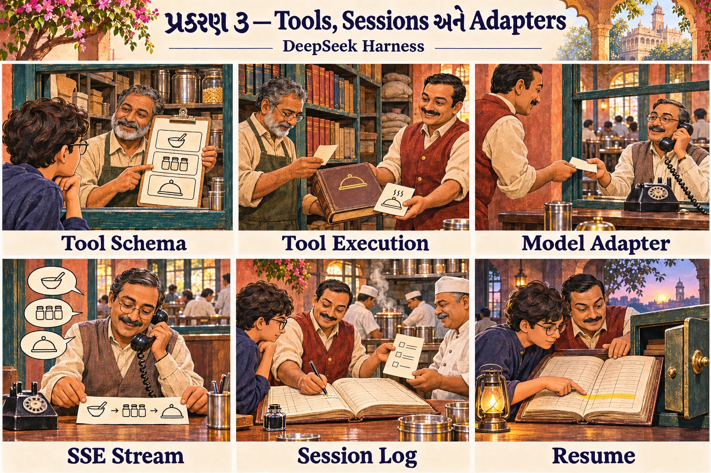
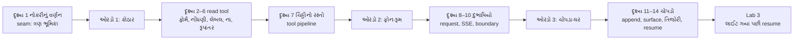
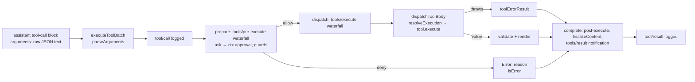
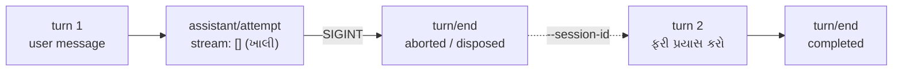

# પ્રકરણ 3 — Tools, sessions અને model adapters

> **Level 3 · વાર્તાનો દિવસ 7.**
> પ્રકરણ 1 માં જે ત્રણ જગ્યાએ "વિગત પછી" લખ્યું હતું, તે ત્રણ ઓરડા આજે અંદરથી ખૂલે છે: **કોઠાર** (`read` tool અને tool pipeline), **ફોન-રૂમ** (DeepSeek adapter), અને **ચોપડા-ઘર** (session log, persistence, resume).
> દરેક દૃશ્ય: 🎬 ઘટના → ❓ પ્રશ્ન → 💻 code માં → 🔬 expert નજર. આખો નકશો: [સમગ્ર નકશો](overview-samagra-naksho.md).



## 🎬 સવાર: અધૂરો ઓર્ડર અને ત્રણ ચાવી

ગઈ રાત્રે નવ વાગ્યે અચાનક લાઈટ ગઈ. ટેબલ 2 નો ઓર્ડર અધૂરો રહ્યો. આજે સવારે આરવ જુએ છે કે રમેશભાઈ ચોપડો ખોલીને ગઈકાલની છેલ્લી લીટીઓ વાંચે છે — "ઓર્ડર શરૂ… મહારાજને પૂછ્યું… **ઓર્ડર રદ (લાઈટ ગઈ)**" — અને ગ્રાહક ફરી આવે ત્યારે ત્યાંથી જ વાત આગળ ચલાવે છે.

"આ કેવી રીતે શક્ય બન્યું, એ સાંજ સુધીમાં તું જાતે કરી બતાવીશ," મીરાદીદી કહે છે, અને ત્રણ ચાવી ટેબલ પર મૂકે છે.

## 🎯 આ પ્રકરણ પછી તમે શું કરી શકશો

- `read` tool નું schema, registration, execution, error handling અને result conversion source માં બતાવી શકશો.
- Tool call ના raw JSON થી `tool/result` event સુધીનો pipeline ક્રમ લખી શકશો.
- એક provider request ને `GenerateOptions` થી HTTP body સુધી અને SSE response ને `StreamChunk` સુધી અનુસરી શકશો.
- Session log કેવી રીતે model context બને છે, file માં કેવી રીતે persist થાય છે, અને interrupted session કેવી રીતે resume થાય છે તે ચલાવીને બતાવી શકશો.

## 🗺️ આજના દિવસનો નકશો



---

## દૃશ્ય 1 — નોકરીનું વર્ણન: seam

🎬 કોઠારના દરવાજા પર એક પાટિયું છે: **"કોઠારી: ચિઠ્ઠી લો, સામાન આપો."** ગયા અઠવાડિયે ભીખાભાઈ બીમાર હતા; તેમની જગ્યાએ બીજા ભાઈ આવ્યા હતા. મહારાજને ખબર પણ ન પડી: તેમની ચિઠ્ઠી એ જ રહી, જવાબ એ જ રીતે આવ્યો.

❓ "મહારાજને ખબર કેમ ન પડી?"

"કારણ કે મહારાજ **ભીખાભાઈ** ને ઓળખતા જ નથી. તે પાટિયાને ઓળખે છે."

💻 **Capability seam** = ત્રણ ભૂમિકાવાળી, બદલી શકાય તેવી capability — એક "સાંધો":

| ભૂમિકા | અર્થ | કોઠારમાં |
|---|---|---|
| **Service Definition** | interface — "આ કામ આવી રીતે માંગવું" | દરવાજા પરનું પાટિયું |
| **Service Provider** | implementation — ખરું કામ કરનાર | ભીખાભાઈ (કે બીજું કોઈ) |
| **Consumer** | તેને વાપરનાર, ઘણી વાર model-facing tool | ચિઠ્ઠી મોકલનાર |

**Abstract class / interface** = "શું કરવું" નું વચન, "કેવી રીતે" નહીં — નોકરીનું વર્ણન.

ઉદાહરણ: `@deepseek-ai/dsh-fs` નો abstract [`FileSystem`][fs-abstract] definition છે, `dsh-fs-sandbox` provider છે, અને `read` tool consumer છે ([architecture.md — Capability seams](https://github.com/deepseek-ai/deepseek-harness/blob/fcc0ad462172522aaf5c93a7b2e01f6b9f0b0159/docs/architecture.md#capability-seams)). ✅

આજના ત્રણ ઓરડા = ત્રણ seam:

| Seam | ઓરડો | Definition | Provider (base bundle) | Consumer |
|---|---|---|---|---|
| Tools | કોઠાર | `ctx.tools` ([`dsh-tools`][tools-execute]) | `tool-executor-native` ([`NativeToolExecutor`][native-executor]) | agent loop |
| Filesystem | કોઠારનાં ખાનાં | `ctx.fs` ([`FileSystem`][fs-abstract]) | `dsh-fs-sandbox` ([policy][fs-sandbox-doc]) | `read`, `write`, `edit` tools |
| LLM | ફોન-રૂમ | `ctx.llm` ([`LlmRuntime`][llm-runtime]) | `dsh-llm-deepseek-api-key` → [`DeepSeekAdapter`][deepseek-adapter] | agent loop |

**યાદ-ચાવી "નિ-ક-વા":** **નિ**યમ (definition), **ક**ારીગર (provider), **વા**પરનાર (consumer).

🔬 **Expert નજર.** Seam એ પ્રકરણ 2 ની "તકતીવાળી ખુરશી" નું પૂરું રૂપ છે. તેની કિંમત ત્યારે દેખાય જ્યારે તમે provider બદલો: remote sandbox, બીજો model provider — અને consumer ની **એક line** બદલવી ન પડે. નવો code વાંચતી વખતે expert પહેલાં seam શોધે છે, કારણ કે harness ને બદલવાની સલામત જગ્યાઓ એ જ છે.

## ઓરડો 1: કોઠાર

## દૃશ્ય 2 — ચિઠ્ઠીનું ફોર્મ: input schema

🎬 કોઠારની બારી પર છાપેલાં ફોર્મની થોકડી છે. દરેક ખાના માટે અલગ ફોર્મ; "રેસીપી-ચોપડી" ના ફોર્મમાં ત્રણ ખાનાં: *કઈ ચોપડી* (ફરજિયાત), *કયા પાનાથી*, *કેટલાં પાનાં*. મહારાજ કોરા કાગળ પર મનફાવે તેમ નથી લખતા; આ ફોર્મ ભરે છે.

❓ "મહારાજને કેવી રીતે ખબર કે ફોર્મમાં કયાં ખાનાં છે? તે તો કોઠાર જોઈ શકતા નથી."

"ફોર્મની નકલ **દરેક વાતચીતમાં** તેમને અપાય છે. પ્રકરણ 1 ના 25 લેબલ યાદ છે? એ આ ફોર્મ છે."

💻 [`applyReadTool`][read-tool] માંથી (repository code):

```ts
  ctx.tools.register(defineTool({
    name: 'read',
    description: 'Read a UTF-8 text file and return line-numbered content.',
    parameters: {
      file_path: { type: 'string', required: true, description: 'Path to read, resolved by the filesystem backend.' },
      offset: { type: 'number', description: '1-based first line to return. Defaults to 1.' },
      limit: { type: 'number', description: `Maximum number of lines to return. Defaults to ${caps.limit}.` },
    },
```

- **DSL** (Domain-Specific Language) = એક ખાસ કામ માટેની નાની "ભાષા". અહીં `{ type: 'string', required: true }` જેવું ટૂંકું લખાણ.
- **JSON Schema** = JSON નો આકાર વર્ણવવાનું ધોરણ: કયાં fields, કયા type, કયાં ફરજિયાત — છાપેલું ફોર્મ.
- **UTF-8** = ગુજરાતી સહિત દુનિયાના બધા અક્ષરો bytes માં લખવાની રીત.

`defineTool` આ નાના DSL ને JSON Schema માં ફેરવે છે; model ને એ જ schema મળે છે (પ્રકરણ 1 ની wire capture માં 25 tools માંનું એક). `limit` નો default `READ_LIMIT = 2000` છે, અને તે `tool-fs` plugin config (`readLimit`) થી બદલી શકાય છે. ✅

🔬 **Expert નજર.** `description` ની દરેક line model વાંચે છે — તે માણસ માટેનું comment નથી, **model માટેની સૂચના** છે. "1-based" જેવો એક શબ્દ નક્કી કરે છે કે model `offset: 0` મોકલશે કે `1`. Tool ની ગુણવત્તાનો અડધો ભાગ તેના ફોર્મના શબ્દોમાં છે. અને `limit` નો default જુઓ: tool **પોતે** નક્કી કરે છે કે એક વારમાં કેટલું આપવું, જેથી મોટી file મહારાજ સામેનો આખો કાગળ (context window) ન ભરી દે.

## દૃશ્ય 3 — નવો કોઠારી બે નોંધ કરાવે: registration

🎬 નવું ખાનું ખૂલે ત્યારે કોઠારી બે જગ્યાએ નોંધ કરાવે છે. એક, **કોઠાર-યાદીમાં** પોતાનું ખાનું. બે, **નિયમોની પોથીમાં** એક લીટી: "રેસીપી જોઈતી હોય તો મને ચિઠ્ઠી આપો; જાતે કબાટ ફંફોસવાનું ન કહેશો."

❓ "યાદીમાં નોંધ પૂરતી નથી? પોથીમાં પણ કેમ?"

"યાદી કહે છે કે ખાનું **છે**. પોથી કહે છે કે તેને **ક્યારે વાપરવું**. મહારાજ પાસે બીજા રસ્તા પણ છે; કયો સારો, એ તેમને કહેવું પડે."

💻 બે નોંધણી, બંને effects (પ્રકરણ 2, દૃશ્ય 6):

1. `ctx.tools.register(defineTool({...}))` — કોઠાર-યાદી.
2. `ctx.systemPrompt.section({ name: 'tool:read', … })` — model ને "cat/sed નહીં, read વાપરો" એવી સૂચના, પણ ફક્ત ત્યારે જ જ્યારે આ scope માં `read` દેખાતું હોય.

`tool-fs` plugin ની શરત: `inject = ['tools', 'fs', 'systemPrompt', 'workingDirectory']` ([source][toolfs-inject]). પ્રકરણ 2 ના Lab 2b માં જોયું કે `workingDirectory` ખૂટે તો આખો `tool-fs` બાંકડે બેસે છે. 🧪

🔬 **Expert નજર.** બંને નોંધ effects છે, એટલે plugin unload થાય ત્યારે **બંને સાથે** જાય. વિચારો કે ફક્ત tool જાય અને પોથીની લીટી રહી જાય: મહારાજ એવા ખાના માટે ચિઠ્ઠી લખે જે છે જ નહીં. અને શરત "ફક્ત ત્યારે જ જ્યારે `read` દેખાતું હોય" એ જ ભૂલને scope ના સ્તરે રોકે છે. System prompt અને tool યાદી **સુસંગત** રહેવાં જોઈએ; બંને અલગ પડે તે model ને ગૂંચવવાની સૌથી સહેલી રીત છે.

## દૃશ્ય 4 — ડબ્બો ખોલ્યા વગર લેબલ: execution

🎬 ચિઠ્ઠી આવે ત્યારે ભીખાભાઈ સીધો ડબ્બો નથી ખોલતા. પહેલાં નક્કી કરે છે કે "કઈ ચોપડી" એટલે **કયા કબાટની** (ફરી બિલ-બુક!). પછી ડબ્બો ખોલ્યા વગર **લેબલ** જુએ છે: ચીજ છે? ચોપડી છે કે આખું ખાનું? કેટલી મોટી? અને બહુ મોટી હોય તો એક ખેપમાં નથી લાવતા; **થોડી થોડી** લાવે છે.

💻

```ts
    async execute(args, exec) {
      const input = parseReadArgs(args, caps.limit)
      const { target, info } = await resolveRegularReadTarget(ctx, exec, input.filePath)
      const chunks = info.size === undefined || info.size >= caps.streamMinSize
        ? await ctx.fs.streamText(target, exec.signal)
        : [await ctx.fs.readText(target, exec.signal)]
```

(ટૂંકાવેલું; [source][read-tool].)

- **Resolve (path)** = relative path ને ચોક્કસ સરનામામાં ફેરવવો. "કોની સામે?" અહીં: session ની current directory સામે.
- **`stat`** = file વિશે માહિતી (છે કે નહીં, file છે કે folder, કદ) — file ખોલ્યા વગર. લેબલ જોવું.

[`resolveRegularReadTarget`][read-target] session ની current directory માં path resolve કરે છે, એક જ `stat` કરે છે, file ન હોય તો `fs/observed` (absent) emit કરી `FsError(..., 'FS_NOT_FOUND')` ફેંકે છે, અને directory હોય તો `FS_NOT_REGULAR_FILE`. 10 MB (`STREAM_MIN_SIZE`) થી મોટી કે size-unknown file stream થાય છે, જેથી backend આખી file memory માં ન ભરે.

🔬 **Expert નજર.** ધ્યાનથી જુઓ કે `read` tool ક્યાંય સીધી disk ને અડતું નથી: `ctx.fs.readText`, `ctx.fs.streamText`. તે seam (દૃશ્ય 1) માંથી જાય છે. એટલે પ્રકરણ 5 ની sandbox સીમા **આપોઆપ** લાગુ પડે છે — tool લખનારે સલામતી યાદ રાખવાની નથી. અને `exec.signal` દરેક call માં આગળ અપાય છે: લાલ દીવો (પ્રવેશ, દૃશ્ય 5) કોઠારની અંદર સુધી પહોંચે છે.

## દૃશ્ય 5 — ત્રણ જાતની "ના", અને લાલ ચિઠ્ઠી: errors

🎬 આજે ભીખાભાઈએ ત્રણ ચિઠ્ઠી પાછી મોકલી, અને ત્રણેયનું કારણ જુદું:

1. ફોર્મમાં **ફરજિયાત ખાનું ખાલી** — "કઈ ચોપડી" લખ્યું જ નથી.
2. ખાનું ભર્યું છે, પણ **value ખોટી** — "શૂન્યમા પાનાથી".
3. ફોર્મ બરાબર છે, પણ **કોઠારમાં એ ચોપડી નથી**.

ત્રણેય વખત ભીખાભાઈ રસોડામાં ઝઘડવા નથી જતા, અને કોઠારને તાળું નથી મારતા. તે **લાલ ચિઠ્ઠી** પર કારણ લખીને પાછી મોકલે છે. મહારાજ વાંચે, અને બીજી ચિઠ્ઠી લખે.

❓ "ભૂલ થઈ અને કોઈ અટક્યું નહીં?"

"મહારાજ **ધારે છે**, જાણતા નથી. તે ખોટું ધારે એ રોજની વાત છે. દર ખોટી ચિઠ્ઠીએ ભોજનાલય અટકે તો કદી થાળી ન પીરસાય. ભૂલને જવાબ બનાવો, અને તેમને ફરી પ્રયત્ન કરવા દો."

💻

| સ્તર | ક્યાં | ઉદાહરણ | Model ને શું મળે |
|---|---|---|---|
| Schema — ખાનું ખાલી | `defineTool` નું `execute` wrapper ([source][schema-defineTool-validate]) | `{"path":"README.md"}` | `Error: invalid arguments: missing required property "file_path"` (`INVALID_ARGS`) 🧪 |
| Value — value ખોટી | [`parseReadArgs`][read-parse] | `offset: 0` | `Error: offset must be a positive integer` ✅ |
| Filesystem — સામાન નથી | [`resolveRegularReadTarget`][read-target] | `NOPE.md` | `Error: cannot read "…/NOPE.md": not found` (`FS_NOT_FOUND`) 🧪 |

દરેક throw ને pipeline [`toolErrorResult`][pipeline-errorResult] માં ફેરવે છે:

```ts
function toolErrorResult(error: unknown): ToolExecutionResult {
  const info = errorInfo(error)
  const message = toolErrorMessage(error)
  return {
    content: [{ type: 'text', text: `Error: ${message}` }],
    isError: true,
    error: { message, ...info ? { info } : {} },
  }
}
```

એટલે tool ની નિષ્ફળતા **crash નથી**; model માટે તે એક સામાન્ય `tool/result` છે. **યાદ-ચાવી: "લાલ ચિઠ્ઠી, ઝઘડો નહીં."**

🔬 **Expert નજર.** Return value માં **બે વાચક** માટે બે વસ્તુ છે. `content` model માટે છે: માણસ વાંચે તેવું `Error: …` text, જેમાંથી model શીખીને સુધારે. `error.info` (`name`, `code`) ચોપડા માટે છે: `FS_NOT_FOUND` જેવો કોડ-નંબર, જે model text નો ભાગ **નથી**. Debugging વખતે તમે code શોધો; model ને code ની જરૂર નથી, તેને કારણ જોઈએ. Error message લખતી વખતે expert પૂછે છે: "આ વાંચીને model ને ખબર પડશે કે **આગળ શું કરવું**?" પહેલી લીટીનો message જુઓ: તે કહે છે કે કયું ખાનું ખૂટે છે.

## દૃશ્ય 6 — સામાન અને લેબલ: canonical value અને render

🎬 ભીખાભાઈ રેસીપી-ચોપડી આપતી વખતે બે વસ્તુ આપે છે: **ચોપડી પોતે** (ગલ્લા પર પપ્પા પણ જોઈ શકે), અને તેના પર ચોંટાડેલું **સાફ લેબલ** — કઈ ચોપડી, અને દરેક લીટી આગળ નંબર — જે મહારાજ વાંચે.

💻

- **Canonical value** = tool નું સાચું, structured પરિણામ, જે log અને UI માટે રહે — સામાન પોતે.
- **Render** = value ને model માટે text બનાવવું — લેબલ.

`execute` એક canonical value આપે છે: `{ path, offset, lines: [{number, text}], totalLines }`. Pipeline તેને `output.schema` સામે validate કરે છે ([source][pipeline-materialize]), પછી `output.render` તેને model-facing text બનાવે છે ([source][read-output]), અને `presentationMeta` UI card માટે `meta` આપે છે (replay પર card ફરી બની શકે). અમારી wire capture માં model ને આવું text ગયું 🧪:

```text
<path><harness>/README.md</path>
<type>file</type>
<content>
1: # DeepSeek Harness
2: 
3: English | [中文](README.zh.md)
```

**`read` tool ના પાંચ ભાગ — યાદ-ચાવી "ઇ-ન-ચ-ભ-રૂ" ("ઇનામ ચલાવ્યું, ભૂલ રૂપે"):** **ઇ**નપુટ schema (દૃશ્ય 2), **ન**ોંધણી (3), **ચ**લાવવું (4), **ભ**ૂલ (5), **રૂ**પાંતર (6).

🔬 **Expert નજર.** Output પણ schema સામે **validate** થાય છે — ફક્ત input નહીં. Tool નું પોતાનું પરિણામ ખોટા આકારનું હોય, તો તે model સુધી પહોંચતાં પહેલાં પકડાય. અને value/render અલગ રાખવાનો ફાયદો: model માટેનું લખાણ કાલે બદલો (દા.ત. line numbers નો format), તો ચોપડામાં સચવાયેલી જૂની values અને UI cards તૂટતાં નથી.

## દૃશ્ય 7 — ચિઠ્ઠીનો આખો રસ્તો: tool pipeline

🎬 આરવ એક ચિઠ્ઠીની પાછળ પાછળ ચાલે છે, રસોડાથી કોઠાર અને પાછી. તે સાત પડાવ ગણે છે:

```text
મહારાજની ચિઠ્ઠી (raw JSON)
  →  parseArguments: ચિઠ્ઠી વાંચો (અક્ષર ગરબડ હોય તો પણ ફેંકો નહીં)
  →  tool/call: ચોપડામાં "આ માંગ્યું"
  →  tools/pre-execute: શેઠની નીતિ, મંજૂરી (પ્રકરણ 5); guards
  →  tools/execute: ખરું કામ (around-wrapper)  →  tool.execute()
  →  validate + render (અથવા throw → "Error: …" લાલ ચિઠ્ઠી)
  →  post-execute, finalize, tools/result
  →  tool/result: ચોપડામાં "આ મળ્યું"
```

❓ "ચિઠ્ઠીના અક્ષર જ ન ઉકલે, તો ફેંકી કેમ નથી દેતા?"

"ફેંકી દઉં તો મહારાજને શું કહું — 'કંઈક ખોટું હતું'? ના. હું ચિઠ્ઠી **જેમ છે તેમ** ખાનાવાળાને આપું છું. તે જ સારી રીતે કહી શકે કે તેમાં શું ખોટું છે."

💻



| Node | Owner | Symbol |
|---|---|---|
| executeToolBatch / parseArguments | `packages/core/tools/src/batch.ts` | [`executeToolBatch`][batch-execute], [`parseArguments`][batch-parse] |
| prepare | `packages/core/tools/src/pipeline.ts` | [`prepare`][pipeline-prepare] |
| dispatch | same | [`dispatch`][pipeline-dispatch] |
| dispatchToolBody | same | [`dispatchToolBody`][pipeline-body] |
| toolErrorResult | same | [`toolErrorResult`][pipeline-errorResult] |
| `tool/call` data | `packages/core/session/src/types.ts` | [`'tool/call'`][session-types-tool] |

બે નાની પણ મહત્વની વિગતો:

- [`parseArguments`][batch-parse]: invalid JSON હોય તો crash નહીં — raw string જ રાખે છે, જેથી tool પોતાનું argument diagnostic આપી શકે; ખાલી string → `{}`.
- [`dispatchToolBody`][pipeline-body]: tool registry માં ન મળે તો `ToolNotFoundError` ([source][contracts-notfound]); અમારા run માં model ને `Error: unknown tool "read_everything"` મળ્યું, code `UNKNOWN_TOOL`. 🧪 "એવું કોઈ ખાનું જ નથી."

**Around-wrapper** = ખરા કામની **આગળ અને પાછળ** બંને બાજુ ચાલતો listener — ઘડિયાળ લઈ ઊભો નિરીક્ષક: "શરૂ… પૂરું, 9 ms." `tools/execute` waterfall હોવાથી plugin `next()` ની આગળ-પાછળ code મૂકી શકે (પ્રકરણ 6 નો metrics plugin).

🔬 **Expert નજર.** Diagram માં જુઓ કે **ત્રણેય રસ્તા** — deny, throw, value — એક જ node `complete` પર ભેગા થાય છે, અને ત્યાંથી એક જ `tool/result` લખાય છે. પરિણામ ગમે તે હોય, અંત એક જ આકારનો. આ પ્રકરણ 1 ના invariant ("દરેક `tool/call` નું એક `tool/result`") નું mechanism છે. અને ક્રમ જુઓ: `tool/call` log થાય છે નીતિ-તપાસ **પહેલાં**. એટલે જે ચિઠ્ઠીને મંજૂરી ન મળી, તેની પણ ચોપડામાં નોંધ છે: model એ શું માંગ્યું હતું, એ કદી ખોવાતું નથી.

## ઓરડો 2: ફોન-રૂમ

## દૃશ્ય 8 — દુભાષિયો: request

🎬 ફોન-રૂમમાં એક જણ બેઠો છે જે બે ભાષા જાણે છે. રમેશભાઈ ભોજનાલયની બોલીમાં કાગળ આપે; દુભાષિયો તેને agency ની ભાષામાં ફેરવી ફોન પર બોલે. આરવ નોંધે છે: રમેશભાઈ કદી ફોન ઉપાડતા નથી, અને દુભાષિયાએ કદી ચોપડો જોયો નથી.

અને દુભાષિયો એક ઘડિયાળ સામે રાખે છે: સામે છેડેથી બહુ વાર કંઈ ન સંભળાય, તો "લાઈન મરી ગઈ" ગણીને ફોન મૂકી દે.

❓ "દુભાષિયો ચોપડો ન જુએ, તો મહારાજને આખી વાત કેવી રીતે કહે?"

"તેને ચોપડાની જરૂર નથી. રમેશભાઈ ચોપડામાંથી જે **નકલ** ઉતારે છે — સિક્કાવાળી — તે જ તેના હાથમાં આવે છે."

💻 **Adapter** = harness ની ભાષા ↔ provider ની wire ભાષાનો દુભાષિયો.

1. Loop [`buildRequest`][loop-buildRequest] માં frozen `GenerateOptions` બનાવે છે (સિક્કાવાળી નકલ — પ્રકરણ 1, દૃશ્ય 7): `provider`, `model`, `messages` (log માંથી), `tools`, `toolHistory`, `sessionId`, `signal`.
2. [`LlmRuntime.stream`][llm-stream] તેને `llm/stream` **waterfall** માંથી પસાર કરે છે; છેલ્લો handler adapter stream છે. એટલે કોઈ પણ plugin દરેક model request જોઈ/લપેટી શકે — પ્રકરણ 1 નો trace plugin અને પ્રકરણ 6 નો metrics plugin આ જ hook વાપરે છે.
3. [`DeepSeekAdapter.generate`][deepseek-generate] idle **watchdog** લગાવે છે ("આટલા સમયમાં કંઈ ન આવ્યું તો ભૂલ ગણો" — દુભાષિયાની ઘડિયાળ; stream શાંત રહે તો `TIMEOUT`), અને errors ને `LlmError` codes માં ફેરવે છે: `TIMEOUT`, `ABORTED`, `TRANSPORT`.
4. `request()` images/files તૈયાર કરે છે, auth headers લાવે છે, [`serialize`][deepseek-serialize] થી Messages-format body બનાવે છે (**serialize** = object ને મોકલી શકાય તેવા text માં ફેરવવું), request extensions ઉમેરે છે, અને [`fetch(…/messages)`][deepseek-fetch] કરે છે:

```ts
        const response = await fetch(`${messagesApiRoot(connection.baseURL)}/messages`, {
          method: 'POST', signal, body: extensions.payload, redirect: 'error',
          headers: {
            ...attributionHeaders(),
            'content-type': 'application/json', 'accept': 'text/event-stream',
            ...auth.headers,
            'anthropic-version': '2023-06-01',
```

(પ્રવેશ દૃશ્ય 4 નો ફોન: `POST` method, URL, headers — અને `accept: text/event-stream` એટલે "જવાબ ટુકડે ટુકડે મોકલજો".)

ફોન પર ખરેખર શું બોલાયું (🧪 [evidence/wire.json](../evidence/wire.json), user id redacted):

```json
    "bodyKeys": ["dsh_plugin_packages", "dsh_session_log", "max_tokens", "messages",
                 "model", "output_config", "stream", "system", "thinking", "tools"],
    "model": "deepseek-flash",
    "stream": true,
    "headers": {
      "anthropic-version": "2023-06-01",
      "x-deepseek-harness-user-id": "<redacted anonymous id>",
      "x-deepseek-harness-session-id": "session-…"
    }
```

આરવ `bodyKeys` માં એક નામ પર અટકે છે: "`dsh_session_log`? Agency ને આપણા **ચોપડાનાં પાનાં** પણ જાય છે?"

"સારી આંખ. હા."

**Request extension** = provider-specific વધારાનો body field, જે plugins ઉમેરે — ઓર્ડર સાથે ટાંકેલું વધારાનું પાનું. `dsh_session_log` અને `dsh_plugin_packages` એવા બે fields છે. `dsh_session_log` field `session-log-deepseek` plugin register કરે છે ([source][sessionlog-register]); તેનું README કહે છે: "Incremental canonical session-log upload for official DeepSeek LLM API requests … Disable it only when the official API must not receive a Session-log suffix." ✅🧪

🔬 **Expert નજર.** આરવનો પ્રશ્ન **data boundary** નો છે: "મારા machine ની બહાર બરાબર શું જાય છે?" તેનો જવાબ docs માં શોધવાનો નથી; **wire capture** માં જોવાનો છે, કારણ કે body માં fields plugins ઉમેરે છે અને plugins બદલાય છે. પ્રકરણ 5 માં આ જ સવાલ ફરી પૂછીશું અને તે row બંધ કરીને ફરક માપીશું. Expert કોઈ પણ agent system અપનાવતાં પહેલાં એક વાર wire જુએ છે.

## દૃશ્ય 9 — મહારાજ ટુકડે ટુકડે બોલે: SSE → `StreamChunk`

🎬 ફોન પર મહારાજ એક શ્વાસે નથી બોલતા: "હવે એક વાત શરૂ કરું છું… આ તેનો ટુકડો… બીજો ટુકડો… એ વાત પૂરી… હવે એક ચિઠ્ઠી લખાવું છું… પૂરી… કુલ આટલા શબ્દ બોલ્યો… બસ." દુભાષિયો દરેક ટુકડાને ભોજનાલયની બોલીના **સાતમાંથી એક** છાપેલા કાર્ડમાં ફેરવીને રમેશભાઈને આપતો જાય છે.

💻 Provider HTTP 200 સાથે Server-Sent Events મોકલે છે. [`parseSse`][deepseek-sse] દરેક `data:` line ને JSON બનાવે છે, અને [`translate`][deepseek-translate] તેને harness ના provider-neutral [`StreamChunk`][llm-streamchunk] માં ફેરવે છે:

```ts
export type StreamChunk =
  | { type: 'block-start'; index: number; blockType: ContentBlockType }
  | { type: 'text-delta'; index: number; text: string }
  | { type: 'reasoning-delta'; index: number; text: string }
  | { type: 'tool-call-delta'; index: number; id: ToolCallId; name?: string; argumentsDelta: string }
  | { type: 'block-end'; index: number; block: ContentBlock }
  | { type: 'usage'; usage: TokenUsage }
  | { type: 'finish'; reason: FinishReason; replayState?: ReplayEnvelope }
```

(repository code; છેલ્લો `finish` variant source માં ઘણી lines માં છે, અહીં એક line માં સંક્ષિપ્ત કર્યો છે.) ઓળખ્યું? Discriminated union (પ્રવેશ, દૃશ્ય 6): `type` જોઈને આકાર નક્કી.

- **Provider-neutral** = કોઈ એક provider ની ભાષા પર આધાર નહીં — ભોજનાલયની પોતાની બોલી.
- **Delta** = "અત્યાર સુધીનામાં આ ઉમેરો" — આખું નહીં, ફક્ત નવો ભાગ.

**યાદ-ચાવી — સાત કાર્ડ "બ્લો-ટે-રી-ટૂ-એન્ડ-યુ-ફિ":** `block-start`, `text-delta`, `reasoning-delta`, `tool-call-delta`, `block-end`, `usage`, `finish`.

Provider ના `stop_reason` નું mapping ([source][deepseek-finish]): `end_turn`/`stop_sequence` → `stop`, `tool_use` → `tool-calls`, `max_tokens` → `max-tokens`. HTTP error હોય તો adapter body વાંચી `providerError(raw, status, headers)` થી code (દા.ત. `AUTH`, `SERVER`, rate limit) બનાવે છે અને `LlmError` ફેંકે છે; `LlmRuntime` તેને `finish` chunk (`kind: 'error'`) માં ફેરવે છે, અને loop `agent/request-error` ચલાવે છે (પ્રકરણ 5).

🔬 **Expert નજર.** `tool-call-delta` માં `argumentsDelta: string` જુઓ: tool call ના arguments પણ **ટુકડે ટુકડે, text તરીકે** આવે છે. JSON અધવચ્ચે કપાઈ શકે, અથવા model ખોટું JSON લખી શકે. એટલે જ દૃશ્ય 7 નું `parseArguments` "અક્ષર ગરબડ હોય તો પણ ફેંકો નહીં" નિયમ પાળે છે. બે ઓરડાના નિયમ એકબીજા પર ટકેલા છે.

## દૃશ્ય 10 — agency બદલાય તો? adapter boundary

🎬 પપ્પા વિચારે છે: "આવતા વર્ષે બીજી agency સસ્તી પડે તો?" આરવ ગભરાય છે: આખું ભોજનાલય ફરી ગોઠવવું પડશે? દીદી ફોન-રૂમના ઉંબરા પર ચોકથી લીટી દોરે છે.

"લીટીની આ બાજુ કોઈને agency ની ભાષા નથી આવડતી. પેલી બાજુ કોઈએ ચોપડો નથી જોયો. Agency બદલાય, તો ફક્ત **દુભાષિયો** બદલાય."

💻

| Boundary ની ઉપર (loop, tools, session) | Boundary ની નીચે (DeepSeekAdapter) |
|---|---|
| `GenerateOptions` મોકલે | `serialize` → HTTP body |
| `StreamChunk` વાંચે | `fetch …/messages`, `parseSse`, `translate` |
| retry નિર્ણય (`agent/request-error`) | HTTP error → `LlmError` code (`AUTH`, `SERVER`, …) |
| wire format જાણતું નથી | session log જાણતું નથી |

નવો provider ઉમેરવો એટલે `ctx.llm.registerAdapter(...)` ([source][llm-registerAdapter]).

⚠️ **વાર્તા અને technical વચ્ચે ફરક:** માણસ દુભાષિયો અર્થ પણ બદલી શકે, ટૂંકાવી શકે. Adapter **ફક્ત format** બદલે છે. **યાદ-ચાવી: "દુભાષિયો ફક્ત ભાષા બદલે, અર્થ નહીં."**

🔬 **Expert નજર.** Table ની ત્રીજી લીટી સૌથી સૂક્ષ્મ છે: adapter error ને **ઓળખે** છે (HTTP 401 → `AUTH`), પણ "ફરી પ્રયત્ન કરવો કે નહીં" તે **નક્કી નથી કરતો**. નિર્ણય ઉપર છે, `agent/request-error` waterfall માં, જ્યાં plugins ભાગ લઈ શકે. ઓળખવું અને નક્કી કરવું બે અલગ જવાબદારી છે. Boundary ની ખરી કસોટી આ પ્રશ્ન છે: "આ file વાંચવા મારે provider ના docs ખોલવા પડે?" જવાબ "હા" ફક્ત adapter ની અંદર હોવો જોઈએ.

## ઓરડો 3: ચોપડા-ઘર

## દૃશ્ય 11 — શાહીથી, નંબર સાથે, તાળાબંધ: `Session.append`

🎬 ચોપડા-ઘરમાં પપ્પાના ત્રણ નિયમ દીવાલ પર લખેલા છે:

1. **"શાહીથી લખાય તેવું જ."** એક વાર કોઈએ લીટીમાં લખ્યું "વિગત માટે રમેશભાઈને પૂછો". એક મહિના પછી રમેશભાઈને યાદ નહોતું. લીટી પોતે પૂરી હોવી જોઈએ.
2. **"લખ્યું તે લખ્યું."** છેકછાક નહીં. ભૂલ હોય તો નવી લીટીમાં સુધારો.
3. **"પાના-નંબર ક્રમમાં, કૂદકો નહીં."**

અને ખાસ: નિયમ 1 તોડતી લીટી રમેશભાઈ **લખવા જ નથી દેતા** — સાંજે તિજોરીમાં મૂકતી વખતે નહીં, લખતી ક્ષણે જ ના પાડે.

❓ "સાંજે તપાસે તોય ચાલે ને?"

"સાંજે પકડાય ત્યારે કોને ખબર કે એ લીટી **કોણે, ક્યારે, કેમ** લખી? ભૂલ જ્યાં થાય ત્યાં જ પકડો; ત્યારે ગુનેગાર સામે ઊભો હોય."

💻

- **Session log** = append-only events ની યાદી; દરેક event ને `seq` (0,1,2…) અને `time` મળે છે.
- **Append-only** = ફક્ત અંતે ઉમેરાય; જૂનું કદી બદલાય કે ભૂંસાય નહીં.

[`Session.append`][session-append]:

```ts
    const dataSnapshot = snapshotJsonValue(data)
    if (dataSnapshot === undefined) {
      throw new Error(`session event "${type}" carries non-JSON-serializable data`)
    }
    …
    const event = deepFreeze({
      type,
      seq: SessionSeq(this.log.length),
      time: Date.now(),
```

ત્રણ નિયમ, ત્રણ lines:

1. Data JSON-serializable હોવો જ જોઈએ; નહીં તો append જ નિષ્ફળ — ખરાબ event પછીથી flush વખતે નહીં, **અહીં જ** પકડાય.
2. Event deep-frozen છે — કોઈ બદલી ન શકે.
3. `seq` = log ની લંબાઈ — ક્રમમાં, કદી કૂદકો નહીં.

રમકડા-agent નું `append` યાદ છે? `Object.freeze({ seq: log.length, … })` — એ જ વિચાર, નાના રૂપમાં.

🔬 **Expert નજર.** નિયમ 1 ને **fail fast** કહેવાય. ખરાબ event ને memory માં સ્વીકારી લો અને disk પર લખતી વખતે નિષ્ફળ જાઓ, તો error નો stack trace `flush` બતાવે — ગુનેગાર plugin નહીં. `append` માં throw કરો, તો stack trace સીધો એ line બતાવે જેણે ખરાબ data આપ્યો. ક્યાં નિષ્ફળ જવું એ પસંદગી debugging ના કલાકો બચાવે છે.

## દૃશ્ય 12 — મહારાજ માટે કઈ લીટીઓ? surface અને `deriveMessages`

🎬 રમેશભાઈ મહારાજ માટે નકલ ઉતારે છે. આરવ જુએ છે કે તે ચોપડાની **દરેક** લીટી નથી ઉતારતા. "ઓર્ડર શરૂ", "કોઠારમાં ચિઠ્ઠી ગઈ", "ઓર્ડર બંધ" — આ છોડી દે છે. ફક્ત **વાતચીતની** લીટીઓ લે છે.

❓ "તો 'જે મહારાજને કહ્યું તે ચોપડામાં' — ઊલટું સાચું નથી? ચોપડાનું બધું મહારાજને નથી જતું?"

"બરાબર. ચોપડામાં બે જાતની લીટી છે: **વાતચીત**, અને **વહીવટ**. મહારાજને વાતચીત જાય. વહીવટ આપણા માટે છે."

💻 **Surface** = log ના એવા nodes જે model history બનાવે છે. તેમાં પાંચ message-producing types છે: `system/message`, `developer/message`, `user/message`, `assistant/message`, `tool/result` ([`SurfaceEventType`][session-surface-types]).

**યાદ-ચાવી "સિ-ડે-યુ-આ-ટૂ" — "સીડી યુવાન આગળ ટૂંકી":** **સિ**સ્ટમ, **ડે**વલપર, **યુ**ઝર, **આ**સિસ્ટન્ટ, **ટૂ**લ result.

[`deriveMessages`][session-derive] surface nodes પરથી `Message[]` બનાવે છે અને **cache** કરે છે (એક વાર ગણેલું સાચવી રાખવું, જેથી ફરી ગણવું ન પડે). **Compaction** (લાંબો ઇતિહાસ ટૂંકો કરવો — આ પુસ્તકમાં વિગતે નથી; પરિશિષ્ટ F) જેવી replacement થાય તો `contentGeneration` બદલાય અને cache ફરી બને. ખાલી content વાળો `assistant/message` (દા.ત. ફક્ત usage) history માં આવતો નથી.

🔬 **Expert નજર.** પ્રકરણ 1 ના Lab ના આંકડા હવે સમજાય છે: 24 થી વધુ events ચોપડામાં હતા, પણ call #2 માં ફક્ત 7 messages ગયા. `turn/start`, `tool/call`, `request/header` surface નથી. (હા, `tool/call` surface નથી: model ની માંગ `assistant/message` ની અંદર tool-call block તરીકે જ history માં છે.) "Model ને શું દેખાશે?" નો જવાબ: પાંચ surface types, બીજું કશું નહીં. તમારો plugin model ને કંઈક બતાવવા માગે, તો તેણે આ પાંચમાંથી એક event append કરવી પડે.

## દૃશ્ય 13 — તિજોરી: persistence

🎬 રાત્રે રમેશભાઈ કાચી નોંધો પાકા ચોપડામાં ઉતારે છે (flush — પ્રકરણ 1), ચોપડો તિજોરીમાં મૂકે છે, અને તિજોરી પર એક ટૅગ લટકાવે છે: "લખાણ ચાલુ છે" — જેથી બે જણ એકસાથે એ જ ચોપડામાં ન લખે. અને પપ્પાનો બીજો નિયમ: ભરાઈ ગયેલો જૂનો ચોપડો **કદી ફેંકાતો કે ફરી લખાતો નથી**. નવું ફોર્મ આવે તો જૂના ચોપડાની નકલ નવા ફોર્મમાં થાય; મૂળ અકબંધ.

💻 **Persistence** = data ને disk પર ટકાવવું, process બંધ થાય તો પણ.

Base bundle `session-persistence-jsonl` ને `root: dshHomePath('sessions')` સાથે mount કરે છે. ✅ અમારા runs માં file layout 🧪:

```text
$DSH_HOME/sessions/<cwd-key>/session-<uuid>/session.v4.jsonl.zstd
$DSH_HOME/sessions/<cwd-key>/session-<uuid>/session.lock
```

પહેલી line header છે (`{"type":"session","version":4,"id":…,"cwd":…}`), પછી એક event પ્રતિ line (JSONL — પ્રવેશ, દૃશ્ય 3). `.zstd` = દબાવેલી પોટલી (compression); `session.lock` = "આ ચોપડો અત્યારે કોઈ લખે છે" નો ટૅગ.

Architecture doc મુજબ v1 અને પછીના format `session.vN.jsonl[.zstd]` નામ વાપરે છે, અને committed generation files ક્યારેય rename/replace/delete થતી નથી; જૂના version ની session ખોલતાં adjacent migrations ચાલે છે. ✅ (**Migration** = જૂના format ના data ને નવા format માં ફેરવવું.) Headless runner અંતે [`sessions.flush`][session-flush] બોલાવે છે, જે દરેક `session/flush` listener ની રાહ જુએ છે.

🔬 **Expert નજર.** File ના નામમાં `v4` છે. Format નો version **data ની સાથે** રહે છે, code માં નહીં. બે વર્ષ પછી કોઈ આ file ખોલે, તો તેને ખબર હોય કે કયા નિયમથી વાંચવી. અને "committed files કદી rename/replace/delete નહીં" એ append-only નો વિચાર (દૃશ્ય 11) file ના સ્તરે છે: migration નિષ્ફળ જાય તો પણ મૂળ ચોપડો સલામત. જે data ગુમાવવો પોસાય નહીં, તેના માટે expert હંમેશા આ બે વાત જુએ છે: versioned format, અને "મૂળને અડ્યા વગર" migration.

## દૃશ્ય 14 — લાઈટ ગયા પછી: recovery અને resume

🎬 સવારનું દૃશ્ય, હવે આખું. ગઈ રાત્રે લાઈટ ગઈ ત્યારે બે વસ્તુ અધૂરી હોઈ શકતી હતી: એક **ચિઠ્ઠી** કોઠારમાં ગયેલી અને જવાબ વગરની, અને આખો **ઓર્ડર**. રમેશભાઈએ જતાં પહેલાં બંને ચોપડામાં બંધ કર્યાં. આજે ગ્રાહક પાછો આવ્યો; રમેશભાઈએ **એ જ ચોપડો** ખોલ્યો, નવો ઓર્ડર-નંબર પાડ્યો, અને મહારાજને ગઈકાલની આખી વાત સાથે નવી માંગ કહી.

💻 બે પ્રકારની recovery source માં છે:

- **Step ની અંદર:** step નિષ્ફળ જાય અને tool calls નાં પરિણામ ખૂટે, તો loop [`toolRecovery.results()`][loop-recovery] વડે ખૂટતા `tool/result` લખે છે — invariant "દરેક `tool/call` ને એક `tool/result`" જળવાય.
- **Process ની બહાર:** headless `--session-id <id>` થી persisted Session ફરી અપનાવી શકાય ([headless flags][headless-flags]).

**Resume** = જૂના session માં નવો turn ચલાવવો — ગઈકાલનો ચોપડો ખોલી વાત આગળ ચલાવવી.

🔬 **Expert નજર.** Resume માટે harness માં કોઈ "ખાસ mode" નથી. તે આપોઆપ મળે છે, કારણ કે ત્રણ નિયમ પહેલેથી પળાય છે: history ચોપડામાંથી derive થાય (પ્રકરણ 1), ચોપડો disk પર છે (દૃશ્ય 13), અને ચોપડામાં કશું અધૂરું નથી (invariants). સારા design ની નિશાની: નવી ક્ષમતા નવા code થી નહીં, **જૂના નિયમોના પરિણામ** તરીકે આવે. Lab માં તમે જોશો કે resumed turn માં model ને બરાબર પહેલાંની history + નવો સંદેશ જાય છે, અને એ માટે loop માં એક પણ ખાસ line નથી.

## Source map: આ ક્રમમાં ખોલો

| ક્રમ | ઓરડો | File | Symbol | Input → Output (side effect) |
|---|---|---|---|---|
| 1 | કોઠાર | `packages/fs/tool-fs/src/read.ts` | [`applyReadTool`][read-tool] | caps → registrations (effects) |
| 2 | કોઠાર | `packages/fs/tool-fs/src/read-target.ts` | [`resolveRegularReadTarget`][read-target] | path → `{target, info}` or `FsError` |
| 3 | કોઠાર | `packages/core/tools/src/schema.ts` | [`defineTool` validation][schema-defineTool-validate] | args → `ToolArgsError` |
| 4 | કોઠાર | `packages/core/tools/src/batch.ts` | [`executeToolBatch`][batch-execute] | calls → `ToolBatchResult` (`tool/*` events) |
| 5 | કોઠાર | `packages/core/tools/src/pipeline.ts` | [`prepare`][pipeline-prepare], [`dispatch`][pipeline-dispatch] | exec → result |
| 6 | ફોન | `packages/llm/llm/src/index.ts` | [`stream`][llm-stream] | `GenerateOptions` → `StreamChunk*` |
| 7 | ફોન | `packages/llm/llm-deepseek/src/adapter.ts` | [`generate`][deepseek-generate], [`fetch`][deepseek-fetch] | → HTTP POST |
| 8 | ફોન | `packages/llm/llm-deepseek/src/translate.ts` | [`translate`][deepseek-translate] | SSE JSON → `StreamChunk` |
| 9 | ચોપડો | `packages/core/session/src/index.ts` | [`append`][session-append], [`deriveMessages`][session-derive] | event → log; log → `Message[]` |

---

## 🧪 Lab 3 — સવારનું દૃશ્ય, તમારા હાથે

🎬 "હવે," દીદી કહે છે, "સવારે રમેશભાઈએ જે કર્યું તે તું કર. પહેલાં સહેલું: ગ્રાહક પાછો આવે. પછી અઘરું: લાઈટ જાય."

### ભાગ A: ગ્રાહક પાછો આવ્યો — સામાન્ય resume

```bash
rm -rf tmp/book-home && bash tmp/book-labs/request-trace/run-mock.sh
```

```bash
SID=$(basename "$(find tmp/book-home/sessions -maxdepth 2 -name 'session-*' -type d | head -1)")
```

(પહેલો command નવા ઘરમાં પ્રકરણ 1 નો run કરે છે; બીજો એ session નું folder નામ — એટલે session id — `SID` variable માં મૂકે છે. `basename` = "આખા path માંથી ફક્ત છેલ્લું નામ".)

**પહેલાં ધારો:** બીજો ઓર્ડર આપશો ત્યારે (1) `turn` નંબર શું હશે? (2) `seq` 0 થી ફરી શરૂ થશે કે આગળ વધશે? (3) Model ને કેટલા messages જશે? (પહેલા turn ના અંતે 7 હતા.)

```bash
SEQUENCE=success SUCCESS_TEXT='ત્રણ મુદ્દા: 1) plugin 2) Cordis 3) session log.' TASK='હવે એ સાર ત્રણ મુદ્દામાં લખો.' DSH_ARGS="--session-id $SID" bash tmp/book-labs/request-trace/run-mock.sh
```

🧪 અવલોકનો ([evidence/resume-a2.err](../evidence/resume-a2.err)): exit 0; નવો event `#27 turn/start {"turn":2}` — એ જ log, આગલો seq; `request/header` reason **`resume`**; ફક્ત **એક** model call, જેમાં `messages=9` — પહેલા turn ની આખી history + નવો સંદેશ.

ગ્રાહક બીજા દિવસે આવીને કહે "ગઈકાલની વાનગી, હવે ઓછી તીખી." રમેશભાઈ એ જ ચોપડો ખોલે (એ જ session), નવો ઓર્ડર નંબર લખે (turn 2), અને મહારાજને ગઈકાલની **આખી** વાત + નવી માંગ કહે (9 messages) — કારણ કે મહારાજ તો ભૂલી ગયા છે.

### ભાગ B: લાઈટ ગઈ — interrupted session ને resume

- **`SIGINT`** = "અટકો" નો signal; Ctrl+C દબાવો ત્યારે process ને મળે.
- **Stall** = mock નું એક વર્તન: headers મોકલી પછી ચૂપ — "ફોન ઉપાડ્યો, પણ કંઈ બોલ્યા નહીં."

Mock ને `--sequence stall` સાથે ચલાવી headless run ને 4 સેકન્ડે `SIGINT` મોકલ્યો, પછી `--session-id` થી resume કર્યું (પૂરા commands: [પરિશિષ્ટ B](../appendix/B-command-reference.md#interrupt-and-resume)). 🧪 Stored log ([evidence/int2.err](../evidence/int2.err)):

```text
#4 turn/start {"turn":1}
#8 user/message source={"kind":"user"} content=[…"આ repositoryનું README વાંચીને ગુજરાતી સાર આપો."…]
#16 assistant/attempt {"turn":1,"step":1,"stream":[]}
#18 turn/end {"turn":1,"reason":{"kind":"aborted","reason":{"kind":"disposed"}}}
#21 turn/start {"turn":2}
#24 user/message source={"kind":"user"} content=[…"ફરી પ્રયાસ કરો."…]
#25 request/header reason=resume model=deepseek-official/deepseek-flash tools=25
#35 turn/end {"turn":2,"reason":{"kind":"completed"}}
```



આરવ લીટી-લીટી વાંચે છે, સવારે રમેશભાઈએ વાંચ્યું હતું તેમ:

- `#8`: ગ્રાહકનો ઓર્ડર **સચવાયો** છે.
- `#16 assistant/attempt … "stream":[]`: મહારાજને પૂછ્યું હતું, પણ તે એક શબ્દ બોલ્યા નહોતા. એ **attempt** છે, `assistant/message` નહીં — એટલે દૃશ્ય 12 મુજબ history માં નથી જતું.
- `#18 turn/end … aborted`: પ્રકરણ 1 નો `finally`. લાઈટ ગઈ, તો પણ ઓર્ડરનો અંત લખાયો.
- `#21` પછી: turn 2 એ history સાથે ફરી `read` ચલાવ્યું અને પૂરો થયો.

Interrupted turn 1 ગુમ થયો નથી.

🔬 **Expert નજર.** આ આઠ લીટીમાં ત્રણ પ્રકરણના નિયમ એકસાથે કામ કરતા દેખાય છે: `finally` (પ્રકરણ 1), attempt ≠ message (પ્રકરણ 1 અને દૃશ્ય 12), persistence (દૃશ્ય 13). અને એક વસ્તુ જે **નથી** તે નોંધો: turn 1 માં અધૂરો `assistant/message` નથી. અડધો જવાબ history માં ગયો હોત, તો turn 2 માં model તેના પર આગળ વધત. Interrupted કામને "અડધું સાચવવું" કરતાં "આખું attempt તરીકે અલગ રાખવું" સલામત છે.

## 🔮 આગાહી કસોટી: ચોપડી માંગી, આખું ખાનું બતાવ્યું

મહારાજ ભૂલથી ચોપડીને બદલે **આખા ખાનાનું નામ** લખે છે. `read` tool ને `{"file_path":"packages"}` (directory) argument સાથે call કરાવો:

```bash
TOOL_ARGS='{"file_path":"packages"}' bash tmp/book-labs/request-trace/run-mock.sh
```

**ચલાવતા પહેલાં લખો:** (1) model ને મળતું exact `Error:` text, (2) `tool/result` માં `error.info.code`, (3) turn નું reason. (સંકેત: દૃશ્ય 5 ની table માં ત્રીજું સ્તર, અને દૃશ્ય 4 નો છેલ્લો ફકરો.)

જવાબ: [પરિશિષ્ટ D — Lab 3](../appendix/D-lab-solutions.md#lab-3).

## 🩺 નિષ્ફળતા: ખાનું છે, પણ મહારાજ કદી ચિઠ્ઠી લખતા નથી

🎬 આરવે નવું કોઠાર-ખાનું બનાવ્યું. Plugin load પણ થયો; startup warning નથી. પણ મહારાજ તે ખાના માટે કદી ચિઠ્ઠી લખતા નથી — જાણે ખાનું છે જ નહીં.

"મહારાજને ગમતું નથી?"

"મહારાજ જે ફોર્મ **જોતા નથી**, તે ભરી ન શકે. પહેલાં જો કે ફોર્મ તેમના સુધી પહોંચે છે?"

💻 **લક્ષણ.** Plugin load થયો છે, પણ `llm/stream` trace ની `tools=[…]` યાદીમાં તમારો tool નથી.

**નિદાન:**

1. **નોંધાવ્યું?** Tool `ctx.tools.register` થી register થાય છે કે ફક્ત object બને છે? `defineTool` એકલું કંઈ register કરતું નથી — ખાનું બનાવ્યું, પણ કોઠાર-યાદીમાં નોંધાવ્યું નહીં.
2. **આ ઓર્ડર માટે માન્ય?** Preset કે agent scope માં ફક્ત અમુક tools દેખાય છે? Loop દરેક step માં `ctx.tools.resolve({ agent, … })` થી step-admitted tools લે છે ([`preStep`][loop-preStep]).
3. **સાચા ટેબલની યાદીમાં?** Plugin કોઈ agent ના `agent.ctx` ને બદલે બીજા scope માં mount થયો છે? Scope chain [`scopeChainOf`][scope-chain] જુઓ.
4. **ફોન પર ગયું?** Trace plugin ની `tools=[…]` line એ wire પર ગયેલી યાદી છે; [`capture-wire.ts`](../labs/request-trace/capture-wire.ts) થી `toolNames` ચકાસો.

🔬 **Expert નજર.** "Model tool વાપરતું નથી" ના બે તદ્દન જુદા અર્થ છે: (a) model ને tool **દેખાતો નથી**, (b) દેખાય છે, પણ model **પસંદ નથી કરતું**. (a) plumbing નો પ્રશ્ન છે અને wire પર સાબિત થાય; (b) ફોર્મના શબ્દો (description, system prompt section — દૃશ્ય 2, 3) નો પ્રશ્ન છે. શિખાઉ સીધો (b) માં કૂદીને prompt બદલવા માંડે છે. Expert પહેલાં wire જોઈને (a) નકારે છે.

<a id="saral-samaj"></a>

## ✅ સાર — આરવની નોટબુક, દિવસ 7

**એક વાક્યમાં:** ત્રણ ઓરડા અંદરથી — કોઠાર (`read` tool: ફોર્મ → નોંધણી → `ctx.fs` → લાલ ચિઠ્ઠી → લેબલ, અને "ભૂલ crash નથી" વાળો pipeline), ફોન-રૂમ (DeepSeek adapter: `GenerateOptions` → HTTP → SSE → `StreamChunk`, ફક્ત ભાષા બદલે), અને ચોપડા-ઘર (append-only log → surface → model history, JSONL file માં, અને `--session-id` થી લાઈટ ગયા પછી પણ resume).

### ચૌદ ઘટના, ચૌદ નિયમ

| ઘટના | નિયમ | Code |
|---|---|---|
| દરવાજા પરનું પાટિયું | Seam: definition, provider, consumer | [`FileSystem`][fs-abstract] |
| ચિઠ્ઠીનું ફોર્મ | Tool schema model ને જાય; description model માટેની સૂચના | [`applyReadTool`][read-tool] |
| બે નોંધ | Tool + system prompt section, બંને effects | [`inject`][toolfs-inject] |
| ડબ્બો ખોલ્યા વગર લેબલ | resolve → એક `stat` → નાની file `readText`, મોટી stream | [`resolveRegularReadTarget`][read-target] |
| ત્રણ "ના", લાલ ચિઠ્ઠી | Tool error = `tool/result` (`isError`); code log માં, text model ને | [`toolErrorResult`][pipeline-errorResult] |
| સામાન અને લેબલ | Canonical value (validated) ≠ render | [`output`][read-output] |
| ચિઠ્ઠીનો રસ્તો | parse → `tool/call` → pre-execute → execute → `tool/result` | [`prepare`][pipeline-prepare], [`dispatch`][pipeline-dispatch] |
| દુભાષિયો | `GenerateOptions` → `llm/stream` waterfall → HTTP POST | [`generate`][deepseek-generate] |
| ટુકડે ટુકડે | SSE → સાત `StreamChunk` | [`translate`][deepseek-translate] |
| ચોકની લીટી | ઉપર wire નથી જાણતા; નીચે log નથી જાણતા | [`registerAdapter`][llm-registerAdapter] |
| શાહી, નંબર, તાળું | JSON-serializable (fail fast), frozen, `seq` ક્રમમાં | [`append`][session-append] |
| વાતચીત vs વહીવટ | પાંચ surface types જ model history બને | [`deriveMessages`][session-derive] |
| તિજોરી | `session.v4.jsonl.zstd`; committed files કદી બદલાય નહીં | [`flush`][session-flush] |
| લાઈટ ગયા પછી | ખૂટતા `tool/result` ભરાય; `--session-id` થી resume | [`toolRecovery`][loop-recovery] |

### નવા ટેકનિકલ શબ્દો

| શબ્દ | અર્થ | ઉદાહરણ | ભોજનાલયમાં |
|---|---|---|---|
| Capability seam | ત્રણ ભૂમિકાવાળો બદલી શકાય તેવો સાંધો | `ctx.fs` | પાટિયું, કોઠારી, ચિઠ્ઠી મોકલનાર |
| Interface / abstract class | "શું કરવું" નું વચન | `FileSystem` | નોકરીનું વર્ણન |
| Tool executor | tool batch ચલાવતો provider | `NativeToolExecutor` | કોઠારી |
| Tool pipeline | policy → body → result નો ક્રમ | `ToolExecutionPipeline` | ચિઠ્ઠીનો રસ્તો |
| Canonical value | tool નું સાચું structured પરિણામ | `{path, lines}` | સામાન પોતે |
| Render | value ને model માટે text બનાવવું | `1: # DeepSeek…` | લેબલ |
| `isError` | આ result નિષ્ફળતા છે | `true` | લાલ ચિઠ્ઠી |
| Adapter | harness ↔ provider wire નો દુભાષિયો | `DeepSeekAdapter` | દુભાષિયો |
| Watchdog | "આટલા સમયમાં કંઈ નહીં તો ભૂલ" | `TIMEOUT` | દુભાષિયાની ઘડિયાળ |
| SSE | server થી એક-દિશાના event ટુકડા | `data: {...}` | ટુકડે ટુકડે |
| `StreamChunk` | provider-neutral ટુકડો | `text-delta` | સાત છાપેલાં કાર્ડ |
| Request extension | provider-specific વધારાનો body field | `dsh_session_log` | ટાંકેલું પાનું |
| Surface | model history બનાવતી log લીટીઓ | 5 પ્રકાર | વાતચીતની લીટીઓ |
| Persistence | data ને disk પર ટકાવવું | JSONL file | તિજોરી |
| zstd | compression format | `.jsonl.zstd` | દબાવેલી પોટલી |
| Resume | જૂના session માં નવો turn | `--session-id` | ગઈકાલનો ચોપડો ખોલવો |

### યાદ-ચાવીઓ

- **"નિ-ક-વા"** — seam ની ત્રણ ભૂમિકા.
- **"ઇનામ ચલાવ્યું, ભૂલ રૂપે"** — `read` tool ના પાંચ ભાગ.
- **"લાલ ચિઠ્ઠી, ઝઘડો નહીં"** — tool ની ભૂલ = સામાન્ય `tool/result`.
- **"દુભાષિયો ફક્ત ભાષા બદલે, અર્થ નહીં"** — adapter boundary.
- **"બ્લો-ટે-રી-ટૂ-એન્ડ-યુ-ફિ"** — `StreamChunk` ના સાત પ્રકાર.
- **"સીડી યુવાન આગળ ટૂંકી"** — પાંચ surface types.
- **"શાહી, નંબર, તાળું"** — `append` ની ત્રણ ખાતરી.

### સામાન્ય ગેરસમજો

| ગેરસમજ | સાચું |
|---|---|
| "Tool નિષ્ફળ જાય તો agent crash થાય." | `toolErrorResult` તેને સામાન્ય result બનાવે છે. |
| "Error code model ને દેખાય છે." | `error.info` log માં; model ને ફક્ત `Error: …` text. |
| "Loop DeepSeek API નું format જાણે છે." | ફક્ત adapter જાણે; loop `StreamChunk` જ જુએ. |
| "Resume એટલે ફરી શરૂઆતથી." | એ જ log, આગળનો `seq`, આખી history સાથે. |
| "Ctrl+C થી અધૂરો turn ગાયબ થાય." | `turn/end aborted` સાથે durable રહે છે. |
| "ચોપડાની દરેક લીટી model ને જાય." | ફક્ત પાંચ surface types. |

### પુનરાવર્તન કાર્ડ

<details><summary>1. `read` tool ની ત્રણ error layers?</summary>

Schema (`ToolArgsError`, `INVALID_ARGS`), value (`parseReadArgs` નો સામાન્ય Error), filesystem (`FS_NOT_FOUND`, `FS_NOT_REGULAR_FILE`).
</details>

<details><summary>2. Invalid JSON arguments આવે તો pipeline શું કરે?</summary>

`parseArguments` raw string સાચવે, જેથી tool પોતાનું argument diagnostic આપી શકે; ખાલી string → `{}`.
</details>

<details><summary>3. Wire body માં DeepSeek-specific બે fields?</summary>

`dsh_session_log` અને `dsh_plugin_packages`.
</details>

<details><summary>4. Directory ને `read` કરો તો?</summary>

`Error: cannot read "…/packages": not a regular file`, code `FS_NOT_REGULAR_FILE`, turn `completed`.
</details>

### મિત્રને સમજાવો (3 મિનિટ)

ફોન-રૂમના ઉંબરાની ચોકની લીટીની વાર્તા કહો. પછી એ જ વાત વાર્તા વગર: નવો model provider ઉમેરવા loop કેમ બદલવો પડતો નથી (`GenerateOptions`, `StreamChunk`, `ctx.llm.registerAdapter`).

## 🧠 Mastery check

1. `read` tool ની ત્રણ error layers અને દરેકનો code લખો.
2. Tool body throw કરે ત્યારે model ને શું મળે છે, અને `error.info` model text માં કેમ નથી?
3. Adapter boundary ની ઉપર અને નીચે કોણ શું જાણે છે?
4. `llm/stream` waterfall હોવાથી શું શક્ય બને છે? એક ઉદાહરણ આપો.
5. `Session.append` non-JSON data પર તરત કેમ નિષ્ફળ થાય છે?
6. Interrupted session resume પછી turn 1 ના કયા events બાકી રહે છે?

જવાબો: [પરિશિષ્ટ D — પ્રકરણ 3](../appendix/D-lab-solutions.md#ch3).

## 🎬 આગળ શું

સાંજે પપ્પા આરવને બે કાગળ આપે છે — બે supplier ના invoice ની યાદીઓ (CSV exports). "આ બેય મેળ ખાય છે કે નહીં, દર મહિને હાથે તપાસવું પડે છે. તારો agent આમાં કંઈ કરી શકે?"

આરવ મીરાદીદી સામે જુએ છે. દીદી: "તેં આજે એક ખાનું અંદરથી જોયું: ફોર્મ → નોંધણી → `ctx.fs` → લાલ ચિઠ્ઠી → લેબલ. કાલે **આ જ ઢાંચાથી** તું તારું પોતાનું કોઠાર-ખાનું બનાવીશ — `csv_compare`. અને 'ભૂલ crash નથી' નો નિયમ તારા પોતાના tests માં સાબિત કરીશ."

---

પાછળ: [પ્રકરણ 2](02-cordis-plugin-architecture.md) · આગળ: [પ્રકરણ 4 — પોતાનો plugin બનાવો](04-potano-plugin.md)

<!-- citations:begin (generated by tools/refdefs.py) -->
[batch-execute]: https://github.com/deepseek-ai/deepseek-harness/blob/fcc0ad462172522aaf5c93a7b2e01f6b9f0b0159/packages/core/tools/src/batch.ts#L50-L96
[batch-parse]: https://github.com/deepseek-ai/deepseek-harness/blob/fcc0ad462172522aaf5c93a7b2e01f6b9f0b0159/packages/core/tools/src/batch.ts#L99-L106
[contracts-notfound]: https://github.com/deepseek-ai/deepseek-harness/blob/fcc0ad462172522aaf5c93a7b2e01f6b9f0b0159/packages/core/tools/src/contracts.ts#L291
[deepseek-adapter]: https://github.com/deepseek-ai/deepseek-harness/blob/fcc0ad462172522aaf5c93a7b2e01f6b9f0b0159/packages/llm/llm-deepseek/src/adapter.ts#L22
[deepseek-fetch]: https://github.com/deepseek-ai/deepseek-harness/blob/fcc0ad462172522aaf5c93a7b2e01f6b9f0b0159/packages/llm/llm-deepseek/src/adapter.ts#L142-L170
[deepseek-finish]: https://github.com/deepseek-ai/deepseek-harness/blob/fcc0ad462172522aaf5c93a7b2e01f6b9f0b0159/packages/llm/llm-deepseek/src/translate.ts#L92-L94
[deepseek-generate]: https://github.com/deepseek-ai/deepseek-harness/blob/fcc0ad462172522aaf5c93a7b2e01f6b9f0b0159/packages/llm/llm-deepseek/src/adapter.ts#L65-L90
[deepseek-serialize]: https://github.com/deepseek-ai/deepseek-harness/blob/fcc0ad462172522aaf5c93a7b2e01f6b9f0b0159/packages/llm/llm-deepseek/src/serialize.ts#L57
[deepseek-sse]: https://github.com/deepseek-ai/deepseek-harness/blob/fcc0ad462172522aaf5c93a7b2e01f6b9f0b0159/packages/llm/llm-deepseek/src/sse.ts#L13
[deepseek-translate]: https://github.com/deepseek-ai/deepseek-harness/blob/fcc0ad462172522aaf5c93a7b2e01f6b9f0b0159/packages/llm/llm-deepseek/src/translate.ts#L104
[fs-abstract]: https://github.com/deepseek-ai/deepseek-harness/blob/fcc0ad462172522aaf5c93a7b2e01f6b9f0b0159/packages/fs/fs/src/index.ts#L103
[fs-sandbox-doc]: https://github.com/deepseek-ai/deepseek-harness/blob/fcc0ad462172522aaf5c93a7b2e01f6b9f0b0159/packages/fs/fs-sandbox/src/index.ts#L20-L24
[headless-flags]: https://github.com/deepseek-ai/deepseek-harness/blob/fcc0ad462172522aaf5c93a7b2e01f6b9f0b0159/packages/bundle/headless/src/startup.ts#L58-L63
[llm-runtime]: https://github.com/deepseek-ai/deepseek-harness/blob/fcc0ad462172522aaf5c93a7b2e01f6b9f0b0159/packages/llm/llm/src/index.ts#L354
[llm-stream]: https://github.com/deepseek-ai/deepseek-harness/blob/fcc0ad462172522aaf5c93a7b2e01f6b9f0b0159/packages/llm/llm/src/index.ts#L1170-L1185
[llm-streamchunk]: https://github.com/deepseek-ai/deepseek-harness/blob/fcc0ad462172522aaf5c93a7b2e01f6b9f0b0159/packages/llm/llm/src/types.ts#L496-L508
[loop-recovery]: https://github.com/deepseek-ai/deepseek-harness/blob/fcc0ad462172522aaf5c93a7b2e01f6b9f0b0159/packages/core/agent-loop/src/agent.ts#L376-L385
[native-executor]: https://github.com/deepseek-ai/deepseek-harness/blob/fcc0ad462172522aaf5c93a7b2e01f6b9f0b0159/packages/core/tool-executor-native/src/index.ts#L8-L35
[pipeline-body]: https://github.com/deepseek-ai/deepseek-harness/blob/fcc0ad462172522aaf5c93a7b2e01f6b9f0b0159/packages/core/tools/src/pipeline.ts#L258-L288
[pipeline-dispatch]: https://github.com/deepseek-ai/deepseek-harness/blob/fcc0ad462172522aaf5c93a7b2e01f6b9f0b0159/packages/core/tools/src/pipeline.ts#L295-L326
[pipeline-materialize]: https://github.com/deepseek-ai/deepseek-harness/blob/fcc0ad462172522aaf5c93a7b2e01f6b9f0b0159/packages/core/tools/src/pipeline.ts#L539
[pipeline-prepare]: https://github.com/deepseek-ai/deepseek-harness/blob/fcc0ad462172522aaf5c93a7b2e01f6b9f0b0159/packages/core/tools/src/pipeline.ts#L190-L236
[read-output]: https://github.com/deepseek-ai/deepseek-harness/blob/fcc0ad462172522aaf5c93a7b2e01f6b9f0b0159/packages/fs/tool-fs/src/read.ts#L107-L121
[read-parse]: https://github.com/deepseek-ai/deepseek-harness/blob/fcc0ad462172522aaf5c93a7b2e01f6b9f0b0159/packages/fs/tool-fs/src/read.ts#L55-L62
[read-target]: https://github.com/deepseek-ai/deepseek-harness/blob/fcc0ad462172522aaf5c93a7b2e01f6b9f0b0159/packages/fs/tool-fs/src/read-target.ts#L19-L34
[read-tool]: https://github.com/deepseek-ai/deepseek-harness/blob/fcc0ad462172522aaf5c93a7b2e01f6b9f0b0159/packages/fs/tool-fs/src/read.ts#L68-L163
[scope-chain]: https://github.com/deepseek-ai/deepseek-harness/blob/fcc0ad462172522aaf5c93a7b2e01f6b9f0b0159/packages/core/scope/src/index.ts#L98
[session-append]: https://github.com/deepseek-ai/deepseek-harness/blob/fcc0ad462172522aaf5c93a7b2e01f6b9f0b0159/packages/core/session/src/index.ts#L806-L836
[session-derive]: https://github.com/deepseek-ai/deepseek-harness/blob/fcc0ad462172522aaf5c93a7b2e01f6b9f0b0159/packages/core/session/src/index.ts#L999-L1021
[session-flush]: https://github.com/deepseek-ai/deepseek-harness/blob/fcc0ad462172522aaf5c93a7b2e01f6b9f0b0159/packages/core/session/src/index.ts#L1342-L1360
[session-surface-types]: https://github.com/deepseek-ai/deepseek-harness/blob/fcc0ad462172522aaf5c93a7b2e01f6b9f0b0159/packages/core/session/src/types.ts#L447-L452
[session-types-tool]: https://github.com/deepseek-ai/deepseek-harness/blob/fcc0ad462172522aaf5c93a7b2e01f6b9f0b0159/packages/core/session/src/types.ts#L369
[sessionlog-register]: https://github.com/deepseek-ai/deepseek-harness/blob/fcc0ad462172522aaf5c93a7b2e01f6b9f0b0159/packages/session/session-log-deepseek/src/index.ts#L196
[toolfs-inject]: https://github.com/deepseek-ai/deepseek-harness/blob/fcc0ad462172522aaf5c93a7b2e01f6b9f0b0159/packages/fs/tool-fs/src/index.ts#L24
[tools-execute]: https://github.com/deepseek-ai/deepseek-harness/blob/fcc0ad462172522aaf5c93a7b2e01f6b9f0b0159/packages/core/tools/src/index.ts#L375-L377
<!-- citations:end -->
