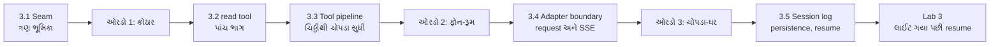
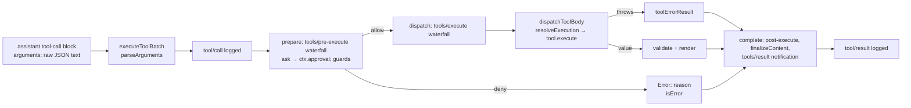
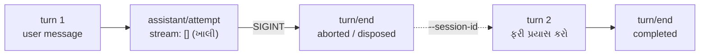

# પ્રકરણ 3 — Tools, sessions અને model adapters

> **Level 3 · 🟡 મોટા ભાગે, 🔴 wire/SSE ની વિગતો બીજી વાંચનમાં.** વાર્તાનો દિવસ 7.
> ત્રણ seam ને અંદરથી ખોલીએ: built-in `read` tool, DeepSeek model adapter, અને session log.
> દરેક માટે: input schema/format, registration, execution, error handling, અને output conversion. આખો નકશો: [સમગ્ર નકશો](overview-samagra-naksho.md).

## 🎬 વાર્તા: ત્રણ ચાવી, ત્રણ ઓરડા

ગઈ રાત્રે નવ વાગ્યે અચાનક લાઈટ ગઈ. ટેબલ 2 નો ઓર્ડર અધૂરો રહ્યો. આજે સવારે આરવે જોયું કે રમેશભાઈ ચોપડો ખોલીને ગઈકાલની છેલ્લી લીટીઓ વાંચે છે — "ઓર્ડર શરૂ… મહારાજને પૂછ્યું… **ઓર્ડર રદ (લાઈટ ગઈ)**" — અને ગ્રાહક ફરી આવે ત્યારે ત્યાંથી જ વાત આગળ ચલાવે છે.

મીરાદીદી ત્રણ ચાવી ટેબલ પર મૂકે છે:

1. **કોઠારની ચાવી** — ભીખાભાઈ મહારાજની ચિઠ્ઠી કેવી રીતે તપાસે, સામાન કેવી રીતે શોધે, અને "નથી" ત્યારે શું કરે. (`read` tool અને tool pipeline)
2. **ફોન-રૂમની ચાવી** — મહારાજ દૂર agency ના રસોડામાં બેસે છે અને બીજી ભાષા બોલે છે. **દુભાષિયો** બંને ભાષા જાણે. (DeepSeek adapter)
3. **ચોપડા-ઘરની ચાવી** — ચોપડો કેવી રીતે લખાય, સચવાય, અને લાઈટ ગયા પછી ઓર્ડર કેવી રીતે આગળ ચાલે. (session log, persistence, resume)

"ત્રણેય ઓરડાની એક ખાસિયત છે," દીદી કહે છે, "દરેક ઓરડાનો **દરવાજો** બદલ્યા વગર અંદરનો માણસ બદલી શકાય. એને **seam** કહે છે."

## 🎯 આ પ્રકરણ પછી તમે શું કરી શકશો

- `read` tool નું schema, registration, execution, error handling અને result conversion source માં બતાવી શકશો.
- Tool call ના raw JSON થી `tool/result` event સુધીનો pipeline ક્રમ લખી શકશો.
- એક provider request ને `GenerateOptions` થી HTTP body સુધી અને SSE response ને `StreamChunk` સુધી અનુસરી શકશો.
- Session log કેવી રીતે model context બને છે, file માં કેવી રીતે persist થાય છે, અને interrupted session કેવી રીતે resume થાય છે તે ચલાવીને બતાવી શકશો.

## 🗺️ આ પ્રકરણનો નકશો



## 3.1 🟢 Seam એટલે બદલી શકાય તેવો સાંધો

> 📦 **Capability seam** — ત્રણ ભૂમિકાવાળી બદલી શકાય તેવી capability:
> **Service Definition** (interface — "આ કામ આવી રીતે માંગવું"), **Service Provider** (implementation — ખરું કામ કરનાર), **Consumer** (તેને વાપરનાર, ઘણી વાર model-facing tool).

ઉદાહરણ: `@deepseek-ai/dsh-fs` નો abstract [`FileSystem`][fs-abstract] definition છે, `dsh-fs-sandbox` provider છે, અને `read` tool consumer છે ([architecture.md — Capability seams](https://github.com/deepseek-ai/deepseek-harness/blob/fcc0ad462172522aaf5c93a7b2e01f6b9f0b0159/docs/architecture.md#capability-seams)). ✅

> 🍽️ **ભોજનાલયમાં:** "કોઠારી" ની નોકરીનું વર્ણન (definition) દીવાલ પર લખેલું છે: "ચિઠ્ઠી લો, સામાન આપો." આજે ભીખાભાઈ (provider) છે; કાલે બીજું કોઈ આવે તો પણ મહારાજ (consumer) ની ચિઠ્ઠી બદલાતી નથી.
>
> **યાદ-ચાવી "નિ-ક-વા":** **નિ**યમ (definition), **ક**ારીગર (provider), **વા**પરનાર (consumer).
>
> 📦 **Abstract class / interface** — "શું કરવું" નું વચન, "કેવી રીતે" નહીં. 🍽️ નોકરીનું વર્ણન.

આ પ્રકરણના ત્રણ seam:

| Seam | 🍽️ ઓરડો | Definition | Provider (base bundle) | Consumer |
|---|---|---|---|---|
| Tools | કોઠાર | `ctx.tools` ([`dsh-tools`][tools-execute]) | `tool-executor-native` ([`NativeToolExecutor`][native-executor]) | agent loop |
| Filesystem | કોઠારનાં ખાનાં | `ctx.fs` ([`FileSystem`][fs-abstract]) | `dsh-fs-sandbox` ([policy][fs-sandbox-doc]) | `read`, `write`, `edit` tools |
| LLM | ફોન-રૂમ | `ctx.llm` ([`LlmRuntime`][llm-runtime]) | `dsh-llm-deepseek-api-key` → [`DeepSeekAdapter`][deepseek-adapter] | agent loop |

**ફાયદો:** provider બદલો (દા.ત. remote sandbox, બીજો model provider), consumer જરા પણ બદલવો પડતો નથી.

## ઓરડો 1: કોઠાર

## 3.2 🟡 `read` tool: પાંચ ભાગ — "ઇ-ન-ચ-ભ-રૂ"

**યાદ-ચાવી "ઇનામ ચલાવ્યું, ભૂલ રૂપે":** **ઇ**નપુટ schema, **ન**ોંધણી, **ચ**લાવવું, **ભ**ૂલ, **રૂ**પાંતર.

### (a) ઇનપુટ schema — "ચિઠ્ઠીનું ફોર્મ"

[`applyReadTool`][read-tool] માંથી (repository code):

```ts
  ctx.tools.register(defineTool({
    name: 'read',
    description: 'Read a UTF-8 text file and return line-numbered content.',
    parameters: {
      file_path: { type: 'string', required: true, description: 'Path to read, resolved by the filesystem backend.' },
      offset: { type: 'number', description: '1-based first line to return. Defaults to 1.' },
      limit: { type: 'number', description: `Maximum number of lines to return. Defaults to ${caps.limit}.` },
    },
```

`defineTool` આ નાના DSL ને JSON Schema માં ફેરવે છે; model ને એ જ schema મળે છે (પ્રકરણ 1 ની wire capture માં 25 tools માંનું એક). `limit` નો default `READ_LIMIT = 2000` છે, અને તે `tool-fs` plugin config (`readLimit`) થી બદલી શકાય છે. ✅

> 📦 **DSL** (Domain-Specific Language) — એક ખાસ કામ માટેની નાની "ભાષા". અહીં `{ type: 'string', required: true }` જેવું ટૂંકું લખાણ.
>
> 📦 **JSON Schema** — JSON નો આકાર વર્ણવવાનું ધોરણ: કયાં fields, કયા type, કયાં ફરજિયાત. 🍽️ છાપેલું ચિઠ્ઠી-ફોર્મ: "file_path (ફરજિયાત), offset, limit".
>
> 📦 **UTF-8** — ગુજરાતી સહિત દુનિયાના બધા અક્ષરો bytes માં લખવાની રીત.

### (b) નોંધણી — બે effects

બે નોંધણી, બંને effects (પ્રકરણ 2): `ctx.systemPrompt.section({ name: 'tool:read', … })` — model ને "cat/sed નહીં, read વાપરો" એવી સૂચના, પણ ફક્ત ત્યારે જ જ્યારે આ scope માં `read` દેખાતું હોય — અને `ctx.tools.register(defineTool({...}))`. `tool-fs` plugin `inject = ['tools', 'fs', 'systemPrompt', 'workingDirectory']` જાહેર કરે છે ([source][toolfs-inject]); પ્રકરણ 2 ના lab માં જોયું કે `workingDirectory` ખૂટે તો આખો `tool-fs` pending રહે છે. 🧪

🍽️ નવો કોઠારી આવે ત્યારે બે કામ: નિયમ-પોથીમાં લખાવે "રેસીપી માટે મને ચિઠ્ઠી આપો, જાતે કબાટ ન ખોલો", અને કોઠાર-યાદીમાં પોતાનું ખાનું નોંધાવે. નોકરી છોડે તો બંને નોંધ આપોઆપ ભૂંસાય.

### (c) ચલાવવું

```ts
    async execute(args, exec) {
      const input = parseReadArgs(args, caps.limit)
      const { target, info } = await resolveRegularReadTarget(ctx, exec, input.filePath)
      const chunks = info.size === undefined || info.size >= caps.streamMinSize
        ? await ctx.fs.streamText(target, exec.signal)
        : [await ctx.fs.readText(target, exec.signal)]
```

(ટૂંકાવેલું; [source][read-tool].) [`resolveRegularReadTarget`][read-target] session ની current directory માં path resolve કરે છે, એક જ `stat` કરે છે, file ન હોય તો `fs/observed` (absent) emit કરી `FsError(..., 'FS_NOT_FOUND')` ફેંકે છે, અને directory હોય તો `FS_NOT_REGULAR_FILE`. 10 MB (`STREAM_MIN_SIZE`) થી મોટી કે size-unknown file stream થાય છે, જેથી backend આખી file memory માં ન ભરે.

> 📦 **`stat`** — file વિશે માહિતી (છે કે નહીં, file છે કે folder, કદ) — file ખોલ્યા વગર. 🍽️ ખાના પરનું લેબલ જોવું, ડબ્બો ખોલ્યા વગર.
>
> 📦 **Resolve (path)** — relative path ને ચોક્કસ સરનામામાં ફેરવવો — "કોની સામે?" એ પ્રશ્ન અહીં પણ: session ની current directory સામે.

### (d) ભૂલ — ત્રણ સ્તર

| સ્તર | ક્યાં | ઉદાહરણ | Model ને શું મળે | 🍽️ |
|---|---|---|---|---|
| Schema | `defineTool` નું `execute` wrapper ([source][schema-defineTool-validate]) | `{"path":"README.md"}` | `Error: invalid arguments: missing required property "file_path"` (`INVALID_ARGS`) 🧪 | ફોર્મમાં ફરજિયાત ખાનું ખાલી |
| Value | [`parseReadArgs`][read-parse] | `offset: 0` | `Error: offset must be a positive integer` ✅ | ખાનું ભર્યું, પણ ખોટી value |
| Filesystem | [`resolveRegularReadTarget`][read-target] | `NOPE.md` | `Error: cannot read "…/NOPE.md": not found` (`FS_NOT_FOUND`) 🧪 | ફોર્મ બરાબર, પણ કોઠારમાં સામાન નથી |

દરેક throw ને pipeline [`toolErrorResult`][pipeline-errorResult] માં ફેરવે છે:

```ts
function toolErrorResult(error: unknown): ToolExecutionResult {
  const info = errorInfo(error)
  const message = toolErrorMessage(error)
  return {
    content: [{ type: 'text', text: `Error: ${message}` }],
    isError: true,
    error: { message, ...info ? { info } : {} },
  }
}
```

એટલે tool ની નિષ્ફળતા **crash નથી**, model માટે એક સામાન્ય `tool/result` છે, અને `info` (`name`, `code`) log માં રહે છે પણ model text નો ભાગ નથી.

> 🍽️ **"લાલ ચિઠ્ઠી, ઝઘડો નહીં":** ભીખાભાઈ સામાન ન મળે તો મહારાજને લાલ ચિઠ્ઠી મોકલે — "નથી". મહારાજ બીજી રીતે વિચારી શકે. કોઠારનો અંદરનો કોડ-નંબર (`FS_NOT_FOUND`) ચોપડામાં નોંધાય, મહારાજની ચિઠ્ઠીમાં નહીં.

### (e) રૂપાંતર — canonical value અને render

> 📦 **Canonical value** — tool નું સાચું, structured પરિણામ, જે log અને UI માટે રહે. 🍽️ સામાન પોતે.
>
> 📦 **Render** — value ને model માટે text બનાવવું. 🍽️ સામાન પર ચોંટાડેલું સાફ લેબલ.

`execute` એક **canonical value** આપે છે: `{ path, offset, lines: [{number, text}], totalLines }`. Pipeline તેને `output.schema` સામે validate કરે છે ([source][pipeline-materialize]), પછી `output.render` તેને model-facing text બનાવે છે ([source][read-output]), અને `presentationMeta` UI card માટે `meta` આપે છે (replay પર card ફરી બની શકે). અમારી wire capture માં model ને આવું text ગયું 🧪:

```text
<path><harness>/README.md</path>
<type>file</type>
<content>
1: # DeepSeek Harness
2: 
3: English | [中文](README.zh.md)
```

## 3.3 🟡 Tool pipeline: raw JSON થી `tool/result` — "ચિઠ્ઠીનો રસ્તો"



ભોજનાલયની ભાષામાં એ જ રસ્તો:

```text
મહારાજની ચિઠ્ઠી (raw JSON)
  →  parseArguments: ચિઠ્ઠી વાંચો (ગરબડ અક્ષરો હોય તો પણ ફેંકો નહીં)
  →  tool/call: ચોપડામાં "આ માંગ્યું"
  →  tools/pre-execute: શેઠની નીતિ, મંજૂરી (પ્રકરણ 5); guards
  →  tools/execute: ખરું કામ (around-wrapper)  →  tool.execute()
  →  validate + render (અથવા throw → "Error: …" લાલ ચિઠ્ઠી)
  →  post-execute, finalize, tools/result
  →  tool/result: ચોપડામાં "આ મળ્યું"
```

| Node | Owner | Symbol |
|---|---|---|
| executeToolBatch / parseArguments | `packages/core/tools/src/batch.ts` | [`executeToolBatch`][batch-execute], [`parseArguments`][batch-parse] |
| prepare | `packages/core/tools/src/pipeline.ts` | [`prepare`][pipeline-prepare] |
| dispatch | same | [`dispatch`][pipeline-dispatch] |
| dispatchToolBody | same | [`dispatchToolBody`][pipeline-body] |
| toolErrorResult | same | [`toolErrorResult`][pipeline-errorResult] |
| `tool/call` data | `packages/core/session/src/types.ts` | [`'tool/call'`][session-types-tool] |

બે નાની પણ મહત્વની વિગતો:

- [`parseArguments`][batch-parse]: invalid JSON હોય તો crash નહીં — raw string જ રાખે છે, જેથી tool પોતાનું argument diagnostic આપી શકે; ખાલી string → `{}`.
- [`dispatchToolBody`][pipeline-body]: tool registry માં ન મળે તો `ToolNotFoundError` ([source][contracts-notfound]); અમારા run માં model ને `Error: unknown tool "read_everything"` મળ્યું, code `UNKNOWN_TOOL`. 🧪 🍽️ "એવું કોઈ ખાનું જ નથી."

> 📦 **Around-wrapper** — ખરા કામની **આગળ અને પાછળ** બંને બાજુ ચાલતો listener (દા.ત. સમય માપવા — પ્રકરણ 6). 🍽️ ઘડિયાળ લઈ ઊભો નિરીક્ષક: "શરૂ… પૂરું, 9 ms."

## ઓરડો 2: ફોન-રૂમ

## 3.4 🟡 Adapter boundary: એક request અને એક streamed response

> 📦 **Adapter** — harness ની ભાષા ↔ provider ની wire ભાષાનો દુભાષિયો. 🍽️ રમેશભાઈ ગુજરાતીમાં બોલે (`GenerateOptions`), agency બીજી ભાષા સમજે (DeepSeek Messages format); દુભાષિયો બંને બાજુ ફેરવે.

### Request: `GenerateOptions` → HTTP

1. Loop [`buildRequest`][loop-buildRequest] માં frozen `GenerateOptions` બનાવે છે: `provider`, `model`, `messages` (log માંથી), `tools`, `toolHistory`, `sessionId`, `signal`.
2. [`LlmRuntime.stream`][llm-stream] તેને `llm/stream` **waterfall** માંથી પસાર કરે છે; છેલ્લો handler adapter stream છે. એટલે કોઈ પણ plugin દરેક model request જોઈ/લપેટી શકે — પ્રકરણ 1 નો trace plugin અને પ્રકરણ 6 નો metrics plugin આ જ hook વાપરે છે.
3. [`DeepSeekAdapter.generate`][deepseek-generate] idle watchdog લગાવે છે (stream શાંત રહે તો `TIMEOUT`), અને errors ને `LlmError` codes માં ફેરવે છે: `TIMEOUT`, `ABORTED`, `TRANSPORT`.
4. `request()` images/files તૈયાર કરે છે, auth headers લાવે છે, [`serialize`][deepseek-serialize] થી Messages-format body બનાવે છે, request extensions ઉમેરે છે, અને [`fetch(…/messages)`][deepseek-fetch] કરે છે:

> 📦 **Watchdog** — "આટલા સમયમાં કંઈ ન આવ્યું તો ભૂલ ગણો" એવી ચોકી. 🍽️ ફોન પર સામે છેડેથી બહુ વાર કંઈ ન સંભળાય તો "લાઇન મરી ગઈ" ગણવું.
>
> 📦 **Serialize** — object ને મોકલી શકાય તેવા text (JSON) માં ફેરવવું.

```ts
        const response = await fetch(`${messagesApiRoot(connection.baseURL)}/messages`, {
          method: 'POST', signal, body: extensions.payload, redirect: 'error',
          headers: {
            ...attributionHeaders(),
            'content-type': 'application/json', 'accept': 'text/event-stream',
            ...auth.headers,
            'anthropic-version': '2023-06-01',
```

(પ્રવેશ પ્ર.4 ની ટપાલ: `POST` method, URL, headers — અને `accept: text/event-stream` એટલે "જવાબ ટીપે ટીપે મોકલજો".)

Wire પર ખરેખર શું ગયું (🧪 [evidence/wire.json](../evidence/wire.json), user id redacted):

```json
    "bodyKeys": ["dsh_plugin_packages", "dsh_session_log", "max_tokens", "messages",
                 "model", "output_config", "stream", "system", "thinking", "tools"],
    "model": "deepseek-flash",
    "stream": true,
    "headers": {
      "anthropic-version": "2023-06-01",
      "x-deepseek-harness-user-id": "<redacted anonymous id>",
      "x-deepseek-harness-session-id": "session-…"
    }
```

> 📦 **Request extension** — provider-specific વધારાનો body field, જે plugins ઉમેરે. 🍽️ ઓર્ડર-ચિઠ્ઠી સાથે ટાંકેલું વધારાનું પાનું.

`dsh_session_log` અને `dsh_plugin_packages` એ **request extensions** છે — DeepSeek-specific fields જે plugins ઉમેરે છે. `dsh_session_log` field `session-log-deepseek` plugin register કરે છે ([source][sessionlog-register]); તેનું README કહે છે: "Incremental canonical session-log upload for official DeepSeek LLM API requests … Disable it only when the official API must not receive a Session-log suffix." પ્રકરણ 5 માં આને **data boundary** તરીકે તપાસીશું — "agency ને આપણા ચોપડાનાં પાનાં પણ જાય છે?" ✅🧪

### 🔴 Response: SSE → `StreamChunk`

Provider HTTP 200 સાથે Server-Sent Events મોકલે છે. [`parseSse`][deepseek-sse] દરેક `data:` line ને JSON બનાવે છે, અને [`translate`][deepseek-translate] તેને harness ના provider-neutral [`StreamChunk`][llm-streamchunk] માં ફેરવે છે:

```ts
export type StreamChunk =
  | { type: 'block-start'; index: number; blockType: ContentBlockType }
  | { type: 'text-delta'; index: number; text: string }
  | { type: 'reasoning-delta'; index: number; text: string }
  | { type: 'tool-call-delta'; index: number; id: ToolCallId; name?: string; argumentsDelta: string }
  | { type: 'block-end'; index: number; block: ContentBlock }
  | { type: 'usage'; usage: TokenUsage }
  | { type: 'finish'; reason: FinishReason; replayState?: ReplayEnvelope }
```

(repository code; છેલ્લો `finish` variant source માં ઘણી lines માં છે, અહીં એક line માં સંક્ષિપ્ત કર્યો છે.) — ઓળખ્યું? આ discriminated union છે (પ્રવેશ પ્ર.6): `type` field જોઈને આકાર નક્કી.

> 📦 **Provider-neutral** — કોઈ એક provider ની ભાષા પર આધાર નહીં. 🍽️ ભોજનાલયની પોતાની ભાષા — agency બદલાય તો પણ એ જ.
>
> 📦 **Delta** — "આગળના ટુકડામાં ઉમેરો" — આખું નહીં, ફક્ત નવો ભાગ. 🍽️ મહારાજનું નવું વાક્ય.

**યાદ-ચાવી — સાત પ્રકાર "બ્લો-ટે-રી-ટૂ-એન્ડ-યુ-ફિ":** `block-start`, `text-delta`, `reasoning-delta`, `tool-call-delta`, `block-end`, `usage`, `finish`.

Provider ના `stop_reason` નું mapping ([source][deepseek-finish]): `end_turn`/`stop_sequence` → `stop`, `tool_use` → `tool-calls`, `max_tokens` → `max-tokens`. HTTP error હોય તો adapter body વાંચી `providerError(raw, status, headers)` થી code (દા.ત. `AUTH`, `SERVER`, rate limit) બનાવે છે અને `LlmError` ફેંકે છે; `LlmRuntime` તેને `finish` chunk (`kind: 'error'`) માં ફેરવે છે, અને loop `agent/request-error` ચલાવે છે (પ્રકરણ 5).

### Adapter boundary નો નિયમ — ઉપર શું, નીચે શું

| Boundary ની ઉપર (loop, tools, session) | Boundary ની નીચે (DeepSeekAdapter) |
|---|---|
| `GenerateOptions` મોકલે | `serialize` → HTTP body |
| `StreamChunk` વાંચે | `fetch …/messages`, `parseSse`, `translate` |
| retry નિર્ણય (`agent/request-error`) | HTTP error → `LlmError` code (`AUTH`, `SERVER`, …) |
| wire format જાણતું નથી | session log જાણતું નથી |

Boundary ની ઉપર (loop, tools, session) કોઈ code DeepSeek wire format જાણતું નથી; boundary ની નીચે adapter harness ના session log ને જાણતું નથી — તે ફક્ત `GenerateOptions` લે છે અને `StreamChunk` આપે છે. નવો provider ઉમેરવો એટલે `ctx.llm.registerAdapter(...)` ([source][llm-registerAdapter]).

**યાદ-ચાવી: "દુભાષિયો ફક્ત ભાષા બદલે, અર્થ નહીં."**

## ઓરડો 3: ચોપડા-ઘર

## 3.5 🟡 Session state → model context

> 📦 **Session log** — append-only events ની યાદી; દરેક event ને `seq` (0,1,2…) અને `time` મળે છે. ઉદાહરણ: પ્રકરણ 1 માં `#17 tool/call`. 🍽️ ઓર્ડર-ચોપડો: દરેક લીટી પર પાના-નંબર અને સમય.
>
> 📦 **Append-only** — ફક્ત અંતે ઉમેરાય; જૂનું કદી બદલાય કે ભૂંસાય નહીં.

[`Session.append`][session-append]:

```ts
    const dataSnapshot = snapshotJsonValue(data)
    if (dataSnapshot === undefined) {
      throw new Error(`session event "${type}" carries non-JSON-serializable data`)
    }
    …
    const event = deepFreeze({
      type,
      seq: SessionSeq(this.log.length),
      time: Date.now(),
```

ત્રણ ખાતરીઓ:

1. data JSON-serializable હોવો જ જોઈએ (નહીં તો append જ નિષ્ફળ — ખરાબ event પછીથી flush વખતે નહીં, **અહીં જ** પકડાય). 🍽️ "ચોપડામાં ફક્ત શાહીથી લખાય તેવું જ" — પેન્સિલ નહીં.
2. event deep-frozen છે — કોઈ બદલી ન શકે.
3. `seq` = log ની લંબાઈ — પાના નંબર ક્રમમાં, કદી કૂદકો નહીં.

રમકડા-agent નું `append` યાદ છે? `Object.freeze({ seq: log.length, … })` — એ જ ત્રણ વિચાર, ઘણા નાના રૂપમાં.

> 📦 **Surface** — log ના એવા nodes જે model history બનાવે છે.

**Surface** માં પાંચ message-producing types છે: `system/message`, `developer/message`, `user/message`, `assistant/message`, `tool/result` ([`SurfaceEventType`][session-surface-types]). [`deriveMessages`][session-derive] surface nodes પરથી `Message[]` બનાવે છે અને cache કરે છે; compaction જેવી replacement થાય તો `contentGeneration` બદલાય અને cache ફરી બને. ખાલી content વાળો `assistant/message` (દા.ત. ફક્ત usage) history માં આવતો નથી.

**યાદ-ચાવી "સિ-ડે-યુ-આ-ટૂ" — "સીડી યુવાન આગળ ટૂંકી":** **સિ**સ્ટમ, **ડે**વલપર, **યુ**ઝર, **આ**સિસ્ટન્ટ, **ટૂ**લ result.

> 📦 **Cache** — એક વાર ગણેલું પરિણામ સાચવી રાખવું, જેથી ફરી ગણવું ન પડે. 📦 **Compaction** — લાંબો ઇતિહાસ ટૂંકો (સાર) કરવો — આ પુસ્તકમાં વિગતે નથી (પરિશિષ્ટ F).

### Persistence — તિજોરીમાં ચોપડો

> 📦 **Persistence** — data ને disk પર ટકાવવું, process બંધ થાય તો પણ. 🍽️ દિવસના અંતે ચોપડો તિજોરીમાં.

Base bundle `session-persistence-jsonl` ને `root: dshHomePath('sessions')` સાથે mount કરે છે. ✅ અમારા runs માં file layout 🧪:

```text
$DSH_HOME/sessions/<cwd-key>/session-<uuid>/session.v4.jsonl.zstd
$DSH_HOME/sessions/<cwd-key>/session-<uuid>/session.lock
```

પહેલી line header છે (`{"type":"session","version":4,"id":…,"cwd":…}`), પછી એક event પ્રતિ line (JSONL — પ્રવેશ પ્ર.3). `.zstd` = દબાવેલી પોટલી (compression); `session.lock` = "આ ચોપડો અત્યારે કોઈ લખે છે" નું તાળું. Architecture doc મુજબ v1 અને પછીના format `session.vN.jsonl[.zstd]` નામ વાપરે છે, અને committed generation files ક્યારેય rename/replace/delete થતી નથી; જૂના version ની session ખોલતાં adjacent migrations ચાલે છે. ✅ Headless runner અંતે [`sessions.flush`][session-flush] બોલાવે છે, જે દરેક `session/flush` listener ની રાહ જુએ છે.

> 📦 **Migration** — જૂના format ના data ને નવા format માં ફેરવવું. 🍽️ જૂના ચોપડાની નકલ નવા ફોર્મમાં — મૂળ ચોપડો અકબંધ.

### Recovery અને resume — લાઈટ ગયા પછી

બે પ્રકારની recovery source માં છે:

- **Step ની અંદર:** step નિષ્ફળ જાય અને tool calls નાં પરિણામ ખૂટે, તો loop [`toolRecovery.results()`][loop-recovery] વડે ખૂટતા `tool/result` લખે છે — દરેક `tool/call` ને જવાબ મળે એ invariant જળવાય.
- **Process ની બહાર:** headless `--session-id <id>` થી persisted Session ફરી અપનાવી શકાય ([headless flags][headless-flags]).

> 📦 **Invariant** — હંમેશા સાચી રહેવી જોઈએ તેવી શરત. અહીં: "દરેક `tool/call` ને એક `tool/result`." 🍽️ દરેક ચિઠ્ઠીનો જવાબ ચોપડામાં હોય જ.
>
> 📦 **Resume** — જૂના session માં નવો turn ચલાવવો. 🍽️ ગઈકાલનો ચોપડો ખોલી વાત આગળ ચલાવવી.

## Source map: આ ક્રમમાં ખોલો

| ક્રમ | ઓરડો | File | Symbol | Input → Output (side effect) |
|---|---|---|---|---|
| 1 | કોઠાર | `packages/fs/tool-fs/src/read.ts` | [`applyReadTool`][read-tool] | caps → registrations (effects) |
| 2 | કોઠાર | `packages/fs/tool-fs/src/read-target.ts` | [`resolveRegularReadTarget`][read-target] | path → `{target, info}` or `FsError` |
| 3 | કોઠાર | `packages/core/tools/src/schema.ts` | [`defineTool` validation][schema-defineTool-validate] | args → `ToolArgsError` |
| 4 | કોઠાર | `packages/core/tools/src/batch.ts` | [`executeToolBatch`][batch-execute] | calls → `ToolBatchResult` (`tool/*` events) |
| 5 | કોઠાર | `packages/core/tools/src/pipeline.ts` | [`prepare`][pipeline-prepare], [`dispatch`][pipeline-dispatch] | exec → result |
| 6 | ફોન | `packages/llm/llm/src/index.ts` | [`stream`][llm-stream] | `GenerateOptions` → `StreamChunk*` |
| 7 | ફોન | `packages/llm/llm-deepseek/src/adapter.ts` | [`generate`][deepseek-generate], [`fetch`][deepseek-fetch] | → HTTP POST |
| 8 | ફોન | `packages/llm/llm-deepseek/src/translate.ts` | [`translate`][deepseek-translate] | SSE JSON → `StreamChunk` |
| 9 | ચોપડો | `packages/core/session/src/index.ts` | [`append`][session-append], [`deriveMessages`][session-derive] | event → log; log → `Message[]` |

## 🧪 Lab 3 — completed અને interrupted session ને resume કરો

**ભાગ A: સામાન્ય resume — "ગ્રાહક પાછો આવ્યો."**

```bash
rm -rf tmp/book-home && bash tmp/book-labs/request-trace/run-mock.sh
```

```bash
SID=$(basename "$(find tmp/book-home/sessions -maxdepth 2 -name 'session-*' -type d | head -1)")
```

(પહેલો command નવા ઘરમાં પ્રકરણ 1 નો run કરે છે; બીજો એ session નું folder નામ — એટલે session id — `SID` variable માં મૂકે છે. `$(…)` અને `basename` = "આખા path માંથી ફક્ત છેલ્લું નામ".)

```bash
SEQUENCE=success SUCCESS_TEXT='ત્રણ મુદ્દા: 1) plugin 2) Cordis 3) session log.' TASK='હવે એ સાર ત્રણ મુદ્દામાં લખો.' DSH_ARGS="--session-id $SID" bash tmp/book-labs/request-trace/run-mock.sh
```

🧪 અવલોકનો ([evidence/resume-a2.err](../evidence/resume-a2.err)): exit 0; નવો event `#27 turn/start {"turn":2}` — એ જ log, આગલો seq; `request/header` reason **`resume`**; ફક્ત **એક** model call, જેમાં `messages=9` — પહેલા turn ની આખી history + નવો સંદેશ.

🍽️ ગ્રાહક બીજા દિવસે આવીને કહે "ગઈકાલની વાનગી, હવે ઓછી તીખી." રમેશભાઈ ચોપડો ખોલે (એ જ session), નવો ઓર્ડર નંબર લખે (turn 2), અને મહારાજને ગઈકાલની **આખી** વાત + નવી માંગ કહે (9 messages).

**ભાગ B: interrupted session ને resume — "લાઈટ ગઈ હતી."** Mock ને `--sequence stall` સાથે ચલાવી headless run ને 4 સેકન્ડે `SIGINT` મોકલ્યો, પછી `--session-id` થી resume કર્યું (પૂરા commands: [પરિશિષ્ટ B](../appendix/B-command-reference.md#interrupt-and-resume)). 🧪 Stored log ([evidence/int2.err](../evidence/int2.err)):

> 📦 **`SIGINT`** — "અટકો" નો signal; Ctrl+C દબાવો ત્યારે process ને મળે. 📦 **Stall** — mock નું એક વર્તન: headers મોકલી પછી ચૂપ — "ફોન ઉપાડ્યો પણ કંઈ બોલ્યા નહીં."

```text
#4 turn/start {"turn":1}
#8 user/message source={"kind":"user"} content=[…"આ repositoryનું README વાંચીને ગુજરાતી સાર આપો."…]
#16 assistant/attempt {"turn":1,"step":1,"stream":[]}
#18 turn/end {"turn":1,"reason":{"kind":"aborted","reason":{"kind":"disposed"}}}
#21 turn/start {"turn":2}
#24 user/message source={"kind":"user"} content=[…"ફરી પ્રયાસ કરો."…]
#25 request/header reason=resume model=deepseek-official/deepseek-flash tools=25
#35 turn/end {"turn":2,"reason":{"kind":"completed"}}
```

Interrupted turn 1 ગુમ થયો નથી: તેનો user message, ખાલી `assistant/attempt`, અને `aborted` reason સાથે `turn/end` durable છે. Turn 2 એ history સાથે ફરી `read` ચલાવ્યું અને પૂરો થયો. — વાર્તાની શરૂઆતમાં રમેશભાઈએ સવારે ચોપડામાં બરાબર આ જ વાંચ્યું હતું.



## 🔮 આગાહી કસોટી

`read` tool ને `{"file_path":"packages"}` (directory) argument સાથે call કરાવો:

```bash
TOOL_ARGS='{"file_path":"packages"}' bash tmp/book-labs/request-trace/run-mock.sh
```

**ચલાવતા પહેલાં લખો:** (1) model ને મળતું exact `Error:` text, (2) `tool/result` માં `error.info.code`, (3) turn નું reason. (સંકેત: 3.2 (d) ની table માં ત્રીજું સ્તર, અને 3.2 (c) નો છેલ્લો ફકરો.) જવાબ: [પરિશિષ્ટ D — Lab 3](../appendix/D-lab-solutions.md#lab-3).

## 🩺 નિષ્ફળતા: નવો tool model ને દેખાતો નથી

**વાર્તામાં.** આરવે નવું કોઠાર-ખાનું બનાવ્યું, plugin load પણ થયો (startup warning નથી). પણ મહારાજ તે ખાના માટે કદી ચિઠ્ઠી લખતા નથી — જાણે ખાનું છે જ નહીં.

**લક્ષણ.** તમારો plugin load થયો છે (startup warning નથી), પણ `llm/stream` trace ની `tools=[…]` યાદીમાં તમારો tool નથી.

**ટૂંકો નિદાન માર્ગ.**

1. Tool `ctx.tools.register` થી register થાય છે કે ફક્ત object બને છે? `defineTool` એકલું કંઈ register કરતું નથી. 🍽️ ખાનું બનાવ્યું, પણ કોઠાર-યાદીમાં નોંધાવ્યું નહીં.
2. Preset કે agent scope માં ફક્ત અમુક tools દેખાય છે? Loop દરેક step માં `ctx.tools.resolve({ agent, … })` થી step-admitted tools લે છે ([`preStep`][loop-preStep]).
3. Plugin કોઈ agent ના `agent.ctx` ને બદલે બીજા scope માં mount થયો છે? Scope chain [`scopeChainOf`][scope-chain] જુઓ. 🍽️ ખાનું બીજા ટેબલની યાદીમાં નોંધાયું.
4. Trace plugin ની `tools=[…]` line એ wire પર ગયેલી યાદી છે; [`capture-wire.ts`](../labs/request-trace/capture-wire.ts) થી `toolNames` ચકાસો.

<a id="saral-samaj"></a>

## ✅ સાર — પ્રકરણ 3 એક પાનામાં

**એક વાક્યમાં:** ત્રણ ઓરડા અંદરથી — કોઠાર (`read` tool: schema → નોંધણી → `ctx.fs` → ભૂલ → render, અને "ભૂલ crash નથી" વાળો tool pipeline), ફોન-રૂમ (DeepSeek adapter: `GenerateOptions` → HTTP → SSE → `StreamChunk`, ફક્ત ભાષા બદલે), અને ચોપડા-ઘર (append-only session log → model history, JSONL file માં સચવાય, અને `--session-id` થી લાઈટ ગયા પછી પણ resume).

> ⚠️ **ઉપમા અહીં તૂટે છે:** સાચો દુભાષિયો વાતચીતનો અર્થ પણ બદલી શકે. અહીં adapter **ફક્ત format** બદલે છે; loop, tools, session એ boundary ની ઉપર DeepSeek ની wire ભાષા ક્યારેય જાણતા નથી.

### નવા ટેકનિકલ શબ્દો — એક નજરે

| શબ્દ | સરળ અર્થ | ઉદાહરણ | યાદ-ચાવી |
|---|---|---|---|
| Capability seam | ત્રણ ભૂમિકાવાળો બદલી શકાય તેવો સાંધો | `ctx.fs` | "નિ-ક-વા" |
| Interface / abstract class | "શું કરવું" નું વચન, "કેવી રીતે" નહીં | `FileSystem` | "નોકરીનું વર્ણન" |
| Tool executor | tool batch ચલાવતો provider | `NativeToolExecutor` | "કોઠારનો મુખ્ય" |
| Tool pipeline | policy → body → result નો ક્રમ | `ToolExecutionPipeline` | "ચિઠ્ઠીનો રસ્તો" |
| Canonical value | tool નું સાચું structured પરિણામ | `{path, lines}` | "સામાન પોતે" |
| Render | value ને model માટે text બનાવવું | `1: # DeepSeek…` | "લેબલ" |
| `isError` | આ result નિષ્ફળતા છે | `true` | "લાલ ચિઠ્ઠી" |
| Adapter | harness ↔ provider wire નો દુભાષિયો | `DeepSeekAdapter` | "દુભાષિયો" |
| HTTP / POST | web પર માંગ મોકલવાની રીત | `POST /v1/messages` | "ટપાલ" |
| SSE | server થી એક-દિશાના event ટુકડા | `data: {...}` | "ટીપે ટીપે" |
| `StreamChunk` | provider-neutral ટુકડો | `text-delta` | "ભોજનાલયની ભાષાનું ટીપું" |
| Request extension | provider-specific વધારાનો body field | `dsh_session_log` | "ચિઠ્ઠી સાથે ટાંકેલું પાનું" |
| Surface | model history બનાવતી log લીટીઓ | 5 પ્રકાર | "સીડી યુવાન આગળ ટૂંકી" |
| Persistence | data ને disk પર ટકાવવું | JSONL file | "તિજોરી" |
| zstd | compression format | `.jsonl.zstd` | "દબાવેલી પોટલી" |
| Resume | જૂના session માં નવો turn | `--session-id` | "ગઈકાલનો ચોપડો ખોલવો" |

### યાદ રાખવાની રીતો

- **"નિ-ક-વા"** — seam ની ત્રણ ભૂમિકા.
- **"ઇનામ ચલાવ્યું, ભૂલ રૂપે"** — `read` tool ના પાંચ ભાગ.
- **"લાલ ચિઠ્ઠી, ઝઘડો નહીં"** — tool ની ભૂલ = સામાન્ય `tool/result`.
- **"દુભાષિયો ફક્ત ભાષા બદલે, અર્થ નહીં"** — adapter boundary.
- **"બ્લો-ટે-રી-ટૂ-એન્ડ-યુ-ફિ"** — `StreamChunk` ના સાત પ્રકાર.
- **"સીડી યુવાન આગળ ટૂંકી"** — પાંચ surface types.
- **ચિત્ર:** ચોપડો, જેની દરેક લીટી પર નંબર (`seq`) અને તાળું (deep-freeze).

### સામાન્ય ગેરસમજો

| ગેરસમજ | સાચું |
|---|---|
| "Tool નિષ્ફળ જાય તો agent crash થાય." | `toolErrorResult` તેને સામાન્ય result બનાવે છે. |
| "Error code model ને દેખાય છે." | `error.info` log માં; model ને ફક્ત `Error: …` text. |
| "Loop DeepSeek API નું format જાણે છે." | ફક્ત adapter જાણે; loop `StreamChunk` જ જુએ. |
| "Resume એટલે ફરી શરૂઆતથી." | એ જ log, આગળનો `seq`, આખી history સાથે. |
| "Ctrl+C થી અધૂરો turn ગાયબ થાય." | `turn/end aborted` સાથે durable રહે છે. |

### પુનરાવર્તન કાર્ડ

<details><summary>1. `read` tool ની ત્રણ error layers?</summary>

Schema (`ToolArgsError`, `INVALID_ARGS`), value (`parseReadArgs` નો સામાન્ય Error), filesystem (`FS_NOT_FOUND`, `FS_NOT_REGULAR_FILE`).
</details>

<details><summary>2. Invalid JSON arguments આવે તો pipeline શું કરે?</summary>

`parseArguments` raw string સાચવે, જેથી tool પોતાનું argument diagnostic આપી શકે; ખાલી string → `{}`.
</details>

<details><summary>3. Wire body માં DeepSeek-specific બે fields?</summary>

`dsh_session_log` અને `dsh_plugin_packages`.
</details>

<details><summary>4. Directory ને `read` કરો તો?</summary>

`Error: cannot read "…/packages": not a regular file`, code `FS_NOT_REGULAR_FILE`, turn `completed`.
</details>

### મિત્રને સમજાવો (3 મિનિટ)

"દુભાષિયો" ઉપમા વાપરીને સમજાવો કે નવો model provider ઉમેરવા માટે loop કેમ બદલવો પડતો નથી (`ctx.llm.registerAdapter`).

## 🧠 Mastery check

1. `read` tool ની ત્રણ error layers અને દરેકનો code લખો.
2. Tool body throw કરે ત્યારે model ને શું મળે છે, અને `error.info` model text માં કેમ નથી?
3. Adapter boundary ની ઉપર અને નીચે કોણ શું જાણે છે?
4. `llm/stream` waterfall હોવાથી શું શક્ય બને છે? એક ઉદાહરણ આપો.
5. `Session.append` non-JSON data પર તરત કેમ નિષ્ફળ થાય છે?
6. Interrupted session resume પછી turn 1 ના કયા events બાકી રહે છે?

જવાબો: [પરિશિષ્ટ D — પ્રકરણ 3](../appendix/D-lab-solutions.md#ch3).

## 🎬 આગળ શું

સાંજે પપ્પા આરવને બે કાગળ આપે છે — બે supplier ના invoice ની યાદીઓ (CSV exports). "આ બેય મેળ ખાય છે કે નહીં, દર મહિને હાથે તપાસવું પડે છે. આમાં તારો agent કંઈ કરી શકે?"

આરવ મીરાદીદી સામે જુએ છે. દીદી હસે છે: "તેં આજે `read` tool અંદરથી જોયો: schema → `ctx.fs` → render → `tool/result`. કાલે **આ જ ઢાંચાથી** તું તારું પોતાનું કોઠાર-ખાનું બનાવીશ — `csv_compare`. અને 'ભૂલ crash નથી' નો નિયમ તારા પોતાના tests માં સાબિત કરીશ."

---

પાછળ: [પ્રકરણ 2](02-cordis-plugin-architecture.md) · આગળ: [પ્રકરણ 4 — પોતાનો plugin બનાવો](04-potano-plugin.md)

<!-- citations:begin (generated by tools/refdefs.py) -->
[batch-execute]: https://github.com/deepseek-ai/deepseek-harness/blob/fcc0ad462172522aaf5c93a7b2e01f6b9f0b0159/packages/core/tools/src/batch.ts#L50-L96
[batch-parse]: https://github.com/deepseek-ai/deepseek-harness/blob/fcc0ad462172522aaf5c93a7b2e01f6b9f0b0159/packages/core/tools/src/batch.ts#L99-L106
[contracts-notfound]: https://github.com/deepseek-ai/deepseek-harness/blob/fcc0ad462172522aaf5c93a7b2e01f6b9f0b0159/packages/core/tools/src/contracts.ts#L291
[deepseek-adapter]: https://github.com/deepseek-ai/deepseek-harness/blob/fcc0ad462172522aaf5c93a7b2e01f6b9f0b0159/packages/llm/llm-deepseek/src/adapter.ts#L22
[deepseek-fetch]: https://github.com/deepseek-ai/deepseek-harness/blob/fcc0ad462172522aaf5c93a7b2e01f6b9f0b0159/packages/llm/llm-deepseek/src/adapter.ts#L142-L170
[deepseek-finish]: https://github.com/deepseek-ai/deepseek-harness/blob/fcc0ad462172522aaf5c93a7b2e01f6b9f0b0159/packages/llm/llm-deepseek/src/translate.ts#L92-L94
[deepseek-generate]: https://github.com/deepseek-ai/deepseek-harness/blob/fcc0ad462172522aaf5c93a7b2e01f6b9f0b0159/packages/llm/llm-deepseek/src/adapter.ts#L65-L90
[deepseek-serialize]: https://github.com/deepseek-ai/deepseek-harness/blob/fcc0ad462172522aaf5c93a7b2e01f6b9f0b0159/packages/llm/llm-deepseek/src/serialize.ts#L57
[deepseek-sse]: https://github.com/deepseek-ai/deepseek-harness/blob/fcc0ad462172522aaf5c93a7b2e01f6b9f0b0159/packages/llm/llm-deepseek/src/sse.ts#L13
[deepseek-translate]: https://github.com/deepseek-ai/deepseek-harness/blob/fcc0ad462172522aaf5c93a7b2e01f6b9f0b0159/packages/llm/llm-deepseek/src/translate.ts#L104
[fs-abstract]: https://github.com/deepseek-ai/deepseek-harness/blob/fcc0ad462172522aaf5c93a7b2e01f6b9f0b0159/packages/fs/fs/src/index.ts#L103
[fs-sandbox-doc]: https://github.com/deepseek-ai/deepseek-harness/blob/fcc0ad462172522aaf5c93a7b2e01f6b9f0b0159/packages/fs/fs-sandbox/src/index.ts#L20-L24
[headless-flags]: https://github.com/deepseek-ai/deepseek-harness/blob/fcc0ad462172522aaf5c93a7b2e01f6b9f0b0159/packages/bundle/headless/src/startup.ts#L58-L63
[llm-runtime]: https://github.com/deepseek-ai/deepseek-harness/blob/fcc0ad462172522aaf5c93a7b2e01f6b9f0b0159/packages/llm/llm/src/index.ts#L354
[llm-stream]: https://github.com/deepseek-ai/deepseek-harness/blob/fcc0ad462172522aaf5c93a7b2e01f6b9f0b0159/packages/llm/llm/src/index.ts#L1170-L1185
[llm-streamchunk]: https://github.com/deepseek-ai/deepseek-harness/blob/fcc0ad462172522aaf5c93a7b2e01f6b9f0b0159/packages/llm/llm/src/types.ts#L496-L508
[loop-recovery]: https://github.com/deepseek-ai/deepseek-harness/blob/fcc0ad462172522aaf5c93a7b2e01f6b9f0b0159/packages/core/agent-loop/src/agent.ts#L376-L385
[native-executor]: https://github.com/deepseek-ai/deepseek-harness/blob/fcc0ad462172522aaf5c93a7b2e01f6b9f0b0159/packages/core/tool-executor-native/src/index.ts#L8-L35
[pipeline-body]: https://github.com/deepseek-ai/deepseek-harness/blob/fcc0ad462172522aaf5c93a7b2e01f6b9f0b0159/packages/core/tools/src/pipeline.ts#L258-L288
[pipeline-dispatch]: https://github.com/deepseek-ai/deepseek-harness/blob/fcc0ad462172522aaf5c93a7b2e01f6b9f0b0159/packages/core/tools/src/pipeline.ts#L295-L326
[pipeline-materialize]: https://github.com/deepseek-ai/deepseek-harness/blob/fcc0ad462172522aaf5c93a7b2e01f6b9f0b0159/packages/core/tools/src/pipeline.ts#L539
[pipeline-prepare]: https://github.com/deepseek-ai/deepseek-harness/blob/fcc0ad462172522aaf5c93a7b2e01f6b9f0b0159/packages/core/tools/src/pipeline.ts#L190-L236
[read-output]: https://github.com/deepseek-ai/deepseek-harness/blob/fcc0ad462172522aaf5c93a7b2e01f6b9f0b0159/packages/fs/tool-fs/src/read.ts#L107-L121
[read-parse]: https://github.com/deepseek-ai/deepseek-harness/blob/fcc0ad462172522aaf5c93a7b2e01f6b9f0b0159/packages/fs/tool-fs/src/read.ts#L55-L62
[read-target]: https://github.com/deepseek-ai/deepseek-harness/blob/fcc0ad462172522aaf5c93a7b2e01f6b9f0b0159/packages/fs/tool-fs/src/read-target.ts#L19-L34
[read-tool]: https://github.com/deepseek-ai/deepseek-harness/blob/fcc0ad462172522aaf5c93a7b2e01f6b9f0b0159/packages/fs/tool-fs/src/read.ts#L68-L163
[scope-chain]: https://github.com/deepseek-ai/deepseek-harness/blob/fcc0ad462172522aaf5c93a7b2e01f6b9f0b0159/packages/core/scope/src/index.ts#L98
[session-append]: https://github.com/deepseek-ai/deepseek-harness/blob/fcc0ad462172522aaf5c93a7b2e01f6b9f0b0159/packages/core/session/src/index.ts#L806-L836
[session-derive]: https://github.com/deepseek-ai/deepseek-harness/blob/fcc0ad462172522aaf5c93a7b2e01f6b9f0b0159/packages/core/session/src/index.ts#L999-L1021
[session-flush]: https://github.com/deepseek-ai/deepseek-harness/blob/fcc0ad462172522aaf5c93a7b2e01f6b9f0b0159/packages/core/session/src/index.ts#L1342-L1360
[session-surface-types]: https://github.com/deepseek-ai/deepseek-harness/blob/fcc0ad462172522aaf5c93a7b2e01f6b9f0b0159/packages/core/session/src/types.ts#L447-L452
[session-types-tool]: https://github.com/deepseek-ai/deepseek-harness/blob/fcc0ad462172522aaf5c93a7b2e01f6b9f0b0159/packages/core/session/src/types.ts#L369
[sessionlog-register]: https://github.com/deepseek-ai/deepseek-harness/blob/fcc0ad462172522aaf5c93a7b2e01f6b9f0b0159/packages/session/session-log-deepseek/src/index.ts#L196
[toolfs-inject]: https://github.com/deepseek-ai/deepseek-harness/blob/fcc0ad462172522aaf5c93a7b2e01f6b9f0b0159/packages/fs/tool-fs/src/index.ts#L24
[tools-execute]: https://github.com/deepseek-ai/deepseek-harness/blob/fcc0ad462172522aaf5c93a7b2e01f6b9f0b0159/packages/core/tools/src/index.ts#L375-L377
<!-- citations:end -->
