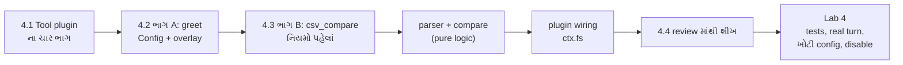
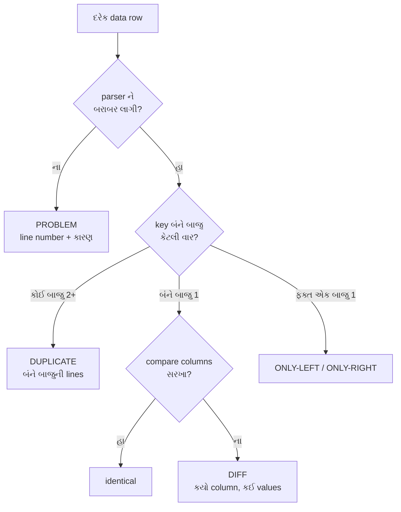

# પ્રકરણ 4 — પોતાનો plugin બનાવો

> **Level 4 · 🟢 ભાગ A, 🟡 ભાગ B.** વાર્તાનો દિવસ 8–9.
> પહેલાં repository ના ચકાસેલા `greet` tutorial example માં સૌથી નાનો ઉપયોગી ફેરફાર કરીએ.
> પછી એક read-only `csv_compare` tool બનાવીએ, જે બે CSV export સરખાવી matched અને unmatched records આપે — deterministic નિયમો સાથે. આખો નકશો: [સમગ્ર નકશો](overview-samagra-naksho.md).

## 🎬 વાર્તા: આરવનું પોતાનું કાઉન્ટર

પપ્પાએ આપેલા બે કાગળ ટેબલ પર છે:

- **આપણી નોંધ** (`export-a.csv`) — ભોજનાલયે મળેલાં invoices ની યાદી.
- **Supplier ની યાદી** (`export-b.csv`) — supplier કહે છે તેણે આ invoices મોકલ્યાં.

દર મહિને પપ્પા બંને યાદી પાસે-પાસે રાખી આંગળી ફેરવતાં સરખાવે છે: "INV-1001 બંનેમાં… INV-1002 માં રકમ 50 પૈસા અલગ… INV-1004 આપણી યાદીમાં **બે વાર**?… INV-1006 ની line અડધી કપાયેલી…"

આરવ કહે છે, "હું એક કાઉન્ટર બનાવીશ — `csv_compare`. મહારાજ ચિઠ્ઠી લખે 'આ બે યાદી સરખાવો', અને મારું કાઉન્ટર હિસાબ આપે."

મીરાદીદી બે શરત મૂકે છે:

1. "પહેલાં **નાનો** ફેરફાર કરીને હાથ બેસાડ — સ્વાગત-કાઉન્ટર (`greet`) નું વાક્ય બદલ."
2. "તારું કાઉન્ટર **ક્યારેય અનુમાન નહીં કરે**. શંકા હોય ત્યાં 'શંકા છે' લખશે, અને દરેક line નો હિસાબ આપશે. ખોટો પણ આત્મવિશ્વાસુ હિસાબ, હિસાબ ન હોય તેના કરતાં ખરાબ."

## 🎯 આ પ્રકરણ પછી તમે શું કરી શકશો

- `defineTool` થી schema-validated tool બનાવી, `Config` schema થી તેને configurable બનાવી શકશો.
- Absolute-path overlay વડે local plugin ને `dsh` માં insert, configure અને disable કરી શકશો.
- Pure logic (CSV parse, compare) ને harness-wiring થી અલગ રાખી, બંને માટે અલગ tests લખી શકશો.
- Determinism ના નિયમો — sorting, duplicates પર guess નહીં, line numbers — લાગુ કરી શકશો.

## 🗺️ આ પ્રકરણનો નકશો



## 4.1 🟢 Tool plugin ના ચાર ભાગ

| ભાગ | પ્રશ્ન | `csv_compare` માં | 🍽️ |
|---|---|---|---|
| `inject` | કઈ services વગર ચાલી ન શકે? | `['tools', 'fs']` | "કોઠાર-યાદી અને કોઠારની ચાવી જોઈએ" |
| `Config` | deployment શું બદલી શકે? | `toolName`, `maxBytes` | શેઠ નક્કી કરે તેવી સેટિંગ |
| `parameters` | model શું મોકલે? | `left_path`, `right_path`, `key_columns`, `compare_columns?` | ચિઠ્ઠી-ફોર્મનાં ખાનાં |
| `output` | canonical value શું, અને model ને text કેવું? | JSON report → `renderReport` text | પૂરો હિસાબ + નાની રસીદ |

> 📦 **Canonical value** — tool નું સાચું, structured પરિણામ, જે log અને UI માટે રહે. 📦 **Rendered content** — model ને દેખાતું text. ઉદાહરણ: `read` નું canonical value `{path, lines, totalLines}`, rendered `1: # DeepSeek Harness…` (પ્રકરણ 3).
>
> 🍽️ canonical value = ગોદામનો પૂરો હિસાબ-ચોપડો; rendered = ગ્રાહકને આપેલી નાની રસીદ.
>
> 📦 **Config** — plugin ની સેટિંગ્સ, `cordis.yml`/overlay માંથી આવે, અને **schema** થી તપાસાય. 📦 **Deployment** — software ને કોઈ ચોક્કસ જગ્યાએ, ચોક્કસ સેટિંગ સાથે ચલાવવું. 🍽️ "મણિનગર શાખા" vs "નવરંગપુરા શાખા" — એક જ ભોજનાલય, જુદી સેટિંગ.

Repository ના બે નિયમ અહીં સીધા લાગુ પડે છે ([AGENTS.md][agents-conventions]):

- **No hardcoded tunables in plugins** — deployment પ્રમાણે બદલાતી પસંદગી validated `Config` field હોવી જોઈએ. 🍽️ "તીખાશ કેટલી" એ રેસીપીમાં પથ્થર પર કોતરેલું ન હોય; દરેક શાખા નક્કી કરી શકે.
- **Misconfiguration fails loud** — ખોટી config load વખતે જ દેખાવી જોઈએ. 🍽️ ખોટી સેટિંગ હોય તો સવારે જ બૂમ — ગ્રાહક આવે ત્યારે નહીં. ✅

> 📦 **Hardcoded** — code માં સીધું લખી દીધેલું, બદલવા code બદલવો પડે. 📦 **Tunable** — બદલી શકાય તેવી સેટિંગ.

## 4.2 🟢 ભાગ A: ચકાસેલા example માં સૌથી નાનો ફેરફાર — સ્વાગત-કાઉન્ટર

Repository ની user guide માં `greet` tool છે ([docs/user/develop/basic/tool.md](https://github.com/deepseek-ai/deepseek-harness/blob/fcc0ad462172522aaf5c93a7b2e01f6b9f0b0159/docs/user/develop/basic/tool.md)). મૂળ tool "Hello, Ada!" આપે. અમે તેમાં **બે** ફેરફાર કર્યા ([labs/greet/greet.ts](../labs/greet/greet.ts), book lab code):

```ts
// change 1: a schema-validated config with a default
export const Config: z<Config> = z.object({
  greeting: z.string().default('નમસ્તે'),
})

export function apply(ctx: Context, config: Config) {
  ctx.tools.register(defineTool({
    …
    async execute(args) {
      return `${config.greeting}, ${args.name}!` // change 2: use the config value
    },
  }))
}
```

> 📦 **`z` (schemastery)** — config નો આકાર વર્ણવતી અને તપાસતી library. `z.string().default('નમસ્તે')` = "text હોવું જોઈએ; ન આપો તો 'નમસ્તે'."

1. `Config` schema: `greeting: z.string().default('નમસ્તે')` — config ન આપો તો "નમસ્તે".
2. `execute` માં `config.greeting` વાપર્યું.

**Overlay** (absolute path ફરજિયાત; પ્રકરણ 2.2). `make-overlay.sh` આ લખે છે:

```yaml
- insert:
    - id: book-greet
      name: '/abs/path/to/tmp/book-labs/greet/greet.ts'
      config:
        greeting: 'કેમ છો'
```

(🍽️ મેનુ પર નવી ચિઠ્ઠી: "આજે નવું કાઉન્ટર `book-greet` ખોલો; સ્વાગત-વાક્ય: 'કેમ છો'.")

**ચલાવો** (mock model `greet` tool call કરશે):

```bash
O=$(GREETING='કેમ છો' bash tmp/book-labs/greet/make-overlay.sh)
```

```bash
TOOL_NAME=greet TOOL_ARGS='{"name":"Ada"}' SUCCESS_TEXT=done EXTRA_PATCH=$O TASK='Use the greet tool to greet Ada.' bash tmp/book-labs/request-trace/run-mock.sh
```

(પહેલો command overlay file બનાવી તેનો path `O` માં મૂકે; બીજો રિહર્સલ મહારાજને કહે "આ વખતે `greet` tool માંગજો, `Ada` નામ સાથે", અને `EXTRA_PATCH=$O` થી આપણું કાઉન્ટર ઉમેરે.)

🧪 Stored `tool/result` text: config વગર `"નમસ્તે, Ada!"`, `greeting: 'કેમ છો'` સાથે `"કેમ છો, Ada!"`; બંને exit 0 ([evidence/greet.err](../evidence/greet.err)).

**શીખ:** deployment પ્રમાણે બદલાતી વસ્તુ code માં hardcode ન કરો; validated `Config` field બનાવો.

## 4.3 🟡 ભાગ B: `csv_compare` — નિયમો પહેલાં, code પછી

> 📦 **Deterministic** — એ જ input → byte-identical output, અને કોઈ નિર્ણય "અનુમાન" થી નહીં. 🍽️ એ જ બે યાદી સો વાર આપો, સો વાર અક્ષરશઃ એ જ હિસાબ.

નિયમો ([labs/csv-inspect/src/compare.ts](../labs/csv-inspect/src/compare.ts)):

1. **Key** = key columns ની trimmed values, U+001F થી જોડેલી. (Trimmed = આગળ-પાછળની ખાલી જગ્યા કાઢી; U+001F = એક અદૃશ્ય વિભાજક અક્ષર, જે સામાન્ય data માં આવતો નથી — જેથી બે columns જોડતાં ગૂંચવણ ન થાય.)
2. કોઈ પણ બાજુ એક key **એકથી વધુ વાર** આવે તો તે **duplicate**: તેની એક પણ row match નહીં થાય, કારણ કે એક પસંદ કરવી એ guess છે. Group માં **બંને બાજુની** એ key ની lines રહે છે, જેથી સામેની બાજુની એકલી row પણ report માંથી ગાયબ ન થાય.
3. બંને બાજુ બરાબર એક વાર હોય તો **matched**; compare columns સરખા હોય તો identical, નહીં તો differences ની યાદી.
4. બાકીની rows તેમની બાજુએ **unmatched**.
5. ખરાબ row (field count ખોટો, quote બંધ નથી) parser **problem** તરીકે line number સાથે report કરે છે. Header માં ખાલી કે પુનરાવર્તિત column name હોય તો **દરેક** data row `INVALID_HEADER` તરીકે નકારાય છે — નહીં તો એક column ની value બીજીને ચૂપચાપ overwrite કરે.
6. બધી output arrays key, પછી line પ્રમાણે sorted.

**યાદ-ચાવી "કી-ડુ-મે-બા-પ્ર-ક્ર" — "કીડી મેદાનમાં બાકી પ્રશ્ન ક્રમમાં":** **કી**, **ડુ**પ્લિકેટ, **મે**ળ, **બા**કી, **પ્ર**શ્ન (problem), **ક્ર**મ.



**છેલ્લી ખાતરી (invariant):** દરેક input data line report માં **બરાબર એક જ** જગ્યાએ દેખાય. આ માટે ખાસ test છે — "હિસાબ પૂરો: એક પણ line ગાયબ નહીં, એક પણ બે વાર નહીં."

**Parser** ([labs/csv-inspect/src/csv.ts](../labs/csv-inspect/src/csv.ts)) RFC 4180 નો નાનો ભાગ સંભાળે છે: comma, double-quoted fields, quote ની અંદર `""`, LF/CRLF, અને UTF-8 BOM. તે ક્યારેય row "સુધારતો" નથી.

> 📦 **Parser** — text ને structured data માં ફેરવનાર. 📦 **RFC 4180** — CSV નું લખેલું ધોરણ. 📦 **LF / CRLF** — line ના અંતના બે પ્રકાર (Linux/Windows). 📦 **BOM** — કેટલીક files ની શરૂઆતમાં આવતો અદૃશ્ય અક્ષર. (આ fixture માં `"Shah Traders, Surat"` જુઓ — field ની અંદર comma, તેથી quotes.)

### Harness wiring (plugin)

[labs/csv-inspect/src/plugin.ts](../labs/csv-inspect/src/plugin.ts) માંથી મુખ્ય ભાગ:

```ts
export const inject = ['tools', 'fs']

export const Config: z<Config> = z.object({
  toolName: z.string().default('csv_compare'),
  maxBytes: z.natural().default(5 * 1024 * 1024),
})

async function readCsvFile(ctx: Context, exec: ToolExecution, path: string, maxBytes: number) {
  const target = await resolveForCall(ctx, exec, path)
  const info = await ctx.fs.stat(target, exec.signal)
  if (info === undefined) throw new Error(`cannot read "${path}": not found`)
  if (info.type !== 'file') throw new Error(`cannot read "${path}": not a regular file`)
  if (info.size !== undefined && info.size > maxBytes) { throw new Error(…) }
  return parseCsv(await ctx.fs.readText(target, exec.signal))
}
```

(`z.natural()` = 0 કે તેથી મોટો પૂર્ણાંક; `5 * 1024 * 1024` = 5 MB.) — `read` tool સાથે સરખાવો: `stat` → ન મળે તો ભૂલ → folder હોય તો ભૂલ → વાંચો. એ જ ઢાંચો.

ત્રણ design નિર્ણયો:

- **Read-only, seam દ્વારા.** File `node:fs` થી નહીં, `ctx.fs` થી વાંચીએ છીએ. તેથી deployment નો filesystem provider (base માં `dsh-fs-sandbox`) path resolution અને policy નો માલિક રહે છે, અને tool કદી write કરતો નથી. 🍽️ આરવનું કાઉન્ટર પોતાની ચાવીથી કબાટ નથી ખોલતું; ભીખાભાઈ પાસે માંગે છે — એટલે કોઠારના નિયમો આપોઆપ લાગુ.
- **Session directory.** `workingDirectory` service હોય તો path ને session ની current directory માં resolve કરીએ છીએ — upstream `read` tool ની જેમ ([`resolveRegularReadTarget`][read-target]). `workingDirectory` ને `inject` માં ન મૂક્યું, કારણ કે unit test માં તે વગર પણ tool ચાલવો જોઈએ; તેથી `ctx.get('workingDirectory')` optional રીતે વાંચીએ છીએ.
- **`isConcurrencySafe: () => true`.** બે reads, કોઈ write નહીં; executor તેને બીજા read-only calls સાથે parallel ચલાવી શકે ([`executeToolBatch`][batch-execute] નું parallel group). 🍽️ બે લોકો એક સાથે મેનુ **વાંચી** શકે; એક સાથે **લખી** ન શકે.

> 📦 **Pure logic** — ફક્ત input પરથી output ગણે, બહારની દુનિયા (files, network) ને અડે નહીં. `parseCsv` અને `compareTables` pure છે; `plugin.ts` "wiring" છે — harness સાથે જોડાણ. **અલગ રાખવાથી** pure ભાગના tests ઝડપી અને સરળ બને.
>
> 📦 **Unit test / integration test** — unit test એક નાના ટુકડાને એકલો તપાસે; integration test ઘણા ટુકડા જોડીને.

## 4.4 🟡 Code review માંથી શીખ — ત્રણ "હિસાબ ખૂટે" ભૂલો

આ labs ના PR review (automated reviewer — Codex) માં ત્રણ ખરી ભૂલો પકડાઈ, અને ત્રણેય "ચૂપચાપ સાચા દેખાતા" પ્રકારની હતી:

| ભૂલ | જૂનું વર્તન | સુધારો |
|---|---|---|
| Header માં `Amount,Amount` | બીજો column પહેલાને ચૂપચાપ ઢાંકી દે; ખોટો identical match | આખી file ની rows નકારો (`INVALID_HEADER`) — નિયમ 5 |
| એક બાજુ duplicate, બીજી બાજુ એક row | એકલી row report માંથી ગાયબ | duplicate group માં બંને બાજુની lines — નિયમ 2 |
| (પ્રકરણ 7) `Debit` column જ નથી | ગેરહાજર column = શૂન્ય; ₹900 ગાયબ | configured column ન હોય તો સ્પષ્ટ config error |

**શીખ — યાદ-ચાવી "ચૂપ સાચું = ખતરનાક":** "ચૂપચાપ સાચા દેખાતા" output સૌથી જોખમી છે. દરેક input row નો હિસાબ test થી સાબિત કરો. મીરાદીદીની બીજી શરત ("ક્યારેય અનુમાન નહીં") આ જ કારણે હતી.

## Source map: આ ક્રમમાં ખોલો

| ક્રમ | File | Symbol | કેમ |
|---|---|---|---|
| 1 | `docs/user/develop/basic/tool.md` | `greet` | મૂળ ચકાસેલું example |
| 2 | `packages/core/tools/src/schema.ts` | [`defineTool` validation][schema-defineTool-validate] | args ક્યાં validate થાય છે |
| 3 | `packages/fs/tool-fs/src/read-target.ts` | [`resolveRegularReadTarget`][read-target] | path resolution નો upstream નમૂનો |
| 4 | `packages/core/tools/src/batch.ts` | [`executeToolBatch`][batch-execute] | concurrency-safe grouping |
| 5 | `vendor/cordis/src/fiber.ts` | config validation (`resolveConfig`) | ખોટી config ક્યાં પકડાય છે |
| 6 | `labs/csv-inspect/src/*.ts` | `parseCsv`, `compareTables`, `apply` | આપણો code |

## 🧪 Lab 4 — tests, real turn, config failure, disable

**(1) Pure logic અને integration tests** (harness checkout ના `tmp/book-labs` થી):

```bash
node --import tsx --test csv-inspect/test/*.test.ts
```

🧪 `tests 13, pass 13, fail 0`. Integration test ([plugin.test.ts](../labs/csv-inspect/test/plugin.test.ts)) real `SystemPrompt`, `ToolRuntime`, `NativeToolExecutor`, `LocalFileSystem` plugins ને `await ctx.plugin(...)` થી ક્રમસર mount કરે છે — upstream testkit [`mountAgentLoopTestDependencies`][testkit-mount] ની જેમ — એટલે પ્રકરણ 2 નો race અહીં શક્ય નથી. છેલ્લો test સાબિત કરે છે કે plugin unload થતાં tool registry માંથી tool ગાયબ થાય છે (પ્રકરણ 2 નું effect — "ઉધારની પહોંચ").

**(2) Type check** (harness ની strict settings, built declarations સામે):

```bash
node --max-old-space-size=8192 ../../node_modules/typescript/bin/tsc -p tsconfig.json
```

🧪 exit 0. (ખાતરી માટે અમે જાણીજોઈને એક ખોટી file ઉમેરી — `TS2322` પકડાયો — પછી કાઢી નાખી.) (`--max-old-space-size=8192` = Node ને 8 GB memory વાપરવાની છૂટ — મોટો project છે.)

**(3) Real headless turn:**

```bash
C=$(bash tmp/book-labs/csv-inspect/make-overlay.sh)
```

```bash
TOOL_NAME=csv_compare TOOL_ARGS='{"left_path":"tmp/book-labs/csv-inspect/fixtures/export-a.csv","right_path":"tmp/book-labs/csv-inspect/fixtures/export-b.csv","key_columns":["Ref"]}' EXTRA_PATCH=$C TASK='આ બે CSV export સરખાવો.' bash tmp/book-labs/request-trace/run-mock.sh
```

🧪 exit 0. Model ને ગયેલું tool result ([evidence/csv.err](../evidence/csv.err) અને stored session):

```text
key: Ref; compared: Date, Party, Amount
left rows 5, right rows 4
identical 1, different 1, only-left 1, only-right 1, duplicate keys 1, problems 1
DIFF INV-1002 (left L3, right L3): Amount "8250.50"≠"8250.00"
ONLY-LEFT INV-1003 (L4)
ONLY-RIGHT INV-1005 (L5)
DUPLICATE INV-1004 (left L5, L6; right L4)
PROBLEM left L7 COLUMN_COUNT: expected 4 fields, found 3
```

**વાર્તામાં વાંચો** — પપ્પાની આંગળીએ જે શોધ્યું, તે જ કાઉન્ટરે line number સાથે:

| Report line | Fixture માં | પપ્પાની ભાષામાં |
|---|---|---|
| `identical 1` | INV-1001 બંનેમાં સરખું | "આ બરાબર" |
| `DIFF INV-1002` | `8250.50` vs `8250.00` | "50 પૈસાનો ફરક — supplier ને પૂછો" |
| `ONLY-LEFT INV-1003` | ફક્ત આપણી યાદીમાં | "supplier ની યાદીમાં નથી" |
| `ONLY-RIGHT INV-1005` | ફક્ત supplier ની યાદીમાં | "આપણે નોંધ્યું નથી" |
| `DUPLICATE INV-1004` | આપણી યાદીમાં lines 5–6, supplier ની line 4 | "બે વાર લખ્યું? કઈ સાચી — જાતે જુઓ" |
| `PROBLEM left L7` | `export-a.csv` ની line 7 માં ત્રણ જ fields | "line અડધી કપાયેલી" |

દરેક line નું મૂળ fixture માં શોધો: `export-a.csv` ની line 7 માં ત્રણ જ fields છે, lines 5–6 એક જ key ધરાવે છે, અને `export-b.csv` ની line 4 એ જ key ની એકલી row છે — તે પણ duplicate group માં દેખાય છે. Test "every input data line appears in exactly one place in the report" આ હિસાબ ચકાસે છે.

**(4) ખોટી config — fail loud.** Overlay માં `maxBytes: -5`. 🧪 ([evidence/csv-badcfg.err](../evidence/csv-badcfg.err)):

```text
dsh: warning: 1 entry did not activate
book-csv-compare (file:///…/csv-inspect/src/plugin.ts): ValidationError: invalid config:
  - $.maxBytes expected number >= 0 but got -5 (at maxBytes)
```

`z.natural()` એ Cordis ના config resolution માં જ નિષ્ફળ થયું; tool register થયો જ નહીં. Required entry ન હોવાથી ફક્ત warning (પ્રકરણ 2 નું "શણગારની ઈંટ"). 🍽️ સવારે જ કાંતિકાકાની બૂમ: "આ કાઉન્ટરની સેટિંગ ખોટી — આજે બંધ."

**(5) Disable કેવી રીતે કરવો.** ત્રણ રસ્તા, સૌથી નાનાથી — **યાદ-ચાવી "ન-બી-કા":**

1. Overlay **ન** આપો (`--patch` કાઢી નાખો).
2. **બી**જું overlay, row ને id થી disable કરે:

```yaml
- id: book-csv-compare
  disabled: true
```

3. **કા**યમ માટે: એ જ row profile ના `cordis.patch.yml` (`$DSH_HOME/profiles/<profile>/cordis.patch.yml`) માં.

🧪 રસ્તો 2 ચકાસ્યો: model એ `csv_compare` call કર્યું ત્યારે result `Error: unknown tool "csv_compare"`, code `UNKNOWN_TOOL` ([evidence/csv-disabled.err](../evidence/csv-disabled.err)). — પ્રકરણ 3 ની "એવું કોઈ ખાનું જ નથી" લાલ ચિઠ્ઠી.

## 🔮 આગાહી કસોટી

`export-b.csv` માં `INV-1004` ને **બે વાર** (lines 4 અને 6) કરો, `export-a.csv` જેમ છે તેમ રાખો. **ચલાવતા પહેલાં લખો:** summary ની `duplicateKeys`, `onlyRight`, અને `duplicates` array ની entries (દરેક entry: `key`, `left`, `right`). પછી test માં assertion તરીકે લખી ચકાસો. (સંકેત: નવી row file ના અંતે, line 6 પર ઉમેરો — `INV-1005` line 5 પર જ રહે છે. હવે key `INV-1004` બંને બાજુ duplicate છે: group કેટલાં?) જવાબ: [પરિશિષ્ટ D — Lab 4](../appendix/D-lab-solutions.md#lab-4).

## 🩺 નિષ્ફળતા: "tool ચાલે છે, પણ path ખોટી જગ્યાએથી વાંચે છે"

**વાર્તામાં.** Tests માં કાઉન્ટર સરસ ચાલે છે. પણ ખરા `dsh` turn માં: "`export-a.csv` મળી નથી." આરવ મૂંઝાય છે — "file તો ત્યાં જ છે!"

**લક્ષણ.** Unit test માં `export-a.csv` મળે છે, પણ `dsh` turn માં `cannot read "export-a.csv": not found`.

**ટૂંકો નિદાન માર્ગ.**

1. Relative path કોની સામે resolve થાય છે? Test માં `LocalFileSystem { cwd: fixtures }`; `dsh` માં session ની working directory (અમારા runs માં harness checkout નું root).
2. `runtime-context` user message માં લખેલી "Current working directory" જુઓ (પ્રકરણ 1 નું `#10 user/message`).
3. Tool argument માં checkout-relative path આપો (`tmp/book-labs/...`), અથવા absolute path.

**ત્રીજી વાર એ જ પ્રશ્ન:** પ્રવેશ પ્રકરણ (shell નું folder), પ્રકરણ 2 (profile directory), અને હવે અહીં (session directory) — "**relative path કોની સામે?**" આ પ્રશ્ન expert ની ટેવ છે.

<a id="saral-samaj"></a>

## ✅ સાર — પ્રકરણ 4 એક પાનામાં

**એક વાક્યમાં:** પોતાનું કાઉન્ટર ખોલવું — પહેલાં `greet` માં એક validated `Config` (નાનો ફેરફાર, મોટો નિયમ: hardcode નહીં), પછી read-only `csv_compare`: `ctx.fs` થી વાંચે, ક્યારેય અનુમાન ન કરે, દરેક line નો હિસાબ આપે, ખોટી config પર સવારે જ બૂમ પાડે, અને `disabled: true` થી બંધ થાય.

> ⚠️ **ઉપમા અહીં તૂટે છે:** સાચો કર્મચારી શંકા પડે તો અનુમાન કરી લે. આપણો tool **ક્યારેય અનુમાન નથી કરતો**: duplicate key હોય તો match કરતો નથી, ખરાબ header હોય તો row સ્વીકારતો નથી — અને એ બધું report માં કારણ સાથે લખે છે.

### નવા ટેકનિકલ શબ્દો — એક નજરે

| શબ્દ | સરળ અર્થ | ઉદાહરણ | યાદ-ચાવી |
|---|---|---|---|
| `defineTool` | schema + execute + output વાળો tool બનાવે (register નહીં) | `defineTool({ name: 'greet', … })` | "ખાનું બનાવવું" |
| `ctx.tools.register` | tool ને registry માં નોંધે; disposer આપે | `register(defineTool(…))` | "કોઠાર-યાદીમાં નોંધ" |
| Config schema | plugin ની સેટિંગનો આકાર અને તપાસ | `z.natural().default(…)` | "શાખાની સેટિંગ" |
| Overlay `insert` | નવી row ઉમેરવી | `- insert: [{ id: book-greet, … }]` | "નવું કાઉન્ટર" |
| Deterministic | એ જ input → એ જ output | sorted report | "સો વાર, એ જ હિસાબ" |
| Duplicate key | એક key એકથી વધુ વાર | `INV-1004` | "બે વાર લખ્યું" |
| Invariant | હંમેશા સાચી રહેતી શરત | "દરેક line બરાબર એક વાર" | "હિસાબ પૂરો" |
| Pure logic | બહારની દુનિયા વગરની ગણતરી | `compareTables` | "કાગળ પર ગણતરી" |
| Integration test | ઘણા ભાગ જોડીને તપાસ | `plugin.test.ts` | "આખું કાઉન્ટર ચલાવી જોવું" |
| `isConcurrencySafe` | બીજા સાથે parallel ચાલી શકે | `() => true` | "વાંચવા સાથે, લખવા એકલા" |
| Fail loud | ખોટી config પર load વખતે જ ભૂલ | `ValidationError` | "સવારે જ બૂમ" |

### યાદ રાખવાની રીતો

- **"કીડી મેદાનમાં બાકી પ્રશ્ન ક્રમમાં"** — છ deterministic નિયમો.
- **"ન-બી-કા"** — disable ના ત્રણ રસ્તા.
- **"ચૂપ સાચું = ખતરનાક"** — review findings નો સાર.
- **"Relative path કોની સામે?"** — ત્રીજી વાર આવેલો પ્રશ્ન.

### સામાન્ય ગેરસમજો

| ગેરસમજ | સાચું |
|---|---|
| "`defineTool` લખ્યું એટલે tool તૈયાર." | `ctx.tools.register(...)` વગર model ને દેખાતો નથી. |
| "Duplicate હોય તો પહેલી row match કરી દો." | એ guess છે; આખું group review માટે રોકો. |
| "ખોટી config પર tool ચાલશે, ભૂલ પછી દેખાશે." | Config load વખતે જ `ValidationError`; tool register જ ન થાય. |
| "`node:fs` થી વાંચવું સરળ છે, ચાલે." | ચાલે, પણ sandbox/policy અને path resolution નો માલિક બાયપાસ થાય; `ctx.fs` વાપરો. |

### પુનરાવર્તન કાર્ડ

<details><summary>1. Tool plugin ના ચાર ભાગ?</summary>

`inject`, `Config`, `parameters`, `output` (canonical value + render).
</details>

<details><summary>2. `csv_compare` duplicates ને match કેમ નથી કરતો?</summary>

એક પસંદ કરવી guess છે; ખોટો match ચૂપચાપ ખોટો હિસાબ બનાવે. બંને બાજુની lines group માં review માટે રહે છે.
</details>

<details><summary>3. `maxBytes: -5` આપો તો?</summary>

`ValidationError … $.maxBytes expected number >= 0`; entry activate ન થાય; required નથી એટલે ફક્ત warning; tool registry માં નથી.
</details>

<details><summary>4. Disable કર્યા પછી model `csv_compare` માંગે તો?</summary>

`Error: unknown tool "csv_compare"`, code `UNKNOWN_TOOL`; turn ચાલુ રહે.
</details>

### મિત્રને સમજાવો (3 મિનિટ)

"ખોટો પણ આત્મવિશ્વાસુ હિસાબ, હિસાબ ન હોય તેના કરતાં ખરાબ" — આ વાક્ય `INV-1004` duplicate અને `Amount,Amount` header ના ઉદાહરણથી સમજાવો.

## 🧠 Mastery check

1. `defineTool` એ `parameters` ને શું બનાવે છે, અને args ક્યાં validate થાય છે?
2. `csv_compare` duplicates ને match કેમ નથી કરતો? કયા વ્યવહારિક નુકસાનથી બચાવે છે?
3. `workingDirectory` ને `inject` માં ન મૂકવાનો trade-off શું છે?
4. Plugin unload થતાં tool registry માંથી tool કેમ ગાયબ થાય છે? કયો Cordis ખ્યાલ?
5. Config ખોટી હોય ત્યારે શું થાય છે, અને તે "fail loud" કેમ ગણાય?
6. Tool ને disable કરવાના ત્રણ રસ્તા લખો.

જવાબો: [પરિશિષ્ટ D — પ્રકરણ 4](../appendix/D-lab-solutions.md#ch4).

## 🎬 આગળ શું

પપ્પા report જોઈને ખુશ થાય છે: "50 પૈસાનો ફરક પણ પકડ્યો!" પણ મીરાદીદી ગંભીર છે: "કાઉન્ટર સારા દિવસે ચાલે છે. હવે **ખરાબ દિવસ** માટે તૈયાર થઈએ — મહારાજ ખોટા ખાનાની ચિઠ્ઠી લખે, ફોન વ્યસ્ત આવે, membership card ખોટું નીકળે, અને રાત્રે અચાનક લાઈટ જાય. અને એક વધુ પ્રશ્ન: રાતની પાળીમાં પપ્પા હાજર ન હોય, ત્યારે કોઈ રસોડાની બહાર કંઈ કરવા માંગે તો **કોણ ના પાડશે?**"

---

પાછળ: [પ્રકરણ 3](03-tools-sessions-adapters.md) · આગળ: [પ્રકરણ 5 — Debugging, permissions અને reliability](05-debugging-permissions-reliability.md)

<!-- citations:begin (generated by tools/refdefs.py) -->
[agents-conventions]: https://github.com/deepseek-ai/deepseek-harness/blob/fcc0ad462172522aaf5c93a7b2e01f6b9f0b0159/AGENTS.md#L130-L142
[batch-execute]: https://github.com/deepseek-ai/deepseek-harness/blob/fcc0ad462172522aaf5c93a7b2e01f6b9f0b0159/packages/core/tools/src/batch.ts#L50-L96
[read-target]: https://github.com/deepseek-ai/deepseek-harness/blob/fcc0ad462172522aaf5c93a7b2e01f6b9f0b0159/packages/fs/tool-fs/src/read-target.ts#L19-L34
[testkit-mount]: https://github.com/deepseek-ai/deepseek-harness/blob/fcc0ad462172522aaf5c93a7b2e01f6b9f0b0159/packages/test-support/agent-loop-testkit/src/index.ts#L74-L90
<!-- citations:end -->
