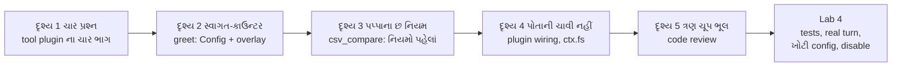
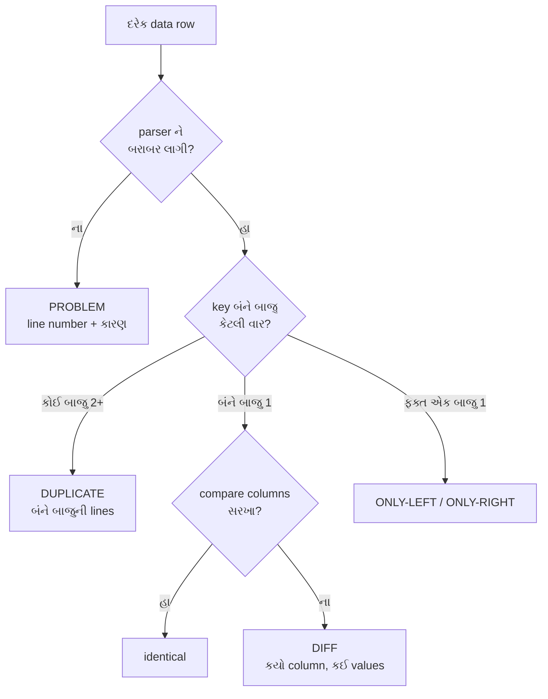

# પ્રકરણ 4 — પોતાનો plugin બનાવો

> **Level 4 · વાર્તાનો દિવસ 8–9.**
> આજ સુધી આરવ જોતો હતો. આજે તે **બનાવે** છે: પહેલાં સ્વાગત-કાઉન્ટર (`greet`) માં સૌથી નાનો ફેરફાર, પછી પોતાનું કાઉન્ટર — read-only `csv_compare`, જે બે CSV export સરખાવે છે.
> પપ્પા દર મહિને યાદીઓ જે નિયમોથી સરખાવે છે, તે જ નિયમો tool ના code બને છે. દરેક દૃશ્ય: 🎬 ઘટના → ❓ પ્રશ્ન → 💻 code માં → 🔬 expert નજર. આખો નકશો: [સમગ્ર નકશો](overview-samagra-naksho.md).

## 🎬 પપ્પાની આંગળી

પપ્પાએ આપેલા બે કાગળ ટેબલ પર છે:

- **આપણી નોંધ** (`export-a.csv`) — ભોજનાલયે મળેલાં invoices ની યાદી.
- **Supplier ની યાદી** (`export-b.csv`) — supplier કહે છે તેણે આ invoices મોકલ્યાં.

દર મહિને પપ્પા બંને યાદી પાસે-પાસે રાખી આંગળી ફેરવતાં સરખાવે છે: "INV-1001 બંનેમાં… INV-1002 માં રકમ 50 પૈસા અલગ… INV-1004 આપણી યાદીમાં **બે વાર**?… INV-1006 ની line અડધી કપાયેલી…"

આરવ: "હું એક કાઉન્ટર બનાવીશ — `csv_compare`. મહારાજ ચિઠ્ઠી લખે 'આ બે યાદી સરખાવો', અને મારું કાઉન્ટર હિસાબ આપે."

મીરાદીદી બે શરત મૂકે છે:

1. "પહેલાં **નાનો** ફેરફાર કરીને હાથ બેસાડ — સ્વાગત-કાઉન્ટરનું વાક્ય બદલ."
2. "તારું કાઉન્ટર **ક્યારેય અનુમાન નહીં કરે**. શંકા હોય ત્યાં 'શંકા છે' લખશે, અને દરેક line નો હિસાબ આપશે. ખોટો પણ આત્મવિશ્વાસુ હિસાબ, હિસાબ ન હોય તેના કરતાં ખરાબ."

## 🎯 આ પ્રકરણ પછી તમે શું કરી શકશો

- `defineTool` થી schema-validated tool બનાવી, `Config` schema થી તેને configurable બનાવી શકશો.
- Absolute-path overlay વડે local plugin ને `dsh` માં insert, configure અને disable કરી શકશો.
- Pure logic (CSV parse, compare) ને harness-wiring થી અલગ રાખી, બંને માટે અલગ tests લખી શકશો.
- Determinism ના નિયમો — sorting, duplicates પર guess નહીં, line numbers — લાગુ કરી શકશો.

## 🗺️ આજના બે દિવસનો નકશો



---

## દૃશ્ય 1 — નવું કાઉન્ટર ખોલતાં પહેલાં ચાર પ્રશ્ન

🎬 આરવ કાંતિકાકા પાસે જાય છે: "મારે નવું કાઉન્ટર ખોલવું છે." કાંતિકાકા હા કે ના નથી કહેતા. તે ચાર પ્રશ્ન પૂછે છે:

1. "તારે **કોની જરૂર** છે? કોના વગર તું કામ શરૂ નહીં કરી શકે?"
2. "**શેઠ** શું નક્કી કરી શકશે? દરેક શાખામાં શું જુદું હોઈ શકે?"
3. "**મહારાજ** તને ચિઠ્ઠીમાં શું લખશે?"
4. "તું **શું પાછું આપીશ** — ચોપડા માટે, અને મહારાજ માટે?"

❓ "પ્રશ્ન 2 કેમ? મને ખબર છે કે સેટિંગ શું હોવી જોઈએ."

"**તને** ખબર છે, મણિનગર માટે. નવરંગપુરા શાખા જુદું ઇચ્છે તો? તેમણે તારું કાઉન્ટર તોડીને ફરી બનાવવું? જે બદલાઈ શકે, તેને દીવાલમાં ચણી ન દે."

💻 ચાર પ્રશ્ન = tool plugin ના ચાર ભાગ:

| ભાગ | કાંતિકાકાનો પ્રશ્ન | `csv_compare` માં |
|---|---|---|
| `inject` | કઈ services વગર ચાલી ન શકે? | `['tools', 'fs']` — કોઠાર-યાદી અને કોઠારની ચાવી |
| `Config` | deployment શું બદલી શકે? | `toolName`, `maxBytes` |
| `parameters` | model શું મોકલે? | `left_path`, `right_path`, `key_columns`, `compare_columns?` |
| `output` | canonical value શું, અને model ને text કેવું? | JSON report → `renderReport` text |

- **Config** = plugin ની સેટિંગ્સ; `cordis.yml`/overlay માંથી આવે, અને **schema** થી તપાસાય.
- **Deployment** = software ને કોઈ ચોક્કસ જગ્યાએ, ચોક્કસ સેટિંગ સાથે ચલાવવું — "મણિનગર શાખા" vs "નવરંગપુરા શાખા".
- **Hardcoded** = code માં સીધું લખી દીધેલું; બદલવા code બદલવો પડે. **Tunable** = બદલી શકાય તેવી સેટિંગ.
- **Canonical value / rendered content** = સામાન પોતે / તેના પરનું લેબલ (પ્રકરણ 3, દૃશ્ય 6).

કાંતિકાકાની સલાહ repository માં બે નિયમ તરીકે લખેલી છે ([AGENTS.md][agents-conventions]) ✅:

- **No hardcoded tunables in plugins** — deployment પ્રમાણે બદલાતી પસંદગી validated `Config` field હોવી જોઈએ.
- **Misconfiguration fails loud** — ખોટી config load વખતે જ દેખાવી જોઈએ: સવારે બૂમ, ગ્રાહક આવે ત્યારે નહીં.

🔬 **Expert નજર.** ચાર ભાગ એ ચાર **વાચક** છે: `inject` Cordis વાંચે, `Config` deployment કરનાર વાંચે, `parameters` model વાંચે, `output` model અને log બંને વાંચે. Tool design કરતી વખતે expert દરેક ભાગ માટે પૂછે છે: "આ કોણ વાંચશે, અને તેને ભૂલ કરતાં કેવી રીતે રોકું?" Schema એ દરેક વાચક માટેની વાડ છે.

## દૃશ્ય 2 — સ્વાગત-કાઉન્ટર: સૌથી નાનો ફેરફાર

🎬 દરવાજે એક સ્વાગત-કાઉન્ટર છે જે દરેક ગ્રાહકને "Hello" કહે છે. પપ્પા: "અમદાવાદમાં 'Hello'? 'નમસ્તે' કહો." અને તરત ઉમેરે છે: "પણ નવરંગપુરા શાખાવાળા 'કેમ છો' ઇચ્છે છે."

આરવ પહેલાં વિચારે છે: code માં "Hello" ને "નમસ્તે" કરી દઉં. પછી કાંતિકાકાનો પ્રશ્ન 2 યાદ આવે છે.

💻 Repository ની user guide માં `greet` tool છે ([docs/user/develop/basic/tool.md](https://github.com/deepseek-ai/deepseek-harness/blob/fcc0ad462172522aaf5c93a7b2e01f6b9f0b0159/docs/user/develop/basic/tool.md)). મૂળ tool "Hello, Ada!" આપે. અમે તેમાં **બે** ફેરફાર કર્યા ([labs/greet/greet.ts](../labs/greet/greet.ts), book lab code):

```ts
// change 1: a schema-validated config with a default
export const Config: z<Config> = z.object({
  greeting: z.string().default('નમસ્તે'),
})

export function apply(ctx: Context, config: Config) {
  ctx.tools.register(defineTool({
    …
    async execute(args) {
      return `${config.greeting}, ${args.name}!` // change 2: use the config value
    },
  }))
}
```

**`z` (schemastery)** = config નો આકાર વર્ણવતી અને તપાસતી library. `z.string().default('નમસ્તે')` = "text હોવું જોઈએ; ન આપો તો 'નમસ્તે'."

1. `Config` schema: `greeting: z.string().default('નમસ્તે')` — મણિનગરનો default.
2. `execute` માં `config.greeting` વાપર્યું.

નવરંગપુરા માટે code બદલવાનો નથી; મેનુ પર એક **ચિઠ્ઠી** (overlay; absolute path ફરજિયાત — પ્રકરણ 2, દૃશ્ય 3). `make-overlay.sh` આ લખે છે:

```yaml
- insert:
    - id: book-greet
      name: '/abs/path/to/tmp/book-labs/greet/greet.ts'
      config:
        greeting: 'કેમ છો'
```

**ચલાવો** (રિહર્સલ મહારાજ `greet` tool માંગશે):

```bash
O=$(GREETING='કેમ છો' bash tmp/book-labs/greet/make-overlay.sh)
```

```bash
TOOL_NAME=greet TOOL_ARGS='{"name":"Ada"}' SUCCESS_TEXT=done EXTRA_PATCH=$O TASK='Use the greet tool to greet Ada.' bash tmp/book-labs/request-trace/run-mock.sh
```

(પહેલો command overlay file બનાવી તેનો path `O` માં મૂકે; બીજો રિહર્સલ મહારાજને કહે "આ વખતે `greet` tool માંગજો, `Ada` નામ સાથે", અને `EXTRA_PATCH=$O` થી આપણું કાઉન્ટર ઉમેરે.)

🧪 Stored `tool/result` text: config વગર `"નમસ્તે, Ada!"`, `greeting: 'કેમ છો'` સાથે `"કેમ છો, Ada!"`; બંને exit 0 ([evidence/greet.err](../evidence/greet.err)).

🔬 **Expert નજર.** બે lines નો ફેરફાર, પણ તેમાં plugin નું આખું જીવનચક્ર છે: schema → default → overlay માંથી value → `apply` ને validated `config` → tool ની અંદર ઉપયોગ. અને `default` ધ્યાનથી જુઓ: config ન આપનાર માટે પણ વર્તન **નક્કી અને લખેલું** છે. "Config નથી" એ undefined વર્તન ન હોવું જોઈએ.

## દૃશ્ય 3 — પપ્પાના છ નિયમ: `csv_compare`, નિયમો પહેલાં

🎬 આરવ code લખવા બેસે છે. દીદી laptop બંધ કરે છે: "પહેલાં પપ્પાને પૂછ કે તે **કેવી રીતે** સરખાવે છે. Code એ નિયમોનું ભાષાંતર છે; નિયમ ન હોય તો ભાષાંતર શેનું?"

આરવ પપ્પાની બાજુમાં બેસીને દરેક આંગળી-ચાલ પર પ્રશ્ન પૂછે છે.

**"બે યાદીમાં એક જ invoice કયો, એ કેવી રીતે નક્કી કરો?"**
"Invoice નંબરથી. અને આગળ-પાછળની ખાલી જગ્યા ગણતો નથી."

**"INV-1004 આપણી યાદીમાં બે વાર છે. Supplier ની યાદીમાં એક વાર. તમે કઈ સાથે મેળવો?"**
પપ્પા પેન નીચે મૂકે છે. "**કોઈ સાથે નહીં.** બેમાંથી એક પસંદ કરું એ તુક્કો છે. ત્રણેય લીટી બાજુ પર કાઢું, અને જાતે તપાસું."

**"બંનેમાં એક-એક વાર હોય?"**
"તો મેળ. પછી રકમ, તારીખ, નામ જોઉં. સરખાં, તો બરાબર; જુદાં, તો **કયું ખાનું** જુદું તે લખું."

**"એક જ યાદીમાં હોય?"**
"તો તે યાદીના 'બાકી' માં."

**"અડધી કપાયેલી line?"**
"તેને સુધારતો નથી. લીટી નંબર સાથે 'ખરાબ' લખું. અને યાદીનું **માથું** જ ખરાબ હોય — એક ખાનાનું નામ બે વાર — તો આખી યાદી પાછી મોકલું. કયું 'રકમ' સાચું, એ હું ન ધારું."

**"અને હિસાબ કયા ક્રમમાં લખો?"**
"નંબર પ્રમાણે. દર મહિને એ જ ક્રમ. નહીં તો ગયા મહિના સાથે સરખાવાય નહીં."

❓ આરવ: "દરેક નિયમમાં તમે એક જ વાત કહો છો: **ધારતો નથી.**"

"હિસાબમાં ધારણા એટલે ચોરી માટે ખુલ્લો દરવાજો."

💻 **Deterministic** = એ જ input → byte-identical output, અને કોઈ નિર્ણય "અનુમાન" થી નહીં. એ જ બે યાદી સો વાર આપો, સો વાર અક્ષરશઃ એ જ હિસાબ.

પપ્પાના છ જવાબ = code ના છ નિયમ ([labs/csv-inspect/src/compare.ts](../labs/csv-inspect/src/compare.ts)):

1. **Key** = key columns ની trimmed values, U+001F થી જોડેલી. (Trimmed = આગળ-પાછળની ખાલી જગ્યા કાઢી; U+001F = એક અદૃશ્ય વિભાજક અક્ષર, જે સામાન્ય data માં આવતો નથી — જેથી બે columns જોડતાં ગૂંચવણ ન થાય.)
2. કોઈ પણ બાજુ એક key **એકથી વધુ વાર** આવે તો તે **duplicate**: તેની એક પણ row match નહીં થાય, કારણ કે એક પસંદ કરવી એ guess છે. Group માં **બંને બાજુની** એ key ની lines રહે છે, જેથી સામેની બાજુની એકલી row પણ report માંથી ગાયબ ન થાય.
3. બંને બાજુ બરાબર એક વાર હોય તો **matched**; compare columns સરખા હોય તો identical, નહીં તો differences ની યાદી.
4. બાકીની rows તેમની બાજુએ **unmatched**.
5. ખરાબ row (field count ખોટો, quote બંધ નથી) parser **problem** તરીકે line number સાથે report કરે છે. Header માં ખાલી કે પુનરાવર્તિત column name હોય તો **દરેક** data row `INVALID_HEADER` તરીકે નકારાય છે — નહીં તો એક column ની value બીજીને ચૂપચાપ overwrite કરે.
6. બધી output arrays key, પછી line પ્રમાણે sorted.

**યાદ-ચાવી "કી-ડુ-મે-બા-પ્ર-ક્ર" — "કીડી મેદાનમાં બાકી પ્રશ્ન ક્રમમાં":** **કી**, **ડુ**પ્લિકેટ, **મે**ળ, **બા**કી, **પ્ર**શ્ન (problem), **ક્ર**મ.



પપ્પા છેલ્લે એક કામ કરે છે જે આરવને શરૂઆતમાં નકામું લાગે છે: બંને યાદીની **કુલ લીટીઓ ગણે**, અને હિસાબમાં લખેલી લીટીઓ ગણે. બંને આંકડા મળવા જોઈએ.

**છેલ્લી ખાતરી (invariant):** દરેક input data line report માં **બરાબર એક જ** જગ્યાએ દેખાય. આ માટે ખાસ test છે — "હિસાબ પૂરો: એક પણ line ગાયબ નહીં, એક પણ બે વાર નહીં."

**Parser** = text ને structured data માં ફેરવનાર. આપણો ([labs/csv-inspect/src/csv.ts](../labs/csv-inspect/src/csv.ts)) RFC 4180 (CSV નું લખેલું ધોરણ) નો નાનો ભાગ સંભાળે છે: comma, double-quoted fields, quote ની અંદર `""`, LF/CRLF (line ના અંતના બે પ્રકાર — Linux/Windows), અને UTF-8 BOM (કેટલીક files ની શરૂઆતમાં આવતો અદૃશ્ય અક્ષર). તે ક્યારેય row "સુધારતો" નથી. (Fixture માં `"Shah Traders, Surat"` જુઓ — field ની અંદર comma, તેથી quotes.)

🔬 **Expert નજર.** છ નિયમ ઉપયોગી છે, પણ આખા tool ને **ભરોસાપાત્ર** બનાવે છે સાતમી વાત — invariant. નિયમો કહે છે કે દરેક row **ક્યાં** જાય. Invariant કહે છે કે **કોઈ row ક્યાંય ન જાય એવું ન બને**. Bug લગભગ હંમેશા બીજા પ્રકારનો હોય છે: કોઈ row ખોટી જગ્યાએ નથી જતી, તે **ચૂપચાપ ગાયબ** થાય છે (દૃશ્ય 5 માં ત્રણ ખરાં ઉદાહરણ). Expert દરેક data-tool માટે પહેલાં આ લખે છે: "input ની ગણતરી = output ની ગણતરી", અને તેને test બનાવે છે. પપ્પાની છેલ્લી ગણતરી નકામી નહોતી; તે આખા હિસાબની સહી હતી.

## દૃશ્ય 4 — પોતાની ચાવી નહીં: harness wiring

🎬 આરવનું કાઉન્ટર તૈયાર છે. યાદીઓ કબાટમાં છે. આરવ ખિસ્સામાંથી પોતાની ચાવી કાઢે છે. ભીખાભાઈ હાથ આડો ધરે છે: "કબાટ હું ખોલીશ. તું ચિઠ્ઠી આપ."

❓ "મારી પાસે ચાવી છે, તો તમને તકલીફ કેમ આપું?"

"તું સીધું ખોલે, તો શેઠના નિયમ — કયું કબાટ ખોલાય, કયું નહીં — તને લાગુ ન પડે. આજે તું સાચું કબાટ ખોલીશ. કાલે મહારાજ તને ખોટા કબાટનું નામ લખી આપે તો?"

💻 [labs/csv-inspect/src/plugin.ts](../labs/csv-inspect/src/plugin.ts) માંથી મુખ્ય ભાગ:

```ts
export const inject = ['tools', 'fs']

export const Config: z<Config> = z.object({
  toolName: z.string().default('csv_compare'),
  maxBytes: z.natural().default(5 * 1024 * 1024),
})

async function readCsvFile(ctx: Context, exec: ToolExecution, path: string, maxBytes: number) {
  const target = await resolveForCall(ctx, exec, path)
  const info = await ctx.fs.stat(target, exec.signal)
  if (info === undefined) throw new Error(`cannot read "${path}": not found`)
  if (info.type !== 'file') throw new Error(`cannot read "${path}": not a regular file`)
  if (info.size !== undefined && info.size > maxBytes) { throw new Error(…) }
  return parseCsv(await ctx.fs.readText(target, exec.signal))
}
```

(`z.natural()` = 0 કે તેથી મોટો પૂર્ણાંક; `5 * 1024 * 1024` = 5 MB.) `read` tool સાથે સરખાવો (પ્રકરણ 3, દૃશ્ય 4): resolve → `stat` (લેબલ) → ન મળે તો ભૂલ → folder હોય તો ભૂલ → વાંચો. એ જ ઢાંચો.

ત્રણ design નિર્ણયો:

- **Read-only, seam દ્વારા.** File `node:fs` (પોતાની ચાવી) થી નહીં, `ctx.fs` (ભીખાભાઈ) થી વાંચીએ છીએ. તેથી deployment નો filesystem provider (base માં `dsh-fs-sandbox`) path resolution અને policy નો માલિક રહે છે, અને tool કદી write કરતો નથી.
- **Session directory.** `workingDirectory` service હોય તો path ને session ની current directory માં resolve કરીએ છીએ — upstream `read` tool ની જેમ ([`resolveRegularReadTarget`][read-target]). `workingDirectory` ને `inject` માં ન મૂક્યું, કારણ કે unit test માં તે વગર પણ tool ચાલવો જોઈએ; તેથી `ctx.get('workingDirectory')` optional રીતે વાંચીએ છીએ.
- **`isConcurrencySafe: () => true`.** બે reads, કોઈ write નહીં; executor તેને બીજા read-only calls સાથે parallel ચલાવી શકે ([`executeToolBatch`][batch-execute] નું parallel group). બે જણ એકસાથે મેનુ **વાંચી** શકે; એકસાથે **લખી** ન શકે.

અને file ની રચના:

- **Pure logic** = ફક્ત input પરથી output ગણે; બહારની દુનિયા (files, network) ને અડે નહીં. `parseCsv` અને `compareTables` pure છે — કાગળ પરની ગણતરી.
- **Wiring** = harness સાથે જોડાણ. `plugin.ts`.
- **Unit test** એક નાના ટુકડાને એકલો તપાસે; **integration test** ઘણા ટુકડા જોડીને.

🔬 **Expert નજર.** Pure અને wiring અલગ રાખવાનું કારણ ઝડપ કરતાં ઊંડું છે. પપ્પાના છ નિયમ (દૃશ્ય 3) માં harness નો **એક પણ શબ્દ** નથી — એટલે તેના tests માં harness ની જરૂર નથી, અને કાલે harness બદલાય તો નિયમો અડ્યા વગર રહે. અને બીજો નિર્ણય એક **trade-off** છે, મફત ભોજન નહીં: `workingDirectory` ને optional રાખવાથી tests સરળ બને છે, પણ તે service ગેરહાજર હોય તેવી composition માં path session directory ને બદલે process ની cwd સામે resolve થાય. Expert trade-off લખીને રાખે છે (Mastery check નો પ્રશ્ન 3).

## દૃશ્ય 5 — ત્રણ ચૂપ ભૂલ: code review

🎬 આરવ ખુશ છે: બધા tests લીલા. દીદી code એક બીજા તપાસનારને મોકલે છે (આ labs ના PR નો automated reviewer — Codex). જવાબમાં ત્રણ ભૂલ આવે છે, અને ત્રણેય એવી કે આરવનું કાઉન્ટર **કોઈ error વગર, આત્મવિશ્વાસથી ખોટો હિસાબ** આપતું હતું.

પપ્પા વાંચીને કહે છે: "આ ત્રણેય ભૂલ મુનીમ પણ કરે. પહેલી: બે ખાનાનું એક જ નામ, અને તેણે બીજું વાંચ્યું. બીજી: 'બાજુ પર કાઢતાં' એક લીટી ટેબલ નીચે પડી ગઈ. ત્રીજી: ખાનું હતું જ નહીં, અને તેણે શૂન્ય માની લીધું."

💻

| ભૂલ | જૂનું વર્તન | સુધારો |
|---|---|---|
| Header માં `Amount,Amount` | બીજો column પહેલાને ચૂપચાપ ઢાંકી દે; ખોટો identical match | આખી file ની rows નકારો (`INVALID_HEADER`) — નિયમ 5 |
| એક બાજુ duplicate, બીજી બાજુ એક row | એકલી row report માંથી ગાયબ | duplicate group માં બંને બાજુની lines — નિયમ 2 |
| (પ્રકરણ 7) `Debit` column જ નથી | ગેરહાજર column = શૂન્ય; ₹900 ગાયબ | configured column ન હોય તો સ્પષ્ટ config error |

**યાદ-ચાવી: "ચૂપ સાચું = ખતરનાક."**

🔬 **Expert નજર.** ત્રણેય ભૂલનો આકાર એક છે: code એ **ખૂટતી કે શંકાસ્પદ માહિતીને કોઈ "વાજબી" default થી ભરી દીધી**. બીજું `Amount` લો. એકલી row છોડો. ગેરહાજર column શૂન્ય ગણો. દરેક default લખતી વખતે નિર્દોષ લાગે છે, અને દરેક એક ધારણા છે. Crash થતો program તમને ભૂલ **કહે** છે; ચૂપચાપ ખોટું output આપતો program ભૂલ **છુપાવે** છે, અને તે પૈસાના હિસાબમાં પહોંચે છે. અને બીજી શીખ: આરવના tests લીલા હતા, કારણ કે tests એ જ માણસે લખ્યા હતા જેણે code લખ્યો — તેની ધારણાઓ બંનેમાં સરખી હતી. Review નું કામ **બીજી ધારણાઓ** લાવવાનું છે. બીજી ભૂલ બરાબર એ પ્રકારની છે જે દૃશ્ય 3 નો invariant test પકડે છે.

## Source map: આ ક્રમમાં ખોલો

| ક્રમ | File | Symbol | કેમ |
|---|---|---|---|
| 1 | `docs/user/develop/basic/tool.md` | `greet` | મૂળ ચકાસેલું example |
| 2 | `packages/core/tools/src/schema.ts` | [`defineTool` validation][schema-defineTool-validate] | args ક્યાં validate થાય છે |
| 3 | `packages/fs/tool-fs/src/read-target.ts` | [`resolveRegularReadTarget`][read-target] | path resolution નો upstream નમૂનો |
| 4 | `packages/core/tools/src/batch.ts` | [`executeToolBatch`][batch-execute] | concurrency-safe grouping |
| 5 | `vendor/cordis/src/fiber.ts` | config validation (`resolveConfig`) | ખોટી config ક્યાં પકડાય છે |
| 6 | `labs/csv-inspect/src/*.ts` | `parseCsv`, `compareTables`, `apply` | આપણો code |

---

## 🧪 Lab 4 (દિવસ 9) — કાઉન્ટરની પાંચ પરીક્ષા

🎬 "કાઉન્ટર ખોલતાં પહેલાં," દીદી કહે છે, "પાંચ પરીક્ષા. નિયમો સાચા છે? ભાષા સાચી છે? ખરા ઓર્ડરમાં ચાલે છે? ખોટી સેટિંગ પર બૂમ પાડે છે? અને બંધ કરી શકાય છે?"

### (1) નિયમો સાચા છે? — pure logic અને integration tests

Harness checkout ના `tmp/book-labs` થી:

```bash
node --import tsx --test csv-inspect/test/*.test.ts
```

🧪 `tests 13, pass 13, fail 0`. Integration test ([plugin.test.ts](../labs/csv-inspect/test/plugin.test.ts)) real `SystemPrompt`, `ToolRuntime`, `NativeToolExecutor`, `LocalFileSystem` plugins ને `await ctx.plugin(...)` થી ક્રમસર mount કરે છે — upstream testkit [`mountAgentLoopTestDependencies`][testkit-mount] ની જેમ — એટલે પ્રકરણ 2 નો race ("ઉતાવળિયો ગ્રાહક") અહીં શક્ય નથી. છેલ્લો test સાબિત કરે છે કે plugin unload થતાં tool registry માંથી tool ગાયબ થાય છે: પ્રકરણ 2 નો "નોકરી છોડતો કર્મચારી", તમારા પોતાના કાઉન્ટર પર.

### (2) ભાષા સાચી છે? — type check

Harness ની strict settings, built declarations સામે:

```bash
node --max-old-space-size=8192 ../../node_modules/typescript/bin/tsc -p tsconfig.json
```

🧪 exit 0. (`--max-old-space-size=8192` = Node ને 8 GB memory વાપરવાની છૂટ — મોટો project છે.)

આરવ: "Exit 0 આવ્યો. પણ તપાસનાર ખરેખર **તપાસે** છે, એ કેમ ખબર?" દીદી હસે છે: "સારો પ્રશ્ન. ખાંડના ડબ્બામાં જાણીજોઈને મીઠું ભર, અને જો કે ભીખાભાઈ પકડે છે." અમે જાણીજોઈને એક ખોટી file ઉમેરી — `TS2322` પકડાયો — પછી કાઢી નાખી. 🧪

### (3) ખરા ઓર્ડરમાં ચાલે છે? — real headless turn

```bash
C=$(bash tmp/book-labs/csv-inspect/make-overlay.sh)
```

```bash
TOOL_NAME=csv_compare TOOL_ARGS='{"left_path":"tmp/book-labs/csv-inspect/fixtures/export-a.csv","right_path":"tmp/book-labs/csv-inspect/fixtures/export-b.csv","key_columns":["Ref"]}' EXTRA_PATCH=$C TASK='આ બે CSV export સરખાવો.' bash tmp/book-labs/request-trace/run-mock.sh
```

🧪 exit 0. Model ને ગયેલું tool result ([evidence/csv.err](../evidence/csv.err) અને stored session):

```text
key: Ref; compared: Date, Party, Amount
left rows 5, right rows 4
identical 1, different 1, only-left 1, only-right 1, duplicate keys 1, problems 1
DIFF INV-1002 (left L3, right L3): Amount "8250.50"≠"8250.00"
ONLY-LEFT INV-1003 (L4)
ONLY-RIGHT INV-1005 (L5)
DUPLICATE INV-1004 (left L5, L6; right L4)
PROBLEM left L7 COLUMN_COUNT: expected 4 fields, found 3
```

આરવ report પપ્પાને બતાવે છે. પપ્પા પોતાની આંગળીએ શોધેલી દરેક વાત તેમાં શોધે છે:

| Report line | Fixture માં | પપ્પાની ભાષામાં |
|---|---|---|
| `identical 1` | INV-1001 બંનેમાં સરખું | "આ બરાબર" |
| `DIFF INV-1002` | `8250.50` vs `8250.00` | "50 પૈસાનો ફરક — supplier ને પૂછો" |
| `ONLY-LEFT INV-1003` | ફક્ત આપણી યાદીમાં | "supplier ની યાદીમાં નથી" |
| `ONLY-RIGHT INV-1005` | ફક્ત supplier ની યાદીમાં | "આપણે નોંધ્યું નથી" |
| `DUPLICATE INV-1004` | આપણી યાદીમાં lines 5–6, supplier ની line 4 | "બે વાર લખ્યું? કઈ સાચી — જાતે જોઈશ" |
| `PROBLEM left L7` | `export-a.csv` ની line 7 માં ત્રણ જ fields | "line અડધી કપાયેલી" |

પછી પપ્પા છેલ્લી ગણતરી કરે છે (invariant), અને તમે પણ કરો: દરેક line નું મૂળ fixture માં શોધો. `export-a.csv` ની line 7 માં ત્રણ જ fields છે, lines 5–6 એક જ key ધરાવે છે, અને `export-b.csv` ની line 4 એ જ key ની એકલી row છે — તે પણ duplicate group માં દેખાય છે. Test "every input data line appears in exactly one place in the report" આ હિસાબ ચકાસે છે.

### (4) ખોટી સેટિંગ પર બૂમ પાડે છે? — fail loud

🎬 આરવ ચિઠ્ઠીમાં જાણીજોઈને લખે છે: "મોટામાં મોટી યાદી: **ઓછા પાંચ** bytes." સવારે કાંતિકાકા કાઉન્ટર પર આવીને બૂમ પાડે છે: "આ સેટિંગ ખોટી છે. આજે આ કાઉન્ટર બંધ." બાકીનું ભોજનાલય ખૂલે છે.

💻 Overlay માં `maxBytes: -5`. 🧪 ([evidence/csv-badcfg.err](../evidence/csv-badcfg.err)):

```text
dsh: warning: 1 entry did not activate
book-csv-compare (file:///…/csv-inspect/src/plugin.ts): ValidationError: invalid config:
  - $.maxBytes expected number >= 0 but got -5 (at maxBytes)
```

`z.natural()` એ Cordis ના config resolution માં જ નિષ્ફળ થયું; tool register થયો જ નહીં. Required entry ન હોવાથી ફક્ત warning (પ્રકરણ 2 ની "શણગારની ઈંટ").

### (5) બંધ કરી શકાય છે? — disable

ત્રણ રસ્તા, સૌથી નાનાથી — **યાદ-ચાવી "ન-બી-કા":**

1. Overlay **ન** આપો (`--patch` કાઢી નાખો).
2. **બી**જું overlay, row ને id થી disable કરે:

```yaml
- id: book-csv-compare
  disabled: true
```

3. **કા**યમ માટે: એ જ row profile ના `cordis.patch.yml` (`$DSH_HOME/profiles/<profile>/cordis.patch.yml`) માં.

🧪 રસ્તો 2 ચકાસ્યો: model એ `csv_compare` call કર્યું ત્યારે result `Error: unknown tool "csv_compare"`, code `UNKNOWN_TOOL` ([evidence/csv-disabled.err](../evidence/csv-disabled.err)) — પ્રકરણ 3 ની "એવું કોઈ ખાનું જ નથી" લાલ ચિઠ્ઠી.

🔬 **Expert નજર.** પાંચ પરીક્ષામાં ફક્ત એક (3) "ચાલે છે?" પૂછે છે. બે (4, 5) પૂછે છે "**ખરાબ રીતે** વાપરો તો શું થાય, અને **કાઢી** શકાય?" શિખાઉ feature ઉમેરીને અટકે છે. Expert જાણે છે કે production માં સૌથી વધુ વપરાતી ક્ષમતા ઘણી વાર "આને હમણાં બંધ કરો" હોય છે. અને (4) માં જુઓ કે ત્રણ પ્રકરણ એક line માં મળે છે: schema (આ પ્રકરણ) → fiber `FAILED` (પ્ર.2) → warning, exit નહીં, કારણ કે required નથી (પ્ર.2).

## 🔮 આગાહી કસોટી: બંને યાદીમાં બે વાર

`export-b.csv` માં `INV-1004` ને **બે વાર** (lines 4 અને 6) કરો; `export-a.csv` જેમ છે તેમ રાખો. હવે key `INV-1004` બંને બાજુ duplicate છે.

**ચલાવતા પહેલાં લખો:** summary ની `duplicateKeys`, `onlyRight`, અને `duplicates` array ની entries (દરેક entry: `key`, `left`, `right`). પછી test માં assertion તરીકે લખી ચકાસો. (સંકેત: નવી row file ના અંતે, line 6 પર ઉમેરો — `INV-1005` line 5 પર જ રહે છે. Group કેટલાં? પપ્પા "બાજુ પર કાઢે" ત્યારે કેટલી થોકડી બને?)

જવાબ: [પરિશિષ્ટ D — Lab 4](../appendix/D-lab-solutions.md#lab-4).

## 🩺 નિષ્ફળતા: ત્રીજી વાર "બીજું ખાનું"

🎬 Tests માં કાઉન્ટર સરસ ચાલે છે. પણ ખરા `dsh` turn માં: "`export-a.csv` મળી નથી." આરવ: "File તો ત્યાં જ છે!" પછી તે અટકે છે, અને પોતે જ હસે છે: "…કોના બીજા ખાનામાંથી?"

💻 **લક્ષણ.** Unit test માં `export-a.csv` મળે છે, પણ `dsh` turn માં `cannot read "export-a.csv": not found`.

**નિદાન:**

1. **Relative path કોની સામે resolve થાય છે?** Test માં `LocalFileSystem { cwd: fixtures }`; `dsh` માં session ની working directory (અમારા runs માં harness checkout નું root).
2. **Harness પોતે કહે છે:** `runtime-context` user message માં લખેલી "Current working directory" જુઓ (પ્રકરણ 1 ના ચાર user messages માંનો "સ્થળ-સમય").
3. **ઉપાય:** tool argument માં checkout-relative path આપો (`tmp/book-labs/...`), અથવા absolute path.

🔬 **Expert નજર.** ત્રીજી વાર એ જ પ્રશ્ન, ત્રણ જુદા જવાબ: પ્રવેશ પ્રકરણમાં **shell નું folder**, પ્રકરણ 2 માં **profile directory**, અહીં **session directory**. "Relative path કોની સામે?" એ expert ની ટેવ છે, કારણ કે જવાબ દરેક સ્તરે જુદો છે અને ખોટો જવાબ દરેક વખતે એક જ લક્ષણ આપે છે: "file તો છે, પણ મળતી નથી."

<a id="saral-samaj"></a>

## ✅ સાર — આરવની નોટબુક, દિવસ 8–9

**એક વાક્યમાં:** પોતાનું કાઉન્ટર ખોલવું — પહેલાં `greet` માં એક validated `Config` (નાનો ફેરફાર, મોટો નિયમ: hardcode નહીં), પછી read-only `csv_compare`: `ctx.fs` થી વાંચે, ક્યારેય અનુમાન ન કરે, દરેક line નો હિસાબ આપે, ખોટી config પર સવારે જ બૂમ પાડે, અને `disabled: true` થી બંધ થાય.

### પાંચ ઘટના, પાંચ નિયમ

| ઘટના | નિયમ | Code |
|---|---|---|
| કાંતિકાકાના ચાર પ્રશ્ન | Tool plugin = `inject`, `Config`, `parameters`, `output` | `plugin.ts` |
| નવરંગપુરાનું "કેમ છો" | No hardcoded tunables; validated `Config` + default | `greet.ts` |
| "કોઈ સાથે નહીં — બાજુ પર કાઢું" | Duplicate પર guess નહીં; છ deterministic નિયમ + invariant | `compare.ts` |
| "કબાટ હું ખોલીશ" | `ctx.fs` seam દ્વારા, read-only; pure logic અને wiring અલગ | `readCsvFile` |
| ત્રણ ચૂપ ભૂલ | ખૂટતી માહિતીને default થી ન ભરો; દરેક row નો હિસાબ test થી | `INVALID_HEADER` |

### નવા ટેકનિકલ શબ્દો

| શબ્દ | અર્થ | ઉદાહરણ | ભોજનાલયમાં |
|---|---|---|---|
| `defineTool` | schema + execute + output વાળો tool બનાવે (register નહીં) | `defineTool({ name: 'greet', … })` | ખાનું બનાવવું |
| `ctx.tools.register` | tool ને registry માં નોંધે; disposer આપે | `register(defineTool(…))` | કોઠાર-યાદીમાં નોંધ |
| Config schema | plugin ની સેટિંગનો આકાર અને તપાસ | `z.natural().default(…)` | શાખાની સેટિંગ |
| Overlay `insert` | નવી row ઉમેરવી | `- insert: [{ id: book-greet, … }]` | નવું કાઉન્ટર |
| Deterministic | એ જ input → એ જ output | sorted report | સો વાર, એ જ હિસાબ |
| Duplicate key | એક key એકથી વધુ વાર | `INV-1004` | બે વાર લખ્યું |
| Invariant | હંમેશા સાચી રહેતી શરત | "દરેક line બરાબર એક વાર" | પપ્પાની છેલ્લી ગણતરી |
| Header | CSV ની પહેલી line, column નામો | `Ref,Date,Party,Amount` | યાદીનું માથું |
| Pure logic | બહારની દુનિયા વગરની ગણતરી | `compareTables` | કાગળ પર ગણતરી |
| Unit test | એક નાનો ભાગ એકલો ચકાસતો test | `compare.test.ts` | એક પૈડું તપાસો |
| `node:test` | Node નો built-in test runner | `node --test` | ઘરનો પરીક્ષક |
| Integration test | ઘણા ભાગ જોડીને તપાસ | `plugin.test.ts` | આખું કાઉન્ટર ચલાવી જોવું |
| `isConcurrencySafe` | બીજા સાથે parallel ચાલી શકે | `() => true` | વાંચવા સાથે, લખવા એકલા |
| Fail loud | ખોટી config પર load વખતે જ ભૂલ | `ValidationError` | સવારે જ બૂમ |

### યાદ-ચાવીઓ

- **"કીડી મેદાનમાં બાકી પ્રશ્ન ક્રમમાં"** — છ deterministic નિયમો.
- **"હિસાબ પૂરો"** — દરેક line બરાબર એક વાર (invariant).
- **"ન-બી-કા"** — disable ના ત્રણ રસ્તા.
- **"ચૂપ સાચું = ખતરનાક"** — review findings નો સાર.
- **"Relative path કોની સામે?"** — ત્રીજી વાર આવેલો પ્રશ્ન.

### સામાન્ય ગેરસમજો

| ગેરસમજ | સાચું |
|---|---|
| "`defineTool` લખ્યું એટલે tool તૈયાર." | `ctx.tools.register(...)` વગર model ને દેખાતો નથી. |
| "Duplicate હોય તો પહેલી row match કરી દો." | એ guess છે; આખું group review માટે રોકો. |
| "ખોટી config પર tool ચાલશે, ભૂલ પછી દેખાશે." | Config load વખતે જ `ValidationError`; tool register જ ન થાય. |
| "`node:fs` થી વાંચવું સરળ છે, ચાલે." | ચાલે, પણ sandbox/policy અને path resolution નો માલિક બાયપાસ થાય; `ctx.fs` વાપરો. |
| "Tests લીલા છે, એટલે code સાચો." | Tests માં લેખકની જ ધારણાઓ છે; review બીજી ધારણાઓ લાવે. |

### પુનરાવર્તન કાર્ડ

<details><summary>1. Tool plugin ના ચાર ભાગ?</summary>

`inject`, `Config`, `parameters`, `output` (canonical value + render).
</details>

<details><summary>2. `csv_compare` duplicates ને match કેમ નથી કરતો?</summary>

એક પસંદ કરવી guess છે; ખોટો match ચૂપચાપ ખોટો હિસાબ બનાવે. બંને બાજુની lines group માં review માટે રહે છે.
</details>

<details><summary>3. `maxBytes: -5` આપો તો?</summary>

`ValidationError … $.maxBytes expected number >= 0`; entry activate ન થાય; required નથી એટલે ફક્ત warning; tool registry માં નથી.
</details>

<details><summary>4. Disable કર્યા પછી model `csv_compare` માંગે તો?</summary>

`Error: unknown tool "csv_compare"`, code `UNKNOWN_TOOL`; turn ચાલુ રહે.
</details>

<details><summary>5. Header માં `Amount,Amount` હોય તો?</summary>

કોઈ row સ્વીકારાતી નથી: header માટે `DUPLICATE_HEADER` problem, અને દરેક data row માટે `INVALID_HEADER` — નહીં તો બીજો `Amount` પહેલાને ચૂપચાપ ઢાંકી દે.
</details>

### મિત્રને સમજાવો (3 મિનિટ)

"ખોટો પણ આત્મવિશ્વાસુ હિસાબ, હિસાબ ન હોય તેના કરતાં ખરાબ." પહેલાં પપ્પાની વાત કહો: INV-1004 બે વાર, અને "કોઈ સાથે નહીં". પછી એ જ વાત duplicate group, `INVALID_HEADER` અને invariant test શબ્દોથી.

## 🧠 Mastery check

1. `defineTool` એ `parameters` ને શું બનાવે છે, અને args ક્યાં validate થાય છે?
2. `csv_compare` duplicates ને match કેમ નથી કરતો? કયા વ્યવહારિક નુકસાનથી બચાવે છે?
3. `workingDirectory` ને `inject` માં ન મૂકવાનો trade-off શું છે?
4. Plugin unload થતાં tool registry માંથી tool કેમ ગાયબ થાય છે? કયો Cordis ખ્યાલ?
5. Config ખોટી હોય ત્યારે શું થાય છે, અને તે "fail loud" કેમ ગણાય?
6. Tool ને disable કરવાના ત્રણ રસ્તા લખો.

જવાબો: [પરિશિષ્ટ D — પ્રકરણ 4](../appendix/D-lab-solutions.md#ch4).

## 🎬 આગળ શું

પપ્પા report જોઈને ખુશ થાય છે: "50 પૈસાનો ફરક પણ પકડ્યો!" પણ મીરાદીદી ગંભીર છે: "તારું કાઉન્ટર **સારા દિવસે** ચાલે છે. કાલે ખરાબ દિવસ આવશે — મહારાજ ખોટા ખાનાની ચિઠ્ઠી લખશે, ફોન વ્યસ્ત આવશે, membership card ખોટું નીકળશે, અને રાત્રે અચાનક લાઈટ જશે. અને એક વધુ પ્રશ્ન: ભીખાભાઈએ આજે તને કબાટ ખોલતાં રોક્યો. રાતની પાળીમાં પપ્પા હાજર ન હોય, અને મહારાજ રસોડાની **બહાર** કંઈ કરવાની ચિઠ્ઠી લખે, ત્યારે **કોણ ના પાડશે?**"

---

પાછળ: [પ્રકરણ 3](03-tools-sessions-adapters.md) · આગળ: [પ્રકરણ 5 — Debugging, permissions અને reliability](05-debugging-permissions-reliability.md)

<!-- citations:begin (generated by tools/refdefs.py) -->
[agents-conventions]: https://github.com/deepseek-ai/deepseek-harness/blob/fcc0ad462172522aaf5c93a7b2e01f6b9f0b0159/AGENTS.md#L130-L142
[batch-execute]: https://github.com/deepseek-ai/deepseek-harness/blob/fcc0ad462172522aaf5c93a7b2e01f6b9f0b0159/packages/core/tools/src/batch.ts#L50-L96
[read-target]: https://github.com/deepseek-ai/deepseek-harness/blob/fcc0ad462172522aaf5c93a7b2e01f6b9f0b0159/packages/fs/tool-fs/src/read-target.ts#L19-L34
[testkit-mount]: https://github.com/deepseek-ai/deepseek-harness/blob/fcc0ad462172522aaf5c93a7b2e01f6b9f0b0159/packages/test-support/agent-loop-testkit/src/index.ts#L74-L90
<!-- citations:end -->
