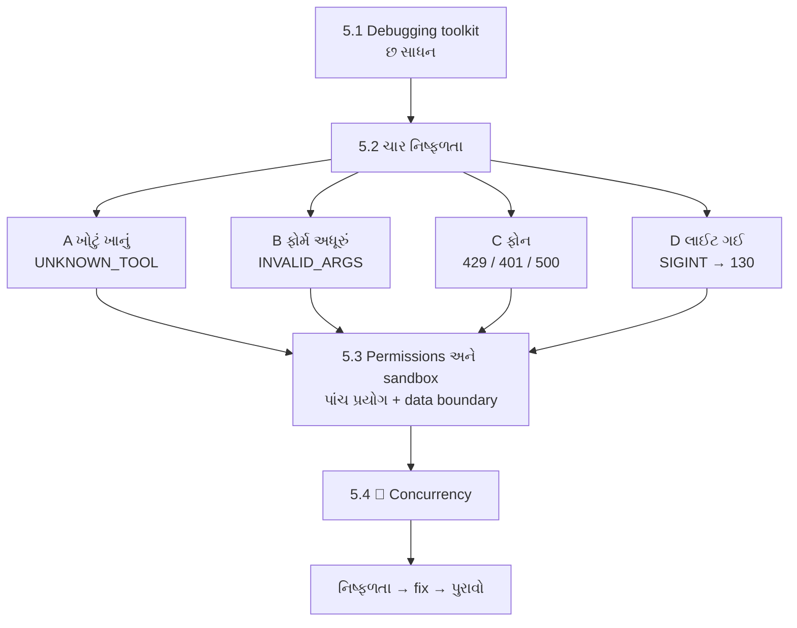
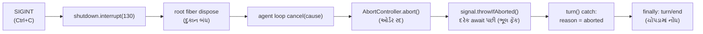

# પ્રકરણ 5 — Debugging, permissions અને reliability

> **Level 5 · 🟢 ચાર નિષ્ફળતા, 🟡 sandbox પ્રયોગ, 🔴 cancellation સાંકળ અને concurrency.** વાર્તાનો દિવસ 10–11.
> ચાર નક્કર નિષ્ફળતાઓ ફરી ઉત્પન્ન કરીએ — unavailable tool, invalid input, provider error, interrupted execution —
> અને દરેકનું નિદાન source, logs, breakpoints અને tests થી કરીએ. પછી permission/sandbox ની ખરી સીમાઓ ચકાસીએ. આખો નકશો: [સમગ્ર નકશો](overview-samagra-naksho.md).

## 🎬 વાર્તા: ખરાબ દિવસ

શનિવાર. ભીડ. અને જે ખોટું થઈ શકે તે બધું થાય છે:

- બપોરે મહારાજ ચિઠ્ઠી લખે છે: "**`read_everything`** ખાનામાંથી બધું લાવો." એવું કોઈ ખાનું જ નથી.
- પછી એક ચિઠ્ઠીમાં ફરજિયાત ખાનું ખાલી — "કઈ file?" લખ્યું જ નથી.
- સાંજે agency નો ફોન **વ્યસ્ત** આવે છે. પછી ખબર પડે છે કે એક દિવસ માટે **membership card** ખોટું નોંધાયું હતું. અને એક વાર agency ના રસોડામાં જ ગડબડ.
- રાત્રે નવ વાગ્યે **લાઈટ જાય છે** — ઓર્ડર અધવચ્ચે.
- રાતની પાળીમાં પપ્પા ઘરે છે. એક ઓર્ડરમાં લખ્યું છે: "રસોડાની બહાર, ઓફિસના કબાટમાં ચિઠ્ઠી મૂકો." **કોણ ના પાડશે?**

રવિવારે સવારે મીરાદીદી આરવ સાથે બેસે છે: "ગઈકાલ ખરાબ નહીં, **શ્રેષ્ઠ શિક્ષક** હતી. આજે આપણે દરેક ભૂલ જાણીજોઈને **ફરી** ઉત્પન્ન કરીશું — રિહર્સલ મહારાજ સાથે — અને દરેકનો માલિક code શોધીશું. પછી રસોડાની સીમાઓ ચકાસીશું: ક્યાં વાડ છે, અને ક્યાં **નથી**."

## 🎯 આ પ્રકરણ પછી તમે શું કરી શકશો

- ચારેય failure class ને mock provider થી ઇચ્છા મુજબ ઉત્પન્ન કરી, stored session માંથી તેનું exact model-visible text અને error code કાઢી શકશો.
- `llm-retry` નું backoff ક્યાં નક્કી થાય છે અને કઈ errors retry થાય છે તે બતાવી શકશો.
- Sandbox modes, approval policy, અને "fail closed" વર્તન ચલાવીને સાબિત કરી શકશો — અને ક્યાં સીમા **નથી** તે પણ.
- Cancellation, retries, concurrency અને recovery ના માલિક symbols બતાવી શકશો.
- દરેક fix માટે "મૂળ નિષ્ફળતા ગઈ" એવો પુરાવો કેવી રીતે આપવો તે લખી શકશો.

## 🗺️ આ પ્રકરણનો નકશો



**સૌથી મહત્વનો ભેદ — યાદ-ચાવી: "સાધનની ભૂલ = ચિઠ્ઠી પાછી; ફોન કે દુકાનની ભૂલ = ઓર્ડર બંધ."**

| ભૂલ ક્યાં | શું થાય | ઉદાહરણ |
|---|---|---|
| **Tool-level** (કોઠાર) | `tool/result` માં `isError: true`; model ને જાણ; turn **ચાલુ** | A, B, sandbox denials |
| **Turn-level** (ફોન કે દુકાન) | retry, અથવા `turn/end` reason `error`/`aborted`; turn **બંધ** | C, D |

## 5.1 🟢 Debugging toolkit — છ સાધન

> 📦 **Debugging** — ભૂલ (bug) શોધી તેનું કારણ સમજવું. 🍽️ "ગઈકાલે દાળ ખારી કેમ થઈ?" — અનુમાન નહીં, પુરાવા.

| Tool | ક્યારે | Command / file | 🍽️ |
|---|---|---|---|
| Observer plugin (logs) | કયું event ક્યારે, કયા ક્રમમાં | [`trace-events.ts`](../labs/request-trace/trace-events.ts) overlay | **સી**સીટીવી |
| Stored session | model ને **ખરેખર** શું દેખાયું | [`print-session.mjs`](../labs/request-trace/print-session.mjs) `--full` | **ચો**પડો |
| Wire capture | adapter એ HTTP પર શું મોકલ્યું | [`capture-wire.ts`](../labs/request-trace/capture-wire.ts) | **ટ**પાલની નકલ |
| Breakpoints | એક line પર અટકવું | `node --inspect-brk --import tsx/esm apps/cli/src/bin.ts --profile headless "…"` | **સ**મય થંભાવવો |
| Upstream tests | વર્તનનો contract | `pnpm exec vitest run <package path>` | **નિ**યમપોથી |
| Startup audit | plugin load નથી થતો | stderr નું `entries did not activate` (પ્રકરણ 2) | **હા**જરીપત્રક |

**યાદ-ચાવી "સી-ચો-ટ-સ-નિ-હા" — "સીધો ચોર ટપાલ સમયે નિયમ હાજર".**

> 📦 **Breakpoint** — debugger ને "આ line પર રોકાઈ જા" કહેવું; ત્યાં અટકી variables જોઈ શકાય. ઉદાહરણ: Chrome માં `chrome://inspect` ખોલી, `packages/core/agent-loop/src/agent.ts` ની [`step`][loop-step] પર breakpoint મૂકો. Source `tsx` થી ચાલે છે, તેથી TypeScript lines સીધી દેખાય છે. 🧪 command ચકાસ્યો (`Debugger listening on ws://127.0.0.1:9229/…`); interactive stepping અમે આ environment માં કર્યું નથી. ⚠️
>
> 📦 **Contract** — "આ code આવું વર્તન કરશે" નું વચન; tests એ વચનને ચકાસે.

## 5.2 ચાર નિષ્ફળતાઓ

બધા runs: `bash tmp/book-labs/request-trace/run-mock.sh` + નીચેના env knobs (રિહર્સલ મહારાજને "આ વખતે આમ કરજો" ની સૂચના). દરેક stored `tool/result` / `turn/end` અમારા [evidence/](../evidence/) માં છે. 🧪

### (A) 🟢 Unavailable tool — "એવું કોઈ ખાનું જ નથી"

```bash
TOOL_NAME=read_everything bash tmp/book-labs/request-trace/run-mock.sh
```

| અવલોકન | મૂલ્ય |
|---|---|
| Model-visible text | `Error: unknown tool "read_everything"` |
| `error` in log | `{"name":"ToolNotFoundError","code":"UNKNOWN_TOOL"}` |
| Turn | `completed` (step 2 ચાલ્યો), exit 0 |

**નિદાન:** pipeline નું [`dispatchToolBody`][pipeline-body] → `resolveExecution` → `undefined` → `throw new ToolNotFoundError(exec.name)` ([class][contracts-notfound]). Tool registry માં નામ છે કે નહીં તે trace ની `tools=[…]` અથવા wire `toolNames` થી જુઓ. પ્રકરણ 4 નું "disabled plugin" પણ બરાબર આ જ લક્ષણ આપે છે.

### (B) 🟢 Invalid input — "ફોર્મ અધૂરું"

```bash
TOOL_ARGS='{"path":"README.md"}' bash tmp/book-labs/request-trace/run-mock.sh
```

| અવલોકન | મૂલ્ય |
|---|---|
| Model-visible text | `Error: invalid arguments: missing required property "file_path"` |
| `error` | `{"name":"ToolArgsError","code":"INVALID_ARGS"}` |

**નિદાન:** [`defineTool` validation][schema-defineTool-validate] — `validate(args)` → `throw new ToolArgsError(violations)`. Model ને સુધારવાની તક મળે છે, કારણ કે તે સામાન્ય tool result છે. 🍽️ ભીખાભાઈ ચિઠ્ઠી પાછી મોકલે: "`file_path` ખાનું ભરો" — મહારાજ સુધારીને ફરી લખી શકે.

### (C) 🟡 Provider error — ત્રણ પ્રકાર, "ફોનની ત્રણ મુશ્કેલી"

| Script | 🍽️ | પરિણામ | Model calls | Exit |
|---|---|---|---|---|
| `SEQUENCE=rate_limit,tool_call_success,success` | લાઇન વ્યસ્ત | 429 → `llm/retry` → ~1s પછી સફળ | 3 | 0 🧪 |
| `SEQUENCE=auth_error` | membership card ખોટું | `turn/end` reason `error`, `AUTH`, status 401; **retry નહીં** | 1 | 1 🧪 |
| Title row on + `tool_call_success,success` (પ્રકરણ 1 ની આગાહી) | agency ના રસોડામાં ગડબડ | 500 `script exhausted` → 5 retries (આશરે 0.5s, 1s, 1.9s, 3.9s, 8.2s) → `SERVER` | 8 | 1 🧪 |

Stored `auth-error` sequence ([evidence/auth-error.err](../evidence/auth-error.err)):

```text
[trace +  323ms] llm/stream call #1 deepseek-official/deepseek-flash messages=5 …
[trace +  375ms] session/event #15 assistant/attempt
[trace +  377ms] session/event #17 turn/end reason={"kind":"error","error":{"message":"mock authentication failed","code":"AUTH","status":401}}
dsh: AUTH: mock authentication failed
```

**Retry ક્યાં નક્કી થાય છે?** Loop stream નિષ્ફળ થાય ત્યારે `assistant/attempt` લખી `agent/request-error` **waterfall** ચલાવે છે ([source][loop-request-error]); `{ kind: 'retry' }` મળે તો એ જ step માં ફરી પ્રયાસ, નહીં તો `LlmError` ફેંકે. Base bundle નો `llm-retry` plugin આ event સાંભળે છે ([listener][retry-listener]) અને retry policy વાપરે છે. Defaults અને retryable codes ([source][retry-defaults]):

```ts
const DEFAULT_MAX_RETRIES = 5
const DEFAULT_INITIAL_DELAY_MS = 500
const DEFAULT_MAX_DELAY_MS = 10_000
const DEFAULT_JITTER_RATIO = 0.1
const DEFAULT_RETRYABLE_CODES = Object.freeze([
  EMPTY_RESPONSE_CODE,
  'RATE_LIMIT',
  'SERVER',
  'TIMEOUT',
  'TRANSPORT',
])
```

> 📦 **Retry** — નિષ્ફળ થયેલું કામ ફરી પ્રયત્ન કરવું. 📦 **Exponential backoff** — દરેક નિષ્ફળતા પછી રાહ **બમણી**: 0.5 → 1 → 2 → 4 → 8 સેકન્ડ, મહત્તમ 10. 📦 **Jitter** — રાહમાં થોડો random ફેરફાર (±10%), જેથી હજારો clients એક સાથે ફરી ન દોડે. 🍽️ ફોન વ્યસ્ત — અડધી મિનિટ પછી, પછી એક મિનિટ, પછી બે… વારંવાર તરત ફોન કરીને લાઇન વધુ વ્યસ્ત ન કરો.

Observed delays (0.5 → 1 → 2 → 4 → 8 s, થોડો jitter) આ exponential backoff સાથે મેળ ખાય છે. `AUTH` retryable codes માં નથી, તેથી તરત error — 🍽️ ખોટું membership card સો વાર બતાવો તો પણ ખોટું જ રહે. ✅🧪 Retry **એ જ step** માં થાય છે; તેથી `agent/pre-step` અને user admission ફરી થતાં નથી (architecture doc ✅).

**યાદ-ચાવી "5-અડધી-બમણું-દસ":** 5 વાર, અડધી સેકન્ડથી, બમણું કરતા, 10 સેકન્ડ સુધી. **"રેટ-સર્વર-ટાઇમ-ટ્રાન્સપોર્ટ ફરી, ઓથ કદી નહીં."**

### (D) 🟡 Interrupted execution — "લાઈટ ગઈ"

Mock ને `--sequence stall` (headers મોકલી શાંત) સાથે ચલાવી, headless process ને 4 સેકન્ડે `SIGINT` (પૂરા commands: [પરિશિષ્ટ B](../appendix/B-command-reference.md#interrupt-and-resume)).

| અવલોકન | મૂલ્ય |
|---|---|
| Exit code | **130** (launcher: `SIGINT` → 130, `SIGTERM` → 0) ([`runProfile`][cli-runProfile]) |
| Durable log | `assistant/attempt {"stream":[]}`, `step/end`, `turn/end {"kind":"aborted","reason":{"kind":"disposed"}}` |
| Stderr | `dsh: session "session-…": flush on a closed handle` |

> 📦 **Signal** — operating system process ને મોકલતો ટૂંકો સંદેશો. `SIGINT` = Ctrl+C ("અટકો"), `SIGTERM` = "વ્યવસ્થિત બંધ થાઓ". Exit code 130 = 128 + 2 (SIGINT નો નંબર) — Unix ની જૂની પ્રથા.

ત્રીજી line રસપ્રદ છે: interruption **સાચું** handle થયું (durable `aborted` turn, exit 130), પણ headless runner teardown પછી પણ `sessions.flush` અને failure report કરે છે. 🍽️ લાઈટ ગઈ, ચોપડામાં "ઓર્ડર રદ" બરાબર લખાયું — પણ પછી કોઈ અંધારામાં તિજોરી ખોલવા ગયું અને બૂમ પાડી "તિજોરી બંધ છે!" — જાણે કંઈ ખોવાયું હોય, જ્યારે ખરેખર કંઈ ખોવાયું નથી. આ નાની ખામીનું આખું contribution — reproduce, patch, regression test — પ્રકરણ 6 માં છે.

#### 🔴 Cancellation કેવી રીતે વહે છે — "બંધ-રદ-ફેંક-નોંધ"



SIGINT → `shutdown.interrupt(130)` → root fiber dispose → agent loop નો `cancel(cause)` ([source][loop-cancel]) → loop-owned `AbortController` abort → દરેક `await` પછીનું `signal.throwIfAborted()` → `turn()` નું `catch` reason `aborted` નક્કી કરે → `finally` માં `turn/end`. Tool body ચાલુ હોય તો pipeline તેને છોડી દેતું નથી: "Cancellation never abandons the body: a started promise reaches quiescence before its outcome becomes `ABORTED`" ([`dispatchToolBody`][pipeline-body]). ✅

પ્રવેશ પ્રકરણનો `rasoi-async.mjs` યાદ છે? `controller.abort()` → `await` ભૂલ ફેંકે → `catch` → "રદ થયું: AbortError". આ જ સાંકળ, ઘણી મોટી.

**યાદ-ચાવી "બંધ-રદ-ફેંક-નોંધ":** દુકાન **બંધ** → ઓર્ડર **રદ** → ભૂલ **ફેંક** → ચોપડામાં **નોંધ**.

> 📦 **Quiescence** — "શાંત, સ્થિર સ્થિતિ" — ચાલુ કામ પૂરું થઈ જાય ત્યાં સુધી. 🍽️ લાઈટ ગઈ, પણ ચૂલા પરનું તપેલું અધવચ્ચે ફેંકી ન દો — ગેસ બંધ કરી, તપેલું નીચે મૂકો, પછી જાહેર કરો "રદ".

## 5.3 🟡 Permissions અને sandbox: ખરી સીમાઓ

> 📦 **Sandbox mode** — process/file side effects કેટલા દૂર સુધી માન્ય: `read-only`, `workspace-write`, `danger-full-access` ([`SandboxPolicyService`][sandbox-policy], default `read-only`). 🍽️ રસોડાની સીમા.
>
> 📦 **Workspace** (અહીં) — agent જ્યાં કામ કરે છે તે folder; base bundle માં `process.cwd()` — હાલનું folder. 🍽️ "પોતાનું રસોડું".
>
> 📦 **Approval policy** — મંજૂરી કોને/કેવી રીતે પૂછવી: `'ask' | 'never'` ([`ApprovalPolicy`][approval-policy]). 🍽️ "મોટું કામ હોય તો પપ્પાને પૂછો."
>
> 📦 **Escalation** — વધુ છૂટ માંગવી (દા.ત. workspace બહાર લખવા). 🍽️ "રસોડાની બહાર જવાની રજા."

Base bundle `DSH_PERMISSION_MODE` ન હોય તો `workspace-write` અને `workspaceRoot: process.cwd()` વાપરે છે ([rows][bundle-base-sandbox]). ✅ `danger-full-access` સિવાય base `ask` વાપરે છે.

| Mode | 🍽️ | વાંચવું | લખવું |
|---|---|---|---|
| `read-only` | ફક્ત જોવાની રજા | ✔ | ✘ |
| `workspace-write` | પોતાના રસોડામાં રાંધવાની રજા | ✔ (ગમે ત્યાં!) | ફક્ત workspace માં |
| `danger-full-access` | આખી ઇમારતની ચાવી | ✔ | ✔ ગમે ત્યાં — ⚠️ ખતરનાક |

દરેક headless run ના log ની શરૂઆતમાં આ ત્રણ events દેખાય છે 🧪:

```text
#0 permission/preset {"preset":"workspace-write"}
#1 sandbox/mode {"mode":"workspace-write"}
#2 approval/policy {"policy":"ask"}
```

### પાંચ પ્રયોગ (🧪 બધા `workspace-write` માં)

| # | Tool call | 🍽️ | પરિણામ (model-visible) | સીમા કોણ લાગુ કરે |
|---|---|---|---|---|
| 1 | `write` `/etc/book-test.txt` | ઓફિસના કબાટમાં લખો | `Error: [sandbox: file access denied under workspace-write mode]` + escalation hint, code `FS_SANDBOX_DENIED` | `dsh-fs-sandbox` ([policy][fs-sandbox-doc]) |
| 2 | એ જ `write` + `sandbox_permissions: "danger-full-access"`, `justification` | "પપ્પાને પૂછો" — પણ રાતની પાળી | `approval/asked` → `approval/decided {"outcome":"unavailable"}` → `Error: sandbox escalation to "danger-full-access" requires approval, but no approval channel is available` | [escalation][sandbox-escalation] (headless માં answerer નથી → fail closed) |
| 3 | `bash` `touch /etc/book-bash-test` | ચોકીદાર જ નથી, તો દરવાજો ખોલવો? | `Error: sandbox mode "workspace-write" is requested but no sandbox backend is usable on this host; refusing to run the command unconfined. Install bubblewrap …` | [`SandboxUnavailableError`][sandbox-unavailable] — અમારા host પર `bwrap` નથી |
| 4 | `read` `/etc/os-release` (workspace બહાર) | ઓફિસનો કાગળ **વાંચો** | **સફળ** — `<path>/usr/lib/os-release</path>` | કોઈ નહીં: "Reads pass through untouched: every mode permits reading" ([source][fs-sandbox-reads]) |
| 5 | `read` `NOPE.md` | ન હોય તેવી ચોપડી | `FS_NOT_FOUND` | `read` tool |

કોઈ પણ run પછી `/etc/book-test.txt` કે `/etc/book-bash-test` બન્યા નથી (`ls` થી ચકાસ્યું). 🧪

> 📦 **`/etc`** — Linux માં system ની settings રાખતું folder — workspace ની બહાર. 📦 **bubblewrap (`bwrap`)** — Linux પર process ને બંધ ઓરડામાં (sandbox) ચલાવતું tool. 🍽️ ચોકીદાર.

**શીખ:**

- **Fail closed.** Sandbox backend નથી, તો bash command unconfined ચાલતો નથી; approval channel નથી, તો escalation નકારાય છે. ✅🧪 🍽️ "શંકા હોય ત્યાં **ના**." — ચોકીદાર ગેરહાજર હોય તો દરવાજો **બંધ** રહે, ખુલ્લો નહીં.

> 📦 **Fail closed / fail open** — નિષ્ફળતા વખતે "બંધ" (સુરક્ષિત) સ્થિતિ vs "ખુલ્લી" (જોખમી) સ્થિતિ. Harness fail closed છે.

- **Reads ખુલ્લાં છે.** File sandbox ફક્ત mutations પર policy fence છે. `read` વડે process વાંચી શકે તે કંઈ પણ model વાંચી શકે છે. Source પોતે કહે છે: "This is containment, not a security boundary". ✅ — તેથી secrets વાળા machine પર agent ચલાવતા પહેલાં [SAFETY.md](https://github.com/deepseek-ai/deepseek-harness/blob/fcc0ad462172522aaf5c93a7b2e01f6b9f0b0159/SAFETY.md) વાંચો: disposable VM/container, least privilege.

> 📦 **Containment vs security boundary** — containment = ભૂલથી થતું નુકસાન ઘટાડતી વાડ; security boundary = હુમલાખોરને રોકતી દીવાલ. 📦 **Least privilege** — કામ પૂરતી જ છૂટ, વધુ નહીં. 📦 **Disposable VM/container** — ફેંકી દેવાય તેવું અલગ computer-ખાનું; બગડે તો નવું.
>
> ⚠️ **ઉપમા અહીં તૂટે છે:** ભોજનાલયની દીવાલ ચોરને પણ રોકે. અહીં file sandbox ફક્ત **લખવા** પર વાડ છે — **વાંચવું ખુલ્લું છે**. `read` થી `/etc/os-release` વંચાય છે. તમારા computer પર passwords કે keys વાળી files હોય, તો model તે **વાંચી** શકે.

- **Kernel isolation shell નું કામ છે.** Linux પર `dsh-sandbox-local` પહેલાં `bwrap`, પછી Landlock ([source][sandbox-local-chain]); macOS `sandbox-exec`; Windows ACL runner.

**યાદ-ચાવી: "લખવા પર વાડ, વાંચવું ઉઘાડ; શેઠ નથી તો ના, વાડ નથી તો ના."**

### Data boundary: model provider ને શું જાય છે

પ્રકરણ 3 ની wire capture મુજબ base bundle દરેક request માં `dsh_session_log` (session log નો incremental suffix) અને `dsh_plugin_packages` મોકલે છે, અને headers માં anonymous user id તથા session id. 🧪 આ permission ની બાબત નથી, **data** ની છે. 🍽️ agency ને ફક્ત ઓર્ડર નહીં, આપણા ચોપડાનાં પાનાં પણ જાય છે.

> 📦 **Data boundary** — કઈ માહિતી આપણા computer ની બહાર જાય છે તેની સીમા. 📦 **Telemetry** — software ના ઉપયોગ વિશે માહિતી બનાવનારને મોકલવી.

Official API ને session-log suffix ન મોકલવો હોય તો row disable કરો ([row][bundle-base-sessionlog]):

```yaml
- id: session-log-deepseek
  disabled: true
```

Telemetry: `session-telemetry-otel` row default `FEEDBACK_ONLY` mode માં છે ([row][bundle-base-telemetry]); base bundle ની comment મુજબ "OTel releases a Session-log prefix only after explicit user feedback", અને non-empty `DSH_TELEMETRY_DISABLED` process ને opt out કરે છે. ✅ (અમારા બધા runs `DSH_TELEMETRY_DISABLED=1` સાથે હતા.)

## 5.4 🔴 Concurrency — એક સાથે ઘણી ચિઠ્ઠીઓ

> 📦 **Concurrency** — ઘણાં કામ એક જ સમયગાળામાં ચાલવાં. 🍽️ મહારાજ એક સાથે ત્રણ ચિઠ્ઠી લખે: "ખાંડ, મીઠું, રેસીપી-ચોપડી" — ત્રણ મદદનીશ એક સાથે લાવી શકે.

Model એક જ response માં ઘણા tool calls આપી શકે. [`executeToolBatch`][batch-execute] દરેક call માટે [`executionMode`][pipeline-executionMode] પૂછે છે: `parallel` calls rolling pool માં ચાલે, બીજાં exclusive barrier બને. Pool ની મર્યાદા `agent-loop` config `maxParallelToolCalls` ([source][loop-maxparallel]), default 10 ([source][loop-maxparallel-default]), અને તે `volatile()` છે — restart વગર બદલાય. Tool `isConcurrencySafe` આપે ત્યારે જ parallel ગણાય (`read` અને આપણો `csv_compare` બંને `true`). Results હંમેશા **model order** માં commit થાય છે. ✅

> 📦 **Rolling pool** — મહત્તમ N કામ એક સાથે; એક પૂરું થાય કે બીજું શરૂ. 📦 **Exclusive barrier** — "આ કામ એકલું; આગળ-પાછળનાં બધાં રાહ જુએ." 🍽️ વાંચવાવાળા સાથે જાય; લખવાવાળો એકલો — કોઈ વચ્ચે ન આવે.

## Source map: આ ક્રમમાં ખોલો

| ક્રમ | File | Symbol | વિષય |
|---|---|---|---|
| 1 | `packages/core/tools/src/pipeline.ts` | [`dispatchToolBody`][pipeline-body] | unknown tool, cancellation |
| 2 | `packages/core/tools/src/schema.ts` | [`defineTool` validation][schema-defineTool-validate] | invalid input |
| 3 | `packages/core/agent-loop/src/agent.ts` | [`agent/request-error`][loop-request-error] | provider error → retry decision |
| 4 | `packages/llm/llm/src/retry-policy.ts` | [defaults][retry-defaults] | backoff, retryable codes |
| 5 | `packages/core/agent-loop/src/agent.ts` | [`cancel`][loop-cancel], [`turn`][loop-turn] | interruption |
| 6 | `packages/fs/fs-sandbox/src/index.ts` | [policy][fs-sandbox-doc] | file mutation fence |
| 7 | `packages/sandbox/sandbox/src/escalation.ts` | [outcomes][sandbox-escalation] | approval |
| 8 | `packages/sandbox/sandbox/src/index.ts` | [`SandboxUnavailableError`][sandbox-unavailable] | fail closed |

## 🧪 Lab 5 — ચાર નિષ્ફળતા + તેમના upstream tests

1. ઉપરના ચારેય runs ચલાવો અને દરેક માટે stored `tool/result` અથવા `turn/end` આ command થી કાઢો:

```bash
node tmp/book-labs/request-trace/print-session.mjs "$(find tmp/book-home/sessions -name 'session.v*.jsonl*' | head -1)" | grep -E "tool/result|turn/end"
```

(`| grep -E "A|B"` = output માંથી ફક્ત A અથવા B વાળી lines — પ્રવેશ પ્ર.2.) દરેક run પહેલાં `rm -rf tmp/book-home` કરો, જેથી `find` એક જ session શોધે.

2. એ જ વર્તનના upstream tests:

```bash
pnpm exec vitest run packages/llm/llm-retry packages/core/tools packages/fs/fs-sandbox
```

🧪 `Test Files 16 passed (16)`, `Tests 321 passed (321)`, આશરે 10 સેકન્ડ.

> 📦 **Vitest** — tests ચલાવતું tool. 🍽️ નિયમપોથી મોટેથી વાંચી, દરેક નિયમ ખરેખર પળાય છે કે નહીં તે તપાસતો નિરીક્ષક.

## 🔮 આગાહી કસોટી

`SEQUENCE=server_error,server_error,tool_call_success,success` સાથે ચલાવો. **ચલાવતા પહેલાં લખો:** (1) કુલ model calls, (2) `llm/retry` events ની સંખ્યા, (3) exit code, (4) આશરે કેટલી સેકન્ડ. (સંકેત: "5-અડધી-બમણું-દસ" — પહેલી બે રાહ કેટલી?) જવાબ: [પરિશિષ્ટ D — Lab 5](../appendix/D-lab-solutions.md#lab-5).

## 🩺 નિષ્ફળતા → fix → પુરાવો: ત્રણ ઉદાહરણ

| નિષ્ફળતા | Fix | મૂળ નિષ્ફળતા ગઈ તેનો પુરાવો |
|---|---|---|
| Tutorial ch.7: `TOOL_EXECUTOR_UNAVAILABLE`, ક્રમ પર આધારિત | executor row ઉમેરો + demo call પહેલાં `loader.await()` | executor row **છેલ્લે** રાખી 3/3 runs સફળ (પ્રકરણ 2d) — fix વગર એ જ ક્રમ નિષ્ફળ |
| TITLE on: ત્રીજો model call script ખાઈ જાય | lab overlay માં `session-title-llm` disable, અથવા script માં ત્રીજો `success` | metrics: `modelCalls` 3 → 2, `purpose: session-title` ગાયબ (પ્રકરણ 6) |
| SIGINT પછી `flush on a closed handle` | headless runner: tree active ન હોય તો report/exit ન કરવો | patch વગર 2/2 runs માં message, patch સાથે ગાયબ; નવો regression test patch વગર fail, સાથે pass; આખું headless suite 136/136 (પ્રકરણ 6) |

સામાન્ય નિયમ: **પહેલાં નિષ્ફળતા ફરી ઉત્પન્ન કરો, પછી fix, પછી એ જ પગલાંથી ફરી ચલાવો, અને fix ઉલટાવીને નિષ્ફળતા પાછી આવે છે તે પણ બતાવો.**

**યાદ-ચાવી "ફરી-સુધાર-ફરી-ઉલટ":** ભૂલ **ફરી** ઉત્પન્ન કરો → **સુધાર** → **ફરી** ચલાવો → fix **ઉલટ**ાવી ભૂલ પાછી આવે છે તે જુઓ. છેલ્લું પગલું જ સાબિત કરે છે કે fix એ જ ભૂલનો હતો — સંયોગ નહીં.

> 📦 **Regression test** — "આ ભૂલ ફરી ન આવે" તેની ચોકી રાખતો test. 🍽️ "ગયા શનિવારે દાળ ખારી થઈ હતી" — હવે દર વખતે મીઠું ચાખવાનો નિયમ.

<a id="saral-samaj"></a>

## ✅ સાર — પ્રકરણ 5 એક પાનામાં

**એક વાક્યમાં:** ખરાબ દિવસને શિક્ષક બનાવવો — ચાર નિષ્ફળતા (ખોટું ખાનું, અધૂરું ફોર્મ, ફોનની મુશ્કેલી, લાઈટ જવી) જાણીજોઈને ફરી ઉત્પન્ન કરી દરેકનો માલિક code શોધવો; સાધનની ભૂલ ચિઠ્ઠી બની પાછી જાય, ફોન/દુકાનની ભૂલ retry કે ઓર્ડર બંધ; અને રસોડાની ખરી સીમા જાણવી — લખવા પર વાડ, વાંચવું ખુલ્લું, શંકા હોય ત્યાં "ના".

### નવા ટેકનિકલ શબ્દો — એક નજરે

| શબ્દ | સરળ અર્થ | ઉદાહરણ | યાદ-ચાવી |
|---|---|---|---|
| `UNKNOWN_TOOL` | registry માં એ નામનો tool નથી | `read_everything` | "ખાનું જ નથી" |
| `INVALID_ARGS` | schema મુજબ arguments નથી | `path` ને બદલે `file_path` જોઈએ | "ફોર્મ અધૂરું" |
| Rate limit (429) | બહુ ઝડપથી માંગણીઓ | `rate_limit` | "લાઇન વ્યસ્ત" |
| `AUTH` (401) | ઓળખ ખોટી | `auth_error` | "card ખોટું" |
| Exponential backoff | રાહ બમણી કરતા જવી | 0.5, 1, 2, 4, 8 s | "5-અડધી-બમણું-દસ" |
| `SIGINT` / exit 130 | Ctrl+C અને તેનો exit code | `--sequence stall` | "લાઈટ ગઈ" |
| `AbortController` | રદ કરવાનું બટન | loop-owned controller | "બંધ-રદ-ફેંક-નોંધ" |
| Sandbox mode | side effects ની સીમા | `workspace-write` | "રસોડાની સીમા" |
| Approval / escalation | વધુ છૂટ માટે મંજૂરી | `danger-full-access` | "પપ્પાને પૂછો" |
| Fail closed | શંકા હોય તો ના | no approval channel | "ચોકીદાર નથી તો દરવાજો બંધ" |
| Data boundary | કઈ માહિતી બહાર જાય | `dsh_session_log` | "agency ને ચોપડાનાં પાનાં" |
| Concurrency | ઘણાં કામ એક સાથે | `maxParallelToolCalls` 10 | "વાંચનારા સાથે, લખનાર એકલો" |
| Regression test | ભૂલ પાછી ન આવે તેની ચોકી | `teardown-flush.spec.ts` | "મીઠું ચાખવાનો નિયમ" |

### યાદ રાખવાની રીતો

- **"સીધો ચોર ટપાલ સમયે નિયમ હાજર"** — છ debugging સાધન.
- **"સાધનની ભૂલ = ચિઠ્ઠી પાછી; ફોન/દુકાનની ભૂલ = ઓર્ડર બંધ"** — tool-level vs turn-level.
- **"5-અડધી-બમણું-દસ"** અને **"ઓથ કદી નહીં"** — retry.
- **"બંધ-રદ-ફેંક-નોંધ"** — cancellation સાંકળ.
- **"લખવા પર વાડ, વાંચવું ઉઘાડ"** — sandbox ની ખરી સીમા.
- **"ફરી-સુધાર-ફરી-ઉલટ"** — fix નો પુરાવો.

### સામાન્ય ગેરસમજો

| ગેરસમજ | સાચું |
|---|---|
| "ખોટા tool નામથી agent crash થાય." | `UNKNOWN_TOOL` tool result બને; turn `completed`. |
| "દરેક provider error retry થાય." | ફક્ત retryable codes (`RATE_LIMIT`, `SERVER`, `TIMEOUT`, `TRANSPORT`, empty response); `AUTH` નહીં. |
| "Ctrl+C થી ચોપડો અધૂરો રહે." | `turn/end aborted` durable રીતે લખાય; exit 130. |
| "Sandbox એટલે model કંઈ જોઈ ન શકે." | Reads ખુલ્લાં છે; ફક્ત mutations પર fence. |
| "Headless માં escalation માંગો તો મળી જાય." | Approval channel નથી → fail closed → નકાર. |

### પુનરાવર્તન કાર્ડ

<details><summary>1. ચાર failure class અને દરેકનો code/exit?</summary>

Unknown tool → `UNKNOWN_TOOL`, turn completed; invalid args → `INVALID_ARGS`; provider → `RATE_LIMIT` (retry, exit 0) / `AUTH` (exit 1) / `SERVER` (5 retries, exit 1); interrupted → exit 130, `turn/end aborted`.
</details>

<details><summary>2. Retry defaults?</summary>

5 retries, 500ms થી શરૂ, બમણું, 10s મહત્તમ, 10% jitter.
</details>

<details><summary>3. `workspace-write` માં `/etc/os-release` વાંચી શકાય?</summary>

હા. "Reads pass through untouched: every mode permits reading" — containment, not a security boundary.
</details>

<details><summary>4. `bwrap` ન હોય તો bash command?</summary>

`SandboxUnavailableError`: unconfined ચલાવવાનો ઇનકાર — fail closed.
</details>

### મિત્રને સમજાવો (3 મિનિટ)

"ચોકીદાર ગેરહાજર હોય તો દરવાજો ખુલ્લો રાખવો કે બંધ?" — આ પ્રશ્નથી fail closed સમજાવો, અને પછી કહો કે આ harness માં **વાંચવા** પર ચોકીદાર જ નથી, એટલે secrets વાળા computer પર શું સાવચેતી રાખવી.

## 🧠 Mastery check

1. Unknown tool અને invalid args — બંને model ને કેવી રીતે પાછાં મળે છે, અને turn કેમ ચાલુ રહે છે?
2. `AUTH` retry કેમ નથી થતો અને 429 કેમ થાય છે? Source બતાવો.
3. SIGINT પર exit 130 ક્યાંથી આવે છે, અને `turn/end` કેમ છતાં લખાય છે?
4. `workspace-write` માં `read` workspace બહારની file વાંચી શકે છે — આ bug છે કે design? Source વાક્ય ટાંકો.
5. Headless માં escalation હંમેશા નકારાય છે — કેમ?
6. `maxParallelToolCalls` `volatile` હોવાનો શું અર્થ?

જવાબો: [પરિશિષ્ટ D — પ્રકરણ 5](../appendix/D-lab-solutions.md#ch5).

## 🎬 આગળ શું

આરવની નોટબુકમાં એક લીટી પર લાલ ગોળ છે: **`flush on a closed handle`**. "દીદી, ચોપડો તો સાચો લખાયો. તો આ ખોટી બૂમ કેમ? આ તો ભોજનાલયની chain ના **દરેક** રસોડામાં થતું હશે!"

મીરાદીદીની આંખ ચમકે છે: "હવે તું ગ્રાહક નથી, **maintainer** ની જેમ વિચારે છે. કાલે આપણે મુખ્ય કચેરીને (upstream) સુધારાનું સૂચન તૈયાર કરીશું — પણ પુરાવા સાથે: ભૂલ ફરી ઉત્પન્ન કરવી, મૂળ કારણ, ત્રણ લીટીનો patch, fix વગર નિષ્ફળ અને fix સાથે સફળ થતો test, અને 'આ ફેરફારથી બીજા કોને અસર થશે' ની નોંધ. પણ પહેલાં એક મોટો પ્રશ્ન: **ક્યારે config બદલવી, ક્યારે plugin લખવો, અને ક્યારે મૂળ code બદલવો?**"

---

પાછળ: [પ્રકરણ 4](04-potano-plugin.md) · આગળ: [પ્રકરણ 6 — Maintainer અને architecture level](06-maintainer-architecture.md)

<!-- citations:begin (generated by tools/refdefs.py) -->
[approval-policy]: https://github.com/deepseek-ai/deepseek-harness/blob/fcc0ad462172522aaf5c93a7b2e01f6b9f0b0159/packages/interaction/user-approval/src/index.ts#L68
[batch-execute]: https://github.com/deepseek-ai/deepseek-harness/blob/fcc0ad462172522aaf5c93a7b2e01f6b9f0b0159/packages/core/tools/src/batch.ts#L50-L96
[bundle-base-sandbox]: https://github.com/deepseek-ai/deepseek-harness/blob/fcc0ad462172522aaf5c93a7b2e01f6b9f0b0159/packages/bundle/base/cordis.patch.yml#L243-L278
[bundle-base-sessionlog]: https://github.com/deepseek-ai/deepseek-harness/blob/fcc0ad462172522aaf5c93a7b2e01f6b9f0b0159/packages/bundle/base/cordis.patch.yml#L43-L44
[bundle-base-telemetry]: https://github.com/deepseek-ai/deepseek-harness/blob/fcc0ad462172522aaf5c93a7b2e01f6b9f0b0159/packages/bundle/base/cordis.patch.yml#L218-L221
[contracts-notfound]: https://github.com/deepseek-ai/deepseek-harness/blob/fcc0ad462172522aaf5c93a7b2e01f6b9f0b0159/packages/core/tools/src/contracts.ts#L291
[fs-sandbox-doc]: https://github.com/deepseek-ai/deepseek-harness/blob/fcc0ad462172522aaf5c93a7b2e01f6b9f0b0159/packages/fs/fs-sandbox/src/index.ts#L20-L24
[fs-sandbox-reads]: https://github.com/deepseek-ai/deepseek-harness/blob/fcc0ad462172522aaf5c93a7b2e01f6b9f0b0159/packages/fs/fs-sandbox/src/index.ts#L7-L8
[loop-cancel]: https://github.com/deepseek-ai/deepseek-harness/blob/fcc0ad462172522aaf5c93a7b2e01f6b9f0b0159/packages/core/agent-loop/src/agent.ts#L191-L201
[loop-maxparallel]: https://github.com/deepseek-ai/deepseek-harness/blob/fcc0ad462172522aaf5c93a7b2e01f6b9f0b0159/packages/core/agent-loop/src/index.ts#L295
[loop-maxparallel-default]: https://github.com/deepseek-ai/deepseek-harness/blob/fcc0ad462172522aaf5c93a7b2e01f6b9f0b0159/packages/core/agent-loop/src/constants.ts#L6
[loop-request-error]: https://github.com/deepseek-ai/deepseek-harness/blob/fcc0ad462172522aaf5c93a7b2e01f6b9f0b0159/packages/core/agent-loop/src/agent.ts#L549-L564
[loop-step]: https://github.com/deepseek-ai/deepseek-harness/blob/fcc0ad462172522aaf5c93a7b2e01f6b9f0b0159/packages/core/agent-loop/src/agent.ts#L435-L610
[loop-turn]: https://github.com/deepseek-ai/deepseek-harness/blob/fcc0ad462172522aaf5c93a7b2e01f6b9f0b0159/packages/core/agent-loop/src/agent.ts#L327-L433
[pipeline-body]: https://github.com/deepseek-ai/deepseek-harness/blob/fcc0ad462172522aaf5c93a7b2e01f6b9f0b0159/packages/core/tools/src/pipeline.ts#L258-L288
[retry-defaults]: https://github.com/deepseek-ai/deepseek-harness/blob/fcc0ad462172522aaf5c93a7b2e01f6b9f0b0159/packages/llm/llm/src/retry-policy.ts#L14-L24
[retry-listener]: https://github.com/deepseek-ai/deepseek-harness/blob/fcc0ad462172522aaf5c93a7b2e01f6b9f0b0159/packages/llm/llm-retry/src/index.ts#L240
[sandbox-escalation]: https://github.com/deepseek-ai/deepseek-harness/blob/fcc0ad462172522aaf5c93a7b2e01f6b9f0b0159/packages/sandbox/sandbox/src/escalation.ts#L200-L204
[sandbox-local-chain]: https://github.com/deepseek-ai/deepseek-harness/blob/fcc0ad462172522aaf5c93a7b2e01f6b9f0b0159/packages/sandbox/sandbox-local/src/index.ts#L2
[sandbox-policy]: https://github.com/deepseek-ai/deepseek-harness/blob/fcc0ad462172522aaf5c93a7b2e01f6b9f0b0159/packages/sandbox/sandbox-policy/src/index.ts#L134-L138
[sandbox-unavailable]: https://github.com/deepseek-ai/deepseek-harness/blob/fcc0ad462172522aaf5c93a7b2e01f6b9f0b0159/packages/sandbox/sandbox/src/index.ts#L139-L150
<!-- citations:end -->
