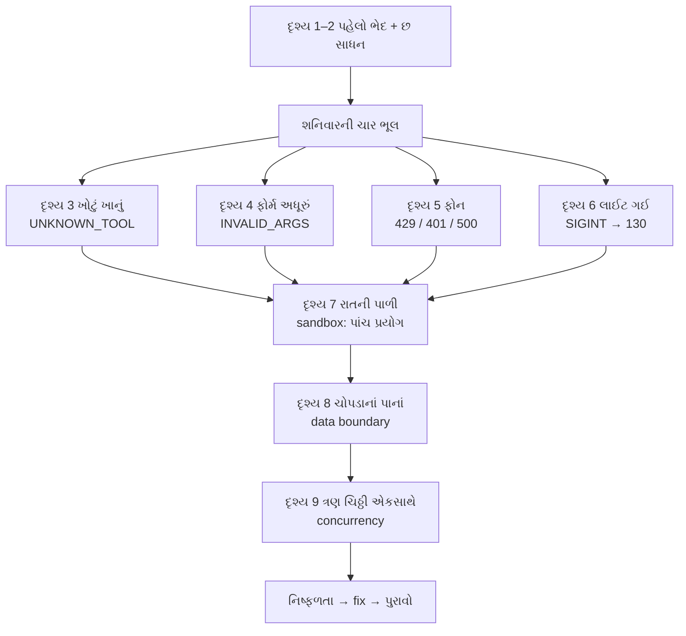
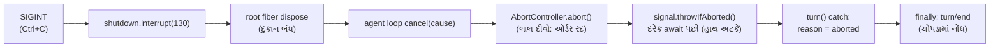

# પ્રકરણ 5 — Debugging, permissions અને reliability

> **Level 5 · વાર્તાનો દિવસ 10–11.**
> શનિવારે ભોજનાલયમાં જે ખોટું થઈ શકે તે બધું થયું. રવિવારે આરવ દરેક ભૂલ **જાણીજોઈને ફરી ઉત્પન્ન** કરે છે — unavailable tool, invalid input, provider error, interrupted execution — અને દરેકનો માલિક code શોધે છે. પછી રસોડાની ખરી સીમાઓ ચકાસે છે: ક્યાં વાડ છે, અને ક્યાં **નથી**.
> દરેક દૃશ્ય: 🎬 ઘટના → ❓ પ્રશ્ન → 💻 code માં → 🔬 expert નજર. આખો નકશો: [સમગ્ર નકશો](overview-samagra-naksho.md).

## 🎬 શનિવાર: ખરાબ દિવસ

ભીડ. અને:

- બપોરે મહારાજ ચિઠ્ઠી લખે છે: "**`read_everything`** ખાનામાંથી બધું લાવો." એવું કોઈ ખાનું જ નથી.
- પછી એક ચિઠ્ઠીમાં ફરજિયાત ખાનું ખાલી — "કઈ file?" લખ્યું જ નથી.
- સાંજે agency નો ફોન **વ્યસ્ત** આવે છે. પછી ખબર પડે છે કે એક દિવસ માટે **membership card** ખોટું નોંધાયું હતું. અને એક વાર agency ના રસોડામાં જ ગડબડ.
- રાત્રે નવ વાગ્યે **ફરી લાઈટ જાય છે** — ઓર્ડર અધવચ્ચે.
- રાતની પાળીમાં પપ્પા ઘરે છે. એક ઓર્ડરમાં લખ્યું છે: "રસોડાની બહાર, ઓફિસના કબાટમાં ચિઠ્ઠી મૂકો." **કોણ ના પાડશે?**

રવિવારે સવારે મીરાદીદી: "ગઈકાલ ખરાબ નહોતી; **શ્રેષ્ઠ શિક્ષક** હતી. પણ યાદશક્તિ પર ભરોસો ન કર. આજે આપણે દરેક ભૂલ રિહર્સલ મહારાજ સાથે **ફરી** કરાવીશું. જે ભૂલ ઇચ્છા મુજબ ફરી કરાવી શકાય, તે જ સમજાઈ ગણાય."

## 🎯 આ પ્રકરણ પછી તમે શું કરી શકશો

- ચારેય failure class ને mock provider થી ઇચ્છા મુજબ ઉત્પન્ન કરી, stored session માંથી તેનું exact model-visible text અને error code કાઢી શકશો.
- `llm-retry` નું backoff ક્યાં નક્કી થાય છે અને કઈ errors retry થાય છે તે બતાવી શકશો.
- Sandbox modes, approval policy, અને "fail closed" વર્તન ચલાવીને સાબિત કરી શકશો — અને ક્યાં સીમા **નથી** તે પણ.
- Cancellation, retries, concurrency અને recovery ના માલિક symbols બતાવી શકશો.
- દરેક fix માટે "મૂળ નિષ્ફળતા ગઈ" એવો પુરાવો કેવી રીતે આપવો તે લખી શકશો.

## 🗺️ આજના બે દિવસનો નકશો



---

## દૃશ્ય 1 — પહેલો ભેદ: ચિઠ્ઠી પાછી, કે ઓર્ડર બંધ?

🎬 આરવ શનિવારની પાંચ ઘટના નોટબુકમાં એક નીચે એક લખે છે. દીદી વચ્ચે એક લીટી દોરે છે: "ઉપરની બે માં **થાળી પીરસાઈ**. નીચેની બે માં **ઓર્ડર જ અટક્યો**. કેમ?"

આરવ વિચારે છે. "ઉપરની બે માં ભૂલ **કોઠારમાં** હતી. મહારાજને લાલ ચિઠ્ઠી મળી, અને તેમણે બીજો રસ્તો લીધો. નીચેની બે માં **મહારાજ સુધી પહોંચાયું જ નહીં** — ફોન કે લાઈટ."

💻

| ભૂલ ક્યાં | શું થાય | શનિવારે |
|---|---|---|
| **Tool-level** (કોઠાર) | `tool/result` માં `isError: true`; model ને જાણ; turn **ચાલુ** | ખોટું ખાનું, અધૂરું ફોર્મ, sandbox ની "ના" |
| **Turn-level** (ફોન કે દુકાન) | retry, અથવા `turn/end` reason `error`/`aborted`; turn **બંધ** | ફોનની મુશ્કેલી, લાઈટ |

**યાદ-ચાવી: "સાધનની ભૂલ = ચિઠ્ઠી પાછી; ફોન કે દુકાનની ભૂલ = ઓર્ડર બંધ."**

🔬 **Expert નજર.** આ ભેદ પાછળ એક સાદો તર્ક છે: **ભૂલ વિશે કોણ કંઈ કરી શકે?** કોઠારની ભૂલ model સુધારી શકે (બીજી ચિઠ્ઠી લખીને), એટલે ભૂલ model ને અપાય. ફોન ન લાગે ત્યારે model કશું ન કરી શકે — તે તો ફોનની પેલી બાજુ છે — એટલે નિર્ણય harness લે: ફરી પ્રયત્ન, કે બંધ. કોઈ પણ error જોતાં પહેલો પ્રશ્ન: "આ કયા સ્તરની છે?" એનો જવાબ કહી દે છે કે ચોપડામાં કઈ event શોધવી: `tool/result`, કે `turn/end`.

## દૃશ્ય 2 — "દાળ ખારી કેમ થઈ?": છ સાધન

🎬 ગયા અઠવાડિયે દાળ ખારી થઈ. બધા પાસે અભિપ્રાય હતો: "મહારાજે બે વાર મીઠું નાખ્યું", "નવું મીઠું વધારે ખારું છે". પપ્પાએ કોઈનું ન સાંભળ્યું. તેમણે **સીસીટીવી** જોયો, **ચોપડો** ખોલ્યો, agency ને ગયેલા સંદેશની **નકલ** મંગાવી, અને **હાજરીપત્રક** તપાસ્યું. દસ મિનિટમાં જવાબ: મીઠાનો ચમચો બદલાયો હતો.

❓ "મહારાજને પૂછી લીધું હોત તો?"

"મહારાજ ભૂલી ગયા છે. અને યાદ હોત તો પણ — માણસ જે **માને** છે તે કહે; ચોપડો જે **થયું** તે કહે."

💻 **Debugging** = ભૂલ (bug) શોધી તેનું કારણ સમજવું — અનુમાનથી નહીં, પુરાવાથી.

| સાધન | કયા પ્રશ્ન માટે | Command / file | પપ્પાની તપાસમાં |
|---|---|---|---|
| Observer plugin (logs) | કયું event ક્યારે, કયા ક્રમમાં | [`trace-events.ts`](../labs/request-trace/trace-events.ts) overlay | **સી**સીટીવી |
| Stored session | model ને **ખરેખર** શું દેખાયું | [`print-session.mjs`](../labs/request-trace/print-session.mjs) `--full` | **ચો**પડો |
| Wire capture | adapter એ HTTP પર શું મોકલ્યું | [`capture-wire.ts`](../labs/request-trace/capture-wire.ts) | **ટ**પાલની નકલ |
| Breakpoints | એક line પર અટકવું | `node --inspect-brk --import tsx/esm apps/cli/src/bin.ts --profile headless "…"` | **સ**મય થંભાવવો |
| Upstream tests | વર્તનનો contract | `pnpm exec vitest run <package path>` | **નિ**યમપોથી |
| Startup audit | plugin load નથી થતો | stderr નું `entries did not activate` (પ્રકરણ 2) | **હા**જરીપત્રક |

**યાદ-ચાવી "સી-ચો-ટ-સ-નિ-હા" — "સીધો ચોર ટપાલ સમયે નિયમ હાજર".**

- **Breakpoint** = debugger ને "આ line પર રોકાઈ જા" કહેવું; ત્યાં અટકી variables જોઈ શકાય. ઉદાહરણ: Chrome માં `chrome://inspect` ખોલી, `packages/core/agent-loop/src/agent.ts` ની [`step`][loop-step] પર breakpoint મૂકો. Source `tsx` થી ચાલે છે, તેથી TypeScript lines સીધી દેખાય છે. 🧪 command ચકાસ્યો (`Debugger listening on ws://127.0.0.1:9229/…`); interactive stepping અમે આ environment માં કર્યું નથી. ⚠️
- **Contract** = "આ code આવું વર્તન કરશે" નું વચન; tests એ વચનને ચકાસે.

🔬 **Expert નજર.** છ સાધન છ **સ્તર** છે, અને દરેક એક જ પ્રકારના પ્રશ્નનો જવાબ આપે. "Model એ ખોટો જવાબ કેમ આપ્યો?" → ચોપડો (તેને શું દેખાયું). "Provider ને ખોટું કેમ ગયું?" → wire. "Plugin કેમ નથી?" → હાજરીપત્રક. શિખાઉ દરેક સવાલ માટે `console.log` ઉમેરે છે; expert પહેલાં પૂછે છે "કયા સ્તરનો પ્રશ્ન?", અને ઘણી વાર code ને અડ્યા વગર જવાબ મળી જાય છે — કારણ કે ચોપડો **પહેલેથી લખાયેલો** છે.

આજના બધા runs: `bash tmp/book-labs/request-trace/run-mock.sh` + નીચેના env knobs (રિહર્સલ મહારાજને "આ વખતે આમ કરજો" ની સૂચના). દરેક stored `tool/result` / `turn/end` અમારા [evidence/](../evidence/) માં છે. 🧪

## દૃશ્ય 3 — "એવું કોઈ ખાનું જ નથી": unavailable tool

🎬 શનિવાર બપોર: મહારાજની ચિઠ્ઠી — "`read_everything` ખાનામાંથી બધું લાવો." ભીખાભાઈ યાદી જુએ છે; એવું ખાનું નથી. લાલ ચિઠ્ઠી પાછી જાય છે. મહારાજ બીજી ચિઠ્ઠી લખે છે, અને થાળી પીરસાય છે.

**પહેલાં ધારો:** turn નું reason? Exit code?

💻

```bash
TOOL_NAME=read_everything bash tmp/book-labs/request-trace/run-mock.sh
```

| અવલોકન | મૂલ્ય |
|---|---|
| Model-visible text | `Error: unknown tool "read_everything"` |
| `error` in log | `{"name":"ToolNotFoundError","code":"UNKNOWN_TOOL"}` |
| Turn | `completed` (step 2 ચાલ્યો), exit 0 |

**માલિક code:** pipeline નું [`dispatchToolBody`][pipeline-body] → `resolveExecution` → `undefined` → `throw new ToolNotFoundError(exec.name)` ([class][contracts-notfound]).

🔬 **Expert નજર.** Exit 0 — ભૂલ થઈ, અને process સફળ. આ વિરોધાભાસ નથી: ભૂલ tool-level હતી, અને turn પૂરો થયો. પણ નોંધો કે આ લક્ષણનાં **બે તદ્દન જુદાં કારણ** હોઈ શકે: model એ નામ બનાવી કાઢ્યું (model ની ભૂલ), અથવા તમારો plugin load ન થયો કે disable છે (તમારી ભૂલ — પ્રકરણ 4 ની પરીક્ષા 5 માં બરાબર આ જ message આવ્યો હતો). ફરક કેવી રીતે પાડવો? Trace ની `tools=[…]` અથવા wire `toolNames` જુઓ: નામ યાદીમાં **હતું** કે નહીં.

## દૃશ્ય 4 — "ફોર્મ અધૂરું": invalid input

🎬 બીજી ચિઠ્ઠી: ખાનું સાચું છે, પણ મહારાજે `file_path` ને બદલે `path` લખ્યું છે. ભીખાભાઈ ફોર્મ પાછું મોકલે છે, અને કઈ લીટી ખૂટે છે તે લખે છે.

💻

```bash
TOOL_ARGS='{"path":"README.md"}' bash tmp/book-labs/request-trace/run-mock.sh
```

| અવલોકન | મૂલ્ય |
|---|---|
| Model-visible text | `Error: invalid arguments: missing required property "file_path"` |
| `error` | `{"name":"ToolArgsError","code":"INVALID_ARGS"}` |

**માલિક code:** [`defineTool` validation][schema-defineTool-validate] — `validate(args)` → `throw new ToolArgsError(violations)`. Model ને સુધારવાની તક મળે છે, કારણ કે તે સામાન્ય tool result છે.

🔬 **Expert નજર.** દૃશ્ય 3 અને 4 ના માલિક **જુદા** છે, ભલે બંને "ખરાબ ચિઠ્ઠી" લાગે: ખાનું શોધવું pipeline નું કામ છે; ફોર્મ તપાસવું `defineTool` ના wrapper નું. અને ફોર્મની તપાસ tool body **પહેલાં** થાય છે — તમારા `execute` function સુધી ખોટા arguments કદી પહોંચતા નથી. એટલે tool લખતી વખતે તમારે "ખાનું ખાલી હોય તો?" ની ચિંતા કરવાની નથી; schema માં `required: true` લખો, અને એ ચિંતા harness ની.

## દૃશ્ય 5 — ફોનની ત્રણ મુશ્કેલી: provider error

🎬 શનિવાર સાંજ. રમેશભાઈ agency ને ફોન કરે છે.

**પહેલી વાર: લાઈન વ્યસ્ત.** રમેશભાઈ તરત ફરી ડાયલ નથી કરતા. અડધી મિનિટ રાહ જુએ છે. ફરી વ્યસ્ત — એક મિનિટ. પછી બે. આરવ અધીરો થાય છે: "તરત ને તરત કરો ને!" રમેશભાઈ: "આખું શહેર અત્યારે એ જ નંબર ડાયલ કરે છે. બધા તરત-તરત કરે, તો લાઈન કદી ખાલી ન થાય."

**બીજી વાર: "તમારું card ખોટું છે."** રમેશભાઈ ફોન મૂકી દે છે અને પપ્પાને બોલાવે છે. ફરી ડાયલ કરતા જ નથી. "ખોટું card સો વાર બતાવું તો પણ ખોટું જ રહે."

**ત્રીજી વાર: "અમારે ત્યાં ગડબડ છે."** પાંચ વાર પ્રયત્ન કરે છે, દરેક વખતે વધારે રાહ જોઈને. પાંચમી વાર પછી અટકે છે: "હવે બસ. ઓર્ડર બંધ કરો, ગ્રાહકને કહો."

❓ "પાંચ જ કેમ? દસ, વીસ?"

"ગ્રાહક બેઠો છે. અનંત રાહ એ પણ એક જવાબ છે — ખરાબ જવાબ."

💻

| Script | ફોન પર | પરિણામ | Model calls | Exit |
|---|---|---|---|---|
| `SEQUENCE=rate_limit,tool_call_success,success` | લાઈન વ્યસ્ત | 429 → `llm/retry` → ~1s પછી સફળ | 3 | 0 🧪 |
| `SEQUENCE=auth_error` | card ખોટું | `turn/end` reason `error`, `AUTH`, status 401; **retry નહીં** | 1 | 1 🧪 |
| Title row on + `tool_call_success,success` (પ્રકરણ 1 ની આગાહી) | agency માં ગડબડ | 500 `script exhausted` → 5 retries (આશરે 0.5s, 1s, 1.9s, 3.9s, 8.2s) → `SERVER` | 8 | 1 🧪 |

Stored `auth-error` sequence ([evidence/auth-error.err](../evidence/auth-error.err)):

```text
[trace +  323ms] llm/stream call #1 deepseek-official/deepseek-flash messages=5 …
[trace +  375ms] session/event #15 assistant/attempt
[trace +  377ms] session/event #17 turn/end reason={"kind":"error","error":{"message":"mock authentication failed","code":"AUTH","status":401}}
dsh: AUTH: mock authentication failed
```

**રમેશભાઈનો નિર્ણય code માં ક્યાં છે?** Loop stream નિષ્ફળ થાય ત્યારે `assistant/attempt` લખી `agent/request-error` **waterfall** ચલાવે છે ([source][loop-request-error]); `{ kind: 'retry' }` મળે તો એ જ step માં ફરી પ્રયાસ, નહીં તો `LlmError` ફેંકે. Base bundle નો `llm-retry` plugin આ event સાંભળે છે ([listener][retry-listener]) અને retry policy વાપરે છે. Defaults અને retryable codes ([source][retry-defaults]):

```ts
const DEFAULT_MAX_RETRIES = 5
const DEFAULT_INITIAL_DELAY_MS = 500
const DEFAULT_MAX_DELAY_MS = 10_000
const DEFAULT_JITTER_RATIO = 0.1
const DEFAULT_RETRYABLE_CODES = Object.freeze([
  EMPTY_RESPONSE_CODE,
  'RATE_LIMIT',
  'SERVER',
  'TIMEOUT',
  'TRANSPORT',
])
```

- **Retry** = નિષ્ફળ થયેલું કામ ફરી પ્રયત્ન કરવું.
- **Exponential backoff** = દરેક નિષ્ફળતા પછી રાહ **બમણી**: 0.5 → 1 → 2 → 4 → 8 સેકન્ડ, મહત્તમ 10.
- **Jitter** = રાહમાં થોડો random ફેરફાર (±10%), જેથી હજારો clients **એકસાથે** ફરી ન દોડે — "આખું શહેર એ જ નંબર ડાયલ કરે છે".

Observed delays (0.5 → 1 → 2 → 4 → 8 s, થોડો jitter) આ backoff સાથે મેળ ખાય છે. `AUTH` retryable codes માં નથી, તેથી તરત error. ✅🧪 Retry **એ જ step** માં થાય છે; તેથી `agent/pre-step` અને user admission ફરી થતાં નથી (architecture doc ✅).

**યાદ-ચાવી "5-અડધી-બમણું-દસ":** 5 વાર, અડધી સેકન્ડથી, બમણું કરતા, 10 સેકન્ડ સુધી. **"રેટ-સર્વર-ટાઇમ-ટ્રાન્સપોર્ટ ફરી, ઓથ કદી નહીં."**

🔬 **Expert નજર.** ત્રણ વાત. (1) Retry યાદીનો નિયમ એક પ્રશ્ન છે: "**રાહ જોવાથી પરિસ્થિતિ બદલાઈ શકે?**" વ્યસ્ત લાઈન ખાલી થાય; ખોટું card સાચું ન થાય. (2) ત્રીજી લીટીમાં 8 model calls છે — 2 સફળ + 1 નિષ્ફળ + 5 retries. Retry **મફત નથી**: દરેક એક ખરો call છે, અને ખરા provider પર તેનો સમય અને ખર્ચ છે. (3) અને સૌથી મહત્વનું: retry નો નિર્ણય loop માં hard-coded નથી; તે `agent/request-error` waterfall માં એક **plugin** નો છે. તમારી deployment ને જુદી નીતિ જોઈએ (દા.ત. `SERVER` પર 2 જ વાર), તો loop બદલવાનો નથી — config કે plugin. પ્રકરણ 3 ની boundary અહીં ફળે છે: adapter error **ઓળખે**, plugin **નક્કી કરે**.

## દૃશ્ય 6 — લાઈટ ગઈ: interrupted execution

🎬 રાત્રે નવ વાગ્યે લાઈટ જાય છે. અંધારામાં, ક્રમમાં, ચાર વાત બને છે:

1. પપ્પા બૂમ પાડે છે: "**દુકાન બંધ!**"
2. રમેશભાઈ રસોડાની બારી પર **લાલ દીવો** (battery વાળો) ચાલુ કરે છે: "ઓર્ડર **રદ**."
3. મહારાજ આગલી નજરે લાલ દીવો જુએ છે અને હાથ **અટકાવે** છે. પણ ચૂલા પરનું તપેલું હવામાં નથી છોડતા: ગેસ બંધ કરે, તપેલું નીચે મૂકે, **પછી** કહે "રદ".
4. રમેશભાઈ ચોપડામાં **નોંધ** કરે છે: "ઓર્ડર રદ — દુકાન બંધ."

અને પછી એક વિચિત્ર વાત: બધું બરાબર બંધ થયા પછી કોઈ અંધારામાં તિજોરી ખોલવા જાય છે અને બૂમ પાડે છે: "**તિજોરી બંધ છે!**" — જાણે કંઈ ખોવાયું હોય.

❓ "કંઈ ખોવાયું છે?"

"ચોપડો ખોલીને જો."

💻 Mock ને `--sequence stall` (headers મોકલી શાંત) સાથે ચલાવી, headless process ને 4 સેકન્ડે `SIGINT` (પૂરા commands: [પરિશિષ્ટ B](../appendix/B-command-reference.md#interrupt-and-resume)).

**Signal** = operating system process ને મોકલતો ટૂંકો સંદેશો. `SIGINT` = Ctrl+C ("અટકો"), `SIGTERM` = "વ્યવસ્થિત બંધ થાઓ".

| અવલોકન | મૂલ્ય |
|---|---|
| Exit code | **130** (launcher: `SIGINT` → 130, `SIGTERM` → 0) ([`runProfile`][cli-runProfile]). 130 = 128 + 2 (SIGINT નો નંબર) — Unix ની જૂની પ્રથા |
| Durable log | `assistant/attempt {"stream":[]}`, `step/end`, `turn/end {"kind":"aborted","reason":{"kind":"disposed"}}` |
| Stderr | `dsh: session "session-…": flush on a closed handle` |

કંઈ ખોવાયું નથી: ચોપડામાં `turn/end aborted` છે (પ્રકરણ 3 ના Lab માં તમે એ જ session resume પણ કર્યું). ત્રીજી line — `flush on a closed handle` — એ "તિજોરી બંધ છે!" ની ખોટી બૂમ છે: interruption **સાચું** handle થયું, પણ headless runner teardown પછી પણ `sessions.flush` કરવા જાય છે અને નિષ્ફળતા report કરે છે. આ નાની ખામીનું આખું contribution — reproduce, patch, regression test — પ્રકરણ 6 માં છે.

### ચાર વાત, ચાર કડી: cancellation કેવી રીતે વહે છે



SIGINT → `shutdown.interrupt(130)` → root fiber dispose → agent loop નો `cancel(cause)` ([source][loop-cancel]) → loop-owned `AbortController` abort → દરેક `await` પછીનું `signal.throwIfAborted()` → `turn()` નું `catch` reason `aborted` નક્કી કરે → `finally` માં `turn/end`.

અને તપેલું: tool body ચાલુ હોય તો pipeline તેને છોડી દેતું નથી — "Cancellation never abandons the body: a started promise reaches quiescence before its outcome becomes `ABORTED`" ([`dispatchToolBody`][pipeline-body]). ✅ **Quiescence** = શાંત, સ્થિર સ્થિતિ: ચાલુ કામ ઠરી જાય ત્યાં સુધી.

પ્રવેશ પ્રકરણનો `rasoi-async.mjs` યાદ છે? `controller.abort()` → `await` ભૂલ ફેંકે → `catch` → "રદ થયું: AbortError" → "રસોડું ફરી તૈયાર". એ જ સાંકળ, ઘણી મોટી.

**યાદ-ચાવી "બંધ-રદ-ફેંક-નોંધ":** દુકાન **બંધ** → ઓર્ડર **રદ** → ભૂલ **ફેંક** → ચોપડામાં **નોંધ**.

🔬 **Expert નજર.** Cancellation **સહકારી** (cooperative) છે: કોઈ મહારાજનો હાથ પકડીને રોકતું નથી; તે પોતે દીવો જુએ છે. એટલે code માં `signal.throwIfAborted()` દરેક `await` પછી **હાથે લખેલું** છે (પ્રકરણ 1, દૃશ્ય 7 (d)). લાંબું ચાલતું tool લખો અને signal જોવાનું ભૂલો, તો Ctrl+C પછી પણ તે ચાલ્યા કરે. અને quiescence નો નિયમ એ invariant ("દરેક `tool/call` નું એક `tool/result`") નો રક્ષક છે: અધવચ્ચે છોડેલું tool કદાચ અડધી file લખી ચૂક્યું હોય; harness તેને ઠરવા દે, **પછી** પરિણામ `ABORTED` નોંધે — જેથી ચોપડો અને disk એક વાત કહે.

## દૃશ્ય 7 — રાતની પાળી: permissions અને sandbox

🎬 રાતની પાળી. પપ્પા ઘરે છે. પપ્પાએ દીવાલ પર ત્રણ સ્તરની રજા લખી છે:

- **"ફક્ત જોવાની રજા."**
- **"પોતાના રસોડામાં રાંધવાની રજા."** (રોજનું)
- **"આખી ઇમારતની ચાવી."** (ખતરનાક; પપ્પાને પૂછ્યા વગર નહીં.)

આરવ રાતે પાંચ પ્રયોગ કરે છે — દરેક વખતે પહેલાં ધારીને.

💻 નામ:

- **Sandbox mode** = process/file side effects કેટલા દૂર સુધી માન્ય: `read-only`, `workspace-write`, `danger-full-access` ([`SandboxPolicyService`][sandbox-policy], default `read-only`) — રસોડાની સીમા.
- **Workspace** (અહીં) = agent જ્યાં કામ કરે છે તે folder; base bundle માં `process.cwd()` — "પોતાનું રસોડું".
- **Approval policy** = મંજૂરી કોને/કેવી રીતે પૂછવી: `'ask' | 'never'` ([`ApprovalPolicy`][approval-policy]) — "પપ્પાને પૂછો".
- **Escalation** = વધુ છૂટ માંગવી (દા.ત. workspace બહાર લખવા).

Base bundle `DSH_PERMISSION_MODE` ન હોય તો `workspace-write` અને `workspaceRoot: process.cwd()` વાપરે છે ([rows][bundle-base-sandbox]). ✅ `danger-full-access` સિવાય base `ask` વાપરે છે.

| Mode | દીવાલ પર | વાંચવું | લખવું |
|---|---|---|---|
| `read-only` | ફક્ત જોવાની રજા | ✔ | ✘ |
| `workspace-write` | પોતાના રસોડામાં રાંધવાની રજા | ✔ (ગમે ત્યાં!) | ફક્ત workspace માં |
| `danger-full-access` | આખી ઇમારતની ચાવી | ✔ | ✔ ગમે ત્યાં — ⚠️ ખતરનાક |

આજે કઈ રજા લાગુ છે, તે દરેક headless run ના ચોપડાની **પહેલી ત્રણ લીટી** કહે છે 🧪:

```text
#0 permission/preset {"preset":"workspace-write"}
#1 sandbox/mode {"mode":"workspace-write"}
#2 approval/policy {"policy":"ask"}
```

### પાંચ પ્રયોગ (🧪 બધા `workspace-write` માં)

**પ્રયોગ 1 — "ઓફિસના કબાટમાં લખો."** મહારાજની ચિઠ્ઠી: રસોડાની બહાર `/etc/book-test.txt` લખો. (**`/etc`** = Linux માં system ની settings રાખતું folder — workspace ની બહાર.)
પરિણામ: `Error: [sandbox: file access denied under workspace-write mode]` + escalation hint, code `FS_SANDBOX_DENIED`. ના પાડનાર: `dsh-fs-sandbox` ([policy][fs-sandbox-doc]).

**પ્રયોગ 2 — "તો પપ્પાને પૂછો."** એ જ `write`, હવે `sandbox_permissions: "danger-full-access"` અને `justification` સાથે. પણ રાત છે; પપ્પા ફોન ઉપાડતા નથી. આરવ ધારે છે: "જવાબ ન મળે, તો ચાલશે ગણીએ?"
પરિણામ: `approval/asked` → `approval/decided {"outcome":"unavailable"}` → `Error: sandbox escalation to "danger-full-access" requires approval, but no approval channel is available`. ના પાડનાર: [escalation][sandbox-escalation] — headless માં જવાબ આપનાર નથી.

**પ્રયોગ 3 — "ચોકીદાર જ નથી."** `bash` થી `touch /etc/book-bash-test`. Commands ને બંધ ઓરડામાં ચલાવનાર ચોકીદાર (**bubblewrap, `bwrap`** — Linux પર process ને sandbox માં ચલાવતું tool) અમારા host પર નથી. આરવ ધારે છે: "ચોકીદાર નથી, તો command સીધો ચાલશે."
પરિણામ: `Error: sandbox mode "workspace-write" is requested but no sandbox backend is usable on this host; refusing to run the command unconfined. Install bubblewrap …`. ના પાડનાર: [`SandboxUnavailableError`][sandbox-unavailable].

**પ્રયોગ 4 — "ઓફિસનો કાગળ વાંચો."** `read` `/etc/os-release` — workspace ની બહાર. આરવ હવે પેટર્ન જાણે છે: "ના પાડશે."
પરિણામ: **સફળ** — `<path>/usr/lib/os-release</path>`. ના પાડનાર: **કોઈ નહીં.** "Reads pass through untouched: every mode permits reading" ([source][fs-sandbox-reads]).

આરવ થોડી વાર screen સામે જોઈ રહે છે.

**પ્રયોગ 5 — "ન હોય તેવી ચોપડી."** `read` `NOPE.md` → `FS_NOT_FOUND` (`read` tool પોતે; પ્રકરણ 3).

કોઈ પણ run પછી `/etc/book-test.txt` કે `/etc/book-bash-test` બન્યા નથી (`ls` થી ચકાસ્યું). 🧪

| # | Tool call | પરિણામ | સીમા કોણ લાગુ કરે |
|---|---|---|---|
| 1 | `write` `/etc/book-test.txt` | `FS_SANDBOX_DENIED` | `dsh-fs-sandbox` |
| 2 | એ જ + escalation | `outcome: unavailable` → નકાર | escalation (fail closed) |
| 3 | `bash` `touch /etc/…` | unconfined ચલાવવાનો ઇનકાર | `SandboxUnavailableError` |
| 4 | `read` `/etc/os-release` | **સફળ** | કોઈ નહીં |
| 5 | `read` `NOPE.md` | `FS_NOT_FOUND` | `read` tool |

### ત્રણ શીખ

**(1) Fail closed — "શંકા હોય ત્યાં ના."** પ્રયોગ 2 અને 3 માં આરવની ધારણા ખોટી પડી, એક જ કારણે. પૂછનારને જવાબ ન મળે → **ના**. ચોકીદાર ગેરહાજર → દરવાજો **બંધ**, ખુલ્લો નહીં. ✅🧪

**Fail closed / fail open** = નિષ્ફળતા વખતે "બંધ" (સુરક્ષિત) સ્થિતિ vs "ખુલ્લી" (જોખમી) સ્થિતિ. Harness fail closed છે.

**(2) Reads ખુલ્લાં છે.** પ્રયોગ 4. File sandbox ફક્ત mutations (લખવા-બદલવા) પર policy fence છે. `read` વડે process વાંચી શકે તે કંઈ પણ model વાંચી શકે છે. Source પોતે કહે છે: "This is containment, not a security boundary". ✅

- **Containment** = ભૂલથી થતું નુકસાન ઘટાડતી વાડ. **Security boundary** = હુમલાખોરને રોકતી દીવાલ.
- **Least privilege** = કામ પૂરતી જ છૂટ, વધુ નહીં.
- **Disposable VM/container** = ફેંકી દેવાય તેવું અલગ computer-ખાનું; બગડે તો નવું.

⚠️ **વાર્તા અને technical વચ્ચે ફરક — આ પુસ્તકનો સૌથી મહત્વનો:** ભોજનાલયની દીવાલ ચોરને પણ રોકે. અહીં file sandbox ફક્ત **લખવા** પર વાડ છે; **વાંચવું ખુલ્લું છે**. તમારા computer પર passwords કે keys વાળી files હોય, તો model તે **વાંચી** શકે — અને દૃશ્ય 8 માં જોશો કે વાંચેલું ક્યાં જઈ શકે. Secrets વાળા machine પર agent ચલાવતા પહેલાં [SAFETY.md](https://github.com/deepseek-ai/deepseek-harness/blob/fcc0ad462172522aaf5c93a7b2e01f6b9f0b0159/SAFETY.md) વાંચો: disposable VM/container, least privilege.

**(3) Kernel isolation shell નું કામ છે.** Linux પર `dsh-sandbox-local` પહેલાં `bwrap`, પછી Landlock ([source][sandbox-local-chain]); macOS `sandbox-exec`; Windows ACL runner.

**યાદ-ચાવી: "લખવા પર વાડ, વાંચવું ઉઘાડ; શેઠ નથી તો ના, વાડ નથી તો ના."**

🔬 **Expert નજર.** Table ની ત્રીજી column — "સીમા કોણ લાગુ કરે" — પાંચ લીટીમાં **ચાર જુદા જવાબ** આપે છે. "Sandbox" એક વસ્તુ નથી; તે ઘણા સ્તરની વાડ છે, અને દરેક સ્તર જુદા ખતરા માટે છે. સુરક્ષા વિશે expert બે પ્રશ્ન પૂછે છે, અને બીજો વધારે મહત્વનો છે: "આ શું રોકે છે?" અને "**આ શું નથી રોકતું?**" પ્રયોગ 4 ચલાવ્યા વગર તમે માની લેત કે workspace ની બહાર બધું સલામત છે. સુરક્ષાનો દાવો વાંચો નહીં; **ચલાવીને તોડી જુઓ**. અને source ની એ line માટે આદર રાખો જે પોતે કહે છે "not a security boundary": પ્રામાણિક documentation ખોટા ભરોસા કરતાં વધુ સલામત છે.

## દૃશ્ય 8 — agency ને ચોપડાનાં પાનાં: data boundary

🎬 પ્રકરણ 3 માં આરવે ફોન પરની વાતમાં `dsh_session_log` જોયું હતું. હવે તે દૃશ્ય 7 સાથે જોડે છે: "મહારાજ ઓફિસનો કાગળ **વાંચી** શકે. અને ચોપડાનાં પાનાં **agency ને જાય** છે. તો વાંચેલું બહાર જાય?"

દીદી માથું હલાવે છે. "હવે તું બે અલગ પ્રશ્નને અલગ જોઈ શકે છે. **Permission**: agent શું **કરી** શકે. **Data**: કઈ માહિતી **બહાર** જાય. પહેલાની વાડ બીજાને નથી રોકતી."

💻 પ્રકરણ 3 ની wire capture મુજબ base bundle દરેક request માં `dsh_session_log` (session log નો incremental suffix) અને `dsh_plugin_packages` મોકલે છે, અને headers માં anonymous user id તથા session id. 🧪

- **Data boundary** = કઈ માહિતી આપણા computer ની બહાર જાય છે તેની સીમા.
- **Telemetry** = software ના ઉપયોગ વિશે માહિતી બનાવનારને મોકલવી.

Official API ને session-log suffix ન મોકલવો હોય તો row disable કરો ([row][bundle-base-sessionlog]) — પ્રકરણ 2 ની ચિઠ્ઠી:

```yaml
- id: session-log-deepseek
  disabled: true
```

Telemetry: `session-telemetry-otel` row default `FEEDBACK_ONLY` mode માં છે ([row][bundle-base-telemetry]); base bundle ની comment મુજબ "OTel releases a Session-log prefix only after explicit user feedback", અને non-empty `DSH_TELEMETRY_DISABLED` process ને opt out કરે છે. ✅ (અમારા બધા runs `DSH_TELEMETRY_DISABLED=1` સાથે હતા.)

🔬 **Expert નજર.** Model ને જે દેખાય છે તે provider ને **જાય જ** છે — એ તો model call ની વ્યાખ્યા છે (tool result history નો ભાગ છે). એટલે "model શું વાંચી શકે" એ પહેલેથી data નો પ્રશ્ન છે, extension હોય કે ન હોય. Extension તેમાં વહીવટી લીટીઓ ઉમેરે છે. અને ઉપાય જુઓ: code બદલવાનો નથી; **એક row** બંધ કરવાની છે. "Everything is a plugin" નો સુરક્ષા-ફાયદો આ છે: જે વર્તન તમને નથી જોઈતું, તે કોઈ file ની ઊંડાણમાં દટાયેલું નથી; તે મેનુની એક લીટી છે, જે `--dump-config` માં દેખાય છે અને ચિઠ્ઠીથી બંધ થાય છે. બંધ કર્યા પછી wire ફરી capture કરીને **સાબિત** કરો કે field ગયું.

## દૃશ્ય 9 — ત્રણ ચિઠ્ઠી એકસાથે: concurrency

🎬 મહારાજ એક જ વારમાં ત્રણ ચિઠ્ઠી લખે છે: "ખાંડ લાવો, મીઠું લાવો, રેસીપી-ચોપડી લાવો." ભીખાભાઈ ત્રણ મદદનીશને **એકસાથે** મોકલે છે. પણ ચોથી ચિઠ્ઠી હોય "કોઠારનું રજિસ્ટર સુધારો", તો તે એકલી ચાલે: જ્યાં સુધી તે પૂરી ન થાય, કોઈ અંદર ન જાય.

અને એક વાત આરવ નોંધે છે: મીઠું ખાંડ કરતાં **વહેલું** આવી જાય, તો પણ ભીખાભાઈ જવાબ મહારાજને **ચિઠ્ઠીના ક્રમમાં** આપે છે: ખાંડ, મીઠું, ચોપડી.

❓ "વહેલું આવ્યું તે વહેલું આપી દે તો શું?"

"તો ચોપડામાં ક્રમ દર વખતે જુદો આવે — કોણ ઝડપી દોડ્યું તેના પર. એ જ ઓર્ડર, બે જુદા ચોપડા. પ્રકરણ 2 નો ઉતાવળિયો ગ્રાહક યાદ છે?"

💻 **Concurrency** = ઘણાં કામ એક જ સમયગાળામાં ચાલવાં.

Model એક જ response માં ઘણા tool calls આપી શકે. [`executeToolBatch`][batch-execute] દરેક call માટે [`executionMode`][pipeline-executionMode] પૂછે છે: `parallel` calls rolling pool માં ચાલે, બીજાં exclusive barrier બને.

- **Rolling pool** = મહત્તમ N કામ એકસાથે; એક પૂરું થાય કે બીજું શરૂ.
- **Exclusive barrier** = "આ કામ એકલું; આગળ-પાછળનાં બધાં રાહ જુએ."

Pool ની મર્યાદા `agent-loop` config `maxParallelToolCalls` ([source][loop-maxparallel]), default 10 ([source][loop-maxparallel-default]), અને તે `volatile()` છે — restart વગર બદલાય. Tool `isConcurrencySafe` આપે ત્યારે જ parallel ગણાય (`read` અને આપણો `csv_compare` બંને `true`). Results હંમેશા **model order** માં commit થાય છે. ✅

🔬 **Expert નજર.** Default જુઓ: tool `isConcurrencySafe` **ન** કહે, તો તે exclusive ગણાય. સલામત default — fail closed નો વિચાર (દૃશ્ય 7), concurrency માં. Tool લખનારે parallel થવાનો હક **માંગવો** પડે, અને માંગતી વખતે વચન આપે છે કે તે કશું બદલતો નથી. પ્રકરણ 4 માં તમે `() => true` લખ્યું હતું; તે એક line નહોતી, વચન હતું. અને "model order માં commit" એ determinism છે (પ્રકરણ 4 નો નિયમ 6, harness ના સ્તરે): કામ ગમે તે ક્રમે પૂરું થાય, **ચોપડો** હંમેશા એક જ ક્રમે લખાય — એટલે replay અને resume એક જ history જુએ.

## Source map: આ ક્રમમાં ખોલો

| ક્રમ | File | Symbol | વિષય |
|---|---|---|---|
| 1 | `packages/core/tools/src/pipeline.ts` | [`dispatchToolBody`][pipeline-body] | unknown tool, cancellation |
| 2 | `packages/core/tools/src/schema.ts` | [`defineTool` validation][schema-defineTool-validate] | invalid input |
| 3 | `packages/core/agent-loop/src/agent.ts` | [`agent/request-error`][loop-request-error] | provider error → retry decision |
| 4 | `packages/llm/llm/src/retry-policy.ts` | [defaults][retry-defaults] | backoff, retryable codes |
| 5 | `packages/core/agent-loop/src/agent.ts` | [`cancel`][loop-cancel], [`turn`][loop-turn] | interruption |
| 6 | `packages/fs/fs-sandbox/src/index.ts` | [policy][fs-sandbox-doc] | file mutation fence |
| 7 | `packages/sandbox/sandbox/src/escalation.ts` | [outcomes][sandbox-escalation] | approval |
| 8 | `packages/sandbox/sandbox/src/index.ts` | [`SandboxUnavailableError`][sandbox-unavailable] | fail closed |

---

## 🧪 Lab 5 — શનિવાર, ફરીથી

🎬 "હવે આખો શનિવાર તારા હાથે," દીદી કહે છે. "અને પછી નિયમપોથી ખોલ: જે તેં જોયું, તે upstream ના પોતાના tests પણ કહે છે?"

1. દૃશ્ય 3–6 ના ચારેય runs ચલાવો, અને દરેક માટે stored `tool/result` અથવા `turn/end` આ command થી કાઢો:

```bash
node tmp/book-labs/request-trace/print-session.mjs "$(find tmp/book-home/sessions -name 'session.v*.jsonl*' | head -1)" | grep -E "tool/result|turn/end"
```

(`| grep -E "A|B"` = output માંથી ફક્ત A અથવા B વાળી lines — પ્રવેશ, દૃશ્ય 2.) દરેક run પહેલાં `rm -rf tmp/book-home` કરો, જેથી `find` એક જ session શોધે.

દરેક run માટે નોટબુકમાં ત્રણ ખાનાં ભરો: **સ્તર** (tool કે turn — દૃશ્ય 1), **ચોપડામાં કઈ event**, **exit code**.

2. એ જ વર્તનના upstream tests — નિયમપોથી:

```bash
pnpm exec vitest run packages/llm/llm-retry packages/core/tools packages/fs/fs-sandbox
```

🧪 `Test Files 16 passed (16)`, `Tests 321 passed (321)`, આશરે 10 સેકન્ડ.

**Vitest** = tests ચલાવતું tool — નિયમપોથી મોટેથી વાંચી, દરેક નિયમ ખરેખર પળાય છે કે નહીં તે તપાસતો નિરીક્ષક.

🔬 **Expert નજર.** પગલું 2 કેમ? તમારો lab **એક** રસ્તો ચલાવે છે; upstream ના 321 tests સેંકડો. તમે જોયેલું વર્તન અકસ્માત છે કે contract, તે tests કહે છે. Expert કોઈ વર્તન પર આધાર રાખતાં પહેલાં શોધે છે: "આને કોઈ test **પકડી રાખે** છે?" જે વર્તન test વગરનું છે, તે આવતા release માં ચૂપચાપ બદલાઈ શકે.

## 🔮 આગાહી કસોટી: બે વાર ગડબડ, પછી સફળ

Agency બે વાર "અમારે ત્યાં ગડબડ છે" કહે, પછી સામાન્ય જવાબ આપે:

`SEQUENCE=server_error,server_error,tool_call_success,success`

**ચલાવતા પહેલાં લખો:** (1) કુલ model calls, (2) `llm/retry` events ની સંખ્યા, (3) exit code, (4) આશરે કેટલી સેકન્ડ. (સંકેત: "5-અડધી-બમણું-દસ" — રમેશભાઈની પહેલી બે રાહ કેટલી?)

જવાબ: [પરિશિષ્ટ D — Lab 5](../appendix/D-lab-solutions.md#lab-5).

## 🩺 નિષ્ફળતા → fix → પુરાવો: મીઠું ચાખવાનો નિયમ

🎬 દાળ ખારી થઈ તે પછી પપ્પાએ ચમચો બદલ્યો. પણ ત્યાં અટક્યા નહીં. તેમણે **જૂનો ચમચો પાછો મૂકીને** એક વાર દાળ બનાવડાવી: ફરી ખારી થઈ. "હવે ખાતરી થઈ કે ચમચો જ કારણ હતો. નહીં તો કદાચ સંયોગથી બીજે દિવસે બરાબર થઈ હોત, અને હું ખોટી વસ્તુને શાબાશી આપત." અને ત્યારથી એક નવો કાયમી નિયમ: **પીરસતાં પહેલાં મીઠું ચાખો.**

💻 આ પુસ્તકના ત્રણ ખરા fixes, એ જ ઢાંચામાં:

| નિષ્ફળતા | Fix | મૂળ નિષ્ફળતા ગઈ તેનો પુરાવો |
|---|---|---|
| Tutorial ch.7: `TOOL_EXECUTOR_UNAVAILABLE`, ક્રમ પર આધારિત | executor row ઉમેરો + demo call પહેલાં `loader.await()` | executor row **છેલ્લે** રાખી 3/3 runs સફળ (પ્રકરણ 2, Lab 2d) — fix વગર એ જ ક્રમ નિષ્ફળ |
| TITLE on: ત્રીજો model call script ખાઈ જાય | lab overlay માં `session-title-llm` disable, અથવા script માં ત્રીજો `success` | metrics: `modelCalls` 3 → 2, `purpose: session-title` ગાયબ (પ્રકરણ 6) |
| SIGINT પછી `flush on a closed handle` | headless runner: tree active ન હોય તો report/exit ન કરવો | patch વગર 2/2 runs માં message, patch સાથે ગાયબ; નવો regression test patch વગર fail, સાથે pass; આખું headless suite 136/136 (પ્રકરણ 6) |

**યાદ-ચાવી "ફરી-સુધાર-ફરી-ઉલટ":** ભૂલ **ફરી** ઉત્પન્ન કરો → **સુધાર** → **ફરી** ચલાવો → fix **ઉલટ**ાવી ભૂલ પાછી આવે છે તે જુઓ.

**Regression test** = "આ ભૂલ ફરી ન આવે" તેની ચોકી રાખતો test — મીઠું ચાખવાનો નિયમ.

🔬 **Expert નજર.** ચોથું પગલું — fix ઉલટાવવું — લગભગ બધા છોડી દે છે, અને તે જ સાબિત કરે છે કે fix **એ જ** ભૂલનો હતો. Race જેવી ભૂલ ક્યારેક આપોઆપ નથી દેખાતી; "fix પછી ચાલ્યું" એ પુરાવો નથી. અને regression test ની કસોટી પણ આ જ છે: **fix વગર તે fail થવો જોઈએ**. જે test fix વગર પણ pass થાય, તે કશું ચોકી નથી કરતો; તે ફક્ત લીલો રંગ છે.

<a id="saral-samaj"></a>

## ✅ સાર — આરવની નોટબુક, દિવસ 10–11

**એક વાક્યમાં:** ખરાબ દિવસને શિક્ષક બનાવવો — ચાર નિષ્ફળતા (ખોટું ખાનું, અધૂરું ફોર્મ, ફોનની મુશ્કેલી, લાઈટ જવી) જાણીજોઈને ફરી ઉત્પન્ન કરી દરેકનો માલિક code શોધવો; સાધનની ભૂલ ચિઠ્ઠી બની પાછી જાય, ફોન/દુકાનની ભૂલ retry કે ઓર્ડર બંધ; અને રસોડાની ખરી સીમા જાણવી — લખવા પર વાડ, વાંચવું ખુલ્લું, શંકા હોય ત્યાં "ના".

### નવ ઘટના, નવ નિયમ

| ઘટના | નિયમ | Code |
|---|---|---|
| થાળી પીરસાઈ કે ઓર્ડર અટક્યો | Tool-level error → `tool/result`; turn-level → retry કે `turn/end` | — |
| "દાળ ખારી કેમ?" | છ સાધન, છ સ્તર; અનુમાન નહીં | `print-session.mjs` |
| ખોટું ખાનું | `UNKNOWN_TOOL`; turn `completed` | [`dispatchToolBody`][pipeline-body] |
| અધૂરું ફોર્મ | `INVALID_ARGS`; tool body પહેલાં | [`defineTool`][schema-defineTool-validate] |
| વ્યસ્ત લાઈન vs ખોટું card | Retryable codes જ retry; 5 વાર, backoff + jitter | [`retry-policy`][retry-defaults] |
| લાઈટ ગઈ | `SIGINT` → exit 130; cancel → abort → throw → `finally` | [`cancel`][loop-cancel] |
| રાતની પાળી | Fail closed; લખવા પર વાડ, **વાંચવું ખુલ્લું** | [`fs-sandbox`][fs-sandbox-reads] |
| ચોપડાનાં પાનાં બહાર | Data boundary ≠ permission; row disable | [`session-log-deepseek`][bundle-base-sessionlog] |
| ત્રણ ચિઠ્ઠી એકસાથે | `isConcurrencySafe` → parallel; results model order માં | [`executeToolBatch`][batch-execute] |

### નવા ટેકનિકલ શબ્દો

| શબ્દ | અર્થ | ઉદાહરણ | ભોજનાલયમાં |
|---|---|---|---|
| `UNKNOWN_TOOL` | registry માં એ નામનો tool નથી | `read_everything` | ખાનું જ નથી |
| `INVALID_ARGS` | schema મુજબ arguments નથી | `path` ને બદલે `file_path` જોઈએ | ફોર્મ અધૂરું |
| Rate limit (429) | બહુ ઝડપથી માંગણીઓ | `rate_limit` | લાઈન વ્યસ્ત |
| `AUTH` (401) | ઓળખ ખોટી | `auth_error` | card ખોટું |
| Exponential backoff | રાહ બમણી કરતા જવી | 0.5, 1, 2, 4, 8 s | રમેશભાઈની વધતી રાહ |
| Jitter | રાહમાં થોડો random ફેરફાર | ±10% | આખું શહેર એકસાથે ન ડાયલ કરે |
| `SIGINT` / exit 130 | Ctrl+C અને તેનો exit code | `--sequence stall` | લાઈટ ગઈ |
| `AbortController` | રદ કરવાનું બટન | loop-owned controller | લાલ દીવો |
| Quiescence | ચાલુ કામ ઠરી જાય ત્યાં સુધી | tool body | તપેલું નીચે મૂકો |
| Sandbox mode | side effects ની સીમા | `workspace-write` | રસોડાની સીમા |
| Approval / escalation | વધુ છૂટ માટે મંજૂરી | `danger-full-access` | પપ્પાને પૂછો |
| Fail closed | શંકા હોય તો ના | no approval channel | ચોકીદાર નથી તો દરવાજો બંધ |
| Containment | ભૂલનું નુકસાન ઘટાડતી વાડ; security boundary નહીં | file sandbox | વાડ, દીવાલ નહીં |
| Data boundary | કઈ માહિતી બહાર જાય | `dsh_session_log` | agency ને ચોપડાનાં પાનાં |
| Concurrency | ઘણાં કામ એકસાથે | `maxParallelToolCalls` 10 | વાંચનારા સાથે, લખનાર એકલો |
| Regression test | ભૂલ પાછી ન આવે તેની ચોકી | `teardown-flush.spec.ts` | મીઠું ચાખવાનો નિયમ |

### યાદ-ચાવીઓ

- **"સીધો ચોર ટપાલ સમયે નિયમ હાજર"** — છ debugging સાધન.
- **"સાધનની ભૂલ = ચિઠ્ઠી પાછી; ફોન/દુકાનની ભૂલ = ઓર્ડર બંધ"** — tool-level vs turn-level.
- **"5-અડધી-બમણું-દસ"** અને **"ઓથ કદી નહીં"** — retry.
- **"બંધ-રદ-ફેંક-નોંધ"** — cancellation સાંકળ.
- **"લખવા પર વાડ, વાંચવું ઉઘાડ"** — sandbox ની ખરી સીમા.
- **"ફરી-સુધાર-ફરી-ઉલટ"** — fix નો પુરાવો.

### સામાન્ય ગેરસમજો

| ગેરસમજ | સાચું |
|---|---|
| "ખોટા tool નામથી agent crash થાય." | `UNKNOWN_TOOL` tool result બને; turn `completed`. |
| "દરેક provider error retry થાય." | ફક્ત retryable codes (`RATE_LIMIT`, `SERVER`, `TIMEOUT`, `TRANSPORT`, empty response); `AUTH` નહીં. |
| "Ctrl+C થી ચોપડો અધૂરો રહે." | `turn/end aborted` durable રીતે લખાય; exit 130. |
| "Sandbox એટલે model કંઈ જોઈ ન શકે." | Reads ખુલ્લાં છે; ફક્ત mutations પર fence. |
| "Headless માં escalation માંગો તો મળી જાય." | Approval channel નથી → fail closed → નકાર. |
| "Fix પછી ચાલ્યું, એટલે fix સાચો." | Fix ઉલટાવીને ભૂલ પાછી આવે તે પણ બતાવો. |

### પુનરાવર્તન કાર્ડ

<details><summary>1. ચાર failure class અને દરેકનો code/exit?</summary>

Unknown tool → `UNKNOWN_TOOL`, turn completed; invalid args → `INVALID_ARGS`; provider → `RATE_LIMIT` (retry, exit 0) / `AUTH` (exit 1) / `SERVER` (5 retries, exit 1); interrupted → exit 130, `turn/end aborted`.
</details>

<details><summary>2. Retry defaults?</summary>

5 retries, 500ms થી શરૂ, બમણું, 10s મહત્તમ, 10% jitter.
</details>

<details><summary>3. `workspace-write` માં `/etc/os-release` વાંચી શકાય?</summary>

હા. "Reads pass through untouched: every mode permits reading" — containment, not a security boundary.
</details>

<details><summary>4. `bwrap` ન હોય તો bash command?</summary>

`SandboxUnavailableError`: unconfined ચલાવવાનો ઇનકાર — fail closed.
</details>

### મિત્રને સમજાવો (3 મિનિટ)

"ચોકીદાર ગેરહાજર હોય તો દરવાજો ખુલ્લો રાખવો કે બંધ?" — આ પ્રશ્નથી fail closed સમજાવો. પછી પ્રયોગ 4 કહો: આ harness માં **વાંચવા** પર ચોકીદાર જ નથી, એટલે secrets વાળા computer પર શું સાવચેતી રાખવી.

## 🧠 Mastery check

1. Unknown tool અને invalid args — બંને model ને કેવી રીતે પાછાં મળે છે, અને turn કેમ ચાલુ રહે છે?
2. `AUTH` retry કેમ નથી થતો અને 429 કેમ થાય છે? Source બતાવો.
3. SIGINT પર exit 130 ક્યાંથી આવે છે, અને `turn/end` કેમ છતાં લખાય છે?
4. `workspace-write` માં `read` workspace બહારની file વાંચી શકે છે — આ bug છે કે design? Source વાક્ય ટાંકો.
5. Headless માં escalation હંમેશા નકારાય છે — કેમ?
6. `maxParallelToolCalls` `volatile` હોવાનો શું અર્થ?

જવાબો: [પરિશિષ્ટ D — પ્રકરણ 5](../appendix/D-lab-solutions.md#ch5).

## 🎬 આગળ શું

આરવની નોટબુકમાં એક લીટી પર લાલ ગોળ છે: **`flush on a closed handle`**. "દીદી, ચોપડો તો સાચો લખાયો. તો આ 'તિજોરી બંધ છે!' ની ખોટી બૂમ કેમ? આ તો chain ના **દરેક** ભોજનાલયમાં થતું હશે!"

મીરાદીદીની આંખ ચમકે છે: "હવે તું ગ્રાહકની જેમ નહીં, **maintainer** ની જેમ વિચારે છે. કાલે આપણે મુખ્ય કચેરીને (upstream) સુધારાનું સૂચન તૈયાર કરીશું — 'ફરી-સુધાર-ફરી-ઉલટ' ના પૂરા પુરાવા સાથે. પણ પહેલાં એક મોટો પ્રશ્ન: **ક્યારે ચિઠ્ઠી (config) બદલવી, ક્યારે નવું કાઉન્ટર (plugin) ખોલવું, અને ક્યારે ઇમારતની દીવાલ (core) તોડવી?**"

---

પાછળ: [પ્રકરણ 4](04-potano-plugin.md) · આગળ: [પ્રકરણ 6 — Maintainer અને architecture level](06-maintainer-architecture.md)

<!-- citations:begin (generated by tools/refdefs.py) -->
[approval-policy]: https://github.com/deepseek-ai/deepseek-harness/blob/fcc0ad462172522aaf5c93a7b2e01f6b9f0b0159/packages/interaction/user-approval/src/index.ts#L68
[batch-execute]: https://github.com/deepseek-ai/deepseek-harness/blob/fcc0ad462172522aaf5c93a7b2e01f6b9f0b0159/packages/core/tools/src/batch.ts#L50-L96
[bundle-base-sandbox]: https://github.com/deepseek-ai/deepseek-harness/blob/fcc0ad462172522aaf5c93a7b2e01f6b9f0b0159/packages/bundle/base/cordis.patch.yml#L243-L278
[bundle-base-sessionlog]: https://github.com/deepseek-ai/deepseek-harness/blob/fcc0ad462172522aaf5c93a7b2e01f6b9f0b0159/packages/bundle/base/cordis.patch.yml#L43-L44
[bundle-base-telemetry]: https://github.com/deepseek-ai/deepseek-harness/blob/fcc0ad462172522aaf5c93a7b2e01f6b9f0b0159/packages/bundle/base/cordis.patch.yml#L218-L221
[contracts-notfound]: https://github.com/deepseek-ai/deepseek-harness/blob/fcc0ad462172522aaf5c93a7b2e01f6b9f0b0159/packages/core/tools/src/contracts.ts#L291
[fs-sandbox-doc]: https://github.com/deepseek-ai/deepseek-harness/blob/fcc0ad462172522aaf5c93a7b2e01f6b9f0b0159/packages/fs/fs-sandbox/src/index.ts#L20-L24
[fs-sandbox-reads]: https://github.com/deepseek-ai/deepseek-harness/blob/fcc0ad462172522aaf5c93a7b2e01f6b9f0b0159/packages/fs/fs-sandbox/src/index.ts#L7-L8
[loop-cancel]: https://github.com/deepseek-ai/deepseek-harness/blob/fcc0ad462172522aaf5c93a7b2e01f6b9f0b0159/packages/core/agent-loop/src/agent.ts#L191-L201
[loop-maxparallel]: https://github.com/deepseek-ai/deepseek-harness/blob/fcc0ad462172522aaf5c93a7b2e01f6b9f0b0159/packages/core/agent-loop/src/index.ts#L295
[loop-maxparallel-default]: https://github.com/deepseek-ai/deepseek-harness/blob/fcc0ad462172522aaf5c93a7b2e01f6b9f0b0159/packages/core/agent-loop/src/constants.ts#L6
[loop-request-error]: https://github.com/deepseek-ai/deepseek-harness/blob/fcc0ad462172522aaf5c93a7b2e01f6b9f0b0159/packages/core/agent-loop/src/agent.ts#L549-L564
[loop-step]: https://github.com/deepseek-ai/deepseek-harness/blob/fcc0ad462172522aaf5c93a7b2e01f6b9f0b0159/packages/core/agent-loop/src/agent.ts#L435-L610
[loop-turn]: https://github.com/deepseek-ai/deepseek-harness/blob/fcc0ad462172522aaf5c93a7b2e01f6b9f0b0159/packages/core/agent-loop/src/agent.ts#L327-L433
[pipeline-body]: https://github.com/deepseek-ai/deepseek-harness/blob/fcc0ad462172522aaf5c93a7b2e01f6b9f0b0159/packages/core/tools/src/pipeline.ts#L258-L288
[retry-defaults]: https://github.com/deepseek-ai/deepseek-harness/blob/fcc0ad462172522aaf5c93a7b2e01f6b9f0b0159/packages/llm/llm/src/retry-policy.ts#L14-L24
[retry-listener]: https://github.com/deepseek-ai/deepseek-harness/blob/fcc0ad462172522aaf5c93a7b2e01f6b9f0b0159/packages/llm/llm-retry/src/index.ts#L240
[sandbox-escalation]: https://github.com/deepseek-ai/deepseek-harness/blob/fcc0ad462172522aaf5c93a7b2e01f6b9f0b0159/packages/sandbox/sandbox/src/escalation.ts#L200-L204
[sandbox-local-chain]: https://github.com/deepseek-ai/deepseek-harness/blob/fcc0ad462172522aaf5c93a7b2e01f6b9f0b0159/packages/sandbox/sandbox-local/src/index.ts#L2
[sandbox-policy]: https://github.com/deepseek-ai/deepseek-harness/blob/fcc0ad462172522aaf5c93a7b2e01f6b9f0b0159/packages/sandbox/sandbox-policy/src/index.ts#L134-L138
[sandbox-unavailable]: https://github.com/deepseek-ai/deepseek-harness/blob/fcc0ad462172522aaf5c93a7b2e01f6b9f0b0159/packages/sandbox/sandbox/src/index.ts#L139-L150
<!-- citations:end -->
