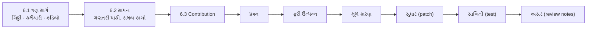
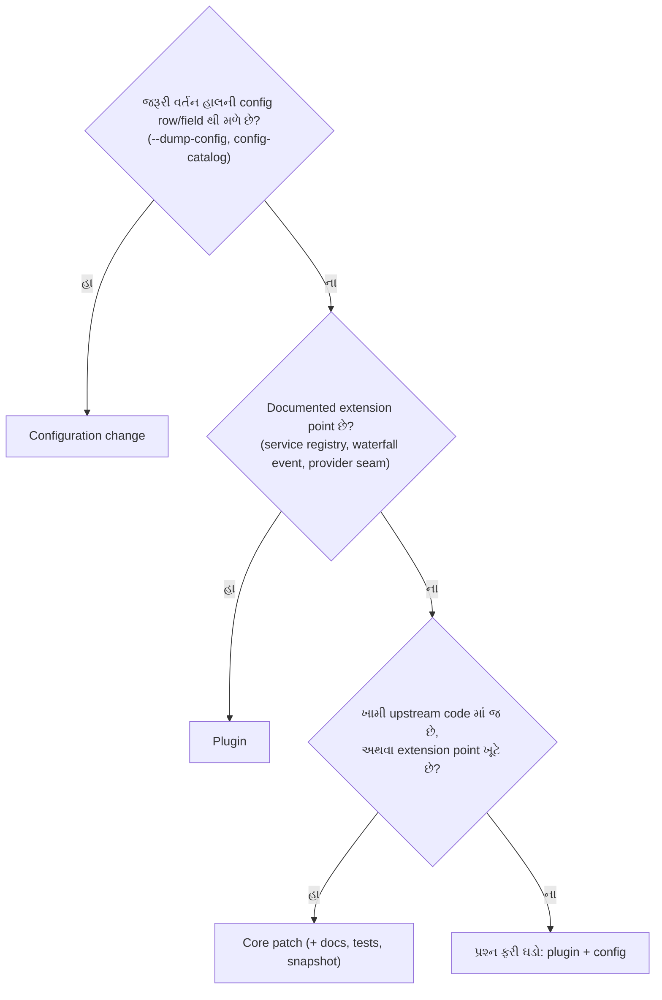
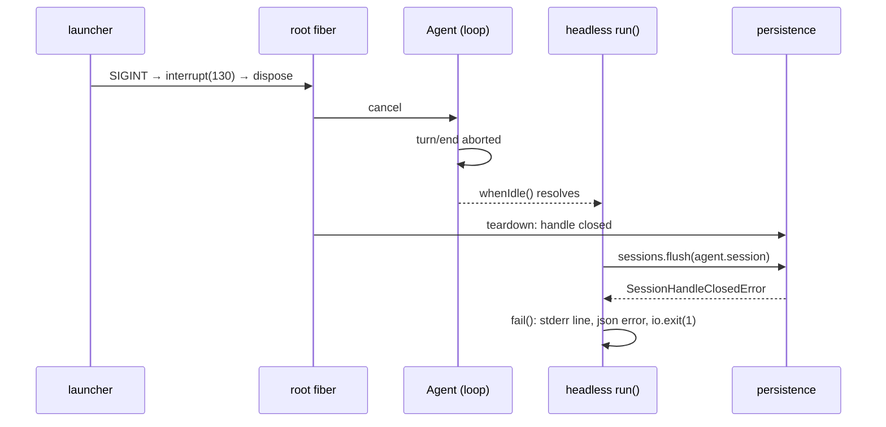

# પ્રકરણ 6 — Maintainer અને architecture level

> **Level 6 · 🟡 ત્રણ માર્ગ અને માપન, 🔴 contribution ની ઝીણી વિગતો.** વાર્તાનો દિવસ 12–13.
> હવે "કેવી રીતે ચાલે છે" થી આગળ વધી "ક્યાં બદલવું" પૂછીએ. ત્રણ extension માર્ગ સરખાવીએ,
> એક વર્તન માપીએ, અને problem statement થી patch, regression test અને review notes સુધીનું એક સાચું contribution કરીએ. આખો નકશો: [સમગ્ર નકશો](overview-samagra-naksho.md).

## 🎬 વાર્તા: મુખ્ય કચેરીને સૂચન-પત્ર

અન્નપૂર્ણા થાળી ઘર એક મોટી chain ની શાખા છે. રસોડાના નિયમો, મશીનો, ફોર્મ — બધું **મુખ્ય કચેરી** નક્કી કરે છે. શાખા પોતાની રીતે મેનુ પર ચિઠ્ઠી ચોંટાડી શકે, નવું કાઉન્ટર ખોલી શકે, પણ **ઇમારતની દીવાલ** તોડવી હોય તો મુખ્ય કચેરીની મંજૂરી જોઈએ.

આરવ ઉત્સાહમાં છે: "`flush on a closed handle` ની ખોટી બૂમ સુધારવા હું સીધો મૂળ code બદલી નાખું!"

મીરાદીદી શાંતિથી ત્રણ આંગળી બતાવે છે:

1. "**ચિઠ્ઠી** (config) થી કામ થાય? — સૌથી સસ્તું."
2. "નહીં તો **નવો કર્મચારી** (plugin) — દીવાલ અડ્યા વગર."
3. "એ પણ ન ચાલે ત્યારે જ **કડિયો** (core patch) — અને ત્યારે મુખ્ય કચેરીને પુરાવા સાથેનો પત્ર."

"અને પત્રમાં લાગણી નહીં, **આંકડા**. પહેલાં માપતાં શીખ — પણ પ્રામાણિકપણે: શું પાકું છે અને શું ફક્ત અંદાજ."

## 🎯 આ પ્રકરણ પછી તમે શું કરી શકશો

- Configuration change, plugin, અને core patch વચ્ચે source પુરાવા સાથે પસંદગી કરી શકશો.
- Model call count અને tool latency ને વર્તન બદલ્યા વગર માપી, પરિણામની મર્યાદા પ્રામાણિકપણે લખી શકશો.
- એક નાની ખામી માટે reproduce → root cause → patch → regression test → verification → review notes નો આખો ક્રમ પૂરો કરી શકશો.
- ફેરફારની હાલના callers અને plugins પર અસર લખી શકશો — ખાસ કરીને machine-readable outputs પર.

## 🗺️ આ પ્રકરણનો નકશો



> 📦 **Maintainer** — project ની સંભાળ રાખનાર: ફેરફારો review કરે, નિયમો ઘડે, લાંબા ગાળાની ગુણવત્તા જાળવે. 🍽️ મુખ્ય કચેરીના અનુભવી રસોઇયા-નિરીક્ષક.
>
> 📦 **Extension point** — જ્યાં મૂળ code બદલ્યા વગર નવું વર્તન જોડી શકાય તેવી જાહેર જગ્યા (service, waterfall event, seam). 🍽️ દીવાલમાં પહેલેથી મૂકેલું plug-point — નવું મશીન લાવો, દીવાલ ન તોડો.

## 6.1 🟡 ત્રણ extension માર્ગ — "ચિઠ્ઠી-કર્મચારી-કડિયો"

Repository ના પોતાના નિયમો દિશા બતાવે છે ([AGENTS.md][agents-conventions]):

- "**Plugins, not loop changes**: new behavior goes on documented extension points; changing `agent-loop` requires updating docs/architecture.md."
- "**No hardcoded tunables in plugins**: deployment-varying choices are validated `Config` fields changeable from cordis.yml."

અને architecture doc નું "Where new behavior goes" table દરેક ધ્યેય માટે mechanism આપે છે ([architecture.md][arch-where]) — model provider → `ctx.llm` adapter, model-facing capability → `ctx.tools`, request/tool/turn intercept → `agent/*`/`tools/*` events, વગેરે. ✅

આ પુસ્તકમાં આપણે ત્રણેય માર્ગ **ખરેખર** વાપર્યા છે:

| માર્ગ | 🍽️ | આપણું ઉદાહરણ | શું બદલાયું | Restart/ship | Risk |
|---|---|---|---|---|---|
| **1. Configuration change** | ચિઠ્ઠી | `session-title-llm` row disable (પ્રકરણ 1); `maxBytes` config (પ્રકરણ 4) | YAML patch, કોઈ code નહીં | overlay/profile patch | સૌથી ઓછું — ફક્ત હાલનાં knobs |
| **2. Plugin** | નવો કર્મચારી | `trace-events`, `metrics` (observers), `csv_compare`, `reconcile_bank_tally` (tools) | નવો module + overlay row | overlay; unload પર બધું પાછું | ઓછું — documented extension points પર જ |
| **3. Core patch** | કડિયો | headless runner teardown fix (6.3) | upstream package source | upstream PR, release | વધુ — હાલના callers પર અસર, review જરૂરી |

> 📦 **Core patch** — project ના મૂળ code માં ફેરફાર. 📦 **Caller** — કોઈ function/program ને વાપરનાર બીજો code. 📦 **Release** — નવું version બહાર પાડવું.

### ક્યારે કયો? — source આધારિત નિર્ણય



ત્રણ ઉદાહરણ પર લાગુ:

- **"Title call બંધ કરવો છે."** `--dump-config` માં `session-title-llm` row છે ([row][bundle-base-title]) → configuration. Plugin લખવો વધારે પડતું ગણાય. 🍽️ "Title લખનાર રજા પર" — એક ચિઠ્ઠી પૂરતી.
- **"દરેક model request ગણવો છે."** કોઈ config નથી, પણ `llm/stream` waterfall છે ([decl][llm-stream-decl]) → plugin ([metrics.ts](../labs/measure/metrics.ts)). Loop બદલવાની જરૂર નથી. 🍽️ ફોન-રૂમના દરવાજે ગણતરી કરતો નવો કર્મચારી.
- **"SIGINT પછી headless ખોટી error છાપે છે."** આ headless runner ના `run()` ની ખામી છે ([source][headless-flush]); બહારથી plugin તેને સુધારી ન શકે → core patch. 🍽️ ભૂલ દીવાલની અંદર છે — કડિયો જ સુધારે.

**યાદ-ચાવી "ચિઠ્ઠી-કર્મચારી-કડિયો":** પહેલાં ચિઠ્ઠી, પછી કર્મચારી, છેલ્લે કડિયો — નાનાથી મોટું, સસ્તાથી મોંઘું.

## 6.2 🟡 એક વર્તન માપો: model calls અને tool latency

> 📦 **Measurement** — વર્તન બદલ્યા વગર સંખ્યા ભેગી કરવી. 🍽️ ઘડિયાળ અને કાગળ લઈ ખૂણામાં બેઠેલો નિરીક્ષક — તે ઓર્ડર લેતો નથી, રાંધતો નથી, ફક્ત નોંધે છે.
>
> 📦 **Latency** — કામ શરૂ થી પૂરું થવા સુધીનો સમય. 📦 **ms** — millisecond, સેકન્ડનો હજારમો ભાગ.

[`metrics.ts`](../labs/measure/metrics.ts) બે listener મૂકે છે, બંને `next()` ને delegate કરે છે:

```ts
  ctx.on('llm/stream', (options, next) => {
    calls.push({ purpose: options.purpose ?? 'agent', messages: options.messages.length })
    return next()
  })

  ctx.on('tools/execute', async (exec, next) => {
    const start = performance.now()
    const result = await next()
    tools.push({ name: exec.name, ms: …, isError: result.isError === true })
    return result
  })
```

પ્રવેશ પ્રકરણના `waterfall.mjs` નો "ચોકીદાર" યાદ છે? એ જોતો, નોંધતો, અને `return next()` કરતો — બરાબર આ જ. બીજો listener **around-wrapper** છે: `next()` પહેલાં ઘડિયાળ ચાલુ, પછી બંધ.

`tools/execute` એ around-dispatch waterfall છે ([decl][tools-events]); તેથી માપ tool body + તેની અંદરના wrappers નું છે, `tools/pre-execute` policy કે post-processing નું નહીં. `options.purpose` એ auxiliary requests ને અલગ પાડે છે (title generator `session-title` purpose મોકલે છે).

**પ્રયોગ:** title row off vs on, દરેક 5 runs, દરેક run નવા `DSH_HOME` સાથે (પૂરા commands: [પરિશિષ્ટ B](../appendix/B-command-reference.md#measure)). 🧪 ([evidence/measure.jsonl](../evidence/measure.jsonl))

| Setting | Model calls (5 runs) | Purposes | `read` latency ms (5 runs) | Median |
|---|---|---|---|---|
| title **off** | 2, 2, 2, 2, 2 | `agent` | 8.32, 10.11, 11.39, 9.34, 9.23 | 9.34 |
| title **on** | 3, 3, 3, 3, 3 | `agent`, `session-title` | 16.35, 14.12, 15.55, 14.89, 16.41 | 15.55 |

> 📦 **Median** — સંખ્યાઓને ક્રમમાં ગોઠવો, વચ્ચેની સંખ્યા. (8.32, 9.23, **9.34**, 10.11, 11.39 → 9.34.) Average કરતાં એક-બે વિચિત્ર સંખ્યાથી ઓછું હલે છે. 📦 **Sample** — એક માપ; 5 runs = 5 samples.

**અર્થઘટન — પ્રામાણિક મર્યાદાઓ સાથે:**

- Model call count deterministic છે: base bundle નું title generator દરેક નવા session માં એક વધારાનો call કરે છે. Real provider પર આનો અર્થ વધારાના tokens અને ખર્ચ છે.
- Latency નો તફાવત **ફક્ત એક અવલોકન** છે: 5 samples, mock server એ જ machine પર, એક જ 4-CPU container. સંભવિત કારણ — title request નું serialization/streaming એ જ Node event loop પર tool execution સાથે overlap થાય છે — પણ અમે તેને profile કરીને સાબિત કર્યું નથી. ⚠️ દાવો કરવા પહેલાં: વધુ samples, CPU profile (`node --cpu-prof`), અને mock server ને બીજા process/machine પર.

> 📦 **CPU profile** — program નો સમય કયા function માં ગયો તેનો વિગતવાર નકશો. 📦 **Event loop** — Node નો એક જ "કામ-દોર", જે વારાફરતી બધાં કામ ચલાવે; બે કામ એક સાથે ભીડ કરે તો બંને ધીમાં.

**યાદ-ચાવી "ગણતરી પાકી, સમય કાચો":** count (2 vs 3) ભરોસાપાત્ર; timing (9 vs 15 ms) ફક્ત સંકેત — પુરાવો નહીં.

## 6.3 🔴 એક સાચું contribution: headless SIGINT teardown

> 📦 **Contribution** — open-source project માં સુધારો આપવો: problem → patch → test → review. 🍽️ મુખ્ય કચેરીને પુરાવા સાથેનો સૂચન-પત્ર.
>
> 📦 **Teardown** — બંધ થતી વખતે બધું વ્યવસ્થિત સમેટવું. 🍽️ રાત્રે દુકાન બંધ કરવાની વિધિ.

**છ પગલાં — યાદ-ચાવી "પ્રફુલ મૂળ સુધારી સાબિત અસર કરે":** **પ્ર**શ્ન (problem statement) → **ફ**રી ઉત્પન્ન (reproduction) → **મૂળ** કારણ (root cause) → **સુધાર** (patch) → **સાબિ**તી (regression test + verification) → **અસર** (review notes).

### 1. Problem statement — પ્રશ્ન

`dsh --profile headless` ચાલુ model stream દરમિયાન `SIGINT` મળે ત્યારે interruption સાચું record થાય છે (durable `turn/end` reason `aborted`/`disposed`, exit 130), પણ runner પછી `stderr` પર `dsh: session "…": flush on a closed handle` છાપે છે, અને `--json` mode માં `{"type":"error","message":"…flush on a closed handle"}` line લખે છે. User ને આ "data નષ્ટ થયો?" એવી ગેરસમજ આપે છે, જ્યારે ખરેખર કંઈ ખોટું થયું નથી.

> 📦 **`--json` mode** — માણસ માટેના text ને બદલે program વાંચી શકે તેવા JSON lines માં output. 📦 **Machine-readable output** — બીજા programs (automation) જેના પર આધાર રાખે; તેમાં ફેરફાર = તેમને તોડવાનું જોખમ.

### 2. Reproduction — ફરી ઉત્પન્ન (🧪 patch વગર 2/2 runs)

```text
dsh exit=130
dsh: session "session-…": flush on a closed handle
```

([evidence/sigint-unpatched.err](../evidence/sigint-unpatched.err), [evidence/json-sigint-orig.jsonl](../evidence/json-sigint-orig.jsonl))

### 3. Root cause — મૂળ કારણ (✅ source)



1. SIGINT → launcher `interrupt(130)` → root fiber dispose ([`runProfile`][cli-runProfile]).
2. Dispose agent ને cancel કરે છે; turn `aborted` થઈ `turn/end` લખે છે; `agent.whenIdle()` resolve થાય છે.
3. Headless [`run`][headless-run] આ "idle" ને સામાન્ય પૂર્ણતા માની આગળ વધે છે અને [`sessions.flush(agent.session)`][headless-flush] બોલાવે છે.
4. ત્યાં સુધીમાં persistence handle teardown માં બંધ થઈ ગયું છે, એટલે [`SessionHandleClosedError`][persistence-closed] — `session "…": flush on a closed handle`.
5. Error runner ના `.catch` થી [`fail`][headless-fail] સુધી પહોંચે છે: `stderr` line, `--json` હોય તો error event, અને `io.exit(1)` — જે launcher ના 130 સાથે સ્પર્ધા કરે છે.

🍽️ લાઈટ ગઈ (SIGINT) → મેનેજરે દુકાન બંધ જાહેર કરી (dispose) → રમેશભાઈએ ઓર્ડર "રદ" લખ્યો → કાઉન્ટરવાળાએ વિચાર્યું "ઓર્ડર પૂરો, હવે ચોપડો તિજોરીમાં" (flush) → પણ તિજોરી પહેલેથી બંધ → બૂમ: "તિજોરી બંધ છે!" — અને "બહાર નીકળવાનો દરવાજો" (exit code) માટે મેનેજર સાથે ધક્કામુક્કી.

### 4. Patch — સુધાર (book lab code, [labs/contribution/headless-teardown.patch](../labs/contribution/headless-teardown.patch); pinned commit પર `git apply --check` સ્વચ્છ 🧪)

> 📦 **Patch / diff** — ફેરફારની નોંધ: `-` થી શરૂ થતી line કાઢી, `+` થી શરૂ થતી ઉમેરી. 📦 **`git apply --check`** — "આ patch લાગી શકે છે?" ની ચકાસણી, ખરેખર લગાવ્યા વગર.

```diff
-import type { Context } from '@deepseek-ai/cordis'
+import { FiberState, type Context } from '@deepseek-ai/cordis'
@@ async function run(ctx: Context, config: Config, io: HeadlessIo): Promise<void>
     } finally {
       stopReasoning?.()
     }
+    // Teardown (for example SIGINT) disposed this runner while the Agent settled;
+    // the launcher owns that exit status, and closed Session handles cannot flush.
+    if (ctx.fiber.state !== FiberState.ACTIVE) return
     await sessions.flush(agent.session)
```

Design: runner નું પોતાનું fiber `ACTIVE` ન હોય ([`FiberState`][cordis-fiberstate]) તો tree teardown માં છે; ત્યારે exit status launcher નો છે, runner નો નહીં. ત્રણ lines, એક જ package. 🍽️ "દુકાન બંધ થઈ રહી હોય (મારું હાજરી-કાર્ડ હવે 'કામ પર' નથી), તો તિજોરી ખોલવા ન જાઓ, બૂમ ન પાડો — દરવાજાનો નિર્ણય મેનેજરનો."

**યાદ-ચાવી "દુકાન બંધ ≠ ઓર્ડર રદ":** `signal.aborted` એ **ઓર્ડર** (turn) રદ થયાનો સંકેત છે; `ctx.fiber.state` એ **કાઉન્ટર** (runner plugin) ખુદ જીવંત છે કે નહીં તે કહે છે. અહીં પ્રશ્ન કાઉન્ટરના જીવનનો છે, તેથી fiber state. (Mastery check પ્રશ્ન 4.)

### 5. Regression test — સાબિતી

નવો `packages/bundle/headless/tests/teardown-flush.spec.ts` upstream ના `terminal-failures.spec.ts` જેવો જ harness વાપરે છે: real `AgentLoop` + mock adapter નું `'hang'` script, પહેલો chunk આવે ત્યારે `ctx.fiber.dispose()`, અને પછી assertion:

```ts
    expect(err).toBe('')
    expect(exits).toEqual([])
```

> 📦 **Assertion** — "આ સાચું હોવું જ જોઈએ" ની ચકાસણી; ખોટું હોય તો test fail. અહીં: stderr ખાલી, અને runner એ કોઈ exit માંગ્યો નથી.

**પ્રામાણિક નોંધ:** પહેલા draft માં અમે `session/flush` listener stub કરી "closed handle" ઉત્પન્ન કરવા માંગતા હતા, પણ root dispose એ stub listener ને પણ કાઢી નાખે છે. તેથી test **flush error** નહીં, પણ એ જ root cause નું બીજું લક્ષણ પકડે છે: patch વગર runner `io.exit(1)` માંગે છે (aborted summary). Test નું નામ એ જ બતાવે છે: "leaves reporting and exit status to the launcher when the tree is disposed mid-turn".

> 📦 **Stub** — ખરા ભાગની જગ્યાએ મૂકેલો નકલી, સાદો ભાગ — test માટે. 🍽️ પૂતળું.

### Verification (બધું 🧪)

| Check | Patch વગર | Patch સાથે |
|---|---|---|
| Real SIGINT run: `flush on a closed handle` stderr | 2/2 runs માં દેખાયું | 1/1 run માં નથી; exit 130; durable `turn/end aborted` હાજર |
| નવો regression test | **fail** (`expected [ 1 ] to deeply equal []`) | pass |
| `pnpm exec vitest run packages/bundle/headless` | — | `Tests 136 passed (136)` |
| Coverage (`packages/bundle/headless/src/**`) | — | Statements/Branches/Functions/Lines 100% |
| `tsc -p packages/bundle/headless/tsconfig.json --noEmit` | — | exit 0 |
| `scripts/run-oxlint.ts` on both files | — | exit 0 (પહેલાં `Promise.withResolvers<void>` પર `no-invalid-void-type` પકડાયું, સુધાર્યું) |

> 📦 **Coverage** — tests એ code ની કેટલી lines/branches ખરેખર ચલાવી તેની ટકાવારી. 📦 **Lint (oxlint)** — code ની શૈલી અને સામાન્ય ભૂલો આપોઆપ પકડતું tool.

### 6. Review notes — હાલના callers અને plugins પર અસર

- **Scope.** ફક્ત `@deepseek-ai/dsh-headless` નો runner. Agent loop, session store, persistence, અને બીજા profiles (web, sdk, acp) બદલાતા નથી.
- **Exit status.** Interrupted runs માં પહેલાં પણ process exit 130 હતો (launcher જીતતો). હવે runner exit request જ નથી કરતો — ખરો exit code બદલાતો નથી, પણ race ઘટે છે.
- **`--json` consumers — વર્તન બદલાય છે.** પહેલાં SIGINT પર છેલ્લી line `{"type":"error",…closed handle}` હતી; હવે કોઈ terminal line નથી, stream `session`/`status` events પછી અટકે છે ([evidence/json-sigint-patched.jsonl](../evidence/json-sigint-patched.jsonl)). કોઈ automation "છેલ્લી line terminal હોય જ" એમ માનતું હોય તો તે ભાંગી શકે. **Reviewer માટે પ્રશ્ન:** શું `{"type":"interrupted"}` જેવો સ્પષ્ટ terminal event ઉમેરવો? એ JSON vocabulary નો additive ફેરફાર છે, જેને `json-stream.ts` docs અને tests જોઈએ — અલગ PR માં સારું.
- **Repository process.** Upstream PR માટે AGENTS.md મુજબ: `dsh-pr-description` skill થી PR description, એક `kind/*` અને લાગુ `area/*` labels, product-user-visible ફેરફાર હોવાથી maintainer સાથે keyless recorded-session snapshot ની જરૂર ચર્ચવી, અને externally perceptible breaking change ગણાય તો upgrade guide. આ પુસ્તક upstream માં PR **ખોલતું નથી**; patch શીખવા માટે છે.

> 📦 **Breaking change** — એવો ફેરફાર જેનાથી જૂનો caller તૂટી શકે. 📦 **Additive change** — ફક્ત ઉમેરો; જૂનું વર્તન જેમનું તેમ. 🍽️ "નવી વાનગી ઉમેરવી" (additive) vs "જૂની વાનગીની રેસીપી બદલવી" (breaking — નિયમિત ગ્રાહકો ફરિયાદ કરી શકે).
>
> 💡 **મીરાદીદીની ટીપ:** સારો maintainer ફક્ત "મારો fix ચાલે છે" નથી કહેતો; "મારા fix થી **કોને** શું બદલાશે" પણ લખે છે — ખાસ કરીને જેઓ ચૂપચાપ આપણા output પર આધાર રાખે છે.

## Source map: આ ક્રમમાં ખોલો

| ક્રમ | File | Symbol | કેમ |
|---|---|---|---|
| 1 | `AGENTS.md` | [Conventions][agents-conventions] | extension નિયમો |
| 2 | `docs/architecture.md` | [Where new behavior goes][arch-where] | mechanism table |
| 3 | `packages/llm/llm/src/index.ts` | [`'llm/stream'`][llm-stream-decl] | metrics hook |
| 4 | `packages/core/tools/src/events.ts` | [`'tools/execute'`][tools-events] | latency hook |
| 5 | `packages/bundle/headless/src/index.ts` | [`run`][headless-run], [`flush`][headless-flush], [`fail`][headless-fail] | contribution |
| 6 | `packages/session/session-persistence/src/errors.ts` | [`SessionHandleClosedError`][persistence-closed] | error નો સ્રોત |

## 🧪 Lab 6 — patch લગાવો, test ને fail/pass કરાવો

Pinned checkout માં:

```bash
git apply <book>/labs/contribution/headless-teardown.patch
```

```bash
pnpm exec vitest run packages/bundle/headless/tests/teardown-flush.spec.ts
```

અપેક્ષિત: `Tests 1 passed (1)`. પછી ફક્ત source ફેરફાર ઉલટાવો (test file રહેવા દો):

```bash
git checkout -- packages/bundle/headless/src/index.ts
```

```bash
pnpm exec vitest run packages/bundle/headless/tests/teardown-flush.spec.ts
```

અપેક્ષિત: `Tests 1 failed (1)` અને `AssertionError: expected [ 1 ] to deeply equal []`. આ "test ખરેખર fix ને પકડે છે" નો પુરાવો છે — પ્રકરણ 5 નું "ફરી-સુધાર-ફરી-**ઉલટ**".

## 🔮 આગાહી કસોટી

Metrics overlay સાથે પ્રકરણ 4 નો `csv_compare` run કરો. **ચલાવતા પહેલાં લખો:** `modelCalls`, `toolCalls`, અને `csv_compare` નું latency `read` કરતાં વધુ હશે કે ઓછું — અને કેમ. (સંકેત: `csv_compare` કેટલી files વાંચે છે, અને પછી શું વધારાનું કરે છે?) જવાબ: [પરિશિષ્ટ D — Lab 6](../appendix/D-lab-solutions.md#lab-6).

## 🩺 નિષ્ફળતા: "મારો observer plugin વર્તન બદલી નાખે છે"

**વાર્તામાં.** આરવે પોતાનો નિરીક્ષક-plugin લખ્યો. તે ચાલુ કર્યો — અને અચાનક કોઠારમાંથી ખાલી ચિઠ્ઠીઓ પાછી આવવા લાગી. "દીદી, મારો નિરીક્ષક તો ફક્ત **જુએ** છે! એ કેવી રીતે કંઈ બગાડે?"

**લક્ષણ.** Metrics plugin ઉમેર્યા પછી tool calls નાં પરિણામ ખાલી આવે છે અથવા model requests થતા જ નથી.

**ટૂંકો નિદાન માર્ગ.** Waterfall listener એ `next()` બોલાવ્યું? `return next()` ભૂલી જાઓ તો સાંકળ ત્યાં અટકે છે — "Waterfall listeners MUST call `next()` to delegate; returning without it short-circuits the chain" ([AGENTS.md][agents-conventions]). `tools/execute` માં `await next()` નું પરિણામ **return** કરો, નહીં તો pipeline ને `undefined` result મળે. — પ્રવેશ પ્રકરણના `waterfall.mjs` નો "ભૂલકણો" listener અને તેનું `B: undefined` — બરાબર આ જ.

> 📦 **Short-circuit** — સાંકળ વચ્ચેથી જ ટૂંકી થઈ જવી; આગળના કોઈ સુધી વાત ન પહોંચે.

<a id="saral-samaj"></a>

## ✅ સાર — પ્રકરણ 6 એક પાનામાં

**એક વાક્યમાં:** maintainer ની જેમ વિચારવું — પહેલાં ચિઠ્ઠી (config), પછી કર્મચારી (plugin), છેલ્લે કડિયો (core patch); વર્તન બદલ્યા વગર માપવું અને પ્રામાણિકપણે લખવું કે ગણતરી પાકી પણ સમય કાચો; અને મુખ્ય કચેરીને સૂચન છ પગલાંમાં — પ્રશ્ન, ફરી ઉત્પન્ન, મૂળ કારણ, ત્રણ-લીટીનો સુધાર, fix વગર fail/સાથે pass થતો test, અને `--json` વાપરનારાઓ પરની અસર.

> ⚠️ **ઉપમા અહીં તૂટે છે:** ઇમારતમાં ફેરફાર કોઈ પણ કડિયો કરી શકે; અહીં core patch માટે upstream ના નિયમો (tests, coverage, snapshot, PR description, labels) પાળવા પડે, અને આ પુસ્તક upstream માં PR ખોલતું **નથી** — patch ફક્ત શીખવા માટે છે.

### નવા ટેકનિકલ શબ્દો — એક નજરે

| શબ્દ | સરળ અર્થ | ઉદાહરણ | યાદ-ચાવી |
|---|---|---|---|
| Extension point | મૂળ code બદલ્યા વગર જોડાણની જગ્યા | `llm/stream` waterfall | "દીવાલમાં plug-point" |
| Configuration change | ફક્ત YAML બદલવું | `disabled: true` | "ચિઠ્ઠી" |
| Core patch | મૂળ code માં ફેરફાર | headless runner fix | "કડિયો" |
| Measurement | વર્તન બદલ્યા વગર ગણવું | `metrics.ts` | "ખૂણાનો નિરીક્ષક" |
| Median | ક્રમમાં ગોઠવી વચ્ચેની સંખ્યા | 9.34 ms | "વચ્ચેનો" |
| Root cause | ભૂલનું મૂળ કારણ | closed handle પર flush | "મૂળ" |
| Regression test | ભૂલ પાછી ન આવે તેની ચોકી | `teardown-flush.spec.ts` | "સાબિતી" |
| Coverage | tests એ કેટલો code ચલાવ્યો | 100% | "કેટલું તપાસ્યું" |
| Breaking change | જૂના callers તૂટી શકે | `--json` છેલ્લી line | "રેસીપી બદલી" |
| Short-circuit | `next()` વગર સાંકળ અટકે | ભૂલકણો listener | "ધોધ અટક્યો" |

### યાદ રાખવાની રીતો

- **"ચિઠ્ઠી-કર્મચારી-કડિયો"** — ત્રણ extension માર્ગ, નાનાથી મોટો.
- **"ગણતરી પાકી, સમય કાચો"** — માપનની પ્રામાણિકતા.
- **"પ્રફુલ મૂળ સુધારી સાબિત અસર કરે"** — contribution ના છ પગલાં.
- **"દુકાન બંધ ≠ ઓર્ડર રદ"** — fiber vs signal.

### સામાન્ય ગેરસમજો

| ગેરસમજ | સાચું |
|---|---|
| "નવું વર્તન = loop બદલો." | Plugins, not loop changes — documented extension points પર. |
| "5 runs માં ફરક દેખાયો એટલે સાબિત." | વધુ samples, profile, અલગ machine — પછી જ દાવો. |
| "Test pass થાય એટલે fix સાચો." | Fix ઉલટાવી test **fail** થાય તે પણ બતાવો. |
| "Exit code ન બદલાયો એટલે કોઈ અસર નથી." | `--json` ની છેલ્લી line બદલાઈ — automation પર અસર. |
| "Observer plugin કંઈ બગાડી ન શકે." | `next()` ભૂલો તો આખી સાંકળ અટકે. |

### પુનરાવર્તન કાર્ડ

<details><summary>1. Title call બંધ કરવો — કયો માર્ગ અને કેમ?</summary>

Configuration: `session-title-llm` row પહેલેથી છે; `disabled: true` પૂરતું.
</details>

<details><summary>2. `tools/execute` પર માપેલું latency શું સમાવે?</summary>

Tool body + તેની અંદરના wrappers; `tools/pre-execute` policy અને post-processing નહીં.
</details>

<details><summary>3. Patch માં fiber state કેમ, `signal.aborted` કેમ નહીં?</summary>

પ્રશ્ન runner plugin ના પોતાના જીવનનો છે (tree teardown), turn ના cancel નો નહીં — "દુકાન બંધ ≠ ઓર્ડર રદ".
</details>

<details><summary>4. Fix ઉલટાવ્યા પછી test નું output?</summary>

`Tests 1 failed (1)`, `AssertionError: expected [ 1 ] to deeply equal []`.
</details>

### મિત્રને સમજાવો (3 મિનિટ)

"ઘરમાં નળ ટપકે છે" — ક્યારે વાલ્વ ફેરવવો (config), ક્યારે નવું ફિલ્ટર જોડવું (plugin), અને ક્યારે plumber બોલાવી દીવાલ ખોલવી (core patch)? આ ઉપમાથી ત્રણ માર્ગ સમજાવો, અને પછી headless fix કેમ ત્રીજો માર્ગ હતો તે કહો.

## 🧠 Mastery check

1. ત્રણ extension માર્ગ અને દરેકનું એક ઉદાહરણ, આ પુસ્તકમાંથી.
2. `tools/execute` પર માપેલું latency શું સમાવે છે અને શું નહીં?
3. Latency તફાવતને "સાબિત" ગણવા પહેલાં કયા ત્રણ પગલાં જોઈએ?
4. Patch માં `ctx.fiber.state !== FiberState.ACTIVE` કેમ, `signal.aborted` કેમ નહીં? (સંકેત: કોનું lifetime?)
5. Regression test patch વગર fail થાય છે તે કેમ મહત્વનું છે?
6. `--json` consumers પર અસર લખો, અને એક વૈકલ્પિક design સૂચવો.

જવાબો: [પરિશિષ્ટ D — પ્રકરણ 6](../appendix/D-lab-solutions.md#ch6).

## 🎬 આગળ શું

સૂચન-પત્ર તૈયાર છે. આરવ ગર્વથી પપ્પાને બતાવે છે. પપ્પા માથું હલાવે છે, પછી ગલ્લા પાછળ બેઠેલા **મુનીમજી** તરફ ઈશારો કરે છે: "આ બધું સરસ. પણ દર મહિનાના અંતે મુનીમજી બે દિવસ bank statement અને Tally નો ચોપડો આંગળીથી મેળવે છે. ક્યારેક 59 રૂપિયા ખૂટે, ક્યારેક એક જ દિવસે બે સરખી entry. **એ** તારું agent કરી શકે?"

મીરાદીદી કહે છે: "આ તારી અંતિમ પરીક્ષા છે. છેલ્લા બે દિવસ — પ્રકરણ 0 થી 6 નું બધું એક સાથે: read-only tool, deterministic નિયમો, દરેક પરિણામનો પુરાવો, ભવિષ્યનો Tally connector ની ડિઝાઇન, અને એક છુપાયેલી ભૂલ જે બધા tests પાસ કરે છે."

---

પાછળ: [પ્રકરણ 5](05-debugging-permissions-reliability.md) · આગળ: [પ્રકરણ 7 — અંતિમ પ્રોજેક્ટ અને mastery પરીક્ષા](07-antim-project-mastery.md)

<!-- citations:begin (generated by tools/refdefs.py) -->
[agents-conventions]: https://github.com/deepseek-ai/deepseek-harness/blob/fcc0ad462172522aaf5c93a7b2e01f6b9f0b0159/AGENTS.md#L130-L142
[arch-where]: https://github.com/deepseek-ai/deepseek-harness/blob/fcc0ad462172522aaf5c93a7b2e01f6b9f0b0159/docs/architecture.md#L144-L170
[bundle-base-title]: https://github.com/deepseek-ai/deepseek-harness/blob/fcc0ad462172522aaf5c93a7b2e01f6b9f0b0159/packages/bundle/base/cordis.patch.yml#L67-L78
[cordis-fiberstate]: https://github.com/deepseek-ai/deepseek-harness/blob/fcc0ad462172522aaf5c93a7b2e01f6b9f0b0159/vendor/cordis/src/fiber.ts#L147-L154
[headless-fail]: https://github.com/deepseek-ai/deepseek-harness/blob/fcc0ad462172522aaf5c93a7b2e01f6b9f0b0159/packages/bundle/headless/src/index.ts#L308-L313
[headless-flush]: https://github.com/deepseek-ai/deepseek-harness/blob/fcc0ad462172522aaf5c93a7b2e01f6b9f0b0159/packages/bundle/headless/src/index.ts#L435-L444
[headless-run]: https://github.com/deepseek-ai/deepseek-harness/blob/fcc0ad462172522aaf5c93a7b2e01f6b9f0b0159/packages/bundle/headless/src/index.ts#L322-L455
[llm-stream-decl]: https://github.com/deepseek-ai/deepseek-harness/blob/fcc0ad462172522aaf5c93a7b2e01f6b9f0b0159/packages/llm/llm/src/index.ts#L75
[persistence-closed]: https://github.com/deepseek-ai/deepseek-harness/blob/fcc0ad462172522aaf5c93a7b2e01f6b9f0b0159/packages/session/session-persistence/src/errors.ts#L68-L78
[tools-events]: https://github.com/deepseek-ai/deepseek-harness/blob/fcc0ad462172522aaf5c93a7b2e01f6b9f0b0159/packages/core/tools/src/events.ts#L29
<!-- citations:end -->
