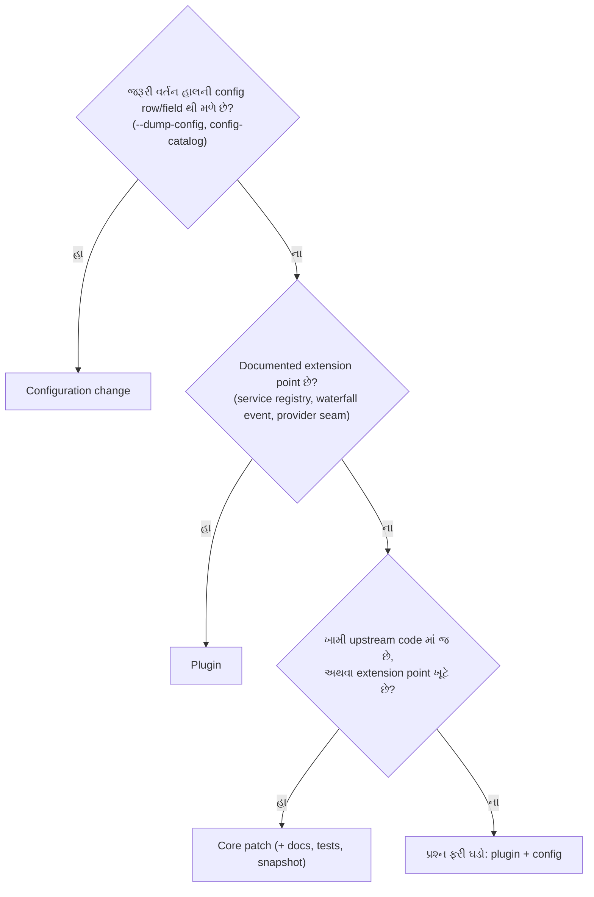
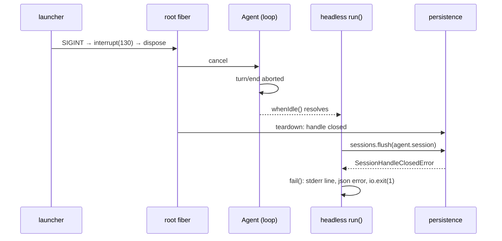

# પ્રકરણ 6 — Maintainer અને architecture level

> **Level 6 · વાર્તાનો દિવસ 12–13.**
> અત્યાર સુધીનો પ્રશ્ન હતો "કેવી રીતે ચાલે છે?" આજનો પ્રશ્ન: "**ક્યાં** બદલવું?" આરવ ત્રણ extension માર્ગ સરખાવે છે, એક વર્તન માપે છે, અને મુખ્ય કચેરી માટે એક સાચું contribution તૈયાર કરે છે: problem statement થી patch, regression test અને review notes સુધી.
> દરેક દૃશ્ય: 🎬 ઘટના → ❓ પ્રશ્ન → 💻 code માં → 🔬 expert નજર. આખો નકશો: [સમગ્ર નકશો](overview-samagra-naksho.md).

## 🎬 સવાર: "હું સીધો મૂળ code બદલી નાખું!"

અન્નપૂર્ણા થાળી ઘર એક મોટી chain ની શાખા છે. રસોડાના નિયમો, મશીનો, ફોર્મ — બધું **મુખ્ય કચેરી** નક્કી કરે છે. શાખા મેનુ પર ચિઠ્ઠી ચોંટાડી શકે, નવું કાઉન્ટર ખોલી શકે. પણ **ઇમારતની દીવાલ** તોડવી હોય, તો મુખ્ય કચેરીની મંજૂરી જોઈએ — કારણ કે એ જ દીવાલ chain ની દરેક શાખામાં છે.

આરવ ઉત્સાહમાં છે: "`flush on a closed handle` ની ખોટી બૂમ સુધારવા હું સીધો મૂળ code બદલી નાખું!"

મીરાદીદી: "કદાચ. પણ દીવાલ તોડતાં પહેલાં બે સસ્તા રસ્તા તપાસવા પડે. અને તોડવી જ પડે, તો મુખ્ય કચેરીને **લાગણી નહીં, આંકડા** જોઈએ."

## 🎯 આ પ્રકરણ પછી તમે શું કરી શકશો

- Configuration change, plugin, અને core patch વચ્ચે source પુરાવા સાથે પસંદગી કરી શકશો.
- Model call count અને tool latency ને વર્તન બદલ્યા વગર માપી, પરિણામની મર્યાદા પ્રામાણિકપણે લખી શકશો.
- એક નાની ખામી માટે reproduce → root cause → patch → regression test → verification → review notes નો આખો ક્રમ પૂરો કરી શકશો.
- ફેરફારની હાલના callers અને plugins પર અસર લખી શકશો — ખાસ કરીને machine-readable outputs પર.

## 🗺️ આજના બે દિવસનો નકશો


- **Maintainer** = project ની સંભાળ રાખનાર: ફેરફારો review કરે, નિયમો ઘડે, લાંબા ગાળાની ગુણવત્તા જાળવે — મુખ્ય કચેરીના અનુભવી નિરીક્ષક.
- **Extension point** = જ્યાં મૂળ code બદલ્યા વગર નવું વર્તન જોડી શકાય તેવી જાહેર જગ્યા (service, waterfall event, seam) — દીવાલમાં પહેલેથી મૂકેલું plug-point.

---

## દૃશ્ય 1 — એક સવાર, ત્રણ વિનંતી: ત્રણ extension માર્ગ

🎬 સવારે કાંતિકાકા પાસે ત્રણ જણ ત્રણ વિનંતી લઈને આવે છે.

**પપ્પા:** "ઓર્ડરને નામ આપવા મહારાજને અલગ ફોન કરવાનું બંધ કરો; બિલ વધે છે."
કાંતિકાકા મેનુ પર એક ચિઠ્ઠી ચોંટાડે છે: "title લખનાર: રજા પર." એક મિનિટ.

**આરવ:** "મારે ગણવું છે કે રોજ agency ને કેટલા ફોન જાય છે."
કાંતિકાકા: "એની કોઈ સ્વિચ નથી. પણ ફોન-રૂમના ઉંબરે દરેક ફોન પસાર થાય છે, અને ત્યાં કોઈને ઊભો રાખવાની જગ્યા છે. એક નવો માણસ મૂક." અડધો દિવસ.

**આરવ, ફરી:** "લાઈટ જાય ત્યારે 'તિજોરી બંધ છે!' ની ખોટી બૂમ બંધ કરવી છે."
કાંતિકાકા લાંબો વિચાર કરે છે. "એ બૂમ parcel કાઉન્ટરની **અંદરની** રીતમાંથી આવે છે. ચિઠ્ઠીથી ન બદલાય; બહાર ઊભેલો કોઈ માણસ તેને રોકી ન શકે. એ દીવાલનું કામ છે. કડિયો જોઈશે, અને મુખ્ય કચેરીને પત્ર."

❓ "દરેક વખતે કડિયો જ બોલાવીએ તો? તે તો બધું કરી શકે."

"કરી શકે. પણ દીવાલનો ફેરફાર chain ની **દરેક** શાખામાં જાય. ચિઠ્ઠી ફાડી નાખો, તો ગઈ. નવો માણસ ન ફાવે, તો રજા આપો — તેની ઉધાર-પહોંચો આપોઆપ ઉતરે. દીવાલ પાછી ચણવી મોંઘી છે."

💻 Repository ના પોતાના નિયમો આ જ દિશા બતાવે છે ([AGENTS.md][agents-conventions]):

- "**Plugins, not loop changes**: new behavior goes on documented extension points; changing `agent-loop` requires updating docs/architecture.md."
- "**No hardcoded tunables in plugins**: deployment-varying choices are validated `Config` fields changeable from cordis.yml."

અને architecture doc નું "Where new behavior goes" table દરેક ધ્યેય માટે mechanism આપે છે ([architecture.md][arch-where]) — model provider → `ctx.llm` adapter, model-facing capability → `ctx.tools`, request/tool/turn intercept → `agent/*`/`tools/*` events, વગેરે. ✅

આ પુસ્તકમાં આપણે ત્રણેય માર્ગ **ખરેખર** વાપર્યા છે:

| માર્ગ | વાર્તામાં | આપણું ઉદાહરણ | શું બદલાયું | Restart/ship | Risk |
|---|---|---|---|---|---|
| **1. Configuration change** | ચિઠ્ઠી | `session-title-llm` row disable (પ્રકરણ 1); `maxBytes` config (પ્રકરણ 4) | YAML patch, કોઈ code નહીં | overlay/profile patch | સૌથી ઓછું — ફક્ત હાલનાં knobs |
| **2. Plugin** | નવો કર્મચારી | `trace-events`, `metrics` (observers), `csv_compare`, `reconcile_bank_tally` (tools) | નવો module + overlay row | overlay; unload પર બધું પાછું | ઓછું — documented extension points પર જ |
| **3. Core patch** | કડિયો | headless runner teardown fix (દૃશ્ય 3–8) | upstream package source | upstream PR, release | વધુ — હાલના callers પર અસર, review જરૂરી |

- **Core patch** = project ના મૂળ code માં ફેરફાર.
- **Caller** = કોઈ function/program ને વાપરનાર બીજો code.
- **Release** = નવું version બહાર પાડવું.

કાંતિકાકાના વિચારનો ક્રમ:



સવારની ત્રણ વિનંતી, source પુરાવા સાથે:

- **"Title call બંધ કરવો છે."** `--dump-config` માં `session-title-llm` row છે ([row][bundle-base-title]) → configuration. Plugin લખવો વધારે પડતું ગણાય.
- **"દરેક model request ગણવો છે."** કોઈ config નથી, પણ `llm/stream` waterfall છે ([decl][llm-stream-decl]) → plugin ([metrics.ts](../labs/measure/metrics.ts)). Loop બદલવાની જરૂર નથી.
- **"SIGINT પછી headless ખોટી error છાપે છે."** આ headless runner ના `run()` ની ખામી છે ([source][headless-flush]); બહારથી plugin તેને સુધારી ન શકે → core patch.

**યાદ-ચાવી "ચિઠ્ઠી-કર્મચારી-કડિયો":** પહેલાં ચિઠ્ઠી, પછી કર્મચારી, છેલ્લે કડિયો — નાનાથી મોટું, સસ્તાથી મોંઘું.

🔬 **Expert નજર.** Decision tree ના દરેક પ્રશ્નનો જવાબ **અભિપ્રાયથી નહીં, source થી** અપાય છે: પહેલો `--dump-config` થી (row છે?), બીજો event ના declaration થી (waterfall છે?), ત્રીજો ખામીની line બતાવીને. "મને લાગે છે plugin થી નહીં થાય" એ maintainer ની ભાષા નથી; "આ line `run()` ની અંદર છે અને તેના પર કોઈ event નથી" એ છે. અને ક્રમ ઊલટો ચાલવાની લાલચ હંમેશા રહે છે, કારણ કે મૂળ code બદલવો **લખવામાં** સૌથી સહેલો લાગે છે. તેની કિંમત લખવામાં નથી; દરેક ભવિષ્યના release માં તેને સાચવવામાં છે.

## દૃશ્ય 2 — ખૂણાનો નિરીક્ષક: માપન, અને તેની પ્રામાણિકતા

🎬 આરવ ફોન-રૂમના ઉંબરે એક માણસ ઊભો રાખે છે, ઘડિયાળ અને કાગળ સાથે. તેનો એક જ નિયમ: **કોઈને રોકવો નહીં, કશું બદલવું નહીં.** ફોન પસાર થાય, ટીક કરે, પસાર થવા દે. કોઠારમાં બીજો માણસ: ચિઠ્ઠી અંદર જાય ત્યારે ઘડિયાળ ચાલુ, સામાન બહાર આવે ત્યારે બંધ.

પાંચ દિવસ title લખનાર રજા પર; પાંચ દિવસ હાજર. આરવ આંકડા લઈને દોડતો આવે છે: "દીદી, બે શોધ! એક: title લખનાર હાજર હોય ત્યારે રોજ **એક ફોન વધારે** જાય છે. બે: તે હાજર હોય ત્યારે **કોઠાર ધીમો** પડી જાય છે — 9 ને બદલે 15!"

દીદી: "પહેલી શોધ પર તું સહી કરી શકે. બીજી પર નહીં."

❓ "બંને મારા જ આંકડા છે. એક સાચી ને બીજી ખોટી?"

"ખોટી નથી કહેતી. **સાબિત નથી** કહું છું. ફોનની ગણતરી કદી બદલાતી નથી: પાંચેય દિવસ 2, પાંચેય દિવસ 3. તેનું કારણ તું જાણે છે. કોઠારનો સમય દરરોજ હલે છે, તેં પાંચ જ દિવસ માપ્યું, એક જ ભોજનાલયમાં, અને 'કેમ ધીમો પડ્યો' નું તારું કારણ તેં જોયું નથી, **ધાર્યું** છે."

💻

- **Measurement** = વર્તન બદલ્યા વગર સંખ્યા ભેગી કરવી.
- **Latency** = કામ શરૂ થી પૂરું થવા સુધીનો સમય. **ms** = millisecond, સેકન્ડનો હજારમો ભાગ.

[`metrics.ts`](../labs/measure/metrics.ts) બે listener મૂકે છે, બંને `next()` ને delegate કરે છે:

```ts
  ctx.on('llm/stream', (options, next) => {
    calls.push({ purpose: options.purpose ?? 'agent', messages: options.messages.length })
    return next()
  })

  ctx.on('tools/execute', async (exec, next) => {
    const start = performance.now()
    const result = await next()
    tools.push({ name: exec.name, ms: …, isError: result.isError === true })
    return result
  })
```

પહેલો listener ઉંબરાનો માણસ છે: નોંધે, અને `return next()`. બીજો **around-wrapper** છે (પ્રકરણ 3, દૃશ્ય 7): `next()` પહેલાં ઘડિયાળ ચાલુ, પછી બંધ, અને પરિણામ **જેમનું તેમ પાછું**.

`tools/execute` એ around-dispatch waterfall છે ([decl][tools-events]); તેથી માપ tool body + તેની અંદરના wrappers નું છે, `tools/pre-execute` policy કે post-processing નું નહીં. `options.purpose` auxiliary requests ને અલગ પાડે છે (title generator `session-title` purpose મોકલે છે).

**પ્રયોગ:** title row off vs on, દરેક 5 runs, દરેક run નવા `DSH_HOME` સાથે (પૂરા commands: [પરિશિષ્ટ B](../appendix/B-command-reference.md#measure)). 🧪 ([evidence/measure.jsonl](../evidence/measure.jsonl))

| Setting | Model calls (5 runs) | Purposes | `read` latency ms (5 runs) | Median |
|---|---|---|---|---|
| title **off** | 2, 2, 2, 2, 2 | `agent` | 8.32, 10.11, 11.39, 9.34, 9.23 | 9.34 |
| title **on** | 3, 3, 3, 3, 3 | `agent`, `session-title` | 16.35, 14.12, 15.55, 14.89, 16.41 | 15.55 |

- **Sample** = એક માપ; 5 runs = 5 samples.
- **Median** = સંખ્યાઓને ક્રમમાં ગોઠવો, વચ્ચેની સંખ્યા. (8.32, 9.23, **9.34**, 10.11, 11.39 → 9.34.) Average કરતાં એક-બે વિચિત્ર સંખ્યાથી ઓછું હલે છે.

**અર્થઘટન — દીદીના બે ચુકાદા:**

- **પહેલી શોધ: પાકી.** Model call count deterministic છે: base bundle નું title generator દરેક નવા session માં એક વધારાનો call કરે છે. Real provider પર આનો અર્થ વધારાના tokens અને ખર્ચ છે.
- **બીજી શોધ: કાચી.** Latency નો તફાવત **ફક્ત એક અવલોકન** છે: 5 samples, mock server એ જ machine પર, એક જ 4-CPU container. સંભવિત કારણ — title request નું serialization/streaming એ જ Node event loop પર tool execution સાથે overlap થાય છે — પણ અમે તેને profile કરીને સાબિત કર્યું નથી. ⚠️ દાવો કરતાં પહેલાં: વધુ samples, CPU profile (`node --cpu-prof`), અને mock server ને બીજા process/machine પર.

- **Event loop** = Node નો એક જ "કામ-દોર", જે વારાફરતી બધાં કામ ચલાવે; બે કામ એકસાથે ભીડ કરે તો બંને ધીમાં.
- **CPU profile** = program નો સમય કયા function માં ગયો તેનો વિગતવાર નકશો.

**યાદ-ચાવી "ગણતરી પાકી, સમય કાચો":** count (2 vs 3) ભરોસાપાત્ર; timing (9 vs 15 ms) ફક્ત સંકેત — પુરાવો નહીં.

🔬 **Expert નજર.** માપનમાં ત્રણ અલગ વસ્તુ છે, અને શિખાઉ ત્રણેયને એક ગણે છે: **અવલોકન** ("મેં 9 અને 15 જોયા"), **તફાવત ખરો છે** (સંયોગ નથી), અને **કારણ** ("event loop overlap ને લીધે"). દરેક માટે જુદો પુરાવો જોઈએ: અવલોકન માટે evidence file; તફાવત માટે વધુ samples અને અલગ machine; કારણ માટે profile. આપણી પાસે ફક્ત પહેલું છે, અને આપણે એટલું જ કહીએ છીએ. ખોટો પણ આત્મવિશ્વાસુ આંકડો ખોટા report કરતાં ખરાબ છે, કારણ કે લોકો આંકડા પર નિર્ણય લે છે. અને માપનારો પોતે પરિણામ ન બગાડે તે જુઓ: listener `next()` પહેલાં અને પછી લગભગ કશું કરતો નથી. નિરીક્ષક દરવાજો રોકીને ઊભો રહે, તો તે ભીડ **માપતો** નથી; ભીડ **બનાવે** છે.

## દૃશ્ય 3 — સૂચન-પત્ર, પગલું 1: પ્રશ્ન

🎬 આરવ પહેલો પત્ર લખે છે: *"લાઈટ જાય ત્યારે ખોટી બૂમ આવે છે. કૃપા કરી સુધારો."* મુખ્ય કચેરીમાં કામ કરી ચૂકેલી દીદી તે વાંચીને પાછો આપે છે.

"મુખ્ય કચેરીને રોજ સો પત્ર આવે છે. તારો પત્ર વાંચનાર તારા ભોજનાલયમાં નહોતો. તેને ચાર વાત જોઈએ: **ક્યારે** થાય છે, **શું સાચું** થાય છે, **શું ખોટું** થાય છે, અને **કોને નુકસાન**."

💻 **Contribution** = open-source project માં સુધારો આપવો: problem → patch → test → review. **Teardown** = બંધ થતી વખતે બધું વ્યવસ્થિત સમેટવું — રાત્રે દુકાન બંધ કરવાની વિધિ.

**છ પગલાં — યાદ-ચાવી "પ્રફુલ મૂળ સુધારી સાબિત અસર કરે":** **પ્ર**શ્ન (problem statement) → **ફ**રી ઉત્પન્ન (reproduction) → **મૂળ** કારણ (root cause) → **સુધાર** (patch) → **સાબિ**તી (regression test + verification) → **અસર** (review notes).

**Problem statement.** `dsh --profile headless` ચાલુ model stream દરમિયાન `SIGINT` મળે ત્યારે interruption સાચું record થાય છે (durable `turn/end` reason `aborted`/`disposed`, exit 130), પણ runner પછી `stderr` પર `dsh: session "…": flush on a closed handle` છાપે છે, અને `--json` mode માં `{"type":"error","message":"…flush on a closed handle"}` line લખે છે. User ને આ "data નષ્ટ થયો?" એવી ગેરસમજ આપે છે, જ્યારે ખરેખર કંઈ ખોટું થયું નથી.

- **`--json` mode** = માણસ માટેના text ને બદલે program વાંચી શકે તેવા JSON lines માં output.
- **Machine-readable output** = બીજા programs (automation) જેના પર આધાર રાખે; તેમાં ફેરફાર = તેમને તોડવાનું જોખમ.

🔬 **Expert નજર.** સારા problem statement માં "શું **સાચું** ચાલે છે" પણ લખેલું હોય છે: turn `aborted`, exit 130, data સલામત. એ વાક્ય reviewer ને કહે છે કે લેખકે સમસ્યાની **સીમા** શોધી છે, અને fix ક્યાં અડવાનો **નથી**. અને ઉકેલ હજી ક્યાંય નથી. Problem statement માં ઉકેલ ભેળવો, તો reviewer તમારા ઉકેલ સાથે દલીલ કરે, અને સમસ્યા પર સંમતિ કદી ન થાય.

## દૃશ્ય 4 — પગલું 2: ફરી ઉત્પન્ન

🎬 "હવે," દીદી કહે છે, "મુખ્ય કચેરીનો માણસ પોતાના રસોડામાં એ બૂમ **સાંભળી શકે** એવું લખ. 'ક્યારેક થાય છે' એ પત્ર કચરાપેટીમાં જાય."

💻 🧪 Patch વગર 2/2 runs (commands: [પરિશિષ્ટ B](../appendix/B-command-reference.md#interrupt-and-resume)):

```text
dsh exit=130
dsh: session "session-…": flush on a closed handle
```

([evidence/sigint-unpatched.err](../evidence/sigint-unpatched.err), [evidence/json-sigint-orig.jsonl](../evidence/json-sigint-orig.jsonl))

🔬 **Expert નજર.** Reproduction ત્રણ કામ કરે છે, અને ત્રીજું સૌથી કિંમતી છે: (1) સાબિત કરે કે ભૂલ ખરી છે; (2) બીજાને તે જોવા દે; (3) પછીથી fix ની **કસોટી** બને — એ જ પગલાં fix પછી ફરી ચલાવીશું. Reproduction વગરનો fix એ દવા છે જેની પહેલાં તાવ માપ્યો નથી. અને "2/2" લખ્યું છે, "થાય છે" નહીં: કેટલી વાર પ્રયત્ન કર્યો અને કેટલી વાર દેખાયું, એ બંને આંકડા.

## દૃશ્ય 5 — પગલું 3: મૂળ કારણ

🎬 આરવ પ્રકરણ 5 ની લાઈટવાળી રાત ફરી યાદ કરે છે, પણ આ વખતે **કોણે, કયા ક્રમે, શું માન્યું** તે લખે છે:

1. લાઈટ ગઈ. પપ્પા: "દુકાન બંધ!"
2. રમેશભાઈએ ઓર્ડર "રદ" લખ્યો, અને હાથ ખંખેર્યા: "હું નવરો."
3. Parcel કાઉન્ટરવાળો **"નવરો"** સાંભળે છે, અને માની લે છે: "ઓર્ડર પૂરો થયો." તે રોજની જેમ આગળનું પગલું લે છે: ચોપડો તિજોરીમાં મૂકવા જાય છે.
4. પણ દુકાન બંધ થતી હતી; તિજોરીને તાળું વાગી ચૂક્યું છે.
5. કાઉન્ટરવાળો બૂમ પાડે છે, ગ્રાહકની રસીદ પર "ભૂલ" લખે છે, અને દરવાજે "નિષ્ફળ" નું પાટિયું મૂકવા દોડે છે — જ્યાં પપ્પા પહેલેથી "લાઈટ ગઈ" નું પાટિયું મૂકી રહ્યા છે.

❓ "ભૂલ કોની? તિજોરીની? રમેશભાઈની?"

"કોઈ ખોટું નથી **કરતું**. કાઉન્ટરવાળો ખોટું **માને** છે: 'નવરો' = 'પૂરું'. રમેશભાઈ બે જુદા કારણે નવરા થઈ શકે, અને તે ફરક નથી જોતો."

💻



1. SIGINT → launcher `interrupt(130)` → root fiber dispose ([`runProfile`][cli-runProfile]).
2. Dispose agent ને cancel કરે છે; turn `aborted` થઈ `turn/end` લખે છે; `agent.whenIdle()` resolve થાય છે.
3. Headless [`run`][headless-run] આ "idle" ને સામાન્ય પૂર્ણતા માની આગળ વધે છે અને [`sessions.flush(agent.session)`][headless-flush] બોલાવે છે.
4. ત્યાં સુધીમાં persistence handle teardown માં બંધ થઈ ગયું છે, એટલે [`SessionHandleClosedError`][persistence-closed] — `session "…": flush on a closed handle`.
5. Error runner ના `.catch` થી [`fail`][headless-fail] સુધી પહોંચે છે: `stderr` line, `--json` હોય તો error event, અને `io.exit(1)` — જે launcher ના 130 સાથે સ્પર્ધા કરે છે.

🔬 **Expert નજર.** **લક્ષણ** અને **મૂળ કારણ** વચ્ચેનો ફરક જુઓ. લક્ષણ step 4 માં છે: `SessionHandleClosedError`. શિખાઉ ત્યાં જ fix કરે: "flush ની આસપાસ `try/catch` મૂકી error ગળી જાઓ." એ બૂમ બંધ કરે, પણ step 5 નું `io.exit(1)` રહી જાય, અને **ખરી** flush ભૂલો પણ ચૂપ થઈ જાય. મૂળ કારણ step 3 માં છે: એક **ખોટી ધારણા** — "idle એટલે સફળ પૂર્ણતા". Root cause શોધવાની રીત: લક્ષણથી પાછળ ચાલો, અને દરેક પગલે પૂછો "આ code એ શું **માન્યું**, જે સાચું નહોતું?"

## દૃશ્ય 6 — પગલું 4: સુધાર. "દુકાન બંધ" અને "ઓર્ડર રદ" એક નથી

🎬 આરવ ઉકેલ સૂચવે છે: "કાઉન્ટરવાળો જુએ કે ઓર્ડર **રદ** થયો છે. રદ હોય, તો તિજોરી પાસે ન જાય અને બૂમ ન પાડે."

દીદી બીજી એક ઘટના યાદ કરાવે છે. ગયા અઠવાડિયે, ભર બપોરે, એક ગ્રાહકે પોતાનો ઓર્ડર રદ કર્યો. દુકાન ખુલ્લી હતી. "તે દિવસે કાઉન્ટરવાળાએ શું કરવું જોઈએ?"

આરવ વિચારે છે. "ચોપડો તિજોરીમાં મૂકવો જોઈએ. અને ગ્રાહકને કહેવું જોઈએ કે ઓર્ડર રદ થયો."

"તો તારો નિયમ — 'રદ હોય તો ચૂપ' — તે દિવસે તેને **ખોટી રીતે** ચૂપ કરી દેત. તારે જે પૂછવું છે તે 'ઓર્ડર રદ થયો?' નથી. તે છે: '**મારું પોતાનું કાઉન્ટર** હજી ચાલુ છે?'"

કાઉન્ટરવાળા પાસે એ જાણવાની રીત છે: તેનું પોતાનું **હાજરી-કાર્ડ** (પ્રકરણ 2, દૃશ્ય 5). કાર્ડ પર "કામ પર" ન હોય, તો દુકાન સમેટાઈ રહી છે; દરવાજાનું પાટિયું પપ્પાનું કામ છે.

💻 Patch (book lab code, [labs/contribution/headless-teardown.patch](../labs/contribution/headless-teardown.patch); pinned commit પર `git apply --check` સ્વચ્છ 🧪):

- **Patch / diff** = ફેરફારની નોંધ: `-` થી શરૂ થતી line કાઢી, `+` થી શરૂ થતી ઉમેરી.
- **`git apply --check`** = "આ patch લાગી શકે છે?" ની ચકાસણી, ખરેખર લગાવ્યા વગર.

```diff
-import type { Context } from '@deepseek-ai/cordis'
+import { FiberState, type Context } from '@deepseek-ai/cordis'
@@ async function run(ctx: Context, config: Config, io: HeadlessIo): Promise<void>
     } finally {
       stopReasoning?.()
     }
+    // Teardown (for example SIGINT) disposed this runner while the Agent settled;
+    // the launcher owns that exit status, and closed Session handles cannot flush.
+    if (ctx.fiber.state !== FiberState.ACTIVE) return
     await sessions.flush(agent.session)
```

Design: runner નું પોતાનું fiber `ACTIVE` ન હોય ([`FiberState`][cordis-fiberstate]) તો tree teardown માં છે; ત્યારે exit status launcher નો છે, runner નો નહીં. ત્રણ lines, એક જ package.

**યાદ-ચાવી "દુકાન બંધ ≠ ઓર્ડર રદ":** `signal.aborted` એ **ઓર્ડર** (turn) રદ થયાનો સંકેત છે; `ctx.fiber.state` એ **કાઉન્ટર** (runner plugin) ખુદ જીવંત છે કે નહીં તે કહે છે. (Mastery check પ્રશ્ન 4.)

🔬 **Expert નજર.** આરવનો પહેલો ઉકેલ **આજની** ભૂલ સુધારત, અને એક **નવી** ભૂલ ઊભી કરત જે કોઈ test માં ન દેખાત — ત્યાં સુધી કે કોઈ ચાલુ app માં એક turn રદ કરે અને report ગાયબ થાય. બે signals એક જ ઘટનામાં સાથે true થાય છે (SIGINT વખતે turn પણ રદ, fiber પણ બંધ), એટલે બંને "ચાલે" છે. સાચો પસંદ કરવા પૂછો: "**કોનું** lifetime મારા નિર્ણય સાથે જોડાયેલું છે?" અને તેની ખરી કસોટી: એવો કિસ્સો વિચારો જ્યાં બે signals **જુદા** પડે. ત્રણ lines નો patch; પણ તેની પાછળનો નિર્ણય આખા પ્રકરણ 2 (fiber lifecycle) અને પ્રકરણ 5 (cancellation) પર ઊભો છે. Patch નું કદ તેની પાછળની સમજનું માપ નથી.

## દૃશ્ય 7 — પગલું 5: સાબિતી, અને એક પ્રામાણિક કબૂલાત

🎬 મુખ્ય કચેરીનો નિયમ: દરેક સુધારા સાથે એક **કાયમી ચોકી** (પ્રકરણ 5 નો "મીઠું ચાખવાનો નિયમ") — એક પરીક્ષા જે સુધારા વગર નાપાસ થાય અને સુધારા સાથે પાસ.

આરવની પહેલી યોજના: રિહર્સલમાં **નકલી તિજોરી** મૂકવી, જે હંમેશા "બંધ છે!" કહે, અને તપાસવું કે બૂમ નથી આવતી. તે ચલાવે છે — અને પરીક્ષા વિચિત્ર રીતે વર્તે છે. કારણ શોધતાં અડધો દિવસ જાય છે: "દુકાન બંધ" થતાં કાંતિકાકાએ **નકલી તિજોરી પણ** ઉતારી લીધી. (ઉધાર-પહોંચો ઊંધા ક્રમે ઉતરે — પ્રકરણ 2, દૃશ્ય 6. નકલી તિજોરી પણ એક પહોંચ હતી.)

એટલે પરીક્ષા "તિજોરીની બૂમ" પકડી નથી શકતી. તે એ જ મૂળ કારણનું **બીજું લક્ષણ** પકડે છે: સુધારા વગર કાઉન્ટરવાળો દરવાજે "નિષ્ફળ" નું પાટિયું મૂકવા દોડે છે.

❓ "તો મારી પરીક્ષા ખોટી છે?"

"ના. પણ તેનું **નામ** તેં જે ઇચ્છ્યું હતું તે ન હોઈ શકે. તે જે ખરેખર તપાસે છે, તે લખ."

💻 નવો `packages/bundle/headless/tests/teardown-flush.spec.ts` upstream ના `terminal-failures.spec.ts` જેવો જ harness વાપરે છે: real `AgentLoop` + mock adapter નું `'hang'` script, પહેલો chunk આવે ત્યારે `ctx.fiber.dispose()`, અને પછી assertion:

```ts
    expect(err).toBe('')
    expect(exits).toEqual([])
```

- **Assertion** = "આ સાચું હોવું જ જોઈએ" ની ચકાસણી; ખોટું હોય તો test fail. અહીં: stderr ખાલી, અને runner એ કોઈ exit માંગ્યો નથી.
- **Stub** = ખરા ભાગની જગ્યાએ મૂકેલો નકલી, સાદો ભાગ — નકલી તિજોરી.

**પ્રામાણિક નોંધ:** પહેલા draft માં અમે `session/flush` listener stub કરી "closed handle" ઉત્પન્ન કરવા માંગતા હતા, પણ root dispose એ stub listener ને પણ કાઢી નાખે છે. તેથી test **flush error** નહીં, પણ એ જ root cause નું બીજું લક્ષણ પકડે છે: patch વગર runner `io.exit(1)` માંગે છે (aborted summary). Test નું નામ એ જ બતાવે છે: "leaves reporting and exit status to the launcher when the tree is disposed mid-turn".

### Verification (બધું 🧪)

| Check | Patch વગર | Patch સાથે |
|---|---|---|
| Real SIGINT run: `flush on a closed handle` stderr | 2/2 runs માં દેખાયું | 1/1 run માં નથી; exit 130; durable `turn/end aborted` હાજર |
| નવો regression test | **fail** (`expected [ 1 ] to deeply equal []`) | pass |
| `pnpm exec vitest run packages/bundle/headless` | — | `Tests 136 passed (136)` |
| Coverage (`packages/bundle/headless/src/**`) | — | Statements/Branches/Functions/Lines 100% |
| `tsc -p packages/bundle/headless/tsconfig.json --noEmit` | — | exit 0 |
| `scripts/run-oxlint.ts` on both files | — | exit 0 (પહેલાં `Promise.withResolvers<void>` પર `no-invalid-void-type` પકડાયું, સુધાર્યું) |

- **Coverage** = tests એ code ની કેટલી lines/branches ખરેખર ચલાવી તેની ટકાવારી.
- **Lint (oxlint)** = code ની શૈલી અને સામાન્ય ભૂલો આપોઆપ પકડતું tool.

🔬 **Expert નજર.** Table ની પહેલી બે લીટી બે **જુદા** પુરાવા છે, અને બંને જોઈએ. પહેલી (ખરો SIGINT run) કહે છે કે user જે જોતો હતો તે ગયું. બીજી (regression test) કહે છે કે તે **પાછું નહીં આવે**. અને આ દૃશ્યની ખરી શીખ કબૂલાતમાં છે: test જે ચકાસવા લખ્યો હતો અને જે ચકાસે છે તે જુદું નીકળ્યું, અને અમે તે **લખ્યું**. Test નું નામ એક વચન છે. છ મહિના પછી તે test fail થાય, તો કોઈ maintainer નામ વાંચીને નક્કી કરશે કે શું તૂટ્યું. નામ ખોટું બોલે, તો તે ખોટી જગ્યાએ શોધશે. Test ખરેખર શું ચકાસે છે તે તેના નામમાં લખો — ઇચ્છેલું નહીં, થયેલું.

## દૃશ્ય 8 — પગલું 6: અસર. "છેલ્લી ઘંટડી" ની રાહ જોનારા

🎬 પત્ર તૈયાર લાગે છે. દીદી એક છેલ્લો પ્રશ્ન પૂછે છે: "તારા સુધારાથી **બીજા કોને** કંઈ બદલાશે?"

"કોઈને નહીં. ખોટી બૂમ ગઈ; બધા ખુશ."

"Parcel બારીની બહાર delivery વાળા ઊભા રહે છે. તે અંદર જોતા નથી. તે એક જ વાત સાંભળે છે: **છેલ્લી ઘંટડી**. 'તૈયાર' ની, અથવા 'ભૂલ' ની. લાઈટ જતી ત્યારે પહેલાં તેમને 'ભૂલ' ની ઘંટડી મળતી હતી — ખોટી, પણ **મળતી** હતી. તારા સુધારા પછી?"

આરવ ધીમેથી: "…કોઈ ઘંટડી નહીં. તે રાહ જોતા ઊભા રહેશે."

"તો એ પત્રમાં લખ. અને પૂછ કે નવી, સાચી ઘંટડી — 'દુકાન બંધ થઈ' — ઉમેરવી કે નહીં. એ નિર્ણય તારો નથી; મુખ્ય કચેરીનો છે."

💻 **Review notes — હાલના callers અને plugins પર અસર:**

- **Scope.** ફક્ત `@deepseek-ai/dsh-headless` નો runner. Agent loop, session store, persistence, અને બીજા profiles (web, sdk, acp) બદલાતા નથી.
- **Exit status.** Interrupted runs માં પહેલાં પણ process exit 130 હતો (launcher જીતતો). હવે runner exit request જ નથી કરતો — ખરો exit code બદલાતો નથી, પણ race ઘટે છે.
- **`--json` consumers — વર્તન બદલાય છે.** પહેલાં SIGINT પર છેલ્લી line `{"type":"error",…closed handle}` હતી; હવે કોઈ terminal line નથી, stream `session`/`status` events પછી અટકે છે ([evidence/json-sigint-patched.jsonl](../evidence/json-sigint-patched.jsonl)). કોઈ automation "છેલ્લી line terminal હોય જ" એમ માનતું હોય તો તે ભાંગી શકે. **Reviewer માટે પ્રશ્ન:** શું `{"type":"interrupted"}` જેવો સ્પષ્ટ terminal event ઉમેરવો? એ JSON vocabulary નો additive ફેરફાર છે, જેને `json-stream.ts` docs અને tests જોઈએ — અલગ PR માં સારું.
- **Repository process.** Upstream PR માટે AGENTS.md મુજબ: `dsh-pr-description` skill થી PR description, એક `kind/*` અને લાગુ `area/*` labels, product-user-visible ફેરફાર હોવાથી maintainer સાથે keyless recorded-session snapshot ની જરૂર ચર્ચવી, અને externally perceptible breaking change ગણાય તો upgrade guide.

- **Breaking change** = એવો ફેરફાર જેનાથી જૂનો caller તૂટી શકે — જૂની વાનગીની રેસીપી બદલવી.
- **Additive change** = ફક્ત ઉમેરો; જૂનું વર્તન જેમનું તેમ — નવી વાનગી ઉમેરવી.

⚠️ **વાર્તા અને ખરી દુનિયા વચ્ચે ફરક:** આરવ પત્ર મોકલે છે. **આ પુસ્તક upstream માં PR ખોલતું નથી**; patch શીખવા માટે છે.

🔬 **Expert નજર.** "ખોટું output" પણ કોઈનો **contract** હોઈ શકે. કોઈ script કદાચ વર્ષોથી એ ખોટી error line પર આધાર રાખીને "run પૂરો થયો" નક્કી કરતી હોય. Bug સુધારવો એ પણ વર્તન બદલવું છે. સારો maintainer ફક્ત "મારો fix ચાલે છે" નથી કહેતો; "મારા fix થી **કોને** શું બદલાશે" પણ લખે છે — ખાસ કરીને જેઓ ચૂપચાપ output પર આધાર રાખે છે અને PR પર comment કરવા કદી નહીં આવે. અને scope જુઓ: નવી ઘંટડીનો વિચાર સારો છે, પણ તે **આ** PR માં નથી. એક PR, એક નિર્ણય. નાનો PR ઝડપથી review થાય, અને ખોટો નીકળે તો સહેલાઈથી પાછો ખેંચાય.

## Source map: આ ક્રમમાં ખોલો

| ક્રમ | File | Symbol | કેમ |
|---|---|---|---|
| 1 | `AGENTS.md` | [Conventions][agents-conventions] | extension નિયમો |
| 2 | `docs/architecture.md` | [Where new behavior goes][arch-where] | mechanism table |
| 3 | `packages/llm/llm/src/index.ts` | [`'llm/stream'`][llm-stream-decl] | metrics hook |
| 4 | `packages/core/tools/src/events.ts` | [`'tools/execute'`][tools-events] | latency hook |
| 5 | `packages/bundle/headless/src/index.ts` | [`run`][headless-run], [`flush`][headless-flush], [`fail`][headless-fail] | contribution |
| 6 | `packages/session/session-persistence/src/errors.ts` | [`SessionHandleClosedError`][persistence-closed] | error નો સ્રોત |

---

## 🧪 Lab 6 — જૂનો ચમચો પાછો મૂકો

🎬 પ્રકરણ 5 માં પપ્પાએ જૂનો ચમચો પાછો મૂકીને દાળ ફરી ખારી કરી હતી. હવે તમારો વારો: patch લગાવો, test pass કરાવો; પછી patch **કાઢો**, અને test ને fail થતો જુઓ.

Pinned checkout માં:

```bash
git apply <book>/labs/contribution/headless-teardown.patch
```

```bash
pnpm exec vitest run packages/bundle/headless/tests/teardown-flush.spec.ts
```

અપેક્ષિત: `Tests 1 passed (1)`. પછી ફક્ત source ફેરફાર ઉલટાવો (test file રહેવા દો):

```bash
git checkout -- packages/bundle/headless/src/index.ts
```

```bash
pnpm exec vitest run packages/bundle/headless/tests/teardown-flush.spec.ts
```

અપેક્ષિત: `Tests 1 failed (1)` અને `AssertionError: expected [ 1 ] to deeply equal []`.

`[ 1 ]` વાંચો: runner એ એક વાર exit માંગ્યો, code `1` સાથે — દરવાજે "નિષ્ફળ" નું પાટિયું. આ "test ખરેખર fix ને પકડે છે" નો પુરાવો છે: પ્રકરણ 5 નું "ફરી-સુધાર-ફરી-**ઉલટ**".

## 🔮 આગાહી કસોટી: નિરીક્ષક, આરવના કાઉન્ટર પર

Metrics overlay સાથે પ્રકરણ 4 નો `csv_compare` run કરો.

**ચલાવતા પહેલાં લખો:** `modelCalls`, `toolCalls`, અને `csv_compare` નું latency `read` કરતાં વધુ હશે કે ઓછું — અને કેમ. (સંકેત: `csv_compare` કેટલી files વાંચે છે, અને પછી શું વધારાનું કરે છે? અને દીદીનો ચુકાદો યાદ રાખો: કયો આંકડો પાકો, કયો કાચો?)

જવાબ: [પરિશિષ્ટ D — Lab 6](../appendix/D-lab-solutions.md#lab-6).

## 🩺 નિષ્ફળતા: "મારો નિરીક્ષક તો ફક્ત જુએ છે!"

🎬 આરવે પોતાનો નિરીક્ષક-plugin લખ્યો. તે ચાલુ કર્યો — અને અચાનક કોઠારમાંથી **ખાલી** જવાબ પાછા આવવા લાગ્યા. "દીદી, મારો નિરીક્ષક તો ફક્ત **જુએ** છે! એ કેવી રીતે કંઈ બગાડે?"

દીદી code જુએ છે અને હસે છે. "તારો નિરીક્ષક ઘડિયાળ ચાલુ કરે છે, ચિઠ્ઠી અંદર મોકલે છે, ઘડિયાળ બંધ કરે છે, સમય નોંધે છે… અને **સામાન ખિસ્સામાં મૂકીને ઘરે જાય છે**. પ્રવેશ પ્રકરણનો ભૂલકણો ચોકીદાર યાદ છે?"

💻 **લક્ષણ.** Metrics plugin ઉમેર્યા પછી tool calls નાં પરિણામ ખાલી આવે છે, અથવા model requests થતા જ નથી.

**નિદાન — બે અલગ ભૂલ:**

1. **`next()` બોલાવ્યું જ નહીં?** તો સાંકળ ત્યાં અટકે: "Waterfall listeners MUST call `next()` to delegate; returning without it short-circuits the chain" ([AGENTS.md][agents-conventions]). લક્ષણ: model requests થતા જ નથી.
2. **`next()` બોલાવ્યું, પણ પરિણામ return ન કર્યું?** `tools/execute` માં `await next()` નું પરિણામ **return** કરો, નહીં તો pipeline ને `undefined` result મળે. લક્ષણ: ખાલી જવાબ. પ્રવેશ પ્રકરણના `waterfall.mjs` નું `B: undefined` — બરાબર આ જ.

**Short-circuit** = સાંકળ વચ્ચેથી જ ટૂંકી થઈ જવી; આગળના કોઈ સુધી વાત ન પહોંચે.

🔬 **Expert નજર.** Waterfall પર "ફક્ત જોનાર" જેવું કંઈ નથી. Listener બન્યા, એટલે તમે સાંકળની **કડી** છો, અને તેની બે જવાબદારી છે: આગળ મોકલવું, અને પાછું આપવું. દિવસ 1 નું 12-line નું રમકડું અને દિવસ 12 નો ખરો plugin એક જ ભૂલ કરે છે. પાયાના ખ્યાલ કદી "પાછળ" નથી રહેતા; expert ની ભૂલો પણ મોટે ભાગે પાયાની જ હોય છે. ફરક એટલો કે expert તેને લક્ષણ પરથી તરત ઓળખે છે.

<a id="saral-samaj"></a>

## ✅ સાર — આરવની નોટબુક, દિવસ 12–13

**એક વાક્યમાં:** maintainer ની જેમ વિચારવું — પહેલાં ચિઠ્ઠી (config), પછી કર્મચારી (plugin), છેલ્લે કડિયો (core patch); વર્તન બદલ્યા વગર માપવું અને પ્રામાણિકપણે લખવું કે ગણતરી પાકી પણ સમય કાચો; અને મુખ્ય કચેરીને સૂચન છ પગલાંમાં — પ્રશ્ન, ફરી ઉત્પન્ન, મૂળ કારણ, ત્રણ-લીટીનો સુધાર, fix વગર fail/સાથે pass થતો test, અને `--json` વાપરનારાઓ પરની અસર.

### આઠ ઘટના, આઠ નિયમ

| ઘટના | નિયમ | Code |
|---|---|---|
| એક સવાર, ત્રણ વિનંતી | Config → plugin → core patch; નિર્ણય source પુરાવાથી | [architecture.md][arch-where] |
| ખૂણાનો નિરીક્ષક | વર્તન બદલ્યા વગર માપો; ગણતરી પાકી, સમય કાચો | [`metrics.ts`](../labs/measure/metrics.ts) |
| પાછો આવેલો પત્ર | Problem statement: ક્યારે, શું સાચું, શું ખોટું, કોને નુકસાન | — |
| "ક્યારેક થાય છે" | Reproduction: પગલાં + કેટલી વાર (2/2) | [evidence](../evidence/sigint-unpatched.err) |
| "નવરો" = "પૂરું"? | Root cause = ખોટી ધારણા, લક્ષણ નહીં | [`run`][headless-run] |
| દુકાન બંધ ≠ ઓર્ડર રદ | Fiber state (plugin નું જીવન), `signal.aborted` (turn) નહીં | [`FiberState`][cordis-fiberstate] |
| નકલી તિજોરી પણ ઉતરી ગઈ | Test fix વગર fail થાય; નામ જે ખરેખર ચકાસે તે કહે | `teardown-flush.spec.ts` |
| છેલ્લી ઘંટડી | Machine-readable output બદલાય = callers પર અસર; લખો | [json](../evidence/json-sigint-patched.jsonl) |

### નવા ટેકનિકલ શબ્દો

| શબ્દ | અર્થ | ઉદાહરણ | ભોજનાલયમાં |
|---|---|---|---|
| Extension point | મૂળ code બદલ્યા વગર જોડાણની જગ્યા | `llm/stream` waterfall | દીવાલમાં plug-point |
| Configuration change | ફક્ત YAML બદલવું | `disabled: true` | ચિઠ્ઠી |
| Core patch | મૂળ code માં ફેરફાર | headless runner fix | કડિયો |
| Measurement | વર્તન બદલ્યા વગર ગણવું | `metrics.ts` | ખૂણાનો નિરીક્ષક |
| Median | ક્રમમાં ગોઠવી વચ્ચેની સંખ્યા | 9.34 ms | વચ્ચેનો |
| Root cause | ભૂલનું મૂળ કારણ | "idle = પૂર્ણતા" ની ધારણા | "નવરો" = "પૂરું"? |
| Regression test | ભૂલ પાછી ન આવે તેની ચોકી | `teardown-flush.spec.ts` | મીઠું ચાખવાનો નિયમ |
| Stub | test માટેનો નકલી ભાગ | `session/flush` listener | નકલી તિજોરી |
| Coverage | tests એ કેટલો code ચલાવ્યો | 100% | કેટલું તપાસ્યું |
| Breaking / additive change | જૂના callers તૂટી શકે / ફક્ત ઉમેરો | `--json` છેલ્લી line / નવો event | રેસીપી બદલી / નવી વાનગી |
| Short-circuit | `next()` વગર સાંકળ અટકે | ભૂલકણો listener | સામાન ખિસ્સામાં |

### યાદ-ચાવીઓ

- **"ચિઠ્ઠી-કર્મચારી-કડિયો"** — ત્રણ extension માર્ગ, નાનાથી મોટો.
- **"ગણતરી પાકી, સમય કાચો"** — માપનની પ્રામાણિકતા.
- **"પ્રફુલ મૂળ સુધારી સાબિત અસર કરે"** — contribution ના છ પગલાં.
- **"દુકાન બંધ ≠ ઓર્ડર રદ"** — fiber vs signal.
- **"છેલ્લી ઘંટડી કોણ સાંભળે છે?"** — callers પર અસર.

### સામાન્ય ગેરસમજો

| ગેરસમજ | સાચું |
|---|---|
| "નવું વર્તન = loop બદલો." | Plugins, not loop changes — documented extension points પર. |
| "5 runs માં ફરક દેખાયો એટલે સાબિત." | વધુ samples, profile, અલગ machine — પછી જ દાવો. |
| "Test pass થાય એટલે fix સાચો." | Fix ઉલટાવી test **fail** થાય તે પણ બતાવો. |
| "Exit code ન બદલાયો એટલે કોઈ અસર નથી." | `--json` ની છેલ્લી line બદલાઈ — automation પર અસર. |
| "Observer plugin કંઈ બગાડી ન શકે." | `next()` ભૂલો તો આખી સાંકળ અટકે. |
| "Error ને `try/catch` થી ગળી જાઓ, fix થઈ ગયો." | એ લક્ષણ છુપાવે; મૂળ કારણ (ખોટી ધારણા) રહે. |

### પુનરાવર્તન કાર્ડ

<details><summary>1. Title call બંધ કરવો — કયો માર્ગ અને કેમ?</summary>

Configuration: `session-title-llm` row પહેલેથી છે; `disabled: true` પૂરતું.
</details>

<details><summary>2. `tools/execute` પર માપેલું latency શું સમાવે?</summary>

Tool body + તેની અંદરના wrappers; `tools/pre-execute` policy અને post-processing નહીં.
</details>

<details><summary>3. Patch માં fiber state કેમ, `signal.aborted` કેમ નહીં?</summary>

પ્રશ્ન runner plugin ના પોતાના જીવનનો છે (tree teardown), turn ના cancel નો નહીં — "દુકાન બંધ ≠ ઓર્ડર રદ".
</details>

<details><summary>4. Fix ઉલટાવ્યા પછી test નું output?</summary>

`Tests 1 failed (1)`, `AssertionError: expected [ 1 ] to deeply equal []`.
</details>

### મિત્રને સમજાવો (3 મિનિટ)

પહેલાં કાંતિકાકાની ત્રણ વિનંતીની સવાર કહો. પછી ભર બપોરે રદ થયેલા ઓર્ડરની વાત: `signal.aborted` વાપર્યું હોત તો શું ખોટું થાત, અને headless fix માં fiber state કેમ સાચો પ્રશ્ન હતો.

## 🧠 Mastery check

1. ત્રણ extension માર્ગ અને દરેકનું એક ઉદાહરણ, આ પુસ્તકમાંથી.
2. `tools/execute` પર માપેલું latency શું સમાવે છે અને શું નહીં?
3. Latency તફાવતને "સાબિત" ગણવા પહેલાં કયા ત્રણ પગલાં જોઈએ?
4. Patch માં `ctx.fiber.state !== FiberState.ACTIVE` કેમ, `signal.aborted` કેમ નહીં? (સંકેત: કોનું lifetime?)
5. Regression test patch વગર fail થાય છે તે કેમ મહત્વનું છે?
6. `--json` consumers પર અસર લખો, અને એક વૈકલ્પિક design સૂચવો.

જવાબો: [પરિશિષ્ટ D — પ્રકરણ 6](../appendix/D-lab-solutions.md#ch6).

## 🎬 આગળ શું

સૂચન-પત્ર તૈયાર છે. આરવ ગર્વથી પપ્પાને બતાવે છે. પપ્પા માથું હલાવે છે, પછી ગલ્લા પાછળ બેઠેલા **મુનીમજી** તરફ ઈશારો કરે છે: "આ બધું સરસ. પણ દર મહિનાના અંતે મુનીમજી બે દિવસ bank statement અને Tally નો ચોપડો આંગળીથી મેળવે છે. ક્યારેક 59 રૂપિયા ખૂટે, ક્યારેક એક જ દિવસે બે સરખી entry. **એ** તારું agent કરી શકે?"

મીરાદીદી: "આ તારી અંતિમ પરીક્ષા છે. છેલ્લા બે દિવસ — પ્રકરણ 0 થી 6 નું બધું એકસાથે: read-only tool, deterministic નિયમો, દરેક પરિણામનો પુરાવો, ભવિષ્યના Tally connector ની ડિઝાઇન, અને એક છુપાયેલી ભૂલ જે બધા tests પાસ કરે છે."

---

પાછળ: [પ્રકરણ 5](05-debugging-permissions-reliability.md) · આગળ: [પ્રકરણ 7 — અંતિમ પ્રોજેક્ટ અને mastery પરીક્ષા](07-antim-project-mastery.md)

<!-- citations:begin (generated by tools/refdefs.py) -->
[agents-conventions]: https://github.com/deepseek-ai/deepseek-harness/blob/fcc0ad462172522aaf5c93a7b2e01f6b9f0b0159/AGENTS.md#L130-L142
[arch-where]: https://github.com/deepseek-ai/deepseek-harness/blob/fcc0ad462172522aaf5c93a7b2e01f6b9f0b0159/docs/architecture.md#L144-L170
[bundle-base-title]: https://github.com/deepseek-ai/deepseek-harness/blob/fcc0ad462172522aaf5c93a7b2e01f6b9f0b0159/packages/bundle/base/cordis.patch.yml#L67-L78
[cordis-fiberstate]: https://github.com/deepseek-ai/deepseek-harness/blob/fcc0ad462172522aaf5c93a7b2e01f6b9f0b0159/vendor/cordis/src/fiber.ts#L147-L154
[headless-fail]: https://github.com/deepseek-ai/deepseek-harness/blob/fcc0ad462172522aaf5c93a7b2e01f6b9f0b0159/packages/bundle/headless/src/index.ts#L308-L313
[headless-flush]: https://github.com/deepseek-ai/deepseek-harness/blob/fcc0ad462172522aaf5c93a7b2e01f6b9f0b0159/packages/bundle/headless/src/index.ts#L435-L444
[headless-run]: https://github.com/deepseek-ai/deepseek-harness/blob/fcc0ad462172522aaf5c93a7b2e01f6b9f0b0159/packages/bundle/headless/src/index.ts#L322-L455
[llm-stream-decl]: https://github.com/deepseek-ai/deepseek-harness/blob/fcc0ad462172522aaf5c93a7b2e01f6b9f0b0159/packages/llm/llm/src/index.ts#L75
[persistence-closed]: https://github.com/deepseek-ai/deepseek-harness/blob/fcc0ad462172522aaf5c93a7b2e01f6b9f0b0159/packages/session/session-persistence/src/errors.ts#L68-L78
[tools-events]: https://github.com/deepseek-ai/deepseek-harness/blob/fcc0ad462172522aaf5c93a7b2e01f6b9f0b0159/packages/core/tools/src/events.ts#L29
<!-- citations:end -->
