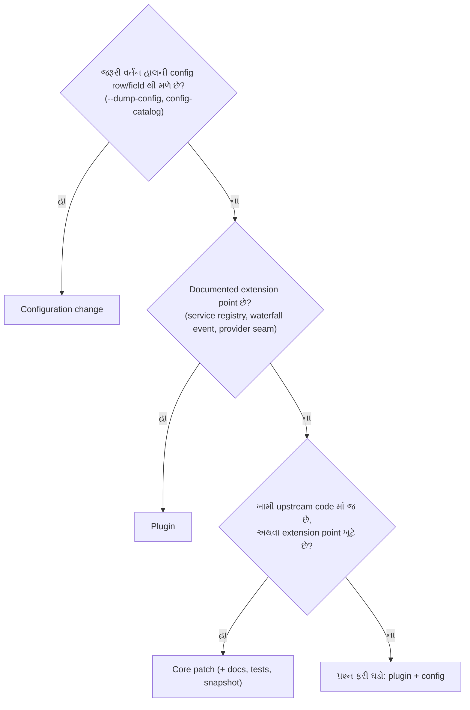

# પ્રકરણ 6 — Maintainer અને architecture level

> 🧭 **નવું:** આ પ્રકરણ અઘરું લાગે તો પહેલાં નીચેનો [સરળ સમજ](#saral-samaj) વિભાગ વાંચો (ઉપમા, નવા શબ્દો, યાદ રાખવાની રીતો). આખા પુસ્તકનો નકશો: [સમગ્ર નકશો](overview-samagra-naksho.md).

> **Level 6.** હવે "કેવી રીતે ચાલે છે" થી આગળ વધી "ક્યાં બદલવું" પૂછીએ. ત્રણ extension માર્ગ સરખાવીએ,
> એક વર્તન માપીએ, અને problem statement થી patch, regression test અને review notes સુધીનું એક સાચું contribution કરીએ.

## આ પ્રકરણ પછી તમે શું કરી શકશો

- Configuration change, plugin, અને core patch વચ્ચે source પુરાવા સાથે પસંદગી કરી શકશો.
- Model call count અને tool latency ને વર્તન બદલ્યા વગર માપી, પરિણામની મર્યાદા પ્રામાણિકપણે લખી શકશો.
- એક નાની ખામી માટે reproduce → root cause → patch → regression test → verification → review notes નો આખો ક્રમ પૂરો કરી શકશો.
- ફેરફારની હાલના callers અને plugins પર અસર લખી શકશો — ખાસ કરીને machine-readable outputs પર.

## 6.1 ત્રણ extension માર્ગ

Repository ના પોતાના નિયમો દિશા બતાવે છે ([AGENTS.md][agents-conventions]):

- "**Plugins, not loop changes**: new behavior goes on documented extension points; changing `agent-loop` requires updating docs/architecture.md."
- "**No hardcoded tunables in plugins**: deployment-varying choices are validated `Config` fields changeable from cordis.yml."

અને architecture doc નું "Where new behavior goes" table દરેક ધ્યેય માટે mechanism આપે છે ([architecture.md][arch-where]) — model provider → `ctx.llm` adapter, model-facing capability → `ctx.tools`, request/tool/turn intercept → `agent/*`/`tools/*` events, વગેરે. ✅

આ પુસ્તકમાં આપણે ત્રણેય માર્ગ **ખરેખર** વાપર્યા છે:

| માર્ગ | આપણું ઉદાહરણ | શું બદલાયું | Restart/ship | Risk |
|---|---|---|---|---|
| **1. Configuration change** | `session-title-llm` row disable (પ્રકરણ 1); `maxBytes` config (પ્રકરણ 4) | YAML patch, કોઈ code નહીં | overlay/profile patch | સૌથી ઓછું — ફક્ત હાલનાં knobs |
| **2. Plugin** | `trace-events`, `metrics` (observers), `csv_compare`, `reconcile_bank_tally` (tools) | નવો module + overlay row | overlay; unload પર બધું પાછું | ઓછું — documented extension points પર જ |
| **3. Core patch** | headless runner teardown fix (6.3) | upstream package source | upstream PR, release | વધુ — હાલના callers પર અસર, review જરૂરી |

### ક્યારે કયો? — source આધારિત નિર્ણય



ત્રણ ઉદાહરણ પર લાગુ:

- **"Title call બંધ કરવો છે."** `--dump-config` માં `session-title-llm` row છે ([row][bundle-base-title]) → configuration. Plugin લખવો વધારે પડતું ગણાય.
- **"દરેક model request ગણવો છે."** કોઈ config નથી, પણ `llm/stream` waterfall છે ([decl][llm-stream-decl]) → plugin ([metrics.ts](../labs/measure/metrics.ts)). Loop બદલવાની જરૂર નથી.
- **"SIGINT પછી headless ખોટી error છાપે છે."** આ headless runner ના `run()` ની ખામી છે ([source][headless-flush]); બહારથી plugin તેને સુધારી ન શકે → core patch.

## 6.2 એક વર્તન માપો: model calls અને tool latency

**Measurement** એટલે વર્તન બદલ્યા વગર સંખ્યા ભેગી કરવી. [`metrics.ts`](../labs/measure/metrics.ts) બે listener મૂકે છે, બંને `next()` ને delegate કરે છે:

```ts
  ctx.on('llm/stream', (options, next) => {
    calls.push({ purpose: options.purpose ?? 'agent', messages: options.messages.length })
    return next()
  })

  ctx.on('tools/execute', async (exec, next) => {
    const start = performance.now()
    const result = await next()
    tools.push({ name: exec.name, ms: …, isError: result.isError === true })
    return result
  })
```

`tools/execute` એ around-dispatch waterfall છે ([decl][tools-events]); તેથી માપ tool body + તેની અંદરના wrappers નું છે, `tools/pre-execute` policy કે post-processing નું નહીં. `options.purpose` એ auxiliary requests ને અલગ પાડે છે (title generator `session-title` purpose મોકલે છે).

**પ્રયોગ:** title row off vs on, દરેક 5 runs, દરેક run નવા `DSH_HOME` સાથે (પૂરા commands: [પરિશિષ્ટ B](../appendix/B-command-reference.md#measure)). 🧪 ([evidence/measure.jsonl](../evidence/measure.jsonl))

| Setting | Model calls (5 runs) | Purposes | `read` latency ms (5 runs) | Median |
|---|---|---|---|---|
| title **off** | 2, 2, 2, 2, 2 | `agent` | 8.32, 10.11, 11.39, 9.34, 9.23 | 9.34 |
| title **on** | 3, 3, 3, 3, 3 | `agent`, `session-title` | 16.35, 14.12, 15.55, 14.89, 16.41 | 15.55 |

**અર્થઘટન — પ્રામાણિક મર્યાદાઓ સાથે:**

- Model call count deterministic છે: base bundle નું title generator દરેક નવા session માં એક વધારાનો call કરે છે. Real provider પર આનો અર્થ વધારાના tokens અને ખર્ચ છે.
- Latency નો તફાવત **ફક્ત એક અવલોકન** છે: 5 samples, mock server એ જ machine પર, એક જ 4-CPU container. સંભવિત કારણ — title request નું serialization/streaming એ જ Node event loop પર tool execution સાથે overlap થાય છે — પણ અમે તેને profile કરીને સાબિત કર્યું નથી. ⚠️ દાવો કરવા પહેલાં: વધુ samples, CPU profile (`node --cpu-prof`), અને mock server ને બીજા process/machine પર.

## 6.3 એક સાચું contribution: headless SIGINT teardown

### Problem statement

`dsh --profile headless` ચાલુ model stream દરમિયાન `SIGINT` મળે ત્યારે interruption સાચું record થાય છે (durable `turn/end` reason `aborted`/`disposed`, exit 130), પણ runner પછી `stderr` પર `dsh: session "…": flush on a closed handle` છાપે છે, અને `--json` mode માં `{"type":"error","message":"…flush on a closed handle"}` line લખે છે. User ને આ "data નષ્ટ થયો?" એવી ગેરસમજ આપે છે, જ્યારે ખરેખર કંઈ ખોટું થયું નથી.

### Reproduction (🧪 patch વગર 2/2 runs)

```text
dsh exit=130
dsh: session "session-…": flush on a closed handle
```

([evidence/sigint-unpatched.err](../evidence/sigint-unpatched.err), [evidence/json-sigint-orig.jsonl](../evidence/json-sigint-orig.jsonl))

### Root cause (✅ source)

1. SIGINT → launcher `interrupt(130)` → root fiber dispose ([`runProfile`][cli-runProfile]).
2. Dispose agent ને cancel કરે છે; turn `aborted` થઈ `turn/end` લખે છે; `agent.whenIdle()` resolve થાય છે.
3. Headless [`run`][headless-run] આ "idle" ને સામાન્ય પૂર્ણતા માની આગળ વધે છે અને [`sessions.flush(agent.session)`][headless-flush] બોલાવે છે.
4. ત્યાં સુધીમાં persistence handle teardown માં બંધ થઈ ગયું છે, એટલે [`SessionHandleClosedError`][persistence-closed] — `session "…": flush on a closed handle`.
5. Error runner ના `.catch` થી [`fail`][headless-fail] સુધી પહોંચે છે: `stderr` line, `--json` હોય તો error event, અને `io.exit(1)` — જે launcher ના 130 સાથે સ્પર્ધા કરે છે.

### Patch (book lab code, [labs/contribution/headless-teardown.patch](../labs/contribution/headless-teardown.patch); pinned commit પર `git apply --check` સ્વચ્છ 🧪)

```diff
-import type { Context } from '@deepseek-ai/cordis'
+import { FiberState, type Context } from '@deepseek-ai/cordis'
@@ async function run(ctx: Context, config: Config, io: HeadlessIo): Promise<void>
     } finally {
       stopReasoning?.()
     }
+    // Teardown (for example SIGINT) disposed this runner while the Agent settled;
+    // the launcher owns that exit status, and closed Session handles cannot flush.
+    if (ctx.fiber.state !== FiberState.ACTIVE) return
     await sessions.flush(agent.session)
```

Design: runner નું પોતાનું fiber `ACTIVE` ન હોય ([`FiberState`][cordis-fiberstate]) તો tree teardown માં છે; ત્યારે exit status launcher નો છે, runner નો નહીં. ત્રણ lines, એક જ package.

### Regression test

નવો `packages/bundle/headless/tests/teardown-flush.spec.ts` upstream ના `terminal-failures.spec.ts` જેવો જ harness વાપરે છે: real `AgentLoop` + mock adapter નું `'hang'` script, પહેલો chunk આવે ત્યારે `ctx.fiber.dispose()`, અને પછી assertion:

```ts
    expect(err).toBe('')
    expect(exits).toEqual([])
```

**પ્રામાણિક નોંધ:** પહેલા draft માં અમે `session/flush` listener stub કરી "closed handle" ઉત્પન્ન કરવા માંગતા હતા, પણ root dispose એ stub listener ને પણ કાઢી નાખે છે. તેથી test **flush error** નહીં, પણ એ જ root cause નું બીજું લક્ષણ પકડે છે: patch વગર runner `io.exit(1)` માંગે છે (aborted summary). Test નું નામ એ જ બતાવે છે: "leaves reporting and exit status to the launcher when the tree is disposed mid-turn".

### Verification (બધું 🧪)

| Check | Patch વગર | Patch સાથે |
|---|---|---|
| Real SIGINT run: `flush on a closed handle` stderr | 2/2 runs માં દેખાયું | 1/1 run માં નથી; exit 130; durable `turn/end aborted` હાજર |
| નવો regression test | **fail** (`expected [ 1 ] to deeply equal []`) | pass |
| `pnpm exec vitest run packages/bundle/headless` | — | `Tests 136 passed (136)` |
| Coverage (`packages/bundle/headless/src/**`) | — | Statements/Branches/Functions/Lines 100% |
| `tsc -p packages/bundle/headless/tsconfig.json --noEmit` | — | exit 0 |
| `scripts/run-oxlint.ts` on both files | — | exit 0 (પહેલાં `Promise.withResolvers<void>` પર `no-invalid-void-type` પકડાયું, સુધાર્યું) |

### Review notes: હાલના callers અને plugins પર અસર

- **Scope.** ફક્ત `@deepseek-ai/dsh-headless` નો runner. Agent loop, session store, persistence, અને બીજા profiles (web, sdk, acp) બદલાતા નથી.
- **Exit status.** Interrupted runs માં પહેલાં પણ process exit 130 હતો (launcher જીતતો). હવે runner exit request જ નથી કરતો — ખરો exit code બદલાતો નથી, પણ race ઘટે છે.
- **`--json` consumers — વર્તન બદલાય છે.** પહેલાં SIGINT પર છેલ્લી line `{"type":"error",…closed handle}` હતી; હવે કોઈ terminal line નથી, stream `session`/`status` events પછી અટકે છે ([evidence/json-sigint-patched.jsonl](../evidence/json-sigint-patched.jsonl)). કોઈ automation "છેલ્લી line terminal હોય જ" એમ માનતું હોય તો તે ભાંગી શકે. **Reviewer માટે પ્રશ્ન:** શું `{"type":"interrupted"}` જેવો સ્પષ્ટ terminal event ઉમેરવો? એ JSON vocabulary નો additive ફેરફાર છે, જેને `json-stream.ts` docs અને tests જોઈએ — અલગ PR માં સારું.
- **Repository process.** Upstream PR માટે AGENTS.md મુજબ: `dsh-pr-description` skill થી PR description, એક `kind/*` અને લાગુ `area/*` labels, product-user-visible ફેરફાર હોવાથી maintainer સાથે keyless recorded-session snapshot ની જરૂર ચર્ચવી, અને externally perceptible breaking change ગણાય તો upgrade guide. આ પુસ્તક upstream માં PR **ખોલતું નથી**; patch શીખવા માટે છે.

## Source map: આ ક્રમમાં ખોલો

| ક્રમ | File | Symbol | કેમ |
|---|---|---|---|
| 1 | `AGENTS.md` | [Conventions][agents-conventions] | extension નિયમો |
| 2 | `docs/architecture.md` | [Where new behavior goes][arch-where] | mechanism table |
| 3 | `packages/llm/llm/src/index.ts` | [`'llm/stream'`][llm-stream-decl] | metrics hook |
| 4 | `packages/core/tools/src/events.ts` | [`'tools/execute'`][tools-events] | latency hook |
| 5 | `packages/bundle/headless/src/index.ts` | [`run`][headless-run], [`flush`][headless-flush], [`fail`][headless-fail] | contribution |
| 6 | `packages/session/session-persistence/src/errors.ts` | [`SessionHandleClosedError`][persistence-closed] | error નો સ્રોત |

## Lab 6 — patch લગાવો, test ને fail/pass કરાવો

Pinned checkout માં:

```bash
git apply <book>/labs/contribution/headless-teardown.patch
```

```bash
pnpm exec vitest run packages/bundle/headless/tests/teardown-flush.spec.ts
```

અપેક્ષિત: `Tests 1 passed (1)`. પછી ફક્ત source ફેરફાર ઉલટાવો:

```bash
git checkout -- packages/bundle/headless/src/index.ts
```

```bash
pnpm exec vitest run packages/bundle/headless/tests/teardown-flush.spec.ts
```

અપેક્ષિત: `Tests 1 failed (1)` અને `AssertionError: expected [ 1 ] to deeply equal []`. આ "test ખરેખર fix ને પકડે છે" નો પુરાવો છે.

## આગાહી કસોટી

Metrics overlay સાથે પ્રકરણ 4 નો `csv_compare` run કરો. **ચલાવતા પહેલાં લખો:** `modelCalls`, `toolCalls`, અને `csv_compare` નું latency `read` કરતાં વધુ હશે કે ઓછું — અને કેમ. જવાબ: [પરિશિષ્ટ D — Lab 6](../appendix/D-lab-solutions.md#lab-6).

## નિષ્ફળતા: "મારો observer plugin વર્તન બદલી નાખે છે"

**લક્ષણ.** Metrics plugin ઉમેર્યા પછી tool calls નાં પરિણામ ખાલી આવે છે અથવા model requests થતા જ નથી.

**ટૂંકો નિદાન માર્ગ.** Waterfall listener એ `next()` બોલાવ્યું? `return next()` ભૂલી જાઓ તો સાંકળ ત્યાં અટકે છે — "Waterfall listeners MUST call `next()` to delegate; returning without it short-circuits the chain" ([AGENTS.md][agents-conventions]). `tools/execute` માં `await next()` નું પરિણામ **return** કરો, નહીં તો pipeline ને `undefined` result મળે.

## Mastery check

1. ત્રણ extension માર્ગ અને દરેકનું એક ઉદાહરણ, આ પુસ્તકમાંથી.
2. `tools/execute` પર માપેલું latency શું સમાવે છે અને શું નહીં?
3. Latency તફાવતને "સાબિત" ગણવા પહેલાં કયા ત્રણ પગલાં જોઈએ?
4. Patch માં `ctx.fiber.state !== FiberState.ACTIVE` કેમ, `signal.aborted` કેમ નહીં? (સંકેત: કોનું lifetime?)
5. Regression test patch વગર fail થાય છે તે કેમ મહત્વનું છે?
6. `--json` consumers પર અસર લખો, અને એક વૈકલ્પિક design સૂચવો.

જવાબો: [પરિશિષ્ટ D — પ્રકરણ 6](../appendix/D-lab-solutions.md#ch6).

<a id="saral-samaj"></a>

## સરળ સમજ — પ્રકરણ 6 સાદી ગુજરાતીમાં

> આ વિભાગ નવો ઉમેરેલો છે; ઉપરનું પ્રકરણ જેમ હતું તેમ જ છે. આખો નકશો: [સમગ્ર નકશો](overview-samagra-naksho.md).

### એક વાક્યમાં

**પ્રકરણ 6 = ભોજનાલયના સંચાલક બનવું: કોઈ ફેરફાર જોઈએ ત્યારે નક્કી કરો કે ફક્ત મેનુ બદલવું (config), નવો કર્મચારી રાખવો (plugin), કે ઇમારતમાં ફેરફાર (core patch); ફેરફાર પહેલાં-પછી માપો; અને સુધારો પુરાવા સાથે માલિક સામે મૂકો.**

### ભોજનાલયની ઉપમામાં

| જરૂર | નાનો ઉપાય (પહેલાં આ) | મધ્યમ | મોટો (છેલ્લે) |
|---|---|---|---|
| કોઈ કાઉન્ટર બંધ કરવું | મેનુ પર ચિઠ્ઠી (config) | — | — |
| દરેક ઓર્ડર ગણવો | — | નવો ગણતરીકાર કર્મચારી (observer plugin) | — |
| દરવાજાનું તાળું ખોટું વર્તન કરે | — | — | ઇમારતમાં સુધારો (core patch, upstream PR) |

**નિયમ:** હંમેશા સૌથી નાનો ઉપાય પહેલાં. Repository પોતે કહે છે: "Plugins, not loop changes".

**ઉપમા ક્યાં તૂટે છે:** ઇમારતમાં ફેરફાર કોઈ પણ કડિયો કરી શકે; અહીં core patch માટે upstream ના નિયમો (tests, coverage, snapshot, PR description, labels) પાળવા પડે, અને આ પુસ્તક upstream માં PR ખોલતું **નથી** — patch ફક્ત શીખવા માટે છે.

### વિષય-વાર ઊંડી સમજ

#### (1) ત્રણ extension માર્ગ — નિર્ણય-વૃક્ષ

1. **હાલની config row/field થી થાય છે?** (`--dump-config`) → **Configuration change.** ઉદાહરણ: title call બંધ કરવો = `session-title-llm` disable.
2. **ના — તો documented extension point છે?** (service registry, waterfall event, provider seam) → **Plugin.** ઉદાહરણ: દરેક model request ગણવો = `llm/stream` પર metrics plugin.
3. **ના — ખામી upstream code માં જ છે?** → **Core patch.** ઉદાહરણ: headless runner નો teardown સંદેશ.

**યાદ-ચાવી "ચિઠ્ઠી-કર્મચારી-કડિયો":** પહેલાં ચિઠ્ઠી, પછી કર્મચારી, છેલ્લે કડિયો.

#### (2) માપન — વર્તન બદલ્યા વગર

Metrics plugin બે listeners મૂકે છે અને **બંને `next()` ને સોંપે છે** — એટલે વર્તન બદલાતું નથી:

- `llm/stream` પર: દરેક model call ગણો, `purpose` સાથે (`agent` કે `session-title`).
- `tools/execute` પર: tool body નો સમય માપો (around-dispatch: policy અને post-processing બાદ).

**પરિણામ (5+5 runs):** title બંધ → દરેક run માં 2 calls; title ચાલુ → દરેકમાં 3. `read` latency median 9.34 ms vs 15.55 ms.

**પ્રામાણિકતાનો નિયમ:** call count નિશ્ચિત (deterministic) છે. Latency નો તફાવત **ફક્ત અવલોકન** છે (5 samples, એક machine); કારણ સાબિત કરવા વધુ samples, CPU profile, અને mock server અલગ machine પર જોઈએ.

**યાદ-ચાવી "ગણતરી પાકી, સમય કાચો":** count ભરોસાપાત્ર, timing ફક્ત સંકેત.

#### (3) એક ખરો સુધારો — છ પગલાંની સીડી

| પગલું | આ પ્રકરણમાં | યાદ-શબ્દ |
|---|---|---|
| 1. Problem statement | Ctrl+C પછી ભ્રામક `flush on a closed handle` અને `--json` માં ખોટો `error` | **પ્રશ્ન** |
| 2. Reproduction | patch વગર 2/2 runs માં સંદેશ | **ફરી** |
| 3. Root cause | teardown પછી runner "idle" ને સામાન્ય અંત માને, બંધ handle પર `flush` | **મૂળ** |
| 4. Patch | runner નું fiber `ACTIVE` ન હોય તો report/exit launcher પર છોડો (3 lines) | **સુધાર** |
| 5. Regression test | patch વગર fail (`expected [ 1 ] to deeply equal []`), સાથે pass | **સાબિતી** |
| 6. Review notes | `--json` consumers ને હવે terminal line નથી — reviewer માટે પ્રશ્ન | **અસર** |

**યાદ-ચાવી "પ્રશ્ન-ફરી-મૂળ-સુધાર-સાબિતી-અસર" — "પ્રફુલ મૂળ સુધારી સાબિત અસર કરે".**

#### (4) `ctx.fiber.state` કેમ, `signal.aborted` કેમ નહીં?

- **Fiber state** = runner **plugin** નું જીવન. `ACTIVE` ન હોય = આખું tree બંધ થઈ રહ્યું છે → exit status launcher નો.
- **Signal** = agent ના **turn** નું. User ફક્ત turn રદ કરે અને app ચાલુ રહે, ત્યારે runner એ report કરવું જ જોઈએ.

**ઉપમા:** "દુકાન બંધ થાય છે" (fiber) અને "એક ઓર્ડર રદ થયો" (signal) — બે જુદી ઘટના.

#### (5) Regression test નું પ્રામાણિક સત્ય

પહેલા draft માં test "flush error" પકડવા માંગતો હતો, પણ root dispose એ stub listener ને પણ કાઢી નાખે. તેથી test એ જ root cause નું **બીજું લક્ષણ** પકડે છે: patch વગર runner `exit(1)` માંગે. Test નું નામ એ જ કહે છે. **શીખ:** test શું ખરેખર ચકાસે છે તે નામમાં પ્રામાણિકપણે લખો.

#### (6) Verification ચેકલિસ્ટ

Real SIGINT run, નવો test (fail/pass), આખું headless suite (136/136), coverage 100%, `tsc` exit 0, lint exit 0, pristine tree પર `git apply --check`. **દરેક દાવો એક command થી.**

### નવા ટેકનિકલ શબ્દો — સરળ ગુજરાતીમાં

| શબ્દ | સરળ અર્થ | ઉદાહરણ | યાદ-ચાવી |
|---|---|---|---|
| Extension point | બદલ્યા વગર જોડાવાની દસ્તાવેજી જગ્યા | `llm/stream` | "ખીંટી" |
| Core patch | upstream ના source માં ફેરફાર | headless runner fix | "ઇમારતમાં કડિયો" |
| Observer | ફક્ત જોનાર, બદલનાર નહીં | metrics plugin | "CCTV" |
| Latency | કામ પૂરું થવામાં લાગતો સમય | 9.34 ms | "રાહ" |
| Median | ક્રમમાં ગોઠવેલી સંખ્યાઓમાં વચ્ચેની | 5 runs માંથી 3જી | "વચલો" |
| Sample | માપનું એક ઉદાહરણ | એક run | "એક ચમચી ચાખવું" |
| Profiling | સમય ક્યાં જાય છે તે માપવું | `node --cpu-prof` | "સમયનો એક્સ-રે" |
| Problem statement | ખામીનું સ્પષ્ટ, ચકાસી શકાય તેવું વર્ણન | ભ્રામક flush સંદેશ | "ફરિયાદ" |
| Root cause | ખામીનું મૂળ કારણ | બંધ handle પર flush | "મૂળ" |
| Patch / diff | ફેરફારની લાઇન-વાર યાદી | `+ if (...) return` | "સુધારાની ચિઠ્ઠી" |
| Regression test | ભૂલ પાછી ન આવે તેની ખાતરી | `teardown-flush.spec.ts` | "ચોકીદાર" |
| Coverage | tests એ કેટલો code ચલાવ્યો | 100% | "કેટલું તપાસ્યું" |
| Lint | style અને સામાન્ય ભૂલો શોધતું tool | oxlint | "જોડણી તપાસ" |
| Review notes | ફેરફારની અસરનું વર્ણન reviewer માટે | `--json` અસર | "માલિકને પત્ર" |
| Backward compatibility | જૂના વાપરનારાઓ ભાંગે નહીં | JSON terminal line | "જૂના ગ્રાહક ખુશ" |

### યાદ રાખવાની રીતો

- **"ચિઠ્ઠી-કર્મચારી-કડિયો"** — ત્રણ extension માર્ગ, નાનાથી મોટો.
- **"ગણતરી પાકી, સમય કાચો"** — માપનની પ્રામાણિકતા.
- **"પ્રફુલ મૂળ સુધારી સાબિત અસર કરે"** — contribution ના છ પગલાં.
- **"દુકાન બંધ ≠ ઓર્ડર રદ"** — fiber vs signal.
- **ચિત્ર:** સીડીનાં છ પગથિયાં; છેલ્લા પગથિયે "અસર" લખેલું — કારણ કે સારો maintainer હંમેશા પૂછે, "આથી કોણ ભાંગે?"

### સામાન્ય ગેરસમજો

| ગેરસમજ | સાચું |
|---|---|
| "નવી વસ્તુ માટે loop બદલો." | પહેલાં config, પછી plugin; loop છેલ્લે. |
| "એક run નું timing પૂરતું." | વધુ samples + median + મર્યાદાઓ. |
| "Test pass થયો એટલે પૂરું." | Fix વગર test fail થાય છે તે પણ બતાવો. |
| "નાનો patch = કોઈ અસર નહીં." | `--json` consumers નું વર્તન બદલાયું; review notes માં લખો. |

### પુનરાવર્તન કાર્ડ

<details><summary>1. ત્રણ extension માર્ગ અને દરેકનું ઉદાહરણ?</summary>

Config (title row disable), plugin (metrics/csv_compare), core patch (headless teardown).
</details>

<details><summary>2. `tools/execute` પરનું માપ શું સમાવે છે?</summary>

Tool body અને અંદરના wrappers; pre-execute policy, approval, guards, post-execute નહીં.
</details>

<details><summary>3. Title ચાલુ/બંધ — model calls?</summary>

બંધ: 2; ચાલુ: 3 (`purpose: session-title`).
</details>

<details><summary>4. Patch નો `--json` પર શો પ્રભાવ?</summary>

SIGINT પર terminal JSON line નથી (પહેલાં ભ્રામક `error` હતું); વિકલ્પ: `{"type":"interrupted"}` અલગ PR માં.
</details>

### મિત્રને સમજાવો (3 મિનિટ)

"ફેરફાર કર્યો અને test pass થયો" — આ maintainer માટે કેમ પૂરતું નથી? છ પગલાંની સીડીથી મિત્રને સમજાવો.

### આગલા પ્રકરણ સાથે જોડાણ

હવે તમારી પાસે બધાં સાધનો છે: ચલાવવું (0), અનુસરવું (1), જોડવું (2), અંદર જોવું (3), ઉમેરવું (4), તોડીને સમજવું (5), અને પુરાવા સાથે બદલવું (6). પ્રકરણ 7 માં આ બધું ભેગું કરી **આખો workflow જાતે બનાવશો**: bank statement ↔ Tally reconciliation, દરેક પરિણામ trace સાથે.

---

પાછળ: [પ્રકરણ 5](05-debugging-permissions-reliability.md) · આગળ: [પ્રકરણ 7 — અંતિમ પ્રોજેક્ટ અને mastery પરીક્ષા](07-antim-project-mastery.md)

<!-- citations:begin (generated by tools/refdefs.py) -->
[agents-conventions]: https://github.com/deepseek-ai/deepseek-harness/blob/fcc0ad462172522aaf5c93a7b2e01f6b9f0b0159/AGENTS.md#L130-L142
[arch-where]: https://github.com/deepseek-ai/deepseek-harness/blob/fcc0ad462172522aaf5c93a7b2e01f6b9f0b0159/docs/architecture.md#L144-L170
[bundle-base-title]: https://github.com/deepseek-ai/deepseek-harness/blob/fcc0ad462172522aaf5c93a7b2e01f6b9f0b0159/packages/bundle/base/cordis.patch.yml#L67-L78
[cordis-fiberstate]: https://github.com/deepseek-ai/deepseek-harness/blob/fcc0ad462172522aaf5c93a7b2e01f6b9f0b0159/vendor/cordis/src/fiber.ts#L147-L154
[headless-fail]: https://github.com/deepseek-ai/deepseek-harness/blob/fcc0ad462172522aaf5c93a7b2e01f6b9f0b0159/packages/bundle/headless/src/index.ts#L308-L313
[headless-flush]: https://github.com/deepseek-ai/deepseek-harness/blob/fcc0ad462172522aaf5c93a7b2e01f6b9f0b0159/packages/bundle/headless/src/index.ts#L435-L444
[headless-run]: https://github.com/deepseek-ai/deepseek-harness/blob/fcc0ad462172522aaf5c93a7b2e01f6b9f0b0159/packages/bundle/headless/src/index.ts#L322-L455
[llm-stream-decl]: https://github.com/deepseek-ai/deepseek-harness/blob/fcc0ad462172522aaf5c93a7b2e01f6b9f0b0159/packages/llm/llm/src/index.ts#L75
[persistence-closed]: https://github.com/deepseek-ai/deepseek-harness/blob/fcc0ad462172522aaf5c93a7b2e01f6b9f0b0159/packages/session/session-persistence/src/errors.ts#L68-L78
[tools-events]: https://github.com/deepseek-ai/deepseek-harness/blob/fcc0ad462172522aaf5c93a7b2e01f6b9f0b0159/packages/core/tools/src/events.ts#L29
<!-- citations:end -->
