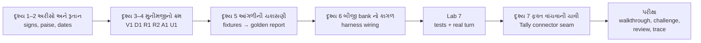
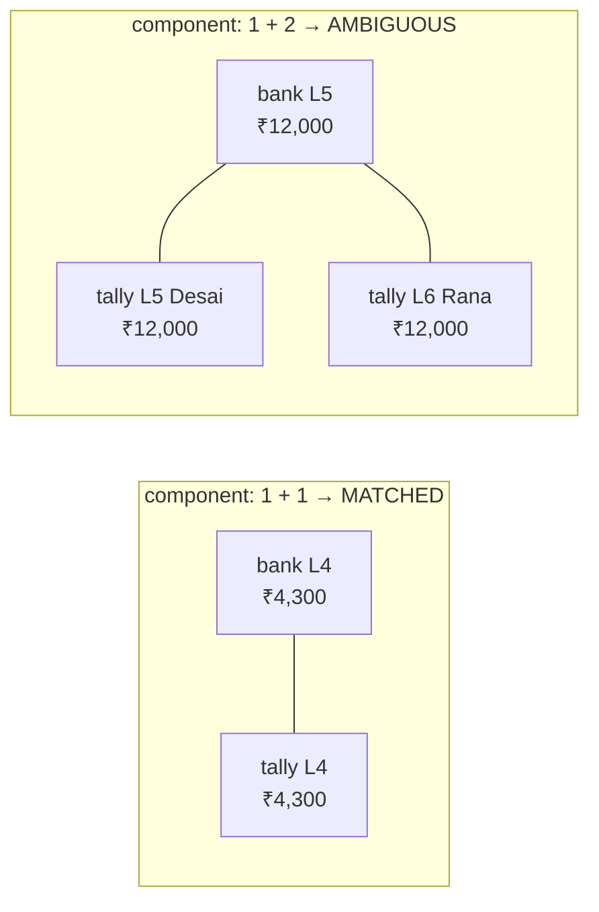
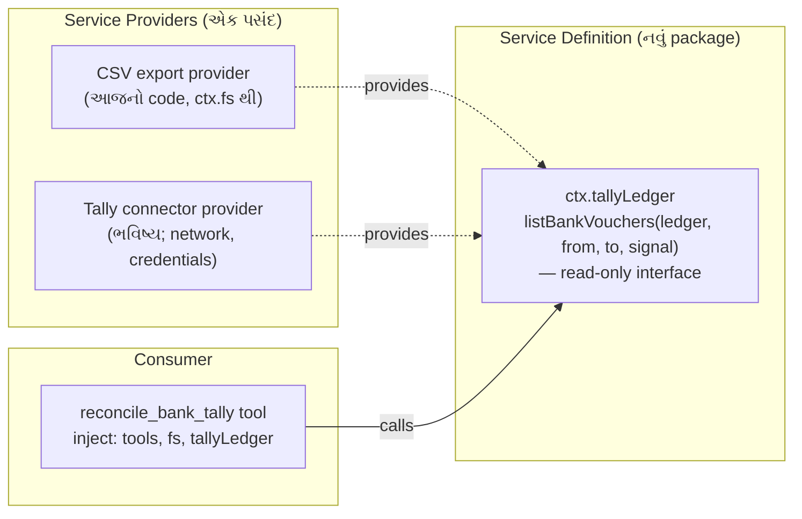

# પ્રકરણ 7 — અંતિમ પ્રોજેક્ટ અને mastery પરીક્ષા

> **Level 7 · વાર્તાનો દિવસ 14–15.**
> મુનીમજી દર મહિને bank statement અને Tally નો ચોપડો જે રીતે મેળવે છે, તે જ રીત આજે એક **read-only reconciliation tool** બને છે. દરેક પરિણામ તેની input rows અને matching rule સુધી trace થાય છે. Fixtures માં malformed files, duplicate rows અને ambiguous matches છે.
> પછી ભવિષ્યનો read-only Tally connector **extension** તરીકે ડિઝાઇન થાય છે, અને આરવ mastery પરીક્ષા આપે છે.
> દરેક દૃશ્ય: 🎬 ઘટના → ❓ પ્રશ્ન → 💻 code માં → 🔬 expert નજર. આખો નકશો: [સમગ્ર નકશો](overview-samagra-naksho.md).

## 🎬 મહિનાનો છેલ્લો દિવસ: મુનીમજીના બે ચોપડા

ગલ્લા પાછળ **મુનીમજી** ચશ્મા ચડાવી બે કાગળ પાસે-પાસે મૂકે છે:

- **Bank statement** — bank કહે છે ખાતામાં શું આવ્યું, શું ગયું.
- **Tally નો bank ledger** — ભોજનાલયના ચોપડામાં શું નોંધાયું.

"આરવ બેટા, આ બંને મળવા જોઈએ. પણ દર મહિને કંઈક ગૂંચ: bank ₹59 ના charges કાપે અને આપણે હજી નોંધ્યા ન હોય. Cheque નંબર bank `004512` લખે, આપણે `4512`. આપણા ચોપડામાં Desai (5 તારીખ) અને Rana (6 તારીખ) — બંનેના ₹12,000 જમા, અને bank માં 5 તારીખે ફક્ત એક જ ₹12,000. કોનો? અને ઉપરથી, **bank નું 'credit' એ આપણું 'debit'!**"

મીરાદીદી ત્રણ શરત યાદ કરાવે છે:

1. "Tool **ફક્ત વાંચશે** — કોઈ voucher બનાવશે કે બદલશે નહીં. અંતિમ નિર્ણય મુનીમજીનો."
2. "દરેક પરિણામ સાથે **કારણ અને line number** — મુનીમજી આંગળી મૂકી ચકાસી શકે."
3. "શંકા હોય ત્યાં **'શંકા'** — Desai કે Rana, guess નહીં."

"અને પછી," દીદી હસે છે, "તારી પરીક્ષા. હું એક ભૂલ છુપાવીશ જે તારા **બધા** tests પાસ કરશે."

## 🎯 આ પ્રકરણ પછી તમે શું કરી શકશો

- Money, dates, signs અને references ને deterministic રીતે normalize કરી શકશો — floating point કે local timezone વગર.
- ક્રમબદ્ધ, traceable matching rules ડિઝાઇન કરી, "first-come" greedy matching ની ભૂલ ટાળી શકશો.
- Golden report, invariant test, અને rule-wise unit tests થી workflow સાબિત કરી શકશો.
- Read-only Tally connector ને capability seam (Definition / Provider / Consumer) તરીકે ડિઝાઇન કરી શકશો.
- Code walkthrough, debugging challenge અને design review પૂરાં કરી rubric સામે પોતાનું મૂલ્યાંકન કરી શકશો.

## 🗺️ નકશો — આખું પુસ્તક એક પ્રોજેક્ટમાં



| આ પ્રકરણમાં | ક્યાંથી આવ્યું |
|---|---|
| `parseCsv` | પ્રકરણ 4 |
| `defineTool` + `Config` + overlay + fail loud | પ્રકરણ 4 |
| `ctx.fs` થી read-only ("કબાટ હું ખોલીશ") | પ્રકરણ 3, 4, 5 |
| capability seam ("દરવાજા પરનું પાટિયું") | પ્રકરણ 3 |
| mock runner + trace | પ્રકરણ 1 |
| "ફરી-સુધાર-ફરી-ઉલટ" | પ્રકરણ 5, 6 |

શબ્દો:

- **Bank reconciliation** = bank statement અને પોતાના ચોપડા (અહીં Tally નું bank ledger) ની entries જોડીને બતાવવું કે કઈ મેળ ખાય છે, કઈ ફક્ત એક બાજુ છે, અને કેમ.
- **Tally** = ભારતમાં વ્યાપક વપરાતું accounting software. **Ledger** = એક ખાતાનો ચોપડો. **Voucher** = Tally માં એક વ્યવહારની નોંધ.
- **Read-only** = tool ફક્ત વાંચે છે. પરિણામ માનવ reviewer માટે પુરાવા સાથેની યાદી છે, ચોપડામાં ફેરફાર નહીં.

> **Data notice.** Fixtures ના બધા નામ, reference numbers અને રકમ પુસ્તક માટે બનાવેલાં **synthetic** (જાતે બનાવેલાં, ખરાં નહીં) છે ([fixtures/README.md](../labs/reconcile/fixtures/README.md)). Tally export નો column layout પણ અમે ધારેલો નમૂનો છે; સાચા Tally export સાથે સરખાવ્યો નથી. ⚠️ તેથી column names `Config` માં છે. (**Fixture** = tests માટે તૈયાર રાખેલી input files.)

---

## દૃશ્ય 1 — અરીસો: bank નું credit, તમારું debit

🎬 આરવ bank statement માં ₹15,000 ની જમા શોધે છે. તે **Credit** ખાનામાં છે. પછી Tally માં એ જ entry શોધે છે. તે **Debit** ખાનામાં છે.

"મુનીમજી, એક ચોપડો ખોટો છે. પૈસા **આવ્યા**; એક કહે credit, બીજો કહે debit."

મુનીમજી હસે છે. "બંને સાચા છે. તું bank ને પૈસા આપે, તો bank ની નજરે તે તારા **દેવાદાર** થયા: તેમણે તને પાછા આપવાના છે. એટલે **તેમના** ચોપડામાં જમા = credit. તારી નજરે bank ખાતું તારી **મિલકત** છે; મિલકત વધી = debit. એક જ ઘટના, સામસામેથી જોયેલી. અરીસો."

❓ "તો સરખાવતી વખતે તમે શું કરો?"

"મનમાં બંનેને એક જ સવાલમાં ફેરવું: **'ખાતામાં પૈસા વધ્યા કે ઘટ્યા?'** વધ્યા તો વત્તા, ઘટ્યા તો ઓછા. પછી Credit-Debit શબ્દો ભૂલી જાઉં."

💻

| Export | Money **in** to bank | Money **out** |
|---|---|---|
| Bank statement | `Credit` | `Debit` |
| Tally bank ledger | `Debit` | `Credit` |

બંનેને એક જ દૃષ્ટિ — "bank account માં +" — માં ફેરવીએ છીએ ([normalize.ts](../labs/reconcile/src/normalize.ts)): bank માટે `credit − debit`, Tally માટે `debit − credit`.

**યાદ-ચાવી: "બૅન્કનું ક્રેડિટ = તમારું ડેબિટ — અરીસામાં જુઓ."**

🔬 **Expert નજર.** આ આખા પ્રોજેક્ટની સૌથી સામાન્ય ભૂલ છે, અને તે ખાસ કરીને ખતરનાક છે કારણ કે ઊંધું sign વાળો code **ચાલે** છે અને વાજબી દેખાતો report આપે છે. બચાવ: sign ને **એક જ જગ્યાએ, સૌથી વહેલા** ઠીક કરો (normalize), અને ત્યાર પછી code માં ક્યાંય "credit"/"debit" શબ્દ ન આવવા દો — ફક્ત signed amount. એક ખ્યાલ બે રૂપમાં આખા code માં ફરે, તો કોઈક જગ્યાએ કોઈ તેને ખોટી રીતે જોડશે. (દીદીની છુપાયેલી ભૂલ યાદ રાખજો.)

## દૃશ્ય 2 — એક પૈસો, બે તારીખ, ત્રણ શૂન્ય: normalize

🎬 મુનીમજી ત્રણ જૂની વાત કહે છે.

**એક પૈસો.** "એક વાર એક computer program એ મારો સરવાળો એક પૈસો ઓછો બતાવ્યો. મેં આખી રાત શોધ્યું. ભૂલ મારી નહોતી: computer દશાંશ બરાબર ગણી શકતું નહોતું. ત્યારથી હું રૂપિયા નથી ગણતો; **પૈસા** ગણું છું. પૂર્ણાંક. ₹8,250.50 નહીં — 8,25,050 પૈસા."

**બે તારીખ.** "Tally લખે `1-Apr-2026`. Bank લખે `01-04-2026`. એક જ દિવસ. હું બંનેને એક રીતે લખું: વર્ષ, મહિનો, દિવસ. અને એક વાર કોઈએ `31-02-2026` લખ્યું. 31 ફેબ્રુઆરી! એવી લીટી હું મેળવતો નથી; કાઢી નાખું છું."

**ત્રણ શૂન્ય.** "Bank cheque નંબર `004512` લખે, આપણે `4512`. એક જ cheque. આગળનાં શૂન્ય, ખાલી જગ્યા, નાના-મોટા અક્ષર — એ ફરક ગણું નહીં."

💻 **Normalize** = જુદી જુદી રીતે લખેલી માહિતીને એક જ ધોરણમાં ફેરવવી. ત્રણ વસ્તુ — **યાદ-ચાવી "રૂતાન": રૂપિયા, તારીખ, નંબર.**

- **રૂ**પિયા → integer **paise**: `1,23,456.50` → `12345650`. Computer માં `0.1 + 0.2` બરાબર `0.3` નથી આવતું (**floating point** ભૂલ); પૈસામાં એક પૈસાની ભૂલ પણ ન ચાલે. પૂર્ણાંક પૈસામાં આ સમસ્યા નથી. ઉદાહરણ: `1500000` paise = ₹15,000.
- **તા**રીખ → **ISO** `YYYY-MM-DD` (વર્ષ-મહિનો-દિવસ વાળું આંતરરાષ્ટ્રીય ધોરણ; text તરીકે sort કરો તો પણ તારીખ-ક્રમ સાચો આવે): `1-Apr-2026` (Tally), `01-04-2026` (bank), `01/04/2026` — બધું `2026-04-01`; `31-02-2026` જેવી અશક્ય તારીખ નકારાય (V1). Local **timezone** વગર — નહીં તો રાત્રે 11:30 ની entry બીજા દેશના સમય મુજબ બીજા દિવસે ગણાય.
- **ન**ંબર (reference) → uppercase, ફક્ત અક્ષર-અંક, આંકડાવાળા ref ના આગળના શૂન્ય દૂર (`004512` = `4512`), અને `-` = ખાલી.

🔬 **Expert નજર.** Normalize ના દરેક નિયમ પાછળ એક **ખરી ભૂલ** છે જે કોઈને ક્યારેક નડી છે: floating point, timezone, leading zeros. અને ક્રમ જુઓ: normalize **પહેલાં**, matching **પછી**. Matching ના નિયમોમાં `toUpperCase()` કે "શૂન્ય કાઢો" ક્યાંય નથી; તે સ્વચ્છ, એક જ આકારના data પર ચાલે છે. બે ચિંતા — "data સાફ કરવો" અને "નિર્ણય લેવો" — ભેળવો, તો દરેક નિયમમાં સફાઈની નકલ થાય અને એક જગ્યાએ ભૂલી જવાય. અને અશક્ય તારીખ: "સુધારવાનો" પ્રયત્ન (1 માર્ચ ગણી લેવી) નથી; **નકાર** છે. પ્રકરણ 4 નો પપ્પાનો નિયમ: ધારવું નહીં.

## દૃશ્ય 3 — મુનીમજીનો ક્રમ: છ નિયમ

🎬 આરવ મુનીમજીને મેળવતા જુએ છે, અને નોંધે છે કે તે હંમેશા **એક જ ક્રમે** ચાલે છે:

1. પહેલાં લાલ પેનથી **ખરાબ લીટીઓ** છેકે છે: અશક્ય તારીખ, ન ઉકલતી રકમ, credit અને debit બંને ભરેલાં.
2. પછી એક જ કાગળમાં **બિલકુલ સરખી બે લીટી** શોધે છે, અને બંનેને બાજુ પર કાઢે છે. "બે વાર છપાયું? કે સાચે જ બે વાર થયું? હું અત્યારે નક્કી નહીં કરું."
3. પછી **નંબર અને રકમ બંને** મળે તેવી જોડીઓ.
4. પછી, નંબર વગરની: **રકમ મળે અને તારીખ આસપાસ હોય** — પણ ફક્ત ત્યારે જ જ્યારે બીજો કોઈ ઉમેદવાર ન હોય.
5. જ્યાં ઉમેદવાર એકથી વધારે: "**શંકા.** Desai કે Rana? ફોન કરીશ."
6. બાકી રહી તે: "**સામે કંઈ નથી.**"

❓ "ક્રમ કેમ મહત્વનો? પહેલાં રકમથી મેળવો, પછી નંબરથી, તો?"

"તો જેનો નંબર ચોખ્ખો મળતો હતો, તે રકમના ગૂંચવાડામાં ફસાઈ જાય. **સૌથી મજબૂત પુરાવો પહેલાં.** મજબૂત પુરાવાવાળી જોડીઓ નીકળી જાય, પછી નબળા પુરાવા માટે ઓછી ગૂંચ રહે."

💻 [reconcile.ts](../labs/reconcile/src/reconcile.ts) ના header માં લખેલા નિયમો, આ ક્રમમાં ચાલે છે:

| Rule | Status | શરત | કેમ આ ક્રમ | મુનીમજીની ભાષામાં |
|---|---|---|---|---|
| **V1** | `rejected` | CSV problem, ખોટી date (દા.ત. `31-02-2026`), ખોટી રકમ, debit અને credit બંને ભરેલા | ખરાબ input પર matching ન ચલાવો | "આ line જ ખોટી છે" |
| **D1** | `duplicate` | **એક જ file** માં date, amount, reference, text સરખાં | બધી copies review માટે રોકો; એક પસંદ કરવી guess છે | "બે વાર છપાયું?" |
| **R1** | `matched` | normalized reference + signed amount સરખાં, 1↔1 | સૌથી મજબૂત પુરાવો પહેલાં | "નંબર અને રકમ બંને મળે" |
| **R2** | `matched` | signed amount સરખું, તારીખ ±`windowDays`, candidate group બરાબર 1 bank + 1 Tally | reference વગરની entries | "નંબર નથી, પણ રકમ અને આસપાસની તારીખ મળે — અને બીજો કોઈ ઉમેદવાર નથી" |
| **A1** | `ambiguous` | R1 કે R2 નો group 1+1 કરતાં મોટો | ક્યારેય guess નહીં | "Desai કે Rana? તમે જુઓ" |
| **U1** | `unmatched` | બાકી બધું; held duplicate સાથે reference મળે તો નોંધ | | "સામે કંઈ નથી" |

**યાદ-ચાવી "વધેલું દૂધ રાખો, રોજ અડધું અલગ":** **વ**(V1) **દ**(D1) **ર**(R1) **ર**(R2) **અ**(A1) **અ**લગ(U1).

**Window (±windowDays)** = તારીખમાં કેટલા દિવસનો ફરક ચલાવી લેવો. Cheque આજે આપ્યો, bank માં બે દિવસ પછી જમા — ±3 દિવસ ચાલે.

🔬 **Expert નજર.** છમાંથી **ચાર** statuses "match નથી" કહે છે, અને દરેક જુદું કારણ આપે છે: `rejected` (input ખરાબ), `duplicate` (શંકાસ્પદ નકલ), `ambiguous` (એકથી વધારે ઉમેદવાર), `unmatched` (કોઈ ઉમેદવાર નથી). નબળો tool ફક્ત બે ખાનાં આપે: "મળ્યું" અને "ન મળ્યું". પણ મુનીમજી માટે દરેક "ના" નું **આગળનું કામ** જુદું છે: bank ને પત્ર, ગ્રાહકને ફોન, ચોપડામાં entry. Tool ની કિંમત matched ની સંખ્યામાં નથી; તે unmatched ને કેટલી સારી રીતે **સમજાવે** છે તેમાં છે. અને R2 ની શરતનો દરેક શબ્દ વાંચો: "**signed** amount", "±window", "**બરાબર** 1 + 1". દરેક શબ્દ એક બારણું બંધ કરે છે.

## દૃશ્ય 4 — મણકા અને દોરા: "પહેલો આવ્યો તે લઈ ગયો" કેમ ખોટું

🎬 મુનીમજી એક જૂની વાત કહે છે. વર્ષો પહેલાં તેમનો એક મદદનીશ હતો, જે "ઝડપી" હતો: bank ની ₹12,000 ની લીટી જોઈ, ચોપડામાં **પહેલી મળી** તે ₹12,000 ની લીટી સાથે જોડી દીધી, અને આગળ વધ્યો. તે મહિને Desai ને જમા મળી.

"બીજા મહિને એ જ કાગળ બીજા ક્રમે છપાયા. હવે Rana ની લીટી પહેલાં હતી. એ જ મદદનીશ, એ જ રીત — અને જમા **Rana** ને મળી. એક જ હકીકત, બે જુદા હિસાબ; ફરક ફક્ત કાગળ પર કોણ ઉપર લખાયું હતું."

❓ "તો તમે કેવી રીતે કરો?"

મુનીમજી મણકા અને દોરો કાઢે છે. "દરેક લીટી એક **મણકો**. જ્યાં શરત મળે — રકમ અને તારીખ — ત્યાં બે મણકા વચ્ચે **દોરો**. બધા દોરા પહેલાં બાંધી લઉં; કોઈને જોડતો નથી. પછી દરેક ઝૂમખું જોઉં. ઝૂમખામાં બરાબર **બે** મણકા — એક bank નો, એક ચોપડાનો — તો મેળ. વધારે, તો શંકા. કાગળ ગમે તે ક્રમે છપાય; **દોરા એ જ રહે.**"

💻

- **Greedy matching** = "પહેલી મળે તે લઈ લો". પરિણામ input ના ક્રમ પર આધાર રાખે.
- **Graph** = બિંદુઓ (nodes) અને તેમને જોડતી રેખાઓ (edges) — મણકા અને દોરા.
- **Connected component** = એકબીજા સાથે (સીધી કે આડકતરી) જોડાયેલાં બિંદુઓનો સમૂહ — ઝૂમખું.

અમે bank અને Tally rows ને graph ના nodes બનાવીએ છીએ; rule ની શરત edge છે; અને દરેક connected component ને એકસાથે નક્કી કરીએ છીએ: 1+1 → match; મોટું → ambiguous. પરિણામ input ક્રમથી સ્વતંત્ર છે. Test "two bank rows competing for one Tally row are ambiguous, not first-come" આ સાબિત કરે છે.



**યાદ-ચાવી "મણકા દોરાથી":** એક ઝૂમખામાં બરાબર બે મણકા = match; વધુ = ambiguous.

🔬 **Expert નજર.** આ પુસ્તકમાં "ક્રમ પર આધાર" ત્રીજી વાર આવ્યો: પ્રકરણ 2 નો ઉતાવળિયો ગ્રાહક (કયો plugin પહેલાં load થયો), પ્રકરણ 5 ની ત્રણ ચિઠ્ઠી (કયો tool પહેલાં પૂરો થયો), અને અહીં (કઈ row પહેલાં લખાઈ). ત્રણેય વખત ઉપાયનો આકાર એક છે: **પહેલાં આખું ચિત્ર ભેગું કરો, પછી નિર્ણય લો** — `loader.await()`, "model order માં commit", connected components. Greedy algorithm લખવામાં સહેલો છે અને મોટે ભાગે સાચો જવાબ આપે છે; તેની ભૂલ ફક્ત ત્યારે દેખાય જ્યારે ambiguity હોય — એટલે કે બરાબર ત્યારે, જ્યારે માણસનું ધ્યાન સૌથી વધુ જોઈતું હોય. Expert "મોટે ભાગે સાચું" algorithm જુએ ત્યારે પૂછે છે: "કયા input પર તે **ચૂપચાપ ખોટું** છે?"

## દૃશ્ય 5 — આંગળીની ચકાસણી: fixtures અને golden report

🎬 દીદી મુનીમજીની દરેક ગૂંચ માટે **નમૂનાના કાગળ** માં એક-એક લીટી મૂકે છે. પછી મુનીમજીને કહે છે: "તમે હાથથી મેળવો. તમારો જવાબ આપણે સાચવી રાખીશું. આરવનું કાઉન્ટર હંમેશા **અક્ષરશઃ** એ જ જવાબ આપવું જોઈએ."

💻

| Input line | શું છે | અપેક્ષિત |
|---|---|---|
| bank L2 ↔ tally L2 | UTR `N0914000123`, ₹15,000 in | R1 matched |
| bank L3 ↔ tally L3 | cheque `004512` vs `4512` (leading zeros), ₹8,250.50 out | R1 matched (normalized ref) |
| bank L4 ↔ tally L4 | ₹4,300 in, ref ફક્ત bank માં, તારીખ 1 દિવસ અલગ | R2 matched |
| bank L5 ↔ tally L5, L6 | ₹12,000 in, Tally માં બે receipts (Desai, Rana) | A1 ambiguous |
| bank L6 | bank charges ₹59 out, ref `-` | U1 unmatched |
| bank L7, L8 | Joshi Pharma ₹6,100 બે વાર, એકસરખું | D1 duplicate |
| tally L7 | Joshi Pharma ₹6,100, ref સરખો | U1 + નોંધ "held bank duplicates (lines 7, 8)" |
| tally L8 | cheque `004513`, ₹2,500 out — હજી clear નથી | U1 unmatched |
| bank L9 | `31-02-2026` | V1 rejected |
| bank L10 | debit અને credit બંને | V1 rejected |
| bank L11 | ફક્ત 3 fields | V1 rejected (`COLUMN_COUNT`) |
| tally L9 | રકમ `12,00x.00` | V1 rejected |

(**UTR** = bank transfer નો અનન્ય reference નંબર. **Cheque clear થવો** = cheque ના પૈસા ખરેખર ખાતામાં જવા/આવવા.)

મુનીમજીની સવારની ચારેય ગૂંચ શોધો: ₹59 charges (bank L6), `004512` vs `4512` (L3), Desai-Rana (L5), અને Joshi Pharma બે વાર (L7–L8).

**Golden report** = "સાચું પરિણામ આ જ" તરીકે સાચવેલું output; દરેક run તેની સાથે byte-by-byte સરખાવાય. ([expected-report.txt](../labs/reconcile/fixtures/expected-report.txt)) — 🧪 library, tool pipeline, અને real headless turn ત્રણેયમાં byte-identical:

```text
bank rows 10, tally rows 8, window ±3 day(s)
matched 3 (₹11049.50), ambiguous 1, unmatched bank 1, unmatched tally 2, duplicates 1, rejected 4
unexplained difference (unmatched bank - unmatched tally): -₹3659.00
MATCHED [R1] bank L2 ↔ tally L2 ₹15000.00: reference N0914000123 and amount ₹15000.00 agree
MATCHED [R1] bank L3 ↔ tally L3 -₹8250.50: reference 4512 and amount -₹8250.50 agree
MATCHED [R2] bank L4 ↔ tally L4 ₹4300.00: amount ₹4300.00 agrees; dates 1 day(s) apart (window 3)
AMBIGUOUS [A1] bank L5 ↔ tally L5,L6 ₹12000.00: amount ₹12000.00 within 3 day(s) fits 1 bank and 2 Tally rows
UNMATCHED [U1] bank L6 -₹59.00: no tally row with this reference or amount within 3 day(s)
UNMATCHED [U1] tally L7 ₹6100.00: reference N0970000456 also appears in held bank duplicates (lines 7, 8)
UNMATCHED [U1] tally L8 -₹2500.00: no bank row with this reference or amount within 3 day(s)
DUPLICATE [D1] bank L7,L8 ₹6100.00: 2 identical bank rows (date 2026-04-07, ₹6100.00); held for review
REJECTED [V1] bank L9: invalid date "31-02-2026"
REJECTED [V1] tally L9: invalid debit "12,00x.00"
REJECTED [V1] bank L10: both debit and credit are filled
REJECTED [V1] bank L11: COLUMN_COUNT: expected 7 fields, found 3
```

**હાથથી ચકાસો** (મુનીમજીની જેમ, કાગળ-પેન્સિલથી): matched = 15,000 − 8,250.50 + 4,300 = **11,049.50**; unexplained = (−59) − (6,100 − 2,500) = **−3,659.00**.

**Traceability** = દરેક પરિણામથી તેની input lines અને નિયમ સુધી પાછા પહોંચી શકાય — પગેરું. ઉદાહરણ: `bank L5 ↔ tally L5,L6 [A1]`. દરેક લીટીમાં ત્રણ વસ્તુ છે: **કયો નિયમ** (`[R2]`), **કઈ lines** (`bank L4 ↔ tally L4`), અને **કેમ** (`dates 1 day(s) apart (window 3)`).

🔬 **Expert નજર.** Golden report નો ખતરો: tool ખોટો હોય અને તમે તેનું output જ "golden" તરીકે સાચવી લો, તો test ભૂલને **સિમેન્ટ** કરી દે. એટલે અહીં golden **હાથથી** ચકાસેલું છે, અને સાથે એક invariant test છે ("every input row appears in exactly one result") જે golden પર આધાર નથી રાખતો. બે સ્વતંત્ર પુરાવા એક કરતાં ઘણા મજબૂત છે. અને tally L7 ની લીટી ફરી વાંચો: tool match નથી કરતું, પણ **મદદ** કરે છે — "આ જ reference બાજુ પર કાઢેલી bank duplicates (lines 7, 8) માં છે". Guess નહીં કરવું એનો અર્થ ચૂપ રહેવું નથી; જે ખબર છે તે બધું કહેવું, અને જે ખબર નથી તે ન ધારવું.

## દૃશ્ય 6 — બીજી bank નો કાગળ: harness wiring

🎬 મુનીમજી બીજા ખાતાનું export લાવે છે, બીજી bank નું. તેમાં ખાનાનાં નામ જુદાં છે: `Date` ને બદલે `Txn Date`. અને એક કાગળમાં `Debit` ખાનું છે જ નહીં.

આરવના પહેલા draft માં, ખાનું ન મળે તો રકમ **શૂન્ય** ગણાતી હતી. પરિણામ: ₹900 નો ઉપાડ ગાયબ થઈ ગયો, અને એ entry નંબરના આધારે ખોટી રીતે "મળી ગઈ". કોઈ error નહીં. સ્વચ્છ report.

મુનીમજી ગંભીર થઈ જાય છે. "બેટા, ખાનું ન મળે ત્યારે 'શૂન્ય' એ જવાબ નથી. **'મને ખાનું નથી મળતું'** એ જવાબ છે."

💻 [plugin.ts](../labs/reconcile/src/plugin.ts) એ પ્રકરણ 4 નો જ નમૂનો છે, ત્રણ ઉમેરા સાથે:

1. **Column names config માં** (`bankColumns`, `tallyColumns`) — બીજી bank નું export? Overlay માં names બદલો, code નહીં. ખોટું નામ હોય તો fail loud: matching શરૂ થાય તે પહેલાં `assertColumns` દરેક configured column header માં છે કે નહીં તે તપાસે છે, અને ન હોય તો `ReconcileConfigError` ("bank export is missing configured column(s) … header is (…)"). નહીં તો ખૂટતો `Debit` column ચૂપચાપ શૂન્ય ગણાય — ₹900 નું withdrawal ગાયબ થઈ entry ખોટી રીતે R1 match થાય. (પ્રકરણ 4, દૃશ્ય 5 ની ત્રીજી review finding — "ચૂપ સાચું = ખતરનાક".)
2. **`windowDays`** — config default 3, અને model દરેક call માં `window_days` (integer) આપી શકે. Negative value schema-level validation માં error બને છે (test).
3. **Canonical JSON report** — દરેક `ResultRow` માં `status`, `rule`, `bankLines`, `tallyLines`, `amount`, `reason`. UI કે બીજો tool line-level trace આ JSON માંથી બનાવી શકે.

🔬 **Expert નજર.** `window` બે જગ્યાએ છે: `Config` માં (deployment નો default) અને `parameters` માં (model દરેક call માં બદલી શકે). પ્રકરણ 4 ના ચાર વાચક યાદ કરો. કયું knob કોના હાથમાં, એ design નિર્ણય છે: column names model ના હાથમાં **નથી** (તે ધારીને ખોટું નામ આપે), પણ window છે (મુનીમજી કહી શકે "આ વખતે ±5 થી જો"). અને error message જુઓ: તેમાં export નું **ખરું header છપાયેલું** છે. સારી error ફક્ત "ખોટું છે" નથી કહેતી; સુધારવા જોઈતી માહિતી સાથે લાવે છે.

## Source map: આ ક્રમમાં ખોલો

| ક્રમ | File | Symbol | કેમ |
|---|---|---|---|
| 1 | `labs/reconcile/src/normalize.ts` | `parseDate`, `parseAmount`, `normalizeRef`, `normalizeBank`/`normalizeTally` | ડેટા એક જ ભાષામાં ("રૂતાન") |
| 2 | `labs/reconcile/src/reconcile.ts` | `splitDuplicates`, `components`, `reconcileTables` | rules |
| 3 | `labs/reconcile/src/plugin.ts` | `Config`, `apply` | harness wiring |
| 4 | `labs/csv-inspect/src/csv.ts` | `parseCsv` | પ્રકરણ 4 નો parser ફરી વાપર્યો |
| 5 | `packages/core/tools/src/schema.ts` | [`defineTool` validation][schema-defineTool-validate] | `window_days` schema |
| 6 | `packages/fs/fs/src/index.ts` | [`FileSystem`][fs-abstract] | read-only seam |

---

## 🧪 Lab 7 — આખો workflow

```bash
node --import tsx --test reconcile/test/*.test.ts
```

🧪 `tests 12, pass 12` (rule-wise tests + golden + "every input row appears in exactly one result" invariant + determinism + missing-column અને invalid-header tests + 3 integration tests).

Real headless turn:

```bash
O=$(bash tmp/book-labs/reconcile/make-overlay.sh)
```

```bash
TOOL_NAME=reconcile_bank_tally TOOL_ARGS='{"bank_path":"tmp/book-labs/reconcile/fixtures/bank-statement.csv","tally_path":"tmp/book-labs/reconcile/fixtures/tally-bank-ledger.csv"}' EXTRA_PATCH=$O TASK='bank statement અને Tally export reconcile કરો.' bash tmp/book-labs/request-trace/run-mock.sh
```

🧪 exit 0; trace: `tools/result reconcile_bank_tally isError=false chars=1210`; `turn/end completed` ([evidence/rec.err](../evidence/rec.err)).

🎬 મુનીમજી report પર આંગળી ફેરવે છે: "₹59 charges: હા, નોંધવાના બાકી. Desai-Rana: હું ફોન કરીને પૂછીશ. Joshi Pharma બે વાર: bank ને પત્ર લખીશ." બે દિવસનું કામ અડધા કલાકમાં — અને **નિર્ણય હજી મુનીમજીનો.**

⚠️ **વાર્તા અને technical વચ્ચે ફરક:** મુનીમજી ફોન કરીને પૂછી શકે છે. Tool **ફક્ત વાંચે અને અહેવાલ આપે**; કોઈ voucher બનાવતો કે બદલતો નથી.

## દૃશ્ય 7 — ફક્ત વાંચવાની ચાવી: ભવિષ્યનો Tally connector

> **આ દૃશ્ય extension design છે — અમલમાં મૂક્યો નથી, ચલાવ્યો નથી.** ⚠️ Tally ની કોઈ API વિગત અહીં ચકાસેલી નથી.

🎬 મુનીમજી: "દર મહિને મારે Tally માંથી કાગળ છાપીને તને આપવો પડે. તારું કાઉન્ટર સીધું મારા Tally માંથી વાંચી ન શકે?"

આરવ ઉત્સાહમાં: "હા! હું Tally ની ચાવી માંગી લઉં."

મુનીમજી હાથ ઊંચો કરે છે. "**કઈ** ચાવી? મારા Tally ની બે ચાવી છે: એક ફક્ત **જોવાની**, એક **લખવાની**. તને લખવાની ચાવી આપું, અને 'ફક્ત વાંચીશ' એવું વચન લઉં — એ વચન પર મારે ભરોસો રાખવો પડે. ફક્ત જોવાની ચાવી આપું, તો ભરોસાની જરૂર જ નથી."

દીદી ઉમેરે છે: "અને કાઉન્ટર ફરી બનાવવાનું નથી. પ્રકરણ 3 નું **દરવાજા પરનું પાટિયું** યાદ કર. આજે પાટિયા પાછળ 'કાગળ વાંચનાર' છે. કાલે 'Tally સાથે સીધું જોડાનાર' આવે. તારું કાઉન્ટર પાટિયાને ઓળખે છે, પાછળના માણસને નહીં."

💻 **Connector** = બીજા software સાથે સીધું જોડાણ (CSV export ને બદલે).

Architecture doc નો **capability seam** નમૂનો ([architecture.md — Capability seams](https://github.com/deepseek-ai/deepseek-harness/blob/fcc0ad462172522aaf5c93a7b2e01f6b9f0b0159/docs/architecture.md#capability-seams)) — પ્રકરણ 3 નું "નિ-ક-વા":



ડિઝાઇન નિયમો (દરેક પાછળ upstream સ્રોત, અને આ પુસ્તકનું એક દૃશ્ય):

1. **Interface માં write method જ નહીં.** Read-only ની ખાતરી type level પર; reviewer ને ફક્ત interface જોવાનું રહે. **યાદ-ચાવી: "ચાવી ફક્ત વાંચવાની આપો, લખવાની નહીં."**
2. **Provider swap = config.** બંને provider એક જ service નામ (`tallyLedger`) provide કરે; overlay એક row disable કરી બીજી insert કરે. એકસાથે બે register થાય તો Cordis સ્પષ્ટ error આપે છે ([`provide`][cordis-provide]). ✅ (પ્રકરણ 2: "એક ખુરશી પર બે જણ".)
3. **Normalization consumer માં જ રહે.** Provider raw vouchers આપે; signs/paise/dates `normalize.ts` જ નક્કી કરે, જેથી CSV અને connector એક જ નિયમથી સરખાવાય.
4. **Network અને credentials.** Connector ને network જોઈએ; deployment એ approval/sandbox policy અને credentials service વિચારવા પડશે. Model-visible input log થવું જોઈએ ("Model-visible ⟺ logged", [AGENTS.md][agents-conventions]) — tool result આપોઆપ `tool/result` તરીકે log થાય છે. (**Credentials** = login માટેની ગુપ્ત માહિતી. પ્રકરણ 5, પ્રયોગ 4 યાદ રાખો: reads ખુલ્લાં છે — credentials file માં રાખો તો model વાંચી શકે.)
5. **Fail loud.** Connector unreachable હોય તો ખાલી યાદી નહીં, structured error — નહીં તો "બધું unmatched" એવો ખોટો report બને. (દૃશ્ય 6 નું ₹900, બીજા રૂપમાં.)

🔬 **Expert નજર.** નિયમ 1 એ "વચન" અને "અશક્યતા" વચ્ચેનો ફરક છે. "અમારો code write નથી કરતો" એ વચન છે; તેને ચકાસવા આખો code વાંચવો પડે, અને કાલે કોઈ એક line ઉમેરે તો તૂટે. "Interface માં write method **છે જ નહીં**" એ અશક્યતા છે; તેને ચકાસવા દસ lines વાંચવી પડે, અને compiler તેની ચોકી કરે. સુરક્ષા જ્યાં શક્ય હોય ત્યાં **આકારમાં** મૂકો, શિસ્તમાં નહીં. અને નિયમ 5: ખાલી યાદી અને નિષ્ફળતા **જુદી** વસ્તુ છે. જે function બંને માટે `[]` આપે, તે તેના caller ને ખોટું બોલવા મજબૂર કરે છે.

---

## પરીક્ષા

🎬 પંદરમો દિવસ. મીરાદીદી laptop આરવ તરફ ફેરવે છે. "ચાર ભાગ. કોઈ નવી વાત નથી; બધું તેં જોયેલું છે. ફરક એટલો કે હવે હું પૂછીશ નહીં, તું **કહીશ**."

## ભાગ 1 — Code walkthrough (જવાબ સાથે મોટેથી વાંચો)

**Code walkthrough** = code ને line-by-line મોટેથી સમજાવવો, જાણે બીજાને શીખવતા હો. ખુલ્લા source સાથે, 15 મિનિટ.

1. `parseAmount('1,23,456.50')` floating point વગર `12345650` કેવી રીતે આપે છે?
2. `fingerprint` માં text કેમ uppercase થાય છે, અને balance column કેમ સામેલ નથી? (સંકેત: duplicate rows નું balance જુદું હોય.)
3. `components` એક જ graph function બંને R1 અને R2 માટે કેવી રીતે વપરાય છે?
4. `firstLine` sort key માં bank lines ને `2n` અને Tally ને `2n+1` કેમ બનાવ્યા?
5. `totals.bankRows` માં `COLUMN_COUNT` problems કેમ ઉમેર્યા?

જવાબો: [પરિશિષ્ટ D — પ્રકરણ 7](../appendix/D-lab-solutions.md#ch7).

## ભાગ 2 — Debugging challenge: "બધા tests પાસ, છતાં ભૂલ"

🎬 દીદી એક નાનો ફેરફાર કરે છે — આરવને બતાવ્યા વગર — અને tests ચલાવે છે. બધા લીલા. પછી એક ચિઠ્ઠી આપે છે, જાણે કોઈ ગ્રાહક-મુનીમે મોકલી હોય:

> "₹100 નો refund **આપ્યો** (Tally payment), અને એ જ દિવસે ₹100 **મળ્યા** (bank receipt). Report કહે છે R2 matched."

મુનીમજી ચિઠ્ઠી વાંચીને માથું ધુણાવે છે: "પૈસા ગયા અને પૈસા આવ્યા — એ મેળ કેવી રીતે? એક ઊંધું છે!"

- **Production** = ખરા વપરાશકારો જ્યાં software વાપરે છે (lab નહીં).
- **Planted bug** = શીખવા માટે જાણીજોઈને મૂકેલી ભૂલ.

તમારું કામ:

1. Planted bug લગાવો (patch ખોલ્યા વગર):

```bash
cd tmp/book-labs && patch -p1 < reconcile/challenge/planted-bug.patch
```

2. Test suite ચલાવો:

```bash
node --import tsx --test reconcile/test/*.test.ts
```

🧪 **બધા 12 tests pass થાય છે.** એ જ challenge છે: test suite માં ખાડો છે.

3. ચિઠ્ઠી પરથી નિષ્ફળ થતો test લખો, bug શોધો, fix કરો, અને સાબિત કરો કે તમારો test fix વગર fail અને fix સાથે pass થાય છે ("ફરી-સુધાર-ફરી-ઉલટ").

**દીદીની દિશા (જવાબ નહીં):** ચિઠ્ઠીમાં ત્રણ શબ્દ પર ગોળ કરો — "**આપ્યો**", "**મળ્યા**", "**R2**". પછી દૃશ્ય 3 ની R2 શરતનો **દરેક** શબ્દ વાંચો, અને દૃશ્ય 1 નો અરીસો યાદ કરો.

અમારો solution test: [challenge/sign.test.ts](../labs/reconcile/challenge/sign.test.ts) (🧪 bug સાથે `fail 1`: `actual: ['matched']`, fix સાથે `pass 1`). સમજૂતી: [પરિશિષ્ટ D — challenge](../appendix/D-lab-solutions.md#challenge).

🔬 **Expert નજર (પરીક્ષા પછી વાંચો).** 12 tests લીલા હતા, કારણ કે fixtures માં એક પણ જોડી એવી નહોતી જ્યાં રકમ સરખી અને sign ઊંધું હોય. Tests એ જ પકડે જે તેમને પૂછ્યું. Fixtures પરથી tests લખો, તો તમે **તમે વિચારેલા** કિસ્સા ચકાસો છો. તેને બદલે **દરેક નિયમની દરેક શરત** (amount, **sign**, window, uniqueness) પરથી લખો: દરેક શરત માટે એક case જ્યાં ફક્ત **તે એક** શરત તૂટે અને જવાબ "ના" આવવો જોઈએ. આગળનું પગથિયું **property-based test** છે: હજારો random inputs પર એક નિયમ ચકાસતો test (દા.ત. "કોઈ match માં બંને amounts નું sign સરખું હોય"); repository ની devDependencies માં `fast-check` આ માટે છે. ⚠️ અમે property test લખ્યો નથી.

## ભાગ 3 — Design review

**Design review** = "આ ડિઝાઇન યોગ્ય છે?" તેની લેખિત ચર્ચા — trade-offs, જોખમો, વિકલ્પો. (**Trade-off** = એક ફાયદો મેળવવા બીજું કંઈક છોડવું.)

🎬 "હવે ખુરશી બદલ," દીદી કહે છે. "તું મુખ્ય કચેરીનો નિરીક્ષક છે, અને આ કાઉન્ટર કોઈ બીજાએ બનાવ્યું છે. છ પ્રશ્ન. ઓછામાં ઓછા ચારના લેખિત જવાબ. સારો જવાબ source કે test ટાંકે છે."

| # | પ્રશ્ન | શું તપાસવું |
|---|---|---|
| 1 | Duplicates ની બધી copies રોકવી યોગ્ય છે? એક જ દિવસે સાચે જ બે સરખી payments થાય તો? | Business rule vs safety; reviewer override કેવી રીતે? |
| 2 | `windowDays` નો default 3 કોણે નક્કી કર્યો? | Config માં છે — "No hardcoded tunables" ✅ |
| 3 | R1 પછી R2 નો ક્રમ ઉલટાવો તો કયા fixtures નું પરિણામ બદલાય? | bank L2/L3 |
| 4 | 5 MB `maxBytes` મર્યાદા પૂરતી છે? મોટી file stream થવી જોઈએ? | upstream `read` નું `streamMinSize` નમૂનો |
| 5 | Report model ને જાય છે — તેમાં party names છે. Data boundary? | પ્રકરણ 5 નું `dsh_session_log` |
| 6 | Tool read-only છે તેની ખાતરી કોણ આપે? | ફક્ત `ctx.fs.stat/readText`; write API વપરાતી નથી |

## ભાગ 4 — Architecture trace

કોઈ મદદ વગર, `reconcile_bank_tally` call માટે પ્રકરણ 1 જેવો sequence diagram બનાવો: overlay row → Loader → `ctx.tools.register` → model tool call → pipeline → `ctx.fs` → `tool/result` → step 2.

**દીદીની દિશા:** પ્રકરણ 1 નું "દસ સ્ટેશન" table કોરા કાગળ પર ફરી લખો, અને દરેક સ્ટેશન પર `read` ને બદલે `reconcile_bank_tally` મૂકો. સ્ટેશન 2 પર પ્રકરણ 2 (ચિઠ્ઠી, કાંતિકાકા, શરત), સ્ટેશન 7 પર પ્રકરણ 3 (ચિઠ્ઠીનો રસ્તો) અને પ્રકરણ 4 ("કબાટ હું ખોલીશ") ઉમેરો. આખું પુસ્તક એક ચિત્રમાં.

દરેક ભાગનો અપેક્ષિત પુરાવો: [પરિશિષ્ટ E — mastery rubric](../appendix/E-mastery-rubric.md).

---

## 🔮 આગાહી કસોટી: "એ જ દિવસ, નહીં તો નહીં"

મુનીમજી કડક થાય છે: "આ મહિને તારીખનો એક દિવસનો પણ ફરક ન ચલાવ." Fixture માં કંઈ બદલ્યા વગર `window_days: 0` સાથે tool ચલાવો.

**ચલાવતા પહેલાં લખો:** matched, ambiguous, unmatched bank, unmatched tally ની સંખ્યા. (સંકેત: દૃશ્ય 5 ની table માં કયો match **તારીખ-ફરક** પર આધાર રાખે છે? Desai અને Rana ની તારીખો શું છે? ઝૂમખામાંથી કયો દોરો તૂટે?)

જવાબ: [પરિશિષ્ટ D — Lab 7](../appendix/D-lab-solutions.md#lab-7).

## 🩺 નિષ્ફળતા: "તારું કાઉન્ટર બગડી ગયું?"

🎬 મુનીમજી બીજી bank ના ખાતાનું export આપે છે. Tool તરત ભૂલ આપે છે. "આરવ, તારું કાઉન્ટર બગડી ગયું?"

આરવ હવે જાણે છે. "ના કાકા. તે **બરાબર** કામ કરે છે: ખોટો હિસાબ આપવાને બદલે ના પાડે છે. ₹900 યાદ છે?"

💻 **લક્ષણ.** બીજી bank નું export આપ્યું; tool result `Error: bank export is missing configured column(s) date="Txn Date"…; header is (…)`.

**નિદાન.** Message માં છપાયેલું header export નું સાચું header છે. Overlay માં `bankColumns` (અથવા `tallyColumns`) ને તે names સાથે મેળવો. Integration test "column names come from config, so a renamed export fails loudly until configured" બરાબર આ લક્ષણ ઉત્પન્ન કરે છે. Header માં જ પુનરાવર્તિત નામ હોય તો error નહીં, પણ દરેક row `V1 INVALID_HEADER` તરીકે નકારાય છે.

🔬 **Expert નજર.** આ "નિષ્ફળતા" ખરેખર **સફળતા** છે: tool પોતાની design મુજબ વર્ત્યું. Error જોઈને પહેલો પ્રશ્ન "કેવી રીતે બંધ કરું?" ન હોવો જોઈએ; "આ મને **શેનાથી બચાવે** છે?" હોવો જોઈએ. દિવસ 2 ની ધૂળવાળી ફરિયાદ-પેટીથી દિવસ 15 સુધી એક જ પાઠ: ચૂપ નિષ્ફળતા સૌથી મોંઘી છે; મોટેથી બોલતી નિષ્ફળતા ભેટ છે.

<a id="saral-samaj"></a>

## ✅ સાર — આરવની નોટબુક, દિવસ 14–15

**એક વાક્યમાં:** મુનીમજીના બે ચોપડા મેળવવા — પહેલાં અરીસા જેવા signs અને "રૂતાન" (રૂપિયા → paise, તારીખ, નંબર) ને એક ભાષામાં લાવો, પછી ક્રમબદ્ધ નિયમો V1 → D1 → R1 → R2 → A1 → U1 ("મણકા દોરાથી", guess કદી નહીં), દરેક પરિણામ કારણ અને line સાથે, golden report અને invariant test થી સાબિત — અને tool ફક્ત વાંચે, નિર્ણય માણસનો.

### સાત ઘટના, સાત નિયમ

| ઘટના | નિયમ | Code |
|---|---|---|
| અરીસો | Bank `credit − debit`, Tally `debit − credit` → એક signed amount | `normalizeBank` / `normalizeTally` |
| એક પૈસો, બે તારીખ, ત્રણ શૂન્ય | Integer paise; ISO date, timezone વગર; ref uppercase, leading zeros દૂર | `parseAmount`, `parseDate`, `normalizeRef` |
| મુનીમજીનો ક્રમ | V1 → D1 → R1 → R2 → A1 → U1; મજબૂત પુરાવો પહેલાં | `reconcileTables` |
| "પહેલો આવ્યો તે લઈ ગયો" | Greedy નહીં; connected components; 1+1 = match | `components` |
| આંગળીની ચકાસણી | હાથથી ચકાસેલો golden report + સ્વતંત્ર invariant | `expected-report.txt` |
| ગાયબ ₹900 | ખૂટતો column = config error, શૂન્ય નહીં | `assertColumns` |
| ફક્ત વાંચવાની ચાવી | Interface માં write method જ નહીં; provider swap = config | `ctx.tallyLedger` (design) |

### નવા ટેકનિકલ શબ્દો

| શબ્દ | અર્થ | ઉદાહરણ | વાર્તામાં |
|---|---|---|---|
| Reconciliation | બે ચોપડા મેળવવા | bank ↔ Tally | મેળવણી |
| Sign convention | in/out કઈ બાજુ લખાય | bank credit = Tally debit | અરીસો |
| Paise (integer) | રકમ પૂર્ણાંક પૈસામાં | `12345650` | એક પૈસાની રાત |
| Normalize | એક ધોરણમાં ફેરવવું | `004512` → `4512` | રૂતાન |
| Window | તારીખનો માન્ય ફરક | ±3 દિવસ | આસપાસની તારીખ |
| Greedy matching | પહેલી મળે તે લેવી | — (ટાળ્યું) | ઝડપી મદદનીશ |
| Connected component | જોડાયેલા nodes નો સમૂહ | Desai-Rana group | મણકાનું ઝૂમખું |
| Golden report | સાચું ઠરાવેલું output | `expected-report.txt` | મુનીમજીનો હાથનો જવાબ |
| Traceability | પરિણામથી input અને નિયમ સુધી પગેરું | `bank L5 ↔ tally L5,L6 [A1]` | આંગળી મૂકી ચકાસવું |
| Planted bug | જાણીજોઈને મૂકેલી ભૂલ | `planted-bug.patch` | દીદીની છુપાયેલી ભૂલ |
| Seam (connector) | Definition / Provider / Consumer | `ctx.tallyLedger` | ફક્ત વાંચવાની ચાવી |

### યાદ-ચાવીઓ

- **"બૅન્કનું ક્રેડિટ = તમારું ડેબિટ — અરીસામાં જુઓ"** — sign convention.
- **"રૂતાન"** — રૂપિયા, તારીખ, નંબર normalization.
- **"વધેલું દૂધ રાખો, રોજ અડધું અલગ"** — V1, D1, R1, R2, A1, U1 નો ક્રમ.
- **"મણકા દોરાથી"** — connected components; એક ઝૂમખામાં બે મણકા = match, વધુ = ambiguous.
- **"ચાવી ફક્ત વાંચવાની"** — Tally connector નો read-only interface.

### સામાન્ય ગેરસમજો

| ગેરસમજ | સાચું |
|---|---|
| "રકમ સરખી એટલે match." | **Signed** રકમ સરખી જોઈએ — in અને out સરખી રકમ મેળ નથી. |
| "₹ ને decimal number માં રાખો, ચાલે." | Floating point ભૂલો; integer paise વાપરો. |
| "ખરાબ rows skip કરો, report સ્વચ્છ દેખાશે." | `rejected` તરીકે રાખો; ચૂપ skip = ખોટો "બધું મળે છે". |
| "બધા tests pass એટલે bug નથી." | Tests એ જ પકડે જે તેમને પૂછ્યું; દરેક શરત માટે negative case જોઈએ. |
| "Tool error આપે એટલે tool બગડ્યું." | Fail loud એ design છે; error કહે છે કે તે શેનાથી બચાવે છે. |

### પુનરાવર્તન કાર્ડ

<details><summary>1. Rules નો ક્રમ અને દરેકનું status?</summary>

V1 rejected → D1 duplicate → R1 matched (ref + amount) → R2 matched (amount + window, 1+1) → A1 ambiguous → U1 unmatched.
</details>

<details><summary>2. Matched total અને unexplained difference હાથથી?</summary>

15,000 − 8,250.50 + 4,300 = 11,049.50; (−59) − (6,100 − 2,500) = −3,659.00.
</details>

<details><summary>3. Desai-Rana ને match કેમ નથી કર્યું?</summary>

R2 નો component 1 bank + 2 Tally છે — 1+1 નથી — તેથી A1 ambiguous; કોનો છે તે guess થાય નહીં.
</details>

<details><summary>4. Connector interface માં write method કેમ નથી?</summary>

Read-only ની ખાતરી type level પર; કોઈ પણ provider હોય, consumer લખી શકતો નથી; reviewer ને ફક્ત interface જોવાનું.
</details>

### મિત્રને સમજાવો (3 મિનિટ)

"Bank નું credit, તમારું debit" — તમારા પોતાના બચત ખાતાના ઉદાહરણથી અરીસો સમજાવો. પછી ઝડપી મદદનીશની વાત કહો, અને refund ના ₹100 (ગયા) અને receipt ના ₹100 (આવ્યા) ને match કરવું કેમ ખોટું છે.

## 🧠 Mastery check

1. Bank અને Tally ના signs કેમ ઊંધા છે, અને code તેમને ક્યાં એક કરે છે?
2. Greedy matching ની કઈ ખામી connected components ટાળે છે? Test નું નામ આપો.
3. Rejected rows ને અલગ result તરીકે રાખવાનો ફાયદો શું — ચૂપચાપ skip કરવાને બદલે?
4. Tally connector ના interface માં write method ન હોવાનો શું ફાયદો?
5. Planted bug એ 12 tests માંથી કોઈને fail કેમ ન કર્યો?

જવાબો: [પરિશિષ્ટ D — પ્રકરણ 7](../appendix/D-lab-solutions.md#ch7).

<a id="upsanhar"></a>

## 🎬 ઉપસંહાર: college નો પહેલો દિવસ

બે મહિના પછી. College ના પહેલા lecture માં professor પૂછે છે: "તમારામાંથી કોઈને ખબર છે કે AI agent અંદરથી કેવી રીતે ચાલે છે?"

આરવ હાથ ઊંચો કરે છે, અને blackboard પર એક ભોજનાલય દોરે છે — મહારાજ, રમેશભાઈ, કોઠાર, ચોપડો, કાંતિકાકા, પપ્પા. પછી દરેક પાત્ર નીચે એક શબ્દ લખે છે: *model, agent loop, tools, session log, Cordis, approval.*

Professor: "સરસ ઉપમા. પણ ઉપમા તો કોઈ પણ આપી શકે."

આરવ ચોક ફરી ઉપાડે છે. "આ ઉપમા નથી, સર. આ **એ જ નિયમો** છે. મહારાજ ભૂલી જાય છે, એટલે ચોપડો છે, અને history દર વખતે ચોપડામાંથી બને છે: `deriveMessages`. લાઈટ જાય તો પણ ઓર્ડરનો અંત લખાય: `finally` માં `turn/end`. ચોકીદાર ગેરહાજર હોય તો દરવાજો બંધ: `SandboxUnavailableError`. દરેકની file અને line હું બતાવી શકું." અને ખૂણામાં લખે છે: *"exit 0 નો અર્થ હંમેશા 'બધું બરાબર' નથી."*

સાંજે મીરાદીદીનો message આવે છે: "તેં 15 દિવસમાં જે કર્યું તે ફરી જો — તેં harness **ચલાવ્યું**, એક request **trace** કરી, startup **સમજ્યું**, ત્રણ seam **ખોલ્યા**, બે tools **બનાવ્યા**, ચાર નિષ્ફળતા **ઉત્પન્ન કરી નિદાન કર્યું**, વર્તન **માપ્યું**, પુરાવા સાથે **contribution** તૈયાર કર્યું, અને મુનીમજીનો ખરો પ્રશ્ન **ઉકેલ્યો**. 'Expert' કોઈ ખિતાબ નથી — આ ટેવો છે."

### Expert ની દસ ટેવો — આખું પુસ્તક દસ લીટીમાં

| # | ટેવ | વાર્તામાં | પ્રકરણ |
|---|---|---|---|
| 1 | **એક ફોટામાં ઊભા રહો** — pin કરો, પછી દાવો કરો | ગયા મહિનાનું મેનુ-કાર્ડ | 0 |
| 2 | **ચલાવતા પહેલાં ધારો** — આગાહી, પછી પુરાવો | "પહેલાં ધાર, પછી ચલાવ" | દરેક |
| 3 | **દરેક પગલાનો માલિક શોધો** — file અને symbol | પપ્પાનું ફરજ-પત્રક | 1 |
| 4 | **"Relative path કોની સામે?"** — હંમેશા પૂછો | "કોના બીજા ખાનામાંથી?" | પ્રવેશ, 2, 4 |
| 5 | **ચોપડો એ જ સત્ય** — logs પર ભરોસો, યાદશક્તિ પર નહીં | "લસણ વગર" નો ઝઘડો | 1, 3 |
| 6 | **ભૂલ crash નથી, માહિતી છે** — લાલ ચિઠ્ઠી વાંચો | ભીખાભાઈની ત્રણ "ના" | 3, 5 |
| 7 | **શંકા હોય ત્યાં "ના"** — fail closed, guess નહીં | "કોઈ સાથે નહીં — બાજુ પર કાઢું" | 4, 5, 7 |
| 8 | **ગણતરી પાકી, સમય કાચો** — પ્રામાણિક માપન | ખૂણાનો નિરીક્ષક | 6 |
| 9 | **ફરી-સુધાર-ફરી-ઉલટ** — fix નો પુરાવો | જૂનો ચમચો પાછો મૂકવો | 5, 6, 7 |
| 10 | **ચિઠ્ઠી-કર્મચારી-કડિયો** — સૌથી નાનો યોગ્ય ફેરફાર, અને બીજા પરની અસરની નોંધ | છેલ્લી ઘંટડી સાંભળનારા | 6 |

### હવે તમારો વારો — આગળ શું શીખવું

આ પુસ્તકનો request path headless profile છે. Harness માં ઘણું વધુ છે, જે અહીં જાણીજોઈને ઓછું આવરી લીધું છે ([પરિશિષ્ટ F — coverage map](../appendix/F-coverage-map.md)): compaction (લાંબો ઇતિહાસ ટૂંકાવવો), subagents (agent ની અંદર agent), MCP (બહારના tools જોડવાનું ધોરણ), PTC executor, Web UI અને remote API, SDK/ACP. એ જ commit પર repository ના `docs/subsystems/*.md` અને `docs/cookbook/*.md` થી શરૂ કરો — અને આ પુસ્તકની ટેવ સાથે: **પહેલાં ચલાવો, પછી trace કરો, પછી બદલો, પછી સાબિત કરો.**

નવો વિષય શીખતી વખતે પોતાને એ જ ચાર પ્રશ્ન પૂછો જે દરેક દૃશ્યમાં હતા: **શું બન્યું? આવું કેમ? Code માં ક્યાં? અને આ નિયમ તૂટે તો શું બગડે?**

તમારી પ્રગતિ [પરિશિષ્ટ E — mastery rubric](../appendix/E-mastery-rubric.md) સામે માપો.

---

પાછળ: [પ્રકરણ 6](06-maintainer-architecture.md) · શરૂઆત: [સમગ્ર નકશો](overview-samagra-naksho.md) · પરિશિષ્ટ: [A — Source index](../appendix/A-source-index.md)

<!-- citations:begin (generated by tools/refdefs.py) -->
[agents-conventions]: https://github.com/deepseek-ai/deepseek-harness/blob/fcc0ad462172522aaf5c93a7b2e01f6b9f0b0159/AGENTS.md#L130-L142
[cordis-provide]: https://github.com/deepseek-ai/deepseek-harness/blob/fcc0ad462172522aaf5c93a7b2e01f6b9f0b0159/vendor/cordis/src/reflect.ts#L291-L311
[fs-abstract]: https://github.com/deepseek-ai/deepseek-harness/blob/fcc0ad462172522aaf5c93a7b2e01f6b9f0b0159/packages/fs/fs/src/index.ts#L103
<!-- citations:end -->
