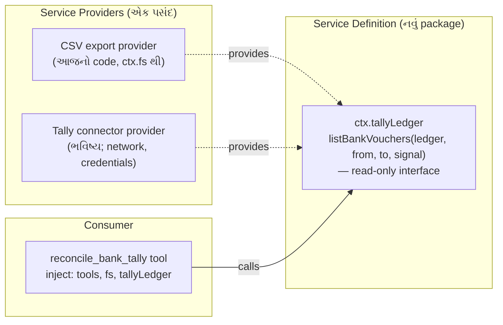

# પ્રકરણ 7 — અંતિમ પ્રોજેક્ટ અને mastery પરીક્ષા

> 🧭 **નવું:** આ પ્રકરણ અઘરું લાગે તો પહેલાં નીચેનો [સરળ સમજ](#saral-samaj) વિભાગ વાંચો (ઉપમા, નવા શબ્દો, યાદ રાખવાની રીતો). આખા પુસ્તકનો નકશો: [સમગ્ર નકશો](overview-samagra-naksho.md).

> **Level 7.** Synthetic bank statement અને sample Tally export પર **read-only reconciliation workflow** બનાવીએ.
> દરેક પરિણામ તેની input rows અને matching rule સુધી trace થાય. Fixtures માં malformed files, duplicate rows અને ambiguous matches છે.
> પછી ભવિષ્યનો read-only Tally connector કેવી રીતે ફિટ થાય તે **extension** તરીકે ડિઝાઇન કરીએ, અને mastery પરીક્ષા આપીએ.

## આ પ્રકરણ પછી તમે શું કરી શકશો

- Money, dates, signs અને references ને deterministic રીતે normalize કરી શકશો — floating point કે local timezone વગર.
- ક્રમબદ્ધ, traceable matching rules ડિઝાઇન કરી, "first-come" greedy matching ની ભૂલ ટાળી શકશો.
- Golden report, invariant test, અને rule-wise unit tests થી workflow સાબિત કરી શકશો.
- Read-only Tally connector ને capability seam (Definition / Provider / Consumer) તરીકે ડિઝાઇન કરી શકશો.
- Code walkthrough, debugging challenge અને design review પૂરાં કરી rubric સામે પોતાનું મૂલ્યાંકન કરી શકશો.

## 7.1 સરળ સમજ: reconciliation એટલે બે ચોપડા સરખાવવા

**Bank reconciliation** એટલે bank statement અને પોતાના ચોપડા (અહીં Tally નું bank ledger) ની entries જોડીને બતાવવું કે કઈ મેળ ખાય છે, કઈ ફક્ત એક બાજુ છે, અને કેમ. ઉદાહરણ: bank charges ₹59 statement માં છે પણ Tally માં હજી નોંધાયા નથી.

**Read-only** એટલે tool ફક્ત વાંચે છે: કોઈ voucher બનાવતો/બદલતો નથી. પરિણામ માનવ reviewer માટે પુરાવા સાથેની યાદી છે, ચોપડામાં ફેરફાર નહીં.

**બે sign convention** (આ આખા પ્રોજેક્ટની સૌથી સામાન્ય ભૂલ):

| Export | Money **in** to bank | Money **out** |
|---|---|---|
| Bank statement | `Credit` | `Debit` |
| Tally bank ledger | `Debit` | `Credit` |

તેથી બંનેને એક જ દૃષ્ટિ — "bank account માં +" — માં ફેરવીએ છીએ ([normalize.ts](../labs/reconcile/src/normalize.ts)): bank માટે `credit − debit`, Tally માટે `debit − credit`, બંને **integer paise** માં.

> **Data notice.** Fixtures ના બધા નામ, reference numbers અને રકમ પુસ્તક માટે બનાવેલાં **synthetic** છે ([fixtures/README.md](../labs/reconcile/fixtures/README.md)). Tally export નો column layout પણ અમે ધારેલો નમૂનો છે; સાચા Tally export સાથે સરખાવ્યો નથી. ⚠️ તેથી column names `Config` માં છે.

## 7.2 Rules — ક્રમ સાથે

[reconcile.ts](../labs/reconcile/src/reconcile.ts) ના header માં લખેલા નિયમો, આ ક્રમમાં ચાલે છે:

| Rule | Status | શરત | કેમ આ ક્રમ |
|---|---|---|---|
| **V1** | `rejected` | CSV problem, ખોટી date (દા.ત. `31-02-2026`), ખોટી રકમ, debit અને credit બંને ભરેલા | ખરાબ input પર matching ન ચલાવો |
| **D1** | `duplicate` | **એક જ file** માં date, amount, reference, text સરખાં | બધી copies review માટે રોકો; એક પસંદ કરવી guess છે |
| **R1** | `matched` | normalized reference + signed amount સરખાં, 1↔1 | સૌથી મજબૂત પુરાવો પહેલાં |
| **R2** | `matched` | signed amount સરખું, તારીખ ±`windowDays`, candidate group બરાબર 1 bank + 1 Tally | reference વગરની entries |
| **A1** | `ambiguous` | R1 કે R2 નો group 1+1 કરતાં મોટો | ક્યારેય guess નહીં |
| **U1** | `unmatched` | બાકી બધું; held duplicate સાથે reference મળે તો નોંધ | |

**Connected components કેમ?** Greedy matching ("પહેલી મળે તે લઈ લો") input ના ક્રમ પર આધાર રાખે છે. અમે bank અને Tally rows ને graph ના nodes બનાવીએ છીએ, rule ની શરત edge છે, અને દરેક connected component ને એક સાથે નક્કી કરીએ છીએ: 1+1 → match; મોટું → ambiguous. પરિણામ input ક્રમથી સ્વતંત્ર છે. Test "two bank rows competing for one Tally row are ambiguous, not first-come" આ સાબિત કરે છે.

## 7.3 Fixtures → rules નકશો

| Input line | શું છે | અપેક્ષિત |
|---|---|---|
| bank L2 ↔ tally L2 | UTR `N0914000123`, ₹15,000 in | R1 matched |
| bank L3 ↔ tally L3 | cheque `004512` vs `4512` (leading zeros), ₹8,250.50 out | R1 matched (normalized ref) |
| bank L4 ↔ tally L4 | ₹4,300 in, ref ફક્ત bank માં, તારીખ 1 દિવસ અલગ | R2 matched |
| bank L5 ↔ tally L5, L6 | ₹12,000 in, Tally માં બે receipts (Desai, Rana) | A1 ambiguous |
| bank L6 | bank charges ₹59 out, ref `-` | U1 unmatched |
| bank L7, L8 | Joshi Pharma ₹6,100 બે વાર, એકસરખું | D1 duplicate |
| tally L7 | Joshi Pharma ₹6,100, ref સરખો | U1 + નોંધ "held bank duplicates (lines 7, 8)" |
| tally L8 | cheque `004513`, ₹2,500 out — હજી clear નથી | U1 unmatched |
| bank L9 | `31-02-2026` | V1 rejected |
| bank L10 | debit અને credit બંને | V1 rejected |
| bank L11 | ફક્ત 3 fields | V1 rejected (`COLUMN_COUNT`) |
| tally L9 | રકમ `12,00x.00` | V1 rejected |

**Golden report** ([expected-report.txt](../labs/reconcile/fixtures/expected-report.txt)) — 🧪 library, tool pipeline, અને real headless turn ત્રણેયમાં byte-identical:

```text
bank rows 10, tally rows 8, window ±3 day(s)
matched 3 (₹11049.50), ambiguous 1, unmatched bank 1, unmatched tally 2, duplicates 1, rejected 4
unexplained difference (unmatched bank - unmatched tally): -₹3659.00
MATCHED [R1] bank L2 ↔ tally L2 ₹15000.00: reference N0914000123 and amount ₹15000.00 agree
MATCHED [R1] bank L3 ↔ tally L3 -₹8250.50: reference 4512 and amount -₹8250.50 agree
MATCHED [R2] bank L4 ↔ tally L4 ₹4300.00: amount ₹4300.00 agrees; dates 1 day(s) apart (window 3)
AMBIGUOUS [A1] bank L5 ↔ tally L5,L6 ₹12000.00: amount ₹12000.00 within 3 day(s) fits 1 bank and 2 Tally rows
UNMATCHED [U1] bank L6 -₹59.00: no tally row with this reference or amount within 3 day(s)
UNMATCHED [U1] tally L7 ₹6100.00: reference N0970000456 also appears in held bank duplicates (lines 7, 8)
UNMATCHED [U1] tally L8 -₹2500.00: no bank row with this reference or amount within 3 day(s)
DUPLICATE [D1] bank L7,L8 ₹6100.00: 2 identical bank rows (date 2026-04-07, ₹6100.00); held for review
REJECTED [V1] bank L9: invalid date "31-02-2026"
REJECTED [V1] tally L9: invalid debit "12,00x.00"
REJECTED [V1] bank L10: both debit and credit are filled
REJECTED [V1] bank L11: COLUMN_COUNT: expected 7 fields, found 3
```

હાથથી ચકાસો: matched = 15,000 − 8,250.50 + 4,300 = **11,049.50**; unexplained = (−59) − (6,100 − 2,500) = **−3,659.00**.

## 7.4 Harness wiring

[plugin.ts](../labs/reconcile/src/plugin.ts) એ પ્રકરણ 4 નો જ નમૂનો છે, ત્રણ ઉમેરા સાથે:

1. **Column names config માં** (`bankColumns`, `tallyColumns`) — બીજી bank નું export? Overlay માં names બદલો, code નહીં. ખોટું નામ હોય તો fail loud: matching શરૂ થાય તે પહેલાં `assertColumns` દરેક configured column header માં છે કે નહીં તે તપાસે છે. નહીં તો ખૂટતો `Debit` column ચૂપચાપ શૂન્ય ગણાય — ₹900 નું withdrawal ગાયબ થઈ entry ખોટી રીતે R1 match થાય.
2. **`windowDays`** — config default 3, અને model દરેક call માં `window_days` (integer) આપી શકે. Negative value schema-level validation માં error બને છે (test).
3. **Canonical JSON report** — દરેક `ResultRow` માં `status`, `rule`, `bankLines`, `tallyLines`, `amount`, `reason`. UI કે બીજો tool line-level trace આ JSON માંથી બનાવી શકે.

## Source map: આ ક્રમમાં ખોલો

| ક્રમ | File | Symbol | કેમ |
|---|---|---|---|
| 1 | `labs/reconcile/src/normalize.ts` | `parseDate`, `parseAmount`, `normalizeRef`, `normalizeBank`/`normalizeTally` | ડેટા એક જ ભાષામાં |
| 2 | `labs/reconcile/src/reconcile.ts` | `splitDuplicates`, `components`, `reconcileTables` | rules |
| 3 | `labs/reconcile/src/plugin.ts` | `Config`, `apply` | harness wiring |
| 4 | `labs/csv-inspect/src/csv.ts` | `parseCsv` | પ્રકરણ 4 નો parser ફરી વાપર્યો |
| 5 | `packages/core/tools/src/schema.ts` | [`defineTool` validation][schema-defineTool-validate] | `window_days` schema |
| 6 | `packages/fs/fs/src/index.ts` | [`FileSystem`][fs-abstract] | read-only seam |

## Lab 7 — આખો workflow

```bash
node --import tsx --test reconcile/test/*.test.ts
```

🧪 `tests 12, pass 12` (rule-wise tests + golden + "every input row appears in exactly one result" invariant + determinism + missing-column અને invalid-header tests + 3 integration tests).

Real headless turn:

```bash
O=$(bash tmp/book-labs/reconcile/make-overlay.sh)
```

```bash
TOOL_NAME=reconcile_bank_tally TOOL_ARGS='{"bank_path":"tmp/book-labs/reconcile/fixtures/bank-statement.csv","tally_path":"tmp/book-labs/reconcile/fixtures/tally-bank-ledger.csv"}' EXTRA_PATCH=$O TASK='bank statement અને Tally export reconcile કરો.' bash tmp/book-labs/request-trace/run-mock.sh
```

🧪 exit 0; trace: `tools/result reconcile_bank_tally isError=false chars=1210`; `turn/end completed` ([evidence/rec.err](../evidence/rec.err)).

## 7.5 Extension: ભવિષ્યનો read-only Tally connector

> **આ વિભાગ extension design છે — અમલમાં મૂક્યો નથી, ચલાવ્યો નથી.** ⚠️ Tally ની કોઈ API વિગત અહીં ચકાસેલી નથી.

હાલમાં tool CSV files વાંચે છે. Connector આવે ત્યારે આખો tool ફરી લખવો ન પડે તે માટે, architecture doc નો **capability seam** નમૂનો ([architecture.md — Capability seams](https://github.com/deepseek-ai/deepseek-harness/blob/fcc0ad462172522aaf5c93a7b2e01f6b9f0b0159/docs/architecture.md#capability-seams)) વાપરીએ:



ડિઝાઇન નિયમો (દરેક નિયમ પાછળ upstream સ્રોત):

1. **Interface માં write method જ નહીં.** Read-only ની ખાતરી type level પર; reviewer ને ફક્ત interface જોવાનું રહે.
2. **Provider swap = config.** બંને provider એક જ service નામ (`tallyLedger`) provide કરે; overlay એક row disable કરી બીજી insert કરે. એક સાથે બે register થાય તો Cordis સ્પષ્ટ error આપે છે ([`provide`][cordis-provide]). ✅
3. **Normalization consumer માં જ રહે.** Provider raw vouchers આપે; signs/paise/dates `normalize.ts` જ નક્કી કરે, જેથી CSV અને connector એક જ નિયમથી સરખાવાય.
4. **Network અને credentials.** Connector ને network જોઈએ; deployment એ approval/sandbox policy અને credentials service વિચારવા પડશે. Model-visible input log થવું જોઈએ ("Model-visible ⟺ logged", [AGENTS.md][agents-conventions]) — tool result આપોઆપ `tool/result` તરીકે log થાય છે.
5. **Fail loud.** Connector unreachable હોય તો ખાલી યાદી નહીં, structured error — નહીં તો "બધું unmatched" એવો ખોટો report બને.

## 7.6 Code walkthrough (જવાબ સાથે મોટેથી વાંચો)

1. `parseAmount('1,23,456.50')` floating point વગર `12345650` કેવી રીતે આપે છે?
2. `fingerprint` માં text કેમ uppercase થાય છે, અને balance column કેમ સામેલ નથી? (સંકેત: duplicate rows નું balance જુદું હોય.)
3. `components` એક જ graph function બંને R1 અને R2 માટે કેવી રીતે વપરાય છે?
4. `firstLine` sort key માં bank lines ને `2n` અને Tally ને `2n+1` કેમ બનાવ્યા?
5. `totals.bankRows` માં `COLUMN_COUNT` problems કેમ ઉમેર્યા?

જવાબો: [પરિશિષ્ટ D — પ્રકરણ 7](../appendix/D-lab-solutions.md#ch7).

## 7.7 Debugging challenge

એક reviewer ને production માં આ મળ્યું: "₹100 નો refund **આપ્યો** (Tally payment) અને એ જ દિવસે ₹100 **મળ્યા** (bank receipt) — report કહે છે R2 matched." તમારું કામ:

1. Planted bug લગાવો (patch ખોલ્યા વગર):

```bash
cd tmp/book-labs && patch -p1 < reconcile/challenge/planted-bug.patch
```

2. Test suite ચલાવો:

```bash
node --import tsx --test reconcile/test/*.test.ts
```

🧪 **બધા 12 tests pass થાય છે.** એ જ challenge છે: test suite માં ખાડો છે.
3. Reviewer ના વર્ણન પરથી નિષ્ફળ થતો test લખો, bug શોધો, fix કરો, અને સાબિત કરો કે તમારો test fix વગર fail અને fix સાથે pass થાય છે.

અમારો solution test: [challenge/sign.test.ts](../labs/reconcile/challenge/sign.test.ts) (🧪 bug સાથે `fail 1`: `actual: ['matched']`, fix સાથે `pass 1`). સમજૂતી: [પરિશિષ્ટ D — challenge](../appendix/D-lab-solutions.md#challenge).

## 7.8 Design review

આ પ્રોજેક્ટ પર reviewer તરીકે નીચેના પ્રશ્નો લખીને જવાબ આપો. સારા જવાબ source કે test ટાંકે છે.

| # | પ્રશ્ન | શું તપાસવું |
|---|---|---|
| 1 | Duplicates ની બધી copies રોકવી યોગ્ય છે? એક જ દિવસે સાચે જ બે સરખી payments થાય તો? | Business rule vs safety; reviewer override કેવી રીતે? |
| 2 | `windowDays` નો default 3 કોણે નક્કી કર્યો? | Config માં છે — "No hardcoded tunables" ✅ |
| 3 | R1 પછી R2 નો ક્રમ ઉલટાવો તો કયા fixtures નું પરિણામ બદલાય? | bank L2/L3 |
| 4 | 5 MB `maxBytes` મર્યાદા પૂરતી છે? મોટી file stream થવી જોઈએ? | upstream `read` નું `streamMinSize` નમૂનો |
| 5 | Report model ને જાય છે — તેમાં party names છે. Data boundary? | પ્રકરણ 5 નું `dsh_session_log` |
| 6 | Tool read-only છે તેની ખાતરી કોણ આપે? | ફક્ત `ctx.fs.stat/readText`; write API વપરાતી નથી |

## 7.9 Mastery પરીક્ષા

પરીક્ષાના ચાર ભાગ છે; દરેકનો અપેક્ષિત પુરાવો [પરિશિષ્ટ E — mastery rubric](../appendix/E-mastery-rubric.md) માં છે.

1. **Code walkthrough** (7.6) — ખુલ્લા source સાથે, 15 મિનિટ.
2. **Debugging challenge** (7.7) — failing test + fix + fail/pass પુરાવો.
3. **Design review** (7.8) — ઓછામાં ઓછા 4 પ્રશ્નોના લેખિત જવાબ, દરેકમાં source/test link.
4. **Architecture trace** — કોઈ મદદ વગર, `reconcile_bank_tally` call માટે પ્રકરણ 1 જેવો sequence diagram બનાવો: overlay row → Loader → `ctx.tools.register` → model tool call → pipeline → `ctx.fs` → `tool/result` → step 2.

## આગાહી કસોટી

Fixture માં કંઈ બદલ્યા વગર `window_days: 0` સાથે tool ચલાવો. **ચલાવતા પહેલાં લખો:** matched, ambiguous, unmatched bank, unmatched tally ની સંખ્યા. જવાબ: [પરિશિષ્ટ D — Lab 7](../appendix/D-lab-solutions.md#lab-7).

## નિષ્ફળતા: "tool કહે છે column ખૂટે છે"

**લક્ષણ.** બીજી bank નું export આપ્યું; tool result `Error: bank export is missing configured column(s) date="Txn Date"…; header is (…)`.

**ટૂંકો નિદાન માર્ગ.** Message માં છપાયેલું header export નું સાચું header છે. Overlay માં `bankColumns` (અથવા `tallyColumns`) ને તે names સાથે મેળવો. Integration test "column names come from config, so a renamed export fails loudly until configured" બરાબર આ લક્ષણ ઉત્પન્ન કરે છે. Header માં જ પુનરાવર્તિત નામ હોય તો error નહીં, પણ દરેક row `V1 INVALID_HEADER` તરીકે નકારાય છે.

## Mastery check

1. Bank અને Tally ના signs કેમ ઊંધા છે, અને code તેમને ક્યાં એક કરે છે?
2. Greedy matching ની કઈ ખામી connected components ટાળે છે? Test નું નામ આપો.
3. Rejected rows ને અલગ result તરીકે રાખવાનો ફાયદો શું — ચૂપચાપ skip કરવાને બદલે?
4. Tally connector ના interface માં write method ન હોવાનો શું ફાયદો?
5. Planted bug એ 10 tests માંથી કોઈને fail કેમ ન કર્યો?

જવાબો: [પરિશિષ્ટ D — પ્રકરણ 7](../appendix/D-lab-solutions.md#ch7).

<a id="saral-samaj"></a>

## સરળ સમજ — પ્રકરણ 7 સાદી ગુજરાતીમાં

> આ વિભાગ નવો ઉમેરેલો છે; ઉપરનું પ્રકરણ જેમ હતું તેમ જ છે. આખો નકશો: [સમગ્ર નકશો](overview-samagra-naksho.md).

### એક વાક્યમાં

**પ્રકરણ 7 = દિવસના અંતે ગલ્લાનો હિસાબ: bank statement અને Tally નો ચોપડો બાજુ-બાજુ મૂકી, દરેક entry ને નિયમ પ્રમાણે જોડો, શંકાવાળી entries ને "review" માટે રોકો, અને દરેક પરિણામ પાછળ કઈ લીટી અને કયો નિયમ છે તે લખો — ક્યારેય ચોપડો બદલ્યા વગર.**

### ભોજનાલયની ઉપમામાં

સાંજે મુનીમજી બે ચોપડા ખોલે છે: bank ની પાસબુક અને પોતાનો Tally ચોપડો.

1. **ફાટેલાં પાનાં અલગ** (V1 rejected): ખોટી તારીખ (`31-02-2026`), ખોટી રકમ (`12,00x.00`), debit અને credit બંને ભરેલાં, અધૂરી લીટી.
2. **બે વાર છપાયેલી entry અલગ** (D1 duplicate): Joshi Pharma ₹6,100 બે વાર — કઈ સાચી તે અનુમાન નહીં, બંને review માટે.
3. **ચેક/UTR નંબર અને રકમ બંને મળે → જોડો** (R1).
4. **નંબર નથી, પણ રકમ સરખી અને તારીખ 3 દિવસની અંદર, અને ફક્ત એક જ ઉમેદવાર → જોડો** (R2).
5. **એક bank entry સામે બે સરખી Tally entries → અનુમાન નહીં** (A1 ambiguous).
6. **બાકી બધું → જોડ વગરનું** (U1 unmatched), કારણ સાથે.

**ઉપમા ક્યાં તૂટે છે:** સાચા મુનીમજી ફોન કરીને પૂછી લે. આ tool **ફક્ત વાંચે અને અહેવાલ આપે**; કોઈ voucher બનાવતો કે બદલતો નથી. અંતિમ નિર્ણય માનવ reviewer નો.

### વિષય-વાર ઊંડી સમજ

#### (1) સૌથી મોટી જાળ: બે sign convention

| Export | પૈસા **આવ્યા** | પૈસા **ગયા** |
|---|---|---|
| Bank statement | Credit | Debit |
| Tally bank ledger | Debit | Credit |

બંને "દર્પણ" જેવાં ઊંધાં છે, કારણ કે bank પોતાની નજરથી લખે છે અને તમારો ચોપડો તમારી નજરથી. Code બંનેને એક જ ભાષામાં ફેરવે છે: **"bank account માં +"**. Bank: `credit − debit`; Tally: `debit − credit`.

**યાદ-ચાવી:** "**બૅન્કનું ક્રેડિટ = તમારું ડેબિટ — અરીસામાં જુઓ.**"

#### (2) ત્રણ normalization — "રૂ-તા-ન"

- **રૂપિયા → paise integer:** `"1,23,456.50"` → `12345650`. Floating point નહીં, કારણ કે `0.1 + 0.2` computer માં બરાબર `0.3` નથી.
- **તારીખ → ISO `YYYY-MM-DD`:** `1-Apr-2026`, `01/04/2026` બધું `2026-04-01`. `31-02-2026` જેવી અશક્ય તારીખ નકારાય.
- **Reference normalize:** uppercase, ફક્ત અક્ષર-અંક, આંકડાવાળા ref ના આગળના શૂન્ય દૂર (`004512` = `4512`), `-` = ખાલી.

**યાદ-ચાવી "રૂતાન" — "રૂપિયા, તારીખ, નંબર".**

#### (3) નિયમોનો ક્રમ — "વ-દ-ર-ર-અ-અ" (V1, D1, R1, R2, A1, U1)

**ક્રમ કેમ?** પહેલાં ખરાબ input બહાર (V1), પછી duplicates (D1), પછી સૌથી મજબૂત પુરાવો (R1: reference + amount), પછી નબળો (R2: amount + તારીખ), પછી શંકા (A1), અને અંતે બાકી (U1).

**યાદ-ચાવી:** "**વધેલું દૂધ રાખો, રોજ અડધું અલગ**" — **વ**(V1) **દ**(D1) **ર**(R1) **ર**(R2) **અ**(A1) **અ**લગ(U1).

#### (4) Connected components — "પહેલો આવે તે લઈ જાય" કેમ ખોટું

**Greedy matching** = પહેલો મળે તે જોડી દો. પરિણામ input ના ક્રમ પર આધાર રાખે: file ની lines ઊંચી-નીચી કરો તો જવાબ બદલાય. **Connected component** = graph માં એકબીજા સાથે જોડાયેલું જૂથ. Tool દરેક જૂથ એક સાથે તપાસે: 1 bank + 1 Tally → match; મોટું → ambiguous. પરિણામ ક્રમથી સ્વતંત્ર.

**ઉદાહરણ:** bank L5 (₹12,000, 5 Apr) સામે Tally L5 (5 Apr) અને L6 (6 Apr) — બંને 3 દિવસમાં → 1+2 નું જૂથ → **A1**. `window_days: 0` હોય તો ફક્ત L5 જોડાય → R2 match. **શીખ:** window એ business નિર્ણય છે, "વધુ સાચું" નહીં.

#### (5) Golden report અને ત્રણ ખાતરીઓ

- **Golden file** (`expected-report.txt`) = અપેક્ષિત output ની સ્થિર નકલ; library, tool pipeline, અને real headless turn ત્રણેયમાં byte-identical.
- **Invariant:** "દરેક input row બરાબર એક result માં."
- **હાથથી હિસાબ:** matched = 15,000 − 8,250.50 + 4,300 = ₹11,049.50; unexplained = (−59) − (6,100 − 2,500) = −₹3,659.00.

#### (6) Config માં column names — અને ગેરહાજર column

બીજી bank નું export? Overlay માં `bankColumns` બદલો, code નહીં. Configured column header માં **ન** હોય તો matching શરૂ થાય તે પહેલાં **`ReconcileConfigError`**: "bank export is missing configured column(s) … header is (…)". કેમ? નહીં તો ગેરહાજર `Debit` column ને શૂન્ય ગણી ₹900 નું withdrawal ગાયબ થાય અને entry ખોટી રીતે R1 match થાય — review માં પકડાયેલી ખરી ભૂલ.

#### (7) Tally connector — extension design (અમલમાં નથી)

ભવિષ્યમાં CSV ને બદલે સીધો Tally થી data: **capability seam** તરીકે.

- **Definition:** `ctx.tallyLedger.listBankVouchers(...)` — **ફક્ત વાંચવાની** methods.
- **Providers:** આજનો CSV provider, ભવિષ્યનો Tally connector.
- **Consumer:** `reconcile_bank_tally` tool.

પાંચ નિયમ: interface માં write method જ નહીં; provider swap = config; normalization consumer માં; network/credentials નો વિચાર; connector unreachable તો ખાલી યાદી નહીં, સ્પષ્ટ error.

**યાદ-ચાવી:** "**ચાવી ફક્ત વાંચવાની આપો, લખવાની નહીં.**"

#### (8) Debugging challenge નો મર્મ

Planted bug: R2 માં `Math.abs(...)` — એટલે ₹100 **આવ્યા** અને ₹100 **ગયા** પણ match થાય. આખો 12 tests નો suite pass થાય છે! કેમ? કોઈ fixture માં એ જ રકમ, ઊંધી દિશા, window ની અંદર એવી જોડ નહોતી. **શીખ:** tests ફક્ત fixtures પરથી નહીં, **દરેક નિયમની દરેક શરત** (amount, sign, window, uniqueness) પરથી લખો.

### નવા ટેકનિકલ શબ્દો — સરળ ગુજરાતીમાં

| શબ્દ | સરળ અર્થ | ઉદાહરણ | યાદ-ચાવી |
|---|---|---|---|
| Bank reconciliation | bank અને ચોપડાની entries જોડવી | `reconcile_bank_tally` | "ગલ્લાનો હિસાબ" |
| Ledger / Tally | હિસાબી ચોપડો / હિસાબી software | Tally bank ledger | "મુનીમનો ચોપડો" |
| Debit / Credit | હિસાબની બે બાજુ | bank credit = આવક | "અરીસામાં ઊંધું" |
| Voucher | એક હિસાબી entry નો દસ્તાવેજ | `R-101` | "પહોંચ" |
| UTR / cheque number | વ્યવહારનો ઓળખ નંબર | `N0914000123` | "રસીદ નંબર" |
| Paise integer | રકમ પૈસામાં, દશાંશ વગર | `1500000` = ₹15,000 | "દશાંશ નહીં, ભૂલ નહીં" |
| ISO date | `YYYY-MM-DD` તારીખ | `2026-04-01` | "વર્ષ પહેલું" |
| Normalization | જુદાં રૂપને એક સરખા રૂપમાં લાવવું | `004512` → `4512` | "એક ભાષા" |
| Greedy matching | પહેલો મળે તે જોડો | — | "પહેલો આવે તે લઈ જાય" |
| Connected component | એકબીજા સાથે જોડાયેલું જૂથ | ambiguous group | "દોરાથી બંધાયેલા મણકા" |
| Window (days) | તારીખનો સ્વીકાર્ય તફાવત | ±3 દિવસ | "છૂટની અવધિ" |
| Golden file | અપેક્ષિત output ની નકલ | `expected-report.txt` | "આદર્શ જવાબપત્ર" |
| Traceability | પરિણામથી input line અને નિયમ સુધી પહોંચાય | `bank L5 ↔ tally L5,L6 [A1]` | "પગેરું" |
| Read-only | ફક્ત વાંચે, ક્યારેય બદલે નહીં | `ctx.fs.readText` | "જોવાની ચાવી" |
| Property-based test | ઘણા random inputs પર નિયમ ચકાસતો test | `fast-check` | "હજાર સવાલ એક નિયમ" |
| Synthetic data | ખોટાં પણ વાસ્તવિક દેખાતાં નમૂના data | Shah Traders | "રમકડાના રૂપિયા" |

### યાદ રાખવાની રીતો

- **"બૅન્કનું ક્રેડિટ = તમારું ડેબિટ — અરીસામાં જુઓ"** — sign convention.
- **"રૂતાન"** — રૂપિયા, તારીખ, નંબર normalization.
- **"વધેલું દૂધ રાખો, રોજ અડધું અલગ"** — V1, D1, R1, R2, A1, U1 નો ક્રમ.
- **"મણકા દોરાથી"** — connected components; એક દોરામાં બે મણકા = match, વધુ = ambiguous.
- **"ચાવી ફક્ત વાંચવાની"** — Tally connector નો read-only interface.
- **ચિત્ર:** fixture-નકશાની table (7.3) ને "બાર ખાનાંની રમત" તરીકે યાદ રાખો — દરેક ખાનું એક નિયમ ચલાવે છે.

### સામાન્ય ગેરસમજો

| ગેરસમજ | સાચું |
|---|---|
| "Duplicate માંથી એક રાખો." | બધી copies review માટે; એક પસંદ કરવી guess છે. |
| "Window મોટી = વધુ matches = સારું." | વધુ ambiguity પણ; window business નિર્ણય છે. |
| "ખરાબ rows ચૂપચાપ skip કરો." | Rejected result તરીકે રાખો; નહીં તો "બધું મેળ ખાય છે" નો ખોટો દેખાવ. |
| "બધા tests pass = bug નથી." | Challenge નો bug 12 tests માંથી પસાર થાય છે. |
| "Tool Tally માં સુધારો કરે." | ફક્ત read-only report. |

### પુનરાવર્તન કાર્ડ

<details><summary>1. Bank અને Tally ના signs કેમ ઊંધા?</summary>

Bank પોતાની નજરથી લખે (credit = આવક); Tally bank ledger તમારી નજરથી (debit = આવક). Code બંનેને "bank માં +" માં ફેરવે.
</details>

<details><summary>2. નિયમોનો ક્રમ?</summary>

V1 rejected → D1 duplicate → R1 ref+amount → R2 amount+window → A1 ambiguous → U1 unmatched.
</details>

<details><summary>3. `window_days: 0` પર શું બદલાય?</summary>

Desai/Rana ambiguous ને બદલે bank L5 ↔ tally L5 R2 match; Mehta (1 દિવસ અલગ) બે unmatched બને.
</details>

<details><summary>4. Configured `Debit` column ગેરહાજર હોય તો?</summary>

`ReconcileConfigError`, missing fields અને મળેલું header સાથે — matching શરૂ થાય તે પહેલાં.
</details>

<details><summary>5. Planted bug tests માંથી કેમ પસાર થયો?</summary>

કોઈ fixture/test માં એ જ રકમ, ઊંધી દિશા, window ની અંદર એવી જોડ નહોતી.
</details>

### મિત્રને સમજાવો (5 મિનિટ) — અંતિમ કસોટી

એક વેપારી મિત્રને, જે Tally વાપરે છે પણ programming નથી જાણતો, સમજાવો: (1) bank અને Tally ના debit/credit કેમ ઊંધા, (2) duplicate entry કેમ "review" માં રાખવી, (3) એક bank entry સામે બે સરખી Tally entries હોય ત્યારે tool કેમ અનુમાન નથી કરતો. ત્રણેય સમજાવી શકો તો આખા પુસ્તકનો મુખ્ય વિચાર — **"દરેક પરિણામ પાછળ પુરાવો"** — તમારો થઈ ગયો.

### આખા પુસ્તક સાથે જોડાણ

આ પ્રકરણ "ચાલુ-ચાલ-જોડ-અંદર-ઉમેર-તૂટ-બદલ-બનાવ" નું છેલ્લું પગથિયું છે. તેમાં પ્રકરણ 4 નો CSV parser, પ્રકરણ 3 નો `ctx.fs` નમૂનો, પ્રકરણ 5 નો read-only/fail-loud વિચાર, અને પ્રકરણ 6 નો "fix ને સાબિત કરો" નિયમ એક સાથે વપરાય છે. હવે [પરિશિષ્ટ E — mastery rubric](../appendix/E-mastery-rubric.md) સામે પોતાનું મૂલ્યાંકન કરો, અને [સમગ્ર નકશો](overview-samagra-naksho.md) ફરી એક વાર મોઢે બોલો.

---

પાછળ: [પ્રકરણ 6](06-maintainer-architecture.md) · [વિષયસૂચિ](../README.md)

<!-- citations:begin (generated by tools/refdefs.py) -->
[agents-conventions]: https://github.com/deepseek-ai/deepseek-harness/blob/fcc0ad462172522aaf5c93a7b2e01f6b9f0b0159/AGENTS.md#L130-L142
[cordis-provide]: https://github.com/deepseek-ai/deepseek-harness/blob/fcc0ad462172522aaf5c93a7b2e01f6b9f0b0159/vendor/cordis/src/reflect.ts#L291-L311
[fs-abstract]: https://github.com/deepseek-ai/deepseek-harness/blob/fcc0ad462172522aaf5c93a7b2e01f6b9f0b0159/packages/fs/fs/src/index.ts#L103
<!-- citations:end -->
