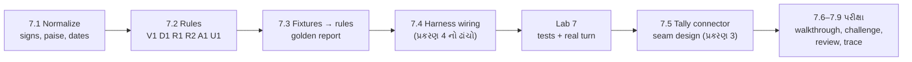
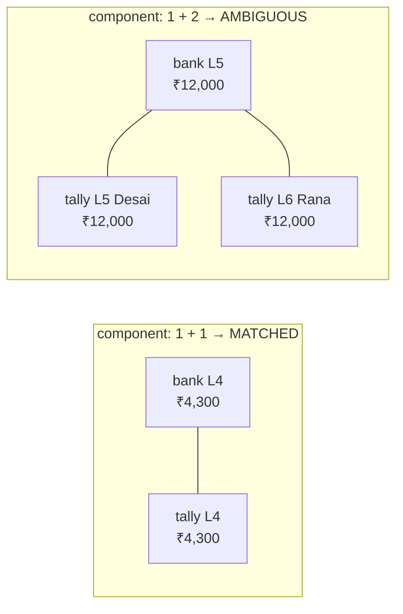
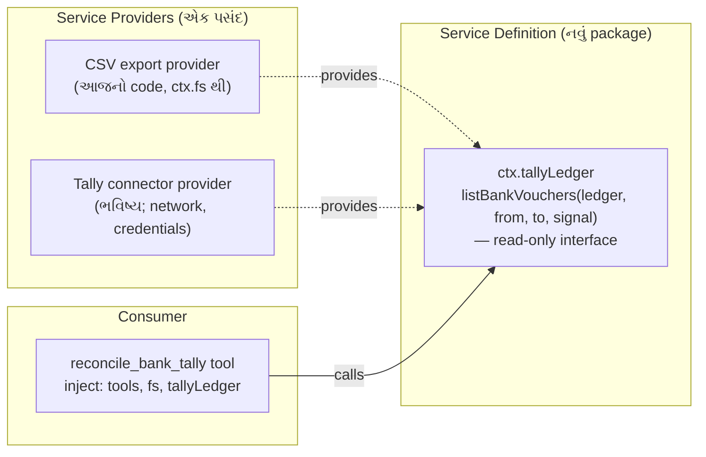

# પ્રકરણ 7 — અંતિમ પ્રોજેક્ટ અને mastery પરીક્ષા

> **Level 7 · 🟡 પ્રોજેક્ટ, 🔴 debugging challenge અને design review.** વાર્તાનો દિવસ 14–15.
> Synthetic bank statement અને sample Tally export પર **read-only reconciliation workflow** બનાવીએ.
> દરેક પરિણામ તેની input rows અને matching rule સુધી trace થાય. Fixtures માં malformed files, duplicate rows અને ambiguous matches છે.
> પછી ભવિષ્યનો read-only Tally connector કેવી રીતે ફિટ થાય તે **extension** તરીકે ડિઝાઇન કરીએ, અને mastery પરીક્ષા આપીએ. આખો નકશો: [સમગ્ર નકશો](overview-samagra-naksho.md).

## 🎬 વાર્તા: મુનીમજીના બે ચોપડા

મહિનાનો છેલ્લો દિવસ. ગલ્લા પાછળ **મુનીમજી** ચશ્મા ચડાવી બે કાગળ પાસે-પાસે મૂકે છે:

- **Bank statement** — bank કહે છે ખાતામાં શું આવ્યું, શું ગયું.
- **Tally નો bank ledger** — ભોજનાલયના ચોપડામાં શું નોંધાયું.

"આરવ બેટા, આ બંને મળવા જોઈએ. પણ દર મહિને કંઈક ગૂંચ: bank ₹59 ના charges કાપે અને આપણે હજી નોંધ્યા ન હોય. Cheque નંબર bank `004512` લખે, આપણે `4512`. આપણા ચોપડામાં Desai (5 તારીખ) અને Rana (6 તારીખ) — બંનેના ₹12,000 જમા, અને bank માં 5 તારીખે ફક્ત એક જ ₹12,000. કોનો? અને ઉપરથી, **bank નું 'credit' એ આપણું 'debit'!**"

આરવ બધું નોટબુકમાં લખે છે. મીરાદીદી ત્રણ શરત યાદ કરાવે છે:

1. "Tool **ફક્ત વાંચશે** — કોઈ voucher બનાવશે કે બદલશે નહીં. અંતિમ નિર્ણય મુનીમજીનો."
2. "દરેક પરિણામ સાથે **કારણ અને line number** — મુનીમજી આંગળી મૂકી ચકાસી શકે."
3. "શંકા હોય ત્યાં **'શંકા'** — Desai કે Rana, guess નહીં."

"અને પછી," દીદી હસે છે, "તારી પરીક્ષા. હું એક ભૂલ છુપાવીશ જે તારા **બધા** tests પાસ કરશે."

## 🎯 આ પ્રકરણ પછી તમે શું કરી શકશો

- Money, dates, signs અને references ને deterministic રીતે normalize કરી શકશો — floating point કે local timezone વગર.
- ક્રમબદ્ધ, traceable matching rules ડિઝાઇન કરી, "first-come" greedy matching ની ભૂલ ટાળી શકશો.
- Golden report, invariant test, અને rule-wise unit tests થી workflow સાબિત કરી શકશો.
- Read-only Tally connector ને capability seam (Definition / Provider / Consumer) તરીકે ડિઝાઇન કરી શકશો.
- Code walkthrough, debugging challenge અને design review પૂરાં કરી rubric સામે પોતાનું મૂલ્યાંકન કરી શકશો.

## 🗺️ આ પ્રકરણનો નકશો — આખું પુસ્તક એક પ્રોજેક્ટમાં



| આ પ્રકરણમાં | ક્યાંથી આવ્યું |
|---|---|
| `parseCsv` | પ્રકરણ 4 |
| `defineTool` + `Config` + overlay + fail loud | પ્રકરણ 4 |
| `ctx.fs` થી read-only | પ્રકરણ 3, 5 |
| capability seam | પ્રકરણ 3 |
| mock runner + trace | પ્રકરણ 1 |
| "ફરી-સુધાર-ફરી-ઉલટ" | પ્રકરણ 5, 6 |

## 7.1 🟢 Reconciliation એટલે બે ચોપડા સરખાવવા

> 📦 **Bank reconciliation** — bank statement અને પોતાના ચોપડા (અહીં Tally નું bank ledger) ની entries જોડીને બતાવવું કે કઈ મેળ ખાય છે, કઈ ફક્ત એક બાજુ છે, અને કેમ. ઉદાહરણ: bank charges ₹59 statement માં છે પણ Tally માં હજી નોંધાયા નથી.
>
> 📦 **Tally** — ભારતમાં વ્યાપક વપરાતું accounting software. 📦 **Ledger** — એક ખાતાનો ચોપડો. 📦 **Voucher** — Tally માં એક વ્યવહારની નોંધ.
>
> 📦 **Read-only** — tool ફક્ત વાંચે છે: કોઈ voucher બનાવતો/બદલતો નથી. પરિણામ માનવ reviewer માટે પુરાવા સાથેની યાદી છે, ચોપડામાં ફેરફાર નહીં.

**બે sign convention** (આ આખા પ્રોજેક્ટની સૌથી સામાન્ય ભૂલ):

| Export | Money **in** to bank | Money **out** |
|---|---|---|
| Bank statement | `Credit` | `Debit` |
| Tally bank ledger | `Debit` | `Credit` |

કેમ ઊંધું? Bank **પોતાના** ચોપડાની દૃષ્ટિએ લખે છે — તમારા પૈસા bank માટે "દેવું" છે, તેથી જમા = credit. તમારા ચોપડામાં bank ખાતું તમારી "મિલકત" છે, તેથી જમા = debit. 🍽️ **યાદ-ચાવી: "બૅન્કનું ક્રેડિટ = તમારું ડેબિટ — અરીસામાં જુઓ."**

તેથી બંનેને એક જ દૃષ્ટિ — "bank account માં +" — માં ફેરવીએ છીએ ([normalize.ts](../labs/reconcile/src/normalize.ts)): bank માટે `credit − debit`, Tally માટે `debit − credit`, બંને **integer paise** માં.

> 📦 **Normalize** — જુદી જુદી રીતે લખેલી માહિતીને એક જ ધોરણમાં ફેરવવી. ત્રણ વસ્તુ — **યાદ-ચાવી "રૂતાન" — રૂપિયા, તારીખ, નંબર:**
>
> - **રૂ**પિયા → integer **paise**: `1,23,456.50` → `12345650`. **કેમ?** Computer માં `0.1 + 0.2` એ બરાબર `0.3` નથી આવતું (**floating point** ભૂલ); પૈસામાં એક પૈસાની ભૂલ પણ ન ચાલે. પૂર્ણાંક પૈસામાં આ સમસ્યા નથી.
> - **તા**રીખ → એક જ format, local **timezone** વગર — નહીં તો રાત્રે 11:30 ની entry બીજા દેશના સમય મુજબ બીજા દિવસે ગણાય.
> - **ન**ંબર (reference) → leading zeros કાઢી: `004512` → `4512`.

> **Data notice.** Fixtures ના બધા નામ, reference numbers અને રકમ પુસ્તક માટે બનાવેલાં **synthetic** છે ([fixtures/README.md](../labs/reconcile/fixtures/README.md)). Tally export નો column layout પણ અમે ધારેલો નમૂનો છે; સાચા Tally export સાથે સરખાવ્યો નથી. ⚠️ તેથી column names `Config` માં છે.
>
> 📦 **Synthetic data** — પુસ્તક માટે જાતે બનાવેલો, ખરો નહીં તેવો data. 📦 **Fixture** — tests માટે તૈયાર રાખેલી input files.

## 7.2 🟡 Rules — ક્રમ સાથે

[reconcile.ts](../labs/reconcile/src/reconcile.ts) ના header માં લખેલા નિયમો, આ ક્રમમાં ચાલે છે:

| Rule | Status | શરત | કેમ આ ક્રમ | મુનીમજીની ભાષામાં |
|---|---|---|---|---|
| **V1** | `rejected` | CSV problem, ખોટી date (દા.ત. `31-02-2026`), ખોટી રકમ, debit અને credit બંને ભરેલા | ખરાબ input પર matching ન ચલાવો | "આ line જ ખોટી છે" |
| **D1** | `duplicate` | **એક જ file** માં date, amount, reference, text સરખાં | બધી copies review માટે રોકો; એક પસંદ કરવી guess છે | "બે વાર છપાયું?" |
| **R1** | `matched` | normalized reference + signed amount સરખાં, 1↔1 | સૌથી મજબૂત પુરાવો પહેલાં | "નંબર અને રકમ બંને મળે" |
| **R2** | `matched` | signed amount સરખું, તારીખ ±`windowDays`, candidate group બરાબર 1 bank + 1 Tally | reference વગરની entries | "નંબર નથી, પણ રકમ અને આસપાસની તારીખ મળે — અને બીજો કોઈ ઉમેદવાર નથી" |
| **A1** | `ambiguous` | R1 કે R2 નો group 1+1 કરતાં મોટો | ક્યારેય guess નહીં | "Desai કે Rana? તમે જુઓ" |
| **U1** | `unmatched` | બાકી બધું; held duplicate સાથે reference મળે તો નોંધ | | "સામે કંઈ નથી" |

**યાદ-ચાવી "વધેલું દૂધ રાખો, રોજ અડધું અલગ":** **વ**(V1) **દ**(D1) **ર**(R1) **ર**(R2) **અ**(A1) **અ**લગ(U1).

> 📦 **Window (±windowDays)** — તારીખમાં કેટલા દિવસનો ફરક ચલાવી લેવો. 🍽️ cheque આજે આપ્યો, bank માં બે દિવસ પછી જમા — ±3 દિવસ ચાલે.

### 🔴 Connected components કેમ? — "મણકા દોરાથી"

> 📦 **Greedy matching** — "પહેલી મળે તે લઈ લો". 📦 **Graph** — બિંદુઓ (nodes) અને તેમને જોડતી રેખાઓ (edges). 📦 **Connected component** — એકબીજા સાથે (સીધી કે આડકતરી) જોડાયેલાં બિંદુઓનો સમૂહ.

Greedy matching ("પહેલી મળે તે લઈ લો") input ના ક્રમ પર આધાર રાખે છે. અમે bank અને Tally rows ને graph ના nodes બનાવીએ છીએ, rule ની શરત edge છે, અને દરેક connected component ને એક સાથે નક્કી કરીએ છીએ: 1+1 → match; મોટું → ambiguous. પરિણામ input ક્રમથી સ્વતંત્ર છે. Test "two bank rows competing for one Tally row are ambiguous, not first-come" આ સાબિત કરે છે.



🍽️ **"મણકા દોરાથી":** દરેક entry એક મણકો; શરત મળે ત્યાં દોરો. એક દોરામાં બરાબર બે મણકા (એક bank, એક Tally) = match; વધુ મણકા = ambiguous. ક્રમમાં ગમે તે પહેલાં આવે — દોરા એ જ રહે.

## 7.3 🟡 Fixtures → rules નકશો

| Input line | શું છે | અપેક્ષિત |
|---|---|---|
| bank L2 ↔ tally L2 | UTR `N0914000123`, ₹15,000 in | R1 matched |
| bank L3 ↔ tally L3 | cheque `004512` vs `4512` (leading zeros), ₹8,250.50 out | R1 matched (normalized ref) |
| bank L4 ↔ tally L4 | ₹4,300 in, ref ફક્ત bank માં, તારીખ 1 દિવસ અલગ | R2 matched |
| bank L5 ↔ tally L5, L6 | ₹12,000 in, Tally માં બે receipts (Desai, Rana) | A1 ambiguous |
| bank L6 | bank charges ₹59 out, ref `-` | U1 unmatched |
| bank L7, L8 | Joshi Pharma ₹6,100 બે વાર, એકસરખું | D1 duplicate |
| tally L7 | Joshi Pharma ₹6,100, ref સરખો | U1 + નોંધ "held bank duplicates (lines 7, 8)" |
| tally L8 | cheque `004513`, ₹2,500 out — હજી clear નથી | U1 unmatched |
| bank L9 | `31-02-2026` | V1 rejected |
| bank L10 | debit અને credit બંને | V1 rejected |
| bank L11 | ફક્ત 3 fields | V1 rejected (`COLUMN_COUNT`) |
| tally L9 | રકમ `12,00x.00` | V1 rejected |

> 📦 **UTR** — bank transfer નો અનન્ય reference નંબર. 📦 **Cheque clear થવો** — cheque ના પૈસા ખરેખર ખાતામાં જવા/આવવા.

વાર્તાની ગૂંચો ક્યાં છે તે શોધો: ₹59 charges (bank L6), `004512` vs `4512` (L3), Desai-Rana (L5), અને Joshi Pharma બે વાર (L7–L8).

> 📦 **Golden report** — "સાચું પરિણામ આ જ" તરીકે સાચવેલું output; દરેક run તેની સાથે byte-by-byte સરખાવાય.

**Golden report** ([expected-report.txt](../labs/reconcile/fixtures/expected-report.txt)) — 🧪 library, tool pipeline, અને real headless turn ત્રણેયમાં byte-identical:

```text
bank rows 10, tally rows 8, window ±3 day(s)
matched 3 (₹11049.50), ambiguous 1, unmatched bank 1, unmatched tally 2, duplicates 1, rejected 4
unexplained difference (unmatched bank - unmatched tally): -₹3659.00
MATCHED [R1] bank L2 ↔ tally L2 ₹15000.00: reference N0914000123 and amount ₹15000.00 agree
MATCHED [R1] bank L3 ↔ tally L3 -₹8250.50: reference 4512 and amount -₹8250.50 agree
MATCHED [R2] bank L4 ↔ tally L4 ₹4300.00: amount ₹4300.00 agrees; dates 1 day(s) apart (window 3)
AMBIGUOUS [A1] bank L5 ↔ tally L5,L6 ₹12000.00: amount ₹12000.00 within 3 day(s) fits 1 bank and 2 Tally rows
UNMATCHED [U1] bank L6 -₹59.00: no tally row with this reference or amount within 3 day(s)
UNMATCHED [U1] tally L7 ₹6100.00: reference N0970000456 also appears in held bank duplicates (lines 7, 8)
UNMATCHED [U1] tally L8 -₹2500.00: no bank row with this reference or amount within 3 day(s)
DUPLICATE [D1] bank L7,L8 ₹6100.00: 2 identical bank rows (date 2026-04-07, ₹6100.00); held for review
REJECTED [V1] bank L9: invalid date "31-02-2026"
REJECTED [V1] tally L9: invalid debit "12,00x.00"
REJECTED [V1] bank L10: both debit and credit are filled
REJECTED [V1] bank L11: COLUMN_COUNT: expected 7 fields, found 3
```

**હાથથી ચકાસો** (મુનીમજીની જેમ, કાગળ-પેન્સિલથી): matched = 15,000 − 8,250.50 + 4,300 = **11,049.50**; unexplained = (−59) − (6,100 − 2,500) = **−3,659.00**.

## 7.4 🟡 Harness wiring

[plugin.ts](../labs/reconcile/src/plugin.ts) એ પ્રકરણ 4 નો જ નમૂનો છે, ત્રણ ઉમેરા સાથે:

1. **Column names config માં** (`bankColumns`, `tallyColumns`) — બીજી bank નું export? Overlay માં names બદલો, code નહીં. ખોટું નામ હોય તો fail loud: matching શરૂ થાય તે પહેલાં `assertColumns` દરેક configured column header માં છે કે નહીં તે તપાસે છે. નહીં તો ખૂટતો `Debit` column ચૂપચાપ શૂન્ય ગણાય — ₹900 નું withdrawal ગાયબ થઈ entry ખોટી રીતે R1 match થાય. (પ્રકરણ 4.4 ની ત્રીજી review finding — "ચૂપ સાચું = ખતરનાક".)
2. **`windowDays`** — config default 3, અને model દરેક call માં `window_days` (integer) આપી શકે. Negative value schema-level validation માં error બને છે (test).
3. **Canonical JSON report** — દરેક `ResultRow` માં `status`, `rule`, `bankLines`, `tallyLines`, `amount`, `reason`. UI કે બીજો tool line-level trace આ JSON માંથી બનાવી શકે.

## Source map: આ ક્રમમાં ખોલો

| ક્રમ | File | Symbol | કેમ |
|---|---|---|---|
| 1 | `labs/reconcile/src/normalize.ts` | `parseDate`, `parseAmount`, `normalizeRef`, `normalizeBank`/`normalizeTally` | ડેટા એક જ ભાષામાં ("રૂતાન") |
| 2 | `labs/reconcile/src/reconcile.ts` | `splitDuplicates`, `components`, `reconcileTables` | rules |
| 3 | `labs/reconcile/src/plugin.ts` | `Config`, `apply` | harness wiring |
| 4 | `labs/csv-inspect/src/csv.ts` | `parseCsv` | પ્રકરણ 4 નો parser ફરી વાપર્યો |
| 5 | `packages/core/tools/src/schema.ts` | [`defineTool` validation][schema-defineTool-validate] | `window_days` schema |
| 6 | `packages/fs/fs/src/index.ts` | [`FileSystem`][fs-abstract] | read-only seam |

## 🧪 Lab 7 — આખો workflow

```bash
node --import tsx --test reconcile/test/*.test.ts
```

🧪 `tests 12, pass 12` (rule-wise tests + golden + "every input row appears in exactly one result" invariant + determinism + missing-column અને invalid-header tests + 3 integration tests).

Real headless turn:

```bash
O=$(bash tmp/book-labs/reconcile/make-overlay.sh)
```

```bash
TOOL_NAME=reconcile_bank_tally TOOL_ARGS='{"bank_path":"tmp/book-labs/reconcile/fixtures/bank-statement.csv","tally_path":"tmp/book-labs/reconcile/fixtures/tally-bank-ledger.csv"}' EXTRA_PATCH=$O TASK='bank statement અને Tally export reconcile કરો.' bash tmp/book-labs/request-trace/run-mock.sh
```

🧪 exit 0; trace: `tools/result reconcile_bank_tally isError=false chars=1210`; `turn/end completed` ([evidence/rec.err](../evidence/rec.err)).

**વાર્તામાં:** મુનીમજી report પર આંગળી ફેરવે છે — "₹59 charges: હા, નોંધવાના બાકી. Desai-Rana: હું ફોન કરીને પૂછીશ. Joshi Pharma બે વાર: bank ને પત્ર લખીશ." બે દિવસનું કામ અડધા કલાકમાં — અને **નિર્ણય હજી મુનીમજીનો.**

## 7.5 🔴 Extension: ભવિષ્યનો read-only Tally connector

> **આ વિભાગ extension design છે — અમલમાં મૂક્યો નથી, ચલાવ્યો નથી.** ⚠️ Tally ની કોઈ API વિગત અહીં ચકાસેલી નથી.
>
> 📦 **Connector** — બીજા software સાથે સીધું જોડાણ (CSV export ને બદલે). 🍽️ મુનીમજીનો Tally સીધો આરવના કાઉન્ટર સાથે જોડાય — કાગળ છાપવાની જરૂર નહીં.

હાલમાં tool CSV files વાંચે છે. Connector આવે ત્યારે આખો tool ફરી લખવો ન પડે તે માટે, architecture doc નો **capability seam** નમૂનો ([architecture.md — Capability seams](https://github.com/deepseek-ai/deepseek-harness/blob/fcc0ad462172522aaf5c93a7b2e01f6b9f0b0159/docs/architecture.md#capability-seams)) વાપરીએ — પ્રકરણ 3 નું "નિ-ક-વા":



ડિઝાઇન નિયમો (દરેક નિયમ પાછળ upstream સ્રોત):

1. **Interface માં write method જ નહીં.** Read-only ની ખાતરી type level પર; reviewer ને ફક્ત interface જોવાનું રહે. 🍽️ **યાદ-ચાવી: "ચાવી ફક્ત વાંચવાની આપો, લખવાની નહીં."**
2. **Provider swap = config.** બંને provider એક જ service નામ (`tallyLedger`) provide કરે; overlay એક row disable કરી બીજી insert કરે. એક સાથે બે register થાય તો Cordis સ્પષ્ટ error આપે છે ([`provide`][cordis-provide]). ✅ (પ્રકરણ 2 નું "એક ખુરશી, એક માણસ".)
3. **Normalization consumer માં જ રહે.** Provider raw vouchers આપે; signs/paise/dates `normalize.ts` જ નક્કી કરે, જેથી CSV અને connector એક જ નિયમથી સરખાવાય.
4. **Network અને credentials.** Connector ને network જોઈએ; deployment એ approval/sandbox policy અને credentials service વિચારવા પડશે. Model-visible input log થવું જોઈએ ("Model-visible ⟺ logged", [AGENTS.md][agents-conventions]) — tool result આપોઆપ `tool/result` તરીકે log થાય છે.
5. **Fail loud.** Connector unreachable હોય તો ખાલી યાદી નહીં, structured error — નહીં તો "બધું unmatched" એવો ખોટો report બને.

> 📦 **Credentials** — login માટેની ગુપ્ત માહિતી (password, token). પ્રકરણ 5 યાદ રાખો: reads ખુલ્લાં છે — credentials file માં રાખો તો model વાંચી શકે.

## 7.6 🔴 Code walkthrough (જવાબ સાથે મોટેથી વાંચો)

> 📦 **Code walkthrough** — code ને line-by-line મોટેથી સમજાવવો, જાણે બીજાને શીખવતા હો.

1. `parseAmount('1,23,456.50')` floating point વગર `12345650` કેવી રીતે આપે છે?
2. `fingerprint` માં text કેમ uppercase થાય છે, અને balance column કેમ સામેલ નથી? (સંકેત: duplicate rows નું balance જુદું હોય.)
3. `components` એક જ graph function બંને R1 અને R2 માટે કેવી રીતે વપરાય છે?
4. `firstLine` sort key માં bank lines ને `2n` અને Tally ને `2n+1` કેમ બનાવ્યા?
5. `totals.bankRows` માં `COLUMN_COUNT` problems કેમ ઉમેર્યા?

જવાબો: [પરિશિષ્ટ D — પ્રકરણ 7](../appendix/D-lab-solutions.md#ch7).

## 7.7 🔴 Debugging challenge — "બધા tests પાસ, છતાં ભૂલ"

એક reviewer ને production માં આ મળ્યું: "₹100 નો refund **આપ્યો** (Tally payment) અને એ જ દિવસે ₹100 **મળ્યા** (bank receipt) — report કહે છે R2 matched." 🍽️ મુનીમજી: "પૈસા ગયા અને પૈસા આવ્યા — એ મેળ કેવી રીતે? એક ઊંધું છે!"

> 📦 **Production** — ખરા વપરાશકારો જ્યાં software વાપરે છે (lab નહીં). 📦 **Planted bug** — શીખવા માટે જાણીજોઈને મૂકેલી ભૂલ.

તમારું કામ:

1. Planted bug લગાવો (patch ખોલ્યા વગર):

```bash
cd tmp/book-labs && patch -p1 < reconcile/challenge/planted-bug.patch
```

2. Test suite ચલાવો:

```bash
node --import tsx --test reconcile/test/*.test.ts
```

🧪 **બધા 12 tests pass થાય છે.** એ જ challenge છે: test suite માં ખાડો છે.
3. Reviewer ના વર્ણન પરથી નિષ્ફળ થતો test લખો, bug શોધો, fix કરો, અને સાબિત કરો કે તમારો test fix વગર fail અને fix સાથે pass થાય છે ("ફરી-સુધાર-ફરી-ઉલટ").

> 💡 **મીરાદીદીની ટીપ (જવાબ નહીં, દિશા):** reviewer ના વાક્યમાં ત્રણ શબ્દ પર ગોળ કરો — "**આપ્યો**", "**મળ્યા**", "**R2**". પછી 7.2 ની R2 શરતનો **દરેક** શબ્દ વાંચો, અને 7.1 નું sign convention યાદ કરો.

અમારો solution test: [challenge/sign.test.ts](../labs/reconcile/challenge/sign.test.ts) (🧪 bug સાથે `fail 1`: `actual: ['matched']`, fix સાથે `pass 1`). સમજૂતી: [પરિશિષ્ટ D — challenge](../appendix/D-lab-solutions.md#challenge).

## 7.8 🔴 Design review

> 📦 **Design review** — "આ ડિઝાઇન યોગ્ય છે?" તેની લેખિત ચર્ચા — trade-offs, જોખમો, વિકલ્પો. 📦 **Trade-off** — એક ફાયદો મેળવવા બીજું કંઈક છોડવું.

આ પ્રોજેક્ટ પર reviewer તરીકે નીચેના પ્રશ્નો લખીને જવાબ આપો. સારા જવાબ source કે test ટાંકે છે.

| # | પ્રશ્ન | શું તપાસવું |
|---|---|---|
| 1 | Duplicates ની બધી copies રોકવી યોગ્ય છે? એક જ દિવસે સાચે જ બે સરખી payments થાય તો? | Business rule vs safety; reviewer override કેવી રીતે? |
| 2 | `windowDays` નો default 3 કોણે નક્કી કર્યો? | Config માં છે — "No hardcoded tunables" ✅ |
| 3 | R1 પછી R2 નો ક્રમ ઉલટાવો તો કયા fixtures નું પરિણામ બદલાય? | bank L2/L3 |
| 4 | 5 MB `maxBytes` મર્યાદા પૂરતી છે? મોટી file stream થવી જોઈએ? | upstream `read` નું `streamMinSize` નમૂનો |
| 5 | Report model ને જાય છે — તેમાં party names છે. Data boundary? | પ્રકરણ 5 નું `dsh_session_log` |
| 6 | Tool read-only છે તેની ખાતરી કોણ આપે? | ફક્ત `ctx.fs.stat/readText`; write API વપરાતી નથી |

## 7.9 Mastery પરીક્ષા

પરીક્ષાના ચાર ભાગ છે; દરેકનો અપેક્ષિત પુરાવો [પરિશિષ્ટ E — mastery rubric](../appendix/E-mastery-rubric.md) માં છે.

1. **Code walkthrough** (7.6) — ખુલ્લા source સાથે, 15 મિનિટ.
2. **Debugging challenge** (7.7) — failing test + fix + fail/pass પુરાવો.
3. **Design review** (7.8) — ઓછામાં ઓછા 4 પ્રશ્નોના લેખિત જવાબ, દરેકમાં source/test link.
4. **Architecture trace** — કોઈ મદદ વગર, `reconcile_bank_tally` call માટે પ્રકરણ 1 જેવો sequence diagram બનાવો: overlay row → Loader → `ctx.tools.register` → model tool call → pipeline → `ctx.fs` → `tool/result` → step 2.

> 💡 **મીરાદીદીની ટીપ:** ભાગ 4 માટે પ્રકરણ 1 નું "દસ સ્ટેશન" table કોરા કાગળ પર ફરી લખો, અને દરેક સ્ટેશન પર `read` ને બદલે `reconcile_bank_tally` મૂકો. સ્ટેશન 2 પર પ્રકરણ 2 (overlay row, Loader), સ્ટેશન 7 પર પ્રકરણ 3 (pipeline) અને પ્રકરણ 4 (`ctx.fs`) ઉમેરો. આખું પુસ્તક એક ચિત્રમાં.

## 🔮 આગાહી કસોટી

Fixture માં કંઈ બદલ્યા વગર `window_days: 0` સાથે tool ચલાવો. **ચલાવતા પહેલાં લખો:** matched, ambiguous, unmatched bank, unmatched tally ની સંખ્યા. (સંકેત: 7.3 ની table માં કયો match **તારીખ-ફરક** પર આધાર રાખે છે? Desai-Rana ની તારીખો શું છે?) જવાબ: [પરિશિષ્ટ D — Lab 7](../appendix/D-lab-solutions.md#lab-7).

## 🩺 નિષ્ફળતા: "tool કહે છે column ખૂટે છે"

**વાર્તામાં.** મુનીમજી બીજી bank ના ખાતાનું export આપે છે. Tool તરત ભૂલ આપે છે. "આરવ, તારું કાઉન્ટર બગડી ગયું?" — "ના કાકા, એ **બરાબર** કામ કરે છે — ખોટો હિસાબ આપવાને બદલે ના પાડે છે."

**લક્ષણ.** બીજી bank નું export આપ્યું; tool result `Error: bank export is missing configured column(s) date="Txn Date"…; header is (…)`.

**ટૂંકો નિદાન માર્ગ.** Message માં છપાયેલું header export નું સાચું header છે. Overlay માં `bankColumns` (અથવા `tallyColumns`) ને તે names સાથે મેળવો. Integration test "column names come from config, so a renamed export fails loudly until configured" બરાબર આ લક્ષણ ઉત્પન્ન કરે છે. Header માં જ પુનરાવર્તિત નામ હોય તો error નહીં, પણ દરેક row `V1 INVALID_HEADER` તરીકે નકારાય છે.

<a id="saral-samaj"></a>

## ✅ સાર — પ્રકરણ 7 એક પાનામાં

**એક વાક્યમાં:** મુનીમજીના બે ચોપડા મેળવવા — પહેલાં "રૂતાન" (રૂપિયા → paise, તારીખ, નંબર) અને અરીસા જેવા signs ને એક ભાષામાં લાવો, પછી ક્રમબદ્ધ નિયમો V1 → D1 → R1 → R2 → A1 → U1 ("મણકા દોરાથી", guess કદી નહીં), દરેક પરિણામ કારણ અને line સાથે, golden report અને invariant test થી સાબિત — અને tool ફક્ત વાંચે, નિર્ણય માણસનો.

> ⚠️ **ઉપમા અહીં તૂટે છે:** સાચા મુનીમજી ફોન કરીને પૂછી લે. આ tool **ફક્ત વાંચે અને અહેવાલ આપે**; કોઈ voucher બનાવતો કે બદલતો નથી. અંતિમ નિર્ણય માનવ reviewer નો.

### નવા ટેકનિકલ શબ્દો — એક નજરે

| શબ્દ | સરળ અર્થ | ઉદાહરણ | યાદ-ચાવી |
|---|---|---|---|
| Reconciliation | બે ચોપડા મેળવવા | bank ↔ Tally | "મેળવણી" |
| Sign convention | in/out કઈ બાજુ લખાય | bank credit = Tally debit | "અરીસો" |
| Paise (integer) | રકમ પૂર્ણાંક પૈસામાં | `12345650` | "floating point નહીં" |
| Normalize | એક ધોરણમાં ફેરવવું | `004512` → `4512` | "રૂતાન" |
| Window | તારીખનો માન્ય ફરક | ±3 દિવસ | "આસપાસની તારીખ" |
| Greedy matching | પહેલી મળે તે લેવી | — (ટાળ્યું) | "ધક્કામુક્કી" |
| Connected component | જોડાયેલા nodes નો સમૂહ | Desai-Rana group | "મણકા દોરાથી" |
| Golden report | સાચું ઠરાવેલું output | `expected-report.txt` | "સોનાનો માપદંડ" |
| Planted bug | જાણીજોઈને મૂકેલી ભૂલ | `Math.abs` | "છુપાયેલો કાંટો" |
| Seam (connector) | Definition / Provider / Consumer | `ctx.tallyLedger` | "ચાવી ફક્ત વાંચવાની" |

### યાદ રાખવાની રીતો

- **"બૅન્કનું ક્રેડિટ = તમારું ડેબિટ — અરીસામાં જુઓ"** — sign convention.
- **"રૂતાન"** — રૂપિયા, તારીખ, નંબર normalization.
- **"વધેલું દૂધ રાખો, રોજ અડધું અલગ"** — V1, D1, R1, R2, A1, U1 નો ક્રમ.
- **"મણકા દોરાથી"** — connected components; એક દોરામાં બે મણકા = match, વધુ = ambiguous.
- **"ચાવી ફક્ત વાંચવાની"** — Tally connector નો read-only interface.

### સામાન્ય ગેરસમજો

| ગેરસમજ | સાચું |
|---|---|
| "રકમ સરખી એટલે match." | **Signed** રકમ સરખી જોઈએ — in અને out સરખી રકમ મેળ નથી. |
| "₹ ને decimal number માં રાખો, ચાલે." | Floating point ભૂલો; integer paise વાપરો. |
| "ખરાબ rows skip કરો, report સ્વચ્છ દેખાશે." | `rejected` તરીકે રાખો; ચૂપ skip = ખોટો "બધું મળે છે". |
| "બધા tests pass એટલે bug નથી." | Tests એ જ પકડે જે તેમને પૂછ્યું; દરેક શરત માટે negative case જોઈએ. |

### પુનરાવર્તન કાર્ડ

<details><summary>1. Rules નો ક્રમ અને દરેકનું status?</summary>

V1 rejected → D1 duplicate → R1 matched (ref + amount) → R2 matched (amount + window, 1+1) → A1 ambiguous → U1 unmatched.
</details>

<details><summary>2. Matched total અને unexplained difference હાથથી?</summary>

15,000 − 8,250.50 + 4,300 = 11,049.50; (−59) − (6,100 − 2,500) = −3,659.00.
</details>

<details><summary>3. Desai-Rana ને match કેમ નથી કર્યું?</summary>

R2 નો component 1 bank + 2 Tally છે — 1+1 નથી — તેથી A1 ambiguous; કોનો છે તે guess થાય નહીં.
</details>

<details><summary>4. Connector interface માં write method કેમ નથી?</summary>

Read-only ની ખાતરી type level પર; કોઈ પણ provider હોય, consumer લખી શકતો નથી; reviewer ને ફક્ત interface જોવાનું.
</details>

### મિત્રને સમજાવો (3 મિનિટ)

"bank નું credit, તમારું debit" — આ વાક્ય તમારા પોતાના બચત ખાતાના ઉદાહરણથી સમજાવો, અને પછી કહો કે refund ના ₹100 (ગયા) અને receipt ના ₹100 (આવ્યા) ને match કરવા કેમ ખોટું છે.

## 🧠 Mastery check

1. Bank અને Tally ના signs કેમ ઊંધા છે, અને code તેમને ક્યાં એક કરે છે?
2. Greedy matching ની કઈ ખામી connected components ટાળે છે? Test નું નામ આપો.
3. Rejected rows ને અલગ result તરીકે રાખવાનો ફાયદો શું — ચૂપચાપ skip કરવાને બદલે?
4. Tally connector ના interface માં write method ન હોવાનો શું ફાયદો?
5. Planted bug એ 12 tests માંથી કોઈને fail કેમ ન કર્યો?

જવાબો: [પરિશિષ્ટ D — પ્રકરણ 7](../appendix/D-lab-solutions.md#ch7).

<a id="upsanhar"></a>

## 🎬 ઉપસંહાર: college નો પહેલો દિવસ

બે મહિના પછી. College ના પહેલા lecture માં professor પૂછે છે: "તમારામાંથી કોઈને ખબર છે કે AI agent અંદરથી કેવી રીતે ચાલે છે?"

આરવ હાથ ઊંચો કરે છે, અને blackboard પર એક ભોજનાલય દોરે છે — મહારાજ, રમેશભાઈ, કોઠાર, ચોપડો, કાંતિકાકા, પપ્પા. પછી દરેક પાત્ર નીચે એક શબ્દ લખે છે: *model, agent loop, tools, session log, Cordis, approval.* અને છેલ્લે ખૂણામાં: *"exit 0 નો અર્થ હંમેશા 'બધું બરાબર' નથી."*

સાંજે મીરાદીદીનો message આવે છે: "તેં 15 દિવસમાં જે કર્યું તે ફરી જો — તેં harness **ચલાવ્યું**, એક request **trace** કરી, startup **સમજ્યું**, ત્રણ seam **ખોલ્યા**, બે tools **બનાવ્યા**, ચાર નિષ્ફળતા **ઉત્પન્ન કરી નિદાન કર્યું**, વર્તન **માપ્યું**, પુરાવા સાથે **contribution** તૈયાર કર્યું, અને મુનીમજીનો ખરો પ્રશ્ન **ઉકેલ્યો**. 'Expert' કોઈ ખિતાબ નથી — આ ટેવો છે."

### Expert ની દસ ટેવો — આખું પુસ્તક દસ લીટીમાં

1. **એક ફોટામાં ઊભા રહો** — pin કરો, પછી દાવો કરો (પ્રકરણ 0).
2. **ચલાવતા પહેલાં ધારો** — આગાહી, પછી પુરાવો (દરેક પ્રકરણ).
3. **દરેક પગલાનો માલિક શોધો** — file અને symbol (પ્રકરણ 1).
4. **"Relative path કોની સામે?"** — હંમેશા પૂછો (પ્રવેશ, 2, 4).
5. **"જે model ને કહ્યું, તે ચોપડામાં લખ્યું"** — logs પર ભરોસો, યાદશક્તિ પર નહીં (પ્રકરણ 1, 3).
6. **ભૂલ crash નથી, માહિતી છે** — લાલ ચિઠ્ઠી વાંચો (પ્રકરણ 3, 5).
7. **શંકા હોય ત્યાં "ના"** — fail closed, guess નહીં (પ્રકરણ 4, 5, 7).
8. **ગણતરી પાકી, સમય કાચો** — પ્રામાણિક માપન (પ્રકરણ 6).
9. **ફરી-સુધાર-ફરી-ઉલટ** — fix નો પુરાવો (પ્રકરણ 5, 6, 7).
10. **ચિઠ્ઠી-કર્મચારી-કડિયો** — સૌથી નાનો યોગ્ય ફેરફાર, અને બીજા પરની અસરની નોંધ (પ્રકરણ 6).

### હવે તમારો વારો — આગળ શું શીખવું

આ પુસ્તકનો request path headless profile છે. Harness માં ઘણું વધુ છે, જે અહીં જાણીજોઈને ઓછું આવરી લીધું છે ([પરિશિષ્ટ F — coverage map](../appendix/F-coverage-map.md)): compaction (લાંબો ઇતિહાસ ટૂંકાવવો), subagents (agent ની અંદર agent), MCP (બહારના tools જોડવાનું ધોરણ), PTC executor, Web UI અને remote API, SDK/ACP. એ જ commit પર repository ના `docs/subsystems/*.md` અને `docs/cookbook/*.md` થી શરૂ કરો — અને આ પુસ્તકની ટેવ સાથે: **પહેલાં ચલાવો, પછી trace કરો, પછી બદલો, પછી સાબિત કરો.**

તમારી પ્રગતિ [પરિશિષ્ટ E — mastery rubric](../appendix/E-mastery-rubric.md) સામે માપો.

---

પાછળ: [પ્રકરણ 6](06-maintainer-architecture.md) · શરૂઆત: [સમગ્ર નકશો](overview-samagra-naksho.md) · પરિશિષ્ટ: [A — Source index](../appendix/A-source-index.md)

<!-- citations:begin (generated by tools/refdefs.py) -->
[agents-conventions]: https://github.com/deepseek-ai/deepseek-harness/blob/fcc0ad462172522aaf5c93a7b2e01f6b9f0b0159/AGENTS.md#L130-L142
[cordis-provide]: https://github.com/deepseek-ai/deepseek-harness/blob/fcc0ad462172522aaf5c93a7b2e01f6b9f0b0159/vendor/cordis/src/reflect.ts#L291-L311
[fs-abstract]: https://github.com/deepseek-ai/deepseek-harness/blob/fcc0ad462172522aaf5c93a7b2e01f6b9f0b0159/packages/fs/fs/src/index.ts#L103
<!-- citations:end -->
