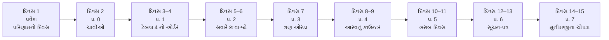
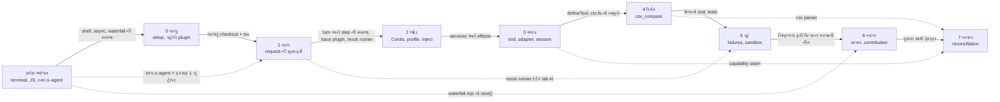

# સમગ્ર નકશો — આખું પુસ્તક એક નજરે

> **આ પાનું પહેલાં વાંચો.** અહીં આખું પુસ્તક એક જ **વાર્તા** અને એક જ **નકશા** માં જોડાયેલું છે.
> આ પુસ્તકમાં વાર્તા અને technical અલગ નથી: ભોજનાલયમાં જે **ઘટના** બને છે, તે જ harness નો **નિયમ** છે, અને બંને એક જ કારણથી બન્યા છે.
> દરેક પ્રકરણ **દૃશ્યો** માં ચાલે છે, અને દરેક દૃશ્ય ચાર પગથિયાંમાં: 🎬 ઘટના → ❓ આરવનો પ્રશ્ન → 💻 code માં → 🔬 expert નજર. પછી 🧪 Lab → 🔮 આગાહી → 🩺 નિષ્ફળતા → ✅ સાર → 🧠 Mastery check → 🎬 આગળ શું.

## આ પાનું વાંચ્યા પછી તમે શું કરી શકશો

- નવ પ્રકરણો (પ્રવેશ + 0–7) શેના વિશે છે અને કયા ક્રમમાં કેમ છે તે એક મિનિટમાં કહી શકશો.
- વાર્તાના 15 દિવસ અને પ્રકરણો વચ્ચેનું જોડાણ બતાવી શકશો.
- દરેક પ્રકરણ આગલા પ્રકરણને શું "આપે" છે, એટલે કે ટુકડા કેવી રીતે જોડાય છે, તે બતાવી શકશો.
- ભોજનાલયની એક-એક ઘટના પરથી DeepSeek Harness નો એક-એક નિયમ, અને તેનું કારણ, કહી શકશો.
- તમારા સ્તર પ્રમાણે વાંચવાનો માર્ગ પસંદ કરી શકશો — 12મા ધોરણથી અનુભવી developer સુધી.

---

## 1. એક વાક્યમાં આખું પુસ્તક

**DeepSeek Harness એ એક એવું "ભોજનાલય" છે જેમાં AI model (મહારાજ) વિચારે છે, tools (કોઠાર) કામ કરે છે, agent loop (વેઈટર) બંનેને જોડે છે, દરેક ઘટના એક ચોપડામાં લખાય છે — અને આ ભોજનાલયની દરેક ઈંટ (plugin) કાઢી-બદલી શકાય છે.**

આ પુસ્તક તમને પહેલાં computer ની ભાષા શીખવે છે (પ્રવેશ), પછી ભોજનાલયની ચાવીઓ આપે છે (0), એક ઓર્ડર શરૂથી અંત સુધી અનુસરાવે છે (1), ભોજનાલય સવારે કેવી રીતે ખૂલે છે તે બતાવે છે (2), ત્રણ ઓરડા અંદરથી ખોલે છે (3), તમને પોતાનું કાઉન્ટર ઉમેરતાં શીખવે છે (4), ખરાબ દિવસ સંભાળતાં શીખવે છે (5), મુખ્ય કચેરીને પુરાવા સાથે સુધારો સૂચવતાં શીખવે છે (6), અને છેલ્લે મુનીમજીનો ખરો હિસાબ-પ્રશ્ન જાતે ઉકેલાવે છે (7).

## 2. વાર્તા: 15 દિવસ, એક ભોજનાલય

**આરવ** 12મું ધોરણ પાસ કરી college ની રાહ જુએ છે. તેના પપ્પાનું અમદાવાદમાં "અન્નપૂર્ણા થાળી ઘર" છે. Software engineer પિતરાઈ બહેન **મીરાદીદી** ઉનાળામાં આવે છે અને રોજ એક પગથિયું શીખવે છે — ભોજનાલયને જ પ્રયોગશાળા બનાવીને.

દરેક પ્રકરણનો અંત ("🎬 આગળ શું") આગલા પ્રકરણનો પ્રશ્ન ઊભો કરે છે, અને આગલું પ્રકરણ એ જ પ્રશ્નથી શરૂ થાય છે — એટલે વાર્તા ક્યાંય તૂટતી નથી.

### વાર્તા કેવી રીતે technical શીખવે છે

એક ઉદાહરણ, પ્રકરણ 1 માંથી:

| પગથિયું | શું |
|---|---|
| 🎬 **ઘટના** | ગ્રાહક બિલ વખતે ઝઘડે છે: "મેં **લસણ વગર** કહ્યું હતું!" ચોપડામાં એ ક્યાંય નથી. રમેશભાઈએ મહારાજને મોઢે કહ્યું હતું; મહારાજને યાદ નથી. |
| ❓ **પ્રશ્ન** | "કોણ સાચું, એ કેવી રીતે સાબિત થાય?" |
| 💻 **Code માં** | નિયમ: "Model-visible ⟺ logged". Model ને જતો દરેક સંદેશ પહેલાં session log માં લખાય, અને history દર વખતે log માંથી જ બને (`deriveMessages`). |
| 🔬 **Expert નજર** | ચોપડો એ જ એકમાત્ર સત્ય; તેનાથી debugging, resume અને સલામત retry — ત્રણેય મળે. |

ઘટના યાદ રહે, એટલે નિયમ યાદ રહે. અને ઘટનામાં નિયમનું **કારણ** છે — એટલે નિયમ ગોખવો નથી પડતો; તે સમજાય છે. Expert ને નિયમ ખબર હોય છે; ખરો expert એ પણ જાણે છે કે નિયમ **કેમ** છે અને તૂટે તો **શું** બગડે.

## 3. કોણ કોણ છે: અન્નપૂર્ણા થાળી ઘર

ભોજનાલયનું દરેક પાત્ર અને દરેક જગ્યા harness નો એક ભાગ છે. નીચેના table માં ત્રીજી column ખરો technical અર્થ આપે છે; વાર્તા અને technical વચ્ચે ક્યાંય ફરક લાગે, તો એ જ સાચું ગણવું. (પાત્રોની પૂરી યાદી: [પ્રવેશ પ્રકરણ](pravesh-shunya-thi-shuruaat.md); બધા શબ્દો: [પરિશિષ્ટ C](../appendix/C-glossary.md).)

| ભોજનાલયમાં | Harness માં | ખરો technical અર્થ | પ્રકરણ |
|---|---|---|---|
| આખું ભોજનાલય | **Harness** (`dsh`) | agent ચલાવવાનું આખું તંત્ર | 0 |
| **મહારાજ**, જે નક્કી કરે કે શું રાંધવું; રસોડાની બહાર પગ નથી મૂકતા, અને દરેક વાતચીત પછી બધું ભૂલી જાય છે | **AI model** (`deepseek-flash`) | text અને tool call બનાવતું model; તે પોતે કોઈ file ખોલતું નથી, અને call વચ્ચે કશું યાદ રાખતું નથી | પ્રવેશ, 0, 1 |
| મહારાજને મોકલતી **agency**, વાત ફોન પર | **Model provider** (DeepSeek API) | HTTP પર model સુધી પહોંચાડતી સેવા | 0, 3 |
| ફોન પરનો **દુભાષિયો** | **Model adapter** (`DeepSeekAdapter`) | `GenerateOptions` ↔ wire format ↔ `StreamChunk` | 3 |
| **રિહર્સલ મહારાજ** | **Mock provider** (`dsh-llm-mock-server`) | scripted જવાબ આપતો નકલી server — key વગર | 1 |
| ઓર્ડર લઈ, મહારાજને પૂછી, સામાન લાવી આપતો **રમેશભાઈ** (વેઈટર) | **Agent loop** (`ReactLoopAgent`) | model → tool → model નો loop | 1 |
| ગ્રાહકનો એક ઓર્ડર, થાળી પીરસાય ત્યાં સુધી | **Turn** | user ના એક સંદેશથી "કંઈ બાકી નથી" સુધી | 1 |
| મહારાજ સાથેની એક વાતચીત + તેમણે માંગેલો સામાન | **Step** | એક model request + તેના tool calls | 1 |
| **કોઠાર**, **ભીખાભાઈ** (કોઠારી) | **Tools** (`read`, `write`, `bash`…) + tool pipeline | model માંગે તે કામ કરતી functions | 1, 3 |
| ઓર્ડર-ચોપડો, જેમાં ફક્ત ઉમેરાય, ભૂંસાય નહીં | **Session log** | append-only events ની યાદી, `session.v4.jsonl.zstd` | 1, 3 |
| દરેક કર્મચારી, કાઉન્ટર, મશીન | **Plugin** | `apply(ctx)` વાળો module | 0, 2 |
| **કાંતિકાકા** (મેનેજર), જે કર્મચારીને ત્યારે જ કામ પર લે જ્યારે તેના સાધનો તૈયાર હોય | **Cordis** + `inject` | services હાજર થાય ત્યારે જ plugin ચાલુ થાય | 2 |
| "આજનું મેનુ" — કયા કાઉન્ટર ખુલશે તેની યાદી + ચોંટાડેલી ચિઠ્ઠીઓ | **Profile / bundle / patch** | ~100 config rows નું composition | 2 |
| હાજરીપત્રક | **Startup audit** | required entry inactive → exit 1 | 2 |
| રસોડાની સીમા: ગમે ત્યાં જોઈ શકો, પણ રાંધી ફક્ત પોતાના રસોડામાં શકો | **Sandbox** (`workspace-write`) | reads ખુલ્લાં; mutations workspace સુધી | 5 |
| મોટું કામ કરતા પહેલાં **પપ્પાને** પૂછવું | **Approval** | escalation માટે મંજૂરી; headless માં શેઠ હાજર નથી → ના | 5 |
| ફોન વ્યસ્ત હોય તો થોડી રાહ જોઈ ફરી કરવો | **Retry / backoff** | 0.5s, 1s, 2s, 4s, 8s પછી ફરી request | 5 |
| **મુખ્ય કચેરી**ને સુધારાનું લેખિત સૂચન, પુરાવા સાથે | **Upstream contribution / patch** | problem → patch → test → review | 6 |
| **મુનીમજી**ના બે ચોપડા મેળવવા | **Reconciliation** | bank statement ↔ Tally ledger | 7 |

**વાર્તા અને technical વચ્ચે ફરક (પુસ્તકમાં ⚠️ નિશાન):**

1. વાર્તામાં મહારાજ રસોડાની બહાર ન જાય એ **નિયમ** છે; ખરા જીવનમાં **model પાસે બહાર જવાની ક્ષમતા જ નથી**. તે ફક્ત "આ tool, આ arguments સાથે ચલાવો" એવું લખાણ મોકલે છે; tool ચલાવવાનું કામ harness કરે છે.
2. કાગળના મેનુમાં ઉપર લખેલું પહેલાં વંચાય. **Cordis માં config rows એકસાથે શરૂ થાય છે**; ક્રમ ફક્ત `inject` (જરૂરી services) થી નક્કી થાય, YAML માં ઉપર-નીચે મૂકવાથી નહીં (પ્રકરણ 2 નો race).
3. ભોજનાલયની દીવાલ ચોરને પણ રોકે. **File sandbox ફક્ત લખવા પર વાડ છે** — વાંચવું ખુલ્લું છે (પ્રકરણ 5). આ પુસ્તકનો સૌથી મહત્વનો ફરક.
4. માણસ દુભાષિયો અર્થ પણ બદલી શકે. **Adapter ફક્ત format બદલે છે** (પ્રકરણ 3).
5. ભીખાભાઈ આખો દિવસ લેબલ તપાસે. **TypeScript ના types ફક્ત compile વખતે તપાસાય** (પ્રવેશ).
6. મુનીમજી ફોન કરીને પૂછી શકે. **Tool ફક્ત વાંચે અને અહેવાલ આપે**; નિર્ણય માણસનો (પ્રકરણ 7).

## 3a. મુખ્ય ઘટનાઓ: આખું પુસ્તક "ઘટના → નિયમ" માં

પરીક્ષા પહેલાં આ એક table જુઓ. ડાબી column વાંચો, અને જમણી બે column ઢાંકીને જાતે બોલો.

| પ્રકરણ | 🎬 ઘટના | 💻 નિયમ | 🔬 તૂટે તો |
|---|---|---|---|
| પ્રવેશ | "બીજા ખાનામાંથી બિલ-બુક લાવ" | Relative path હાલના folder સામે ગણાય | "file તો છે, પણ મળતી નથી" |
| પ્રવેશ | ભૂલકણો ચોકીદાર ચિઠ્ઠી ખિસ્સામાં મૂકે | Waterfall listener એ `next()` બોલાવવું જ પડે | સાંકળ ચૂપચાપ અટકે; error નહીં |
| 0 | ગયા મહિનાનું મેનુ-કાર્ડ | Pin: એક commit, એક વાતાવરણ | પુસ્તક એક વાત કહે, code બીજી |
| 0 | ધૂળવાળી ફરિયાદ-પેટી | Exit 0 ≠ plugin ચાલ્યો; log exporter જોઈએ | નિષ્ફળ plugin, અને કોઈને ખબર નહીં |
| 1 | મહારાજ પાસે બે વાર જવું પડ્યું | Model ફક્ત tool call લખે; step `null` → loop ફરે | — (આ agent ની વ્યાખ્યા છે) |
| 1 | લાઈટ ગઈ, ઓર્ડર 7 અધૂરો | `turn/end` `finally` માં; દરેક `tool/call` નું `tool/result` | Resume ને ખબર ન પડે ક્યાંથી આગળ વધવું |
| 1 | "લસણ વગર" નો ઝઘડો | Model-visible ⟺ logged; history log માંથી derive, પછી freeze | "Model ને શું મોકલાયું?" નો જવાબ અનુમાન બને |
| 2 | કાંતિકાકા ક્રમ નથી આપતા, શરત સાંભળે છે | ક્રમ ફક્ત `inject` થી | ~100 plugins ની ક્રમ-યાદી કોઈ સાચવી ન શકે |
| 2 | એક ચાવીવાળાની રજા, અઢાર જણ બાંકડે | Pending cascade; required હોય તો જ fatal | Warning ન વાંચો તો "tools કેમ નથી?" |
| 2 | નોકરી છોડતો કર્મચારી | Registrations are effects; disposal LIFO | Unload પછી "ભૂત" નોંધણીઓ |
| 2 | ઉતાવળિયો ગ્રાહક | `inject` ફક્ત services ની રાહ જુએ; settle point વાપરો | ક્યારેક ચાલે, ક્યારેક નહીં (race) |
| 3 | દરવાજા પરનું પાટિયું | Seam: definition, provider, consumer | Provider બદલતાં consumer ફરી લખવો પડે |
| 3 | ભીખાભાઈની લાલ ચિઠ્ઠી | Tool error = `tool/result` (`isError`); crash નહીં | Model ની દરેક ખોટી ધારણાએ turn તૂટે |
| 3 | ફોન-રૂમના ઉંબરે ચોકની લીટી | Adapter boundary: ઉપર wire નથી જાણતા, નીચે log નથી | નવો provider = આખો loop ફરી |
| 3 | "શાહીથી, નંબર સાથે, તાળાબંધ" | `append`: JSON-serializable (fail fast), frozen, `seq` | ખરાબ event મોડી પકડાય, ગુનેગાર વગર |
| 4 | "INV-1004 કઈ સાથે? — કોઈ સાથે નહીં" | Duplicate પર guess નહીં; દરેક row નો હિસાબ (invariant) | ચૂપચાપ ખોટો, આત્મવિશ્વાસુ હિસાબ |
| 4 | "કબાટ હું ખોલીશ" | `ctx.fs` seam દ્વારા, `node:fs` નહીં | Sandbox policy બાયપાસ |
| 5 | વ્યસ્ત લાઈન vs ખોટું card | Retryable codes જ retry; backoff + jitter | નકામા calls, અથવા અનંત રાહ |
| 5 | ચોકીદાર ગેરહાજર → દરવાજો બંધ | Fail closed | નિષ્ફળતા વખતે ખુલ્લું = જોખમ |
| 5 | ઓફિસનો કાગળ **વંચાયો** | Reads ખુલ્લાં; containment, security boundary નહીં | ખોટો ભરોસો: secrets model ને દેખાય |
| 5 | જૂનો ચમચો પાછો મૂકવો | ફરી-સુધાર-ફરી-ઉલટ; regression test fix વગર fail થાય | સંયોગને fix માની લેવાય |
| 6 | એક સવાર, ત્રણ વિનંતી | Config → plugin → core patch | દરેક ફેરફાર દીવાલમાં; દરેક release માં બોજ |
| 6 | "કોઠાર ધીમો પડ્યો" — 5 દિવસના આંકડા | ગણતરી પાકી, સમય કાચો | ખોટા આંકડા પર નિર્ણય |
| 6 | ભર બપોરે રદ થયેલો ઓર્ડર | Fiber state (plugin નું જીવન) ≠ `signal.aborted` (turn) | આજની ભૂલ સુધરે, નવી છુપાઈ જાય |
| 6 | છેલ્લી ઘંટડી સાંભળનારા | Machine-readable output બદલાય = callers પર અસર | ચૂપચાપ તૂટતું automation |
| 7 | અરીસો | Bank અને Tally ના signs normalize કરો, એક જ જગ્યાએ | ગયેલા અને આવેલા પૈસા "મળી જાય" |
| 7 | ઝડપી મદદનીશ | Greedy નહીં; connected components | એ જ data, જુદા ક્રમે જુદો હિસાબ |
| 7 | ફક્ત વાંચવાની ચાવી | Read-only ને interface ના આકારમાં મૂકો | "અમે write નથી કરતા" ફક્ત વચન રહે |

## 4. નવ પગથિયાંની નિસરણી: દરેક પ્રકરણ એક પ્રશ્નનો જવાબ

દરેક પ્રકરણ એક જ મોટા પ્રશ્નનો જવાબ આપે છે. પ્રશ્નો ક્રમમાં છે, કારણ કે દરેક જવાબ પછીના પ્રશ્ન માટે જરૂરી છે.

| પગથિયું | પ્રશ્ન | ટૂંકો જવાબ | યાદ-શબ્દ | ઊંડા જાઓ |
|---|---|---|---|---|
| પ્રવેશ | computer, code અને AI ની ભાષા શું છે? | terminal, JSON/YAML/CSV, HTTP, JavaScript, model/tool call, 40-line રમકડા-agent | **ઓળખ** | [પ્રવેશ](pravesh-shunya-thi-shuruaat.md) · [સાર](pravesh-shunya-thi-shuruaat.md#saral-samaj) |
| 0 | આ ચાલુ કેવી રીતે કરું? | Node 24 + pnpm + build; key વગર પહેલો plugin | **ચાલુ** | [પ્રકરણ 0](00-paayo-ane-pratham-run.md) · [સાર](00-paayo-ane-pratham-run.md#saral-samaj) |
| 1 | એક request ક્યાં-ક્યાં જાય છે? | CLI → runner → turn → 2 steps → 2 model calls → `read` → જવાબ | **ચાલ** | [પ્રકરણ 1](01-request-ni-musafari.md) · [સાર](01-request-ni-musafari.md#saral-samaj) |
| 2 | આ બધા ટુકડા જોડાય કેવી રીતે? | profile → patches → rows → Cordis services, `inject` | **જોડ** | [પ્રકરણ 2](02-cordis-plugin-architecture.md) · [સાર](02-cordis-plugin-architecture.md#saral-samaj) |
| 3 | દરેક ટુકડો અંદરથી કેવો છે? | `read` tool, tool pipeline, DeepSeek adapter, session log | **અંદર** | [પ્રકરણ 3](03-tools-sessions-adapters.md) · [સાર](03-tools-sessions-adapters.md#saral-samaj) |
| 4 | હું મારો ટુકડો કેવી રીતે ઉમેરું? | `defineTool` + `Config` + overlay; `csv_compare` | **ઉમેર** | [પ્રકરણ 4](04-potano-plugin.md) · [સાર](04-potano-plugin.md#saral-samaj) |
| 5 | તૂટે તો શું? | 4 નિષ્ફળતા, retry, cancel, sandbox, approval | **તૂટ** | [પ્રકરણ 5](05-debugging-permissions-reliability.md) · [સાર](05-debugging-permissions-reliability.md#saral-samaj) |
| 6 | ક્યાં બદલવું, અને ફેરફાર સાચો છે તે કેવી રીતે સાબિત કરું? | config vs plugin vs core patch; માપન; contribution | **બદલ** | [પ્રકરણ 6](06-maintainer-architecture.md) · [સાર](06-maintainer-architecture.md#saral-samaj) |
| 7 | આખું જાતે બનાવી શકું? | bank ↔ Tally reconciliation, દરેક પરિણામ trace સાથે | **બનાવ** | [પ્રકરણ 7](07-antim-project-mastery.md) · [સાર](07-antim-project-mastery.md#saral-samaj) |

### યાદ રાખવાની ચાવી: "ઓળખ-ચાલુ-ચાલ-જોડ-અંદર-ઉમેર-તૂટ-બદલ-બનાવ"

આ નવ શબ્દો એક જ લયમાં બોલો, જાણે રસોડાનો નિયમ હોય:

> પહેલાં **ઓળખ**, પછી **ચાલુ** કરો, **ચાલ** જુઓ, **જોડ** સમજો, **અંદર** ડોકિયું કરો,
> **ઉમેરો**, **તૂટે** તો સંભાળો, **બદલો**, અને અંતે **બનાવો**.

દરેક શબ્દ એક પ્રકરણનો દરવાજો છે. પરીક્ષામાં કોઈ પ્રશ્ન આવે ("SIGINT પછી શું થાય?") તો પૂછો: "આ કયો શબ્દ છે?" — અહીં જવાબ **તૂટ** છે, એટલે પ્રકરણ 5.

## 5. બિંદુ-થી-બિંદુ જોડાણ: કોણ કોને શું આપે છે

Solid arrows મુખ્ય ક્રમ બતાવે છે; dotted arrows એ બતાવે છે કે કોઈ પ્રકરણનું સાધન આગળ ક્યાં ફરી વપરાય છે.

| આ પ્રકરણમાં બનેલું | ક્યાં ફરી વપરાય છે | કેમ મહત્વનું |
|---|---|---|
| Shell નિશાન `&&`, `$( )`, `VAR=value` (પ્રવેશ) | બધી labs | દરેક lab command આ ટુકડાઓથી બને છે |
| `rasoi-async.mjs` — `AbortController` + `finally` (પ્રવેશ) | 1, 5 | `turn/end` અને cancellation સાંકળનું રમકડું |
| `waterfall.mjs` — `next()` (પ્રવેશ) | 1, 2, 6 | waterfall events અને "observer વર્તન બદલે" નિષ્ફળતા |
| રમકડા-agent (પ્રવેશ) | 1, 3 | turn/step/ચોપડાનો આકાર પહેલેથી આંખે |
| `tmp/` માં tsx થી ચલાવવાની રીત (0) | બધી labs | workspace packages ત્યાંથી જ resolve થાય |
| Turn/step ની વ્યાખ્યા (1) | 3, 5, 6 | retry, cancel, metrics બધું step ની અંદર થાય છે |
| `run-mock.sh` અને `trace-events.ts` (1) | 2, 3, 4, 5, 6, 7 | key વગર દરેક વર્તન ચલાવી જોવાય |
| `inject` અને pending/fatal નો નિયમ (2) | 4, 5 | plugin કેમ ચાલતો નથી તેનું પહેલું નિદાન |
| "Relative path કોની સામે?" (પ્રવેશ, 2) | 4 | ત્રણ જુદા જવાબ: shell folder, profile directory, session directory |
| `read` tool નો નમૂનો: schema → `ctx.fs` → render (3) | 4, 7 | આપણા બંને tools એ જ ઢાંચો વાપરે છે |
| Session log અને resume (3) | 5, 6 | interrupted run નું durable `aborted` |
| `defineTool` + `Config` + overlay + disable (4) | 7 | reconciliation tool એ જ રીતે wire થાય છે |
| `parseCsv` (4) | 7 | Tally અને bank બંને exports એ જ parser થી વંચાય છે |
| Fail closed, reads ખુલ્લાં (5) | 7 | reconciliation tool read-only કેમ છે |
| Waterfall માં `next()` (પ્રવેશ, 2, 6) | 6 | metrics plugin વર્તન બદલતો નથી |
| Reproduce → fix → ઉલટાવીને ફરી નિષ્ફળ (5, 6) | 7 debugging challenge | test સાચે જ ભૂલ પકડે છે તેનો પુરાવો |

## 6. એક request ના દસ સ્ટેશન (પ્રકરણ 1 નો સાર)

આખા પુસ્તકનું હૃદય આ એક મુસાફરી છે. ઉદાહરણ: **"આ repositoryનું README વાંચીને ગુજરાતી સાર આપો."**

| # | સ્ટેશન | શું થાય | ભોજનાલયમાં | ઊંડા જાઓ |
|---|---|---|---|---|
| 1 | `pnpm dsh` | `apps/cli/src/bin.ts` ચાલે | ગ્રાહક દરવાજે આવ્યો | [પ્રકરણ 1](01-request-ni-musafari.md) |
| 2 | Profile boot | ~100 plugins mount થાય | ભોજનાલય ખૂલ્યું, સ્ટાફ હાજર | [પ્રકરણ 2](02-cordis-plugin-architecture.md) |
| 3 | Headless runner | Agent બને, task inbox માં જાય | ઓર્ડર પેટીમાં પડ્યો | [પ્રકરણ 1](01-request-ni-musafari.md) |
| 4 | `turn/start` | Turn ચોપડામાં શરૂ | ઓર્ડર નંબર પડ્યો | [પ્રકરણ 1](01-request-ni-musafari.md) |
| 5 | Step 1: model call #1 | system + 4 user messages + 25 tools મોકલાય | રમેશભાઈ મહારાજને પૂછે | [પ્રકરણ 3](03-tools-sessions-adapters.md) |
| 6 | Tool call `read` | model કહે: "README.md ખોલો" | મહારાજની ચિઠ્ઠી: "રેસીપી-ચોપડી લાવો" | [પ્રકરણ 3](03-tools-sessions-adapters.md) |
| 7 | Tool pipeline | policy → tool body → `tool/result` | ભીખાભાઈ કોઠારમાંથી આપે | [પ્રકરણ 3](03-tools-sessions-adapters.md) |
| 8 | Step 2: model call #2 | tool result સાથે ફરી પૂછાય | મહારાજ રેસીપી વાંચીને રાંધે | [પ્રકરણ 1](01-request-ni-musafari.md) |
| 9 | `turn/end completed` | ચોપડામાં turn બંધ | થાળી પીરસાઈ | [પ્રકરણ 1](01-request-ni-musafari.md) |
| 10 | stdout + exit 0 | જવાબ છપાય | ગ્રાહકને બિલ | [પ્રકરણ 1](01-request-ni-musafari.md) |

**યાદ-ચાવી "2-1-25-4":** **2** model calls, **1** tool call, **25** tools model ને દેખાય, **4** user messages (task, workspace instructions, runtime context, skill catalog). Title row ચાલુ હોય તો calls **3** થાય — એ પ્રકરણ 1 ની આગાહી કસોટી છે.

## 7. તમારા સ્તર પ્રમાણે વાંચવાનો માર્ગ

| તમે કોણ છો | માર્ગ |
|---|---|
| **12મું ધોરણ પાસ / programming ક્યારેય નથી કર્યું** | આ પાનું → [પ્રવેશ પ્રકરણ](pravesh-shunya-thi-shuruaat.md) આખું, દરેક program ચલાવીને → પ્રકરણ 0 થી ક્રમમાં → પહેલી વાંચનમાં 🔬 ઝડપથી → દરેક પ્રકરણના અંતે ✅ સાર અને પુનરાવર્તન કાર્ડ → બીજી વાંચનમાં 🔬 પર અટકો |
| **College student / થોડું programming આવડે છે** | આ પાનું → પ્રવેશ ની [સ્વ-કસોટી](pravesh-shunya-thi-shuruaat.md#swa-kasoti) (અટકો ત્યાં એ વિભાગ) → પ્રકરણ 0 થી શરૂ → lab → mastery check |
| **અનુભવી developer** | આ પાનું (ખાસ કરીને 3a) → પ્રકરણ 1, 2, 3 માં 💻 અને 🔬 → 5, 6, 7 ના labs ધ્યાનથી → [પરિશિષ્ટ E](../appendix/E-mastery-rubric.md) |

### બે વાંચન

| વાંચન | દરેક દૃશ્યમાં શું વાંચવું |
|---|---|
| પહેલી | 🎬 ઘટના, ❓ પ્રશ્ન, અને 💻 code ધ્યાનથી; lab ચલાવો. 🔬 expert નજર ઝડપથી વાંચો — બધું ન સમજાય તો ચાલે. |
| બીજી | 🔬 expert નજર પર અટકો. દરેક માટે પૂછો: "આ નિયમ ન હોત તો કઈ ઘટના બનત?" અને pinned source links ખોલો. |

## 8. આખા પુસ્તકમાં વપરાયેલી યાદ રાખવાની આઠ રીતો

દરેક પ્રકરણમાં આ રીતો વપરાઈ છે. અહીં દરેક રીત શું છે અને કેમ કામ કરે છે તે સમજો, જેથી તમે પોતે પણ નવા વિષય પર વાપરી શકો.

1. **ઘટના → નિયમ.** આ પુસ્તકની મુખ્ય રીત. નિયમને એવી ઘટના સાથે જોડો જેમાં તે નિયમ **ન હોવાથી** કંઈક બગડ્યું. ઘટના સાથે કારણ યાદ રહે છે, અને કારણ ખબર હોય તો નિયમ ભૂલાય તો પણ ફરી ઘડી શકાય. ઉદાહરણ: "લસણ વગર" નો ઝઘડો → Model-visible ⟺ logged. (આખી યાદી: 3a.)
1. **ઉપમા (analogy).** અજાણી વસ્તુને જાણીતી વસ્તુ સાથે જોડો. ઉદાહરણ: session log = ઓર્ડર-ચોપડો.
2. **વાર્તા-સાંકળ (story chain).** પગલાંને એક વાર્તામાં ગૂંથો; વાર્તાનો ક્રમ પગલાંનો ક્રમ યાદ રખાવે છે. ઉદાહરણ: આરવના 15 દિવસ, અને ઉપરના દસ સ્ટેશન.
3. **ટૂંકાક્ષર/યાદ-શબ્દ (mnemonic).** પહેલા અક્ષર કે શબ્દોની લયબદ્ધ યાદી. ઉદાહરણ: "ઓળખ-ચાલુ-ચાલ-જોડ-અંદર-ઉમેર-તૂટ-બદલ-બનાવ".
4. **સંખ્યા-ચાવી.** મહત્વની સંખ્યાઓ એક જોડમાં યાદ રાખો. ઉદાહરણ: "2-1-25-4", retry માટે "5-અડધી-બમણું-દસ".
5. **ચિત્ર (visual).** Mermaid diagrams; આંખ ક્રમ અને જોડાણ ઝડપથી પકડે છે. દરેક પ્રકરણની શરૂઆતમાં 🗺️ નકશો છે.
6. **આગાહી પહેલાં (prediction).** પરિણામ જોતાં પહેલાં ધારો. ખોટી ધારણા સુધરે ત્યારે શીખેલું સૌથી લાંબું યાદ રહે છે. એટલે દીદીનો નિયમ "પહેલાં ધાર, પછી ચલાવ", અને દરેક પ્રકરણમાં 🔮 "આગાહી કસોટી".
7. **સમજાવી જુઓ (Feynman technique).** વિષય કોઈ મિત્રને બે વાર સમજાવો: પહેલાં વાર્તાથી, પછી વાર્તા વગર ફક્ત technical શબ્દોથી. બંને રીતે કહી શકો, ત્યારે આવડ્યું. દરેક ✅ સાર ના અંતે "મિત્રને સમજાવો" કસરત છે.

### પુનરાવર્તનનું સમયપત્રક (spaced repetition)

**Spaced repetition** એટલે વધતા અંતરે પુનરાવર્તન: આજે શીખ્યું તે 1 દિવસ પછી, પછી 3 દિવસ પછી, પછી 7 દિવસ પછી ફરી જોવું. દરેક વખતે ભૂલવાની ઝડપ ઘટે છે.

| દિવસ | શું કરવું |
|---|---|
| પ્રકરણ વાંચ્યાનો દિવસ | lab ચલાવો, પુનરાવર્તન કાર્ડ જવાબ જોયા વગર લખો |
| +1 દિવસ | ફક્ત કાર્ડના પ્રશ્નો; ખોટા પડેલા પર નિશાની |
| +3 દિવસ | નિશાનીવાળા કાર્ડ + "મિત્રને સમજાવો" કસરત |
| +7 દિવસ | Mastery check, જવાબ જોયા વગર |
| દર રવિવારે | આ પાનાનું table "નવ પગથિયાં" મોઢે બોલો; 3a ની "ઘટના → નિયમ" table જમણી બાજુ ઢાંકીને; અને પ્રકરણ 7 ના ઉપસંહારની "expert ની દસ ટેવો" |

## 9. આ નકશો કેવી રીતે વાપરવો

- **કોઈ પણ શબ્દ ન સમજાય:** દરેક શબ્દ જે દૃશ્યમાં પહેલી વાર આવે ત્યાં જ, 💻 ભાગમાં, **ઘાટા અક્ષરે** સમજાવેલો છે; આખી યાદી [પરિશિષ્ટ C](../appendix/C-glossary.md) (ભોજનાલય સાથે).
- **કોઈ command યાદ ન આવે:** [પરિશિષ્ટ B](../appendix/B-command-reference.md); shell નિશાનનો અર્થ: [પ્રવેશ, દૃશ્ય 2](pravesh-shunya-thi-shuruaat.md).
- **કોઈ દાવો ખરેખર ચલાવીને ચકાસ્યો છે કે નહીં:** ✅ / 🧪 / ⚠️ ચિહ્ન, અને [પરિશિષ્ટ G](../appendix/G-verification-log.md).
- **તમારી પ્રગતિ માપવી:** [પરિશિષ્ટ E — mastery rubric](../appendix/E-mastery-rubric.md).

---

આગળ: [પ્રવેશ — શૂન્યથી શરૂઆત](pravesh-shunya-thi-shuruaat.md) · અથવા સીધા: [પ્રકરણ 0 — પાયો અને પ્રથમ run](00-paayo-ane-pratham-run.md)
