# પ્રવેશ — શૂન્યથી શરૂઆત (12મા ધોરણ પછીનો પહેલો દિવસ)

> **Level −1 · વાર્તાનો દિવસ 1.** આ પ્રકરણ એવા વાચક માટે છે જેણે 12મું ધોરણ પાસ કર્યું છે, mobile અને computer વાપર્યાં છે, પણ ક્યારેય programming નથી કર્યું.
> ભોજનાલયના એક દિવસમાં દસ નાની ઘટના બને છે. દરેક ઘટના computer નો એક પાયાનો નિયમ છે, અને દરેક પછી આરવ એ જ નિયમ પોતાના computer પર ચલાવી જુએ છે.
> Terminal, JavaScript, JSON અને HTTP પહેલેથી આવડતાં હોય તો [સ્વ-કસોટી](#swa-kasoti) આપો અને સીધા [પ્રકરણ 0](00-paayo-ane-pratham-run.md) પર જાઓ.

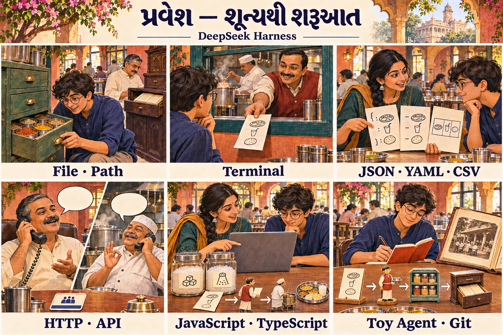

## 🎬 પરિણામનો દિવસ

અમદાવાદના મણિનગરમાં **"અન્નપૂર્ણા થાળી ઘર"** નામનું નાનું ભોજનાલય છે. તેના માલિક છે **આરવના પપ્પા**. આજે આરવનું 12મા ધોરણ (science) નું પરિણામ આવ્યું છે. સારા ગુણ આવ્યા છે; college બે મહિના પછી શરૂ થશે.

સાંજે ભોજનાલયમાં ભીડ છે. આરવ ગલ્લા પર બેઠો mobile પર વાંચે છે: *"AI agents હવે code લખે છે, files વાંચે છે, commands ચલાવે છે."* તેને પ્રશ્ન થાય છે: **"આ agent અંદરથી કામ કેવી રીતે કરે છે? હું એ બનાવી શકું?"**

એ જ વખતે બેંગલુરુથી તેની પિતરાઈ બહેન **મીરાદીદી** આવે છે. તે software engineer છે અને આ ઉનાળામાં અમદાવાદથી જ કામ કરવાની છે.

"દીદી, મારે AI agent ના expert બનવું છે. પણ મને તો programming જ નથી આવડતું."

મીરાદીદી ભોજનાલય તરફ હાથ કરે છે: "તું રોજ એક agent ને કામ કરતો જુએ છે. ગ્રાહક ઓર્ડર આપે, રમેશભાઈ લખે, મહારાજને પૂછે, મહારાજ કહે 'કોઠારમાંથી ચણાનો લોટ લાવો', રમેશભાઈ લાવે, મહારાજ રાંધે, થાળી પીરસાય, અને બધું ચોપડામાં લખાય. **AI agent બરાબર આ જ રીતે ચાલે છે.** આ ભોજનાલયના નિયમો સમજ, એટલે harness ના નિયમો સમજાઈ જશે. 15 દિવસ, રોજ એક પગથિયું."

### આ પુસ્તક કેવી રીતે શીખવે છે

વાર્તા શણગાર નથી. ભોજનાલયમાં જે નિયમ છે, તે જ harness માં છે, અને બંને એક જ કારણથી બન્યા છે. એટલે દરેક દૃશ્ય ચાર પગથિયાંમાં ચાલે છે:

| નિશાન | પગથિયું |
|---|---|
| 🎬 | **ઘટના** — ભોજનાલયમાં કંઈક બને છે |
| ❓ | **આરવનો પ્રશ્ન** — "આવું કેમ?" |
| 💻 | **Code માં** — એ જ વાત computer કે harness માં; ચલાવીને જુઓ |
| 🔬 | **Expert નજર** — આ નિયમ કેમ બન્યો, તૂટે તો શું બગડે |

બીજાં નિશાન: ✅ pinned source વાંચીને ચકાસ્યું · 🧪 આ પુસ્તક લખતી વખતે ચલાવીને ચકાસ્યું · ⚠️ ચકાસ્યું નથી, અથવા વાર્તા અને technical વચ્ચે ફરક છે.

Code ના ટુકડા પર હંમેશા લખેલું હશે કે તે **repository code** (DeepSeek Harness નો ખરો code), **teaching pseudocode** (સમજાવવા સાદો કરેલો), કે **book lab code** (આ પુસ્તકનો પોતાનો code, [`labs/`](../labs/README.md) માં) છે.

### આખા પુસ્તકનાં પાત્રો (આ યાદી સાચવી રાખો)

પ્રકરણ બદલાય, પાત્રો એ જ રહે.

| પાત્ર / જગ્યા | ભોજનાલયમાં શું કરે | Harness માં શું છે | ઊંડાણથી |
|---|---|---|---|
| **આરવ** | નવો શીખનાર — તમે | વાચક | આ પ્રકરણ |
| **મીરાદીદી** | માર્ગદર્શક | આ પુસ્તકનો અવાજ | આ પ્રકરણ |
| **મહારાજ** (રસોઇયા) | નક્કી કરે કે શું રાંધવું. **રસોડાની બહાર પગ નથી મૂકતા** (ફક્ત ચિઠ્ઠી લખે), અને **દરેક વાતચીત પછી બધું ભૂલી જાય છે** | **AI model** (`deepseek-flash`) | પ્રકરણ 0, 1 |
| **રસોઈ-સેવા agency** | મહારાજને મોકલતી સંસ્થા; વાત ફોન પર | **Model provider** (DeepSeek API) | પ્રકરણ 0, 3 |
| **દુભાષિયો** | ભોજનાલયની ભાષા ↔ agency ની ભાષા | **Model adapter** (`DeepSeekAdapter`) | પ્રકરણ 3 |
| **રમેશભાઈ** (વેઈટર) | ઓર્ડર લે, મહારાજને પૂછે, સામાન લાવે, ફરી પૂછે | **Agent loop** (`ReactLoopAgent`) | પ્રકરણ 1 |
| **કોઠાર અને ભીખાભાઈ** (કોઠારી) | ચિઠ્ઠી તપાસી સામાન આપે | **Tools** અને tool pipeline | પ્રકરણ 1, 3 |
| **ઓર્ડર-ચોપડો** | દરેક ઘટના નવી લીટીમાં; ભૂંસવાનું નહીં | **Session log** | પ્રકરણ 1, 3 |
| **કાંતિકાકા** (મેનેજર) | સવારે સ્ટાફને કામ પર લે — જેનાં સાધન તૈયાર હોય તેને જ | **Cordis** (plugin framework) | પ્રકરણ 2 |
| **આજનું મેનુ** | આજે કયાં કાઉન્ટર ખુલશે | **Profile / bundle / patch** | પ્રકરણ 2 |
| **દરેક કાઉન્ટર, મશીન, કર્મચારી** | એક-એક કામ | **Plugin** | પ્રકરણ 0, 2 |
| **પપ્પા** (શેઠ) | મોટું કામ હોય તો તેમની મંજૂરી | **Approval** | પ્રકરણ 5 |
| **રસોડાની સીમા** | ગમે ત્યાં જોઈ શકો, રાંધો ફક્ત પોતાના રસોડામાં | **Sandbox** | પ્રકરણ 5 |
| **મુખ્ય કચેરી** | ભોજનાલયની chain ના નિયમો ઘડનાર | **Upstream repository** | પ્રકરણ 6 |
| **મુનીમજી** | Tally માં હિસાબ, bank સાથે મેળવણી | અંતિમ પ્રોજેક્ટ | પ્રકરણ 7 |

## 🎯 આ પ્રકરણ પછી તમે શું કરી શકશો

- File, folder, path, program, process, exit code, stdout અને stderr નો અર્થ ઉદાહરણથી કહી શકશો.
- Terminal માં ફરી શકશો, file બનાવી-વાંચી શકશો, અને labs માં આવતાં shell નિશાન (`&&`, `|`, `$( )`, `VAR=value`) વાંચી શકશો.
- એક જ માહિતીને JSON, YAML અને CSV — ત્રણેય આકારમાં ઓળખી શકશો.
- HTTP request, response, status code, API અને API key શું છે તે સમજાવી શકશો.
- JavaScript નાં object, array, function, `async`/`await`, `try`/`catch`/`finally` અને `AbortController` વાળા નાના programs ચલાવી, output પહેલેથી કહી શકશો.
- AI model શું કરે છે અને શું **નથી** કરતું, તથા "tool call" એટલે શું તે સમજાવી શકશો.
- 40 lines નો રમકડા-agent ચલાવી, તેમાં turn, step અને ચોપડો (log) ઓળખી શકશો.

## 🗺️ આજના દિવસનો નકશો

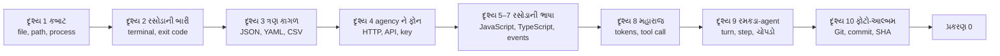

---

## દૃશ્ય 1 — "બીજા ખાનામાંથી બિલ-બુક લાવ": file, path, process

🎬 પપ્પા ગલ્લા પરથી બૂમ પાડે છે: "આરવ, **બીજા ખાનામાંથી** બિલ-બુક લાવ!" આરવ રસોડામાં ઊભો છે. તે રસોડાના કબાટનું બીજું ખાનું ખોલે છે — ત્યાં મસાલા છે. પપ્પા ગલ્લાના કબાટની વાત કરતા હતા.

❓ "'બીજું ખાનું' — પણ **કોના** બીજા ખાનામાંથી?"

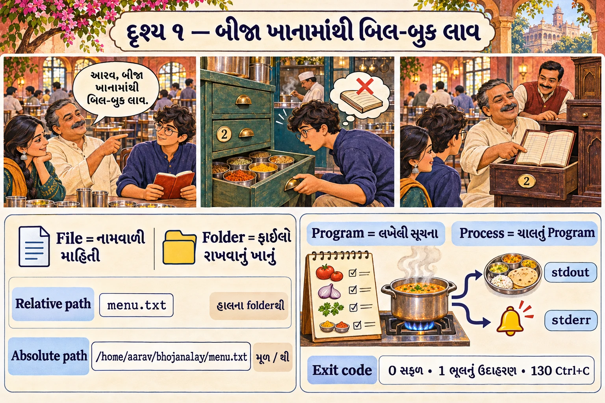

💻 Computer માં આ જ પ્રશ્ન રોજ આવે છે.

- **File** = નામવાળી માહિતી, disk પર સચવાયેલી. ઉદાહરણ: `menu.txt`, `README.md`.
- **Folder (directory)** = files અને બીજાં folders રાખતું ખાનું.
- **Path** = file સુધી પહોંચવાનું સરનામું.

| પ્રકાર | ઉદાહરણ | અર્થ | ભોજનાલયમાં |
|---|---|---|---|
| **Absolute path** | `/home/aarav/bhojanalay/menu.txt` | મૂળ (`/`) થી શરૂ થતું પૂરું સરનામું | "ગલ્લાના કબાટનું બીજું ખાનું" — ગમે ત્યાં ઊભા હો, એક જ જગ્યા |
| **Relative path** | `menu.txt`, `../labs/x.ts` | "હું અત્યારે જ્યાં ઊભો છું ત્યાંથી" | "બીજું ખાનું" — તમે ક્યાં ઊભા છો તેના પર આધાર |

`..` એટલે "એક folder ઉપર", `.` એટલે "આ જ folder", `~` એટલે "મારું home folder".

રસોડામાં આરવ બીજી બે વાત જુએ છે. છાજલી પર **રેસીપી-ચોપડી** પડી છે, અને ચૂલા પર એ જ રેસીપીની **ત્રણ તપેલી** એકસાથે ચડે છે.

- **Program** = computer માટે લખેલી સૂચનાઓની file — રેસીપી-ચોપડી. ઉદાહરણ: `node`.
- **Process** = ચાલતો program — ચૂલા પરની રસોઈ. એક program ના ઘણા process એકસાથે ચાલી શકે.

દરેક process પૂરો થાય ત્યારે એક આંકડો પાછો આપે છે, અને તેની પાસે બોલવાની બે અલગ બારી છે:

- **Exit code** = process પૂરો થતાં આપતો આંકડો. **`0` = સફળ**; બીજું કંઈ પણ = કોઈક સમસ્યા. પુસ્તકમાં `0`, `1`, `130` (Ctrl+C થી અટકાવ્યું) વારંવાર આવશે.
- **stdout** (standard output) = સામાન્ય જવાબ — ગ્રાહકને પીરસાતી થાળી.
- **stderr** (standard error) = ભૂલો, ચેતવણી, માહિતી — રસોડામાંથી આવતી બૂમો. ગ્રાહકની થાળીમાં નથી જતી.

🔬 **Expert નજર.** થાળી અને બૂમો અલગ બારીમાંથી નીકળે છે એટલે જ પ્રકરણ 1 માં agent નો જવાબ (stdout) ગુમાવ્યા વગર આખો trace (stderr) જોઈ શકાશે. અને relative path "ક્યાંથી ગણવું" એ પ્રશ્ન પ્રકરણ 2 અને 4 માં મોટા રૂપમાં પાછો આવશે — આજની બિલ-બુક યાદ રાખજો.

## દૃશ્ય 2 — રસોડાની બારી: terminal

🎬 રસોડા અને હૉલ વચ્ચે એક નાની બારી છે. રમેશભાઈ ત્યાં ચિઠ્ઠી મૂકે છે; રસોડું વાંચીને કામ કરે છે. બોલીને નહીં, **લખીને**. ચિઠ્ઠીમાં જોડણી ખોટી હોય તો રસોડું સમજતું નથી.

❓ "Computer ને પણ આમ લખીને કામ સોંપાય?"

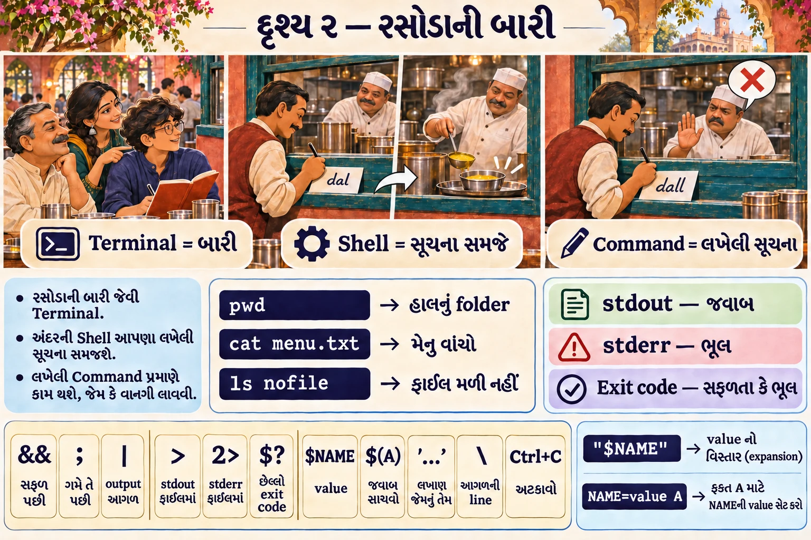

💻 **Terminal (shell)** = text command લખીને computer ચલાવવાની બારી. Linux/macOS માં "Terminal" app; Windows માં WSL2 નું Ubuntu (પ્રકરણ 0 માં setup).

આ commands ચલાવો. દરેક line એક command છે.

```bash
pwd
```

**pwd** = print working directory = "હું અત્યારે ક્યાં ઊભો છું?" (દૃશ્ય 1 નો પ્રશ્ન.) Output કંઈક આવું: `/home/aarav`.

```bash
mkdir -p ~/bhojanalay && cd ~/bhojanalay
```

`mkdir -p` folder બનાવે (હોય તો ભૂલ નહીં); `cd` તેમાં જાય. **`&&`** એટલે "પહેલો command સફળ થાય (exit 0) તો જ બીજો ચલાવો" — ગેસ ચાલુ થાય તો જ તપેલી મૂકો.

```bash
echo "દાળ ભાત શાક" > menu.txt && cat menu.txt
```

`echo` text છાપે; `>` તેને stdout ને બદલે file માં મોકલે; `cat` file વાંચીને છાપે. Output: `દાળ ભાત શાક`.

```bash
ls nofile; echo "exit code = $?"
```

`$?` એટલે "છેલ્લા command નો exit code". 🧪 અમારા Linux પર output:

```text
ls: cannot access 'nofile': No such file or directory
exit code = 2
```

`ls` નિષ્ફળ ગયું, તેથી exit code 0 નહીં પણ 2. (`;` એટલે "સફળ હોય કે ન હોય, પછીનો command ચલાવો.")

### Labs માં આવતાં shell નિશાન — એક table માં

આગળ આવા commands આવશે:
`TOOL_NAME=greet TOOL_ARGS='{"name":"Ada"}' bash tmp/book-labs/request-trace/run-mock.sh`.
તે આ નાના ટુકડાઓથી બનેલું છે:

| નિશાન | અર્થ | ઉદાહરણ | ભોજનાલયમાં |
|---|---|---|---|
| `A && B` | A સફળ થાય તો જ B | `cd x && ls` | ગેસ ચાલુ થાય તો જ તપેલી |
| `A ; B` | A પછી B, ગમે તે થાય | `ls nofile; echo $?` | પછી તો કરવું જ |
| `A \| B` | A નું stdout B ના input માં | `cat menu.txt \| grep દાળ` | એક વાસણમાંથી બીજામાં ગાળવું |
| `A > f` | stdout ને file `f` માં | `echo hi > a.txt` | થાળી ટેબલને બદલે ડબ્બામાં |
| `A 2> f` | stderr ને file `f` માં | `ls nofile 2> err.txt` | બૂમો રેકોર્ડરમાં |
| `NAME=value A` | ફક્ત આ command માટે **environment variable** | `DSH_HOME=$PWD/tmp/home pnpm dsh …` | આજના ઓર્ડર માટે ખાસ સૂચના |
| `$NAME` | variable ની value | `echo $HOME` | ચિઠ્ઠી ખોલીને વાંચો |
| `X=$(A)` | A નું stdout variable X માં | `O=$(bash make-overlay.sh)` | જવાબ ખિસ્સામાં રાખો |
| `'...'` | text જેમ છે તેમ (અંદર `$` નો અર્થ નહીં) | `'{"name":"Ada"}'` | સીલબંધ પરબીડિયું |
| `"..."` | text, પણ અંદર `$NAME` ખૂલે | `"$SID"` | ખુલ્લું પરબીડિયું |
| `\` (line ના અંતે) | command આગળની line માં ચાલુ | | વાક્ય ચાલુ છે |
| `Ctrl+C` | ચાલતો process અટકાવો (`SIGINT`) | | અચાનક ગેસ બંધ — પ્રકરણ 5 |

**Environment variable** = process ને બહારથી આપેલી નામવાળી સેટિંગ. ઉદાહરણ: `DEEPSEEK_BASE_URL` (model ક્યાં છે), `DSH_HOME` (harness પોતાની files ક્યાં રાખે). પ્રકરણ 1 નું આખું lab આના પર ચાલે છે.

🔬 **Expert નજર.** Exit code એ automation ની ભાષા છે. `&&` exit code વાંચીને જ નક્કી કરે છે કે આગળ વધવું કે નહીં. Expert કોઈ પણ command પછી screen પરનું લખાણ જોતાં પહેલાં exit code જુએ છે — લખાણ ખોટું બોલી શકે, exit code program નો પોતાનો ચુકાદો છે.

## દૃશ્ય 3 — એક ઓર્ડર, ત્રણ કાગળ: JSON, YAML, CSV

🎬 ટેબલ 4 નો ઓર્ડર: "2 ગુજરાતી થાળી, ઓછું તીખું, સાથે છાશ અને પાપડ." આરવ જુએ છે કે આ **એક જ ઓર્ડર ત્રણ જગ્યાએ ત્રણ રીતે** લખાય છે:

- રસોડાની ચિઠ્ઠીમાં — કડક ખાનાંવાળી, કારણ કે રસોડું ઉતાવળમાં વાંચે છે.
- કાંતિકાકાના પાટિયા પર — ખુલ્લી, સહેલાઈથી વંચાય તેવી, કારણ કે માણસો વાંચે છે.
- મુનીમજીના રજિસ્ટરમાં — લીટી અને કૉલમમાં, કારણ કે તેનો સરવાળો કરવાનો છે.

❓ "એક જ વાત ત્રણ વાર કેમ? એક આકાર કેમ નહીં?"

"કારણ કે વાંચનાર અલગ છે. આકાર વાંચનાર માટે હોય, લખનાર માટે નહીં."

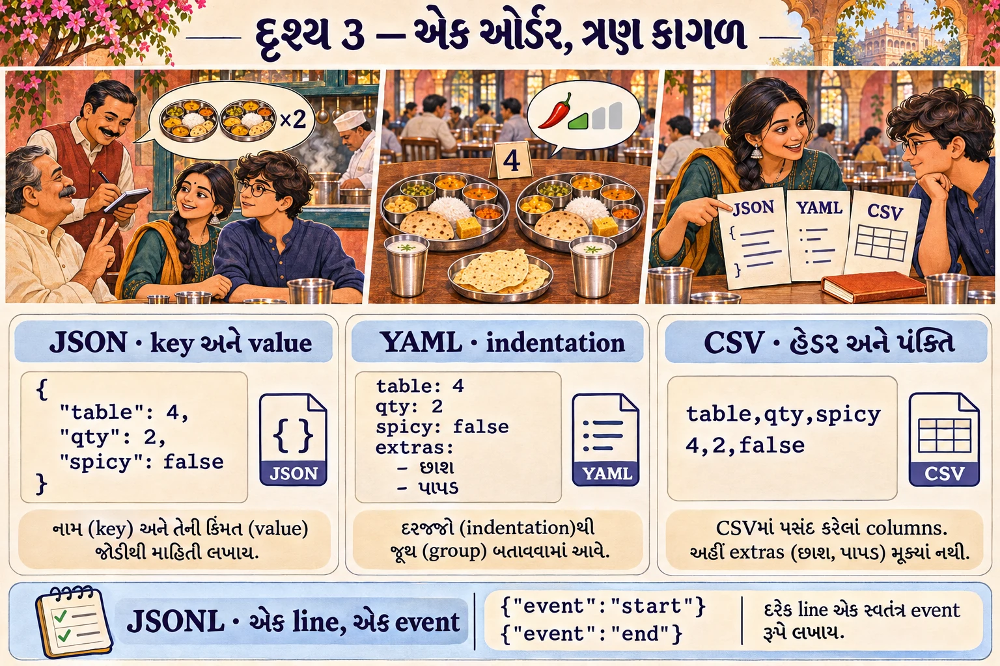

💻 **JSON** (JavaScript Object Notation) — `{ }` માં નામ-value જોડી, `[ ]` માં યાદી. Program માટે: સ્પષ્ટ અને કડક.

```json
{ "table": 4, "dish": "ગુજરાતી થાળી", "qty": 2, "spicy": false, "extras": ["છાશ", "પાપડ"] }
```

**YAML** — indentation (આગળની જગ્યા) થી માળખું, `-` થી યાદી. માણસ માટે: વાંચવું સહેલું.

```yaml
table: 4
dish: ગુજરાતી થાળી
qty: 2
spicy: false
extras:
  - છાશ
  - પાપડ
```

**CSV** (Comma-Separated Values) — table: પહેલી line માં column નામો (**header**), પછી દરેક line એક row.

```text
table,dish,qty,spicy
4,ગુજરાતી થાળી,2,false
7,પંજાબી થાળી,1,true
```

| આકાર | આ પુસ્તકમાં ક્યાં | કેમ |
|---|---|---|
| JSON | tool arguments, session events, HTTP body | program માટે સ્પષ્ટ અને કડક |
| **JSONL** (JSON Lines) | session log file: **એક line = એક JSON event** | ફક્ત અંતે ઉમેરવું સહેલું — ચોપડામાં નવી લીટી |
| YAML | `cordis.yml`, overlays/patches | માણસ માટે વાંચવું સહેલું |
| CSV | પ્રકરણ 4 નો `csv_compare`, પ્રકરણ 7 નું bank ↔ Tally reconciliation | Excel/Tally/bank exports આ જ આકારમાં આવે |

⚠️ **સૌથી સામાન્ય ભૂલો:** JSON માં છેલ્લા item પછી `,` ન ચાલે, અને નામો `"double quotes"` માં જ જોઈએ. YAML માં tab નહીં, spaces જ. CSV માં field ની અંદર comma હોય તો આખું field `"..."` માં મૂકવું પડે — પ્રકરણ 4 નો parser આ સંભાળે છે.

🔬 **Expert નજર.** ઓર્ડર-ચોપડો JSONL માં કેમ છે, એક મોટા JSON માં કેમ નહીં? મોટા JSON માં નવી entry ઉમેરવા આખી file ફરી લખવી પડે, અને લખતાં લખતાં લાઈટ જાય તો આખી file બગડે. JSONL માં ફક્ત **અંતે એક લીટી** ઉમેરાય; જૂની લીટીઓને કોઈ અડતું નથી. Format ની પસંદગી એ સલામતીનો નિર્ણય છે.

## દૃશ્ય 4 — agency ને ફોન: HTTP, API, API key, streaming

🎬 મહારાજ ભોજનાલયના પગારદાર નથી; **રસોઈ-સેવા agency** તેમને મોકલે છે, અને દરેક વાતચીત ફોન પર થાય છે. પપ્પા ફોન જોડે છે. પહેલાં membership નંબર બોલવો પડે. આજે ચાર વાર ફોન કર્યો, ચાર અલગ જવાબ મળ્યા: એક વાર "બરાબર, બોલો", એક વાર "તમારું card ખોટું છે", એક વાર "લાઈન વ્યસ્ત છે, થોડી વાર પછી", અને એક વાર "અમારે ત્યાં ગડબડ છે".

❓ "ચાર અલગ 'ના'. દરેક વખતે શું કરવું એ કેમ ખબર પડે?"

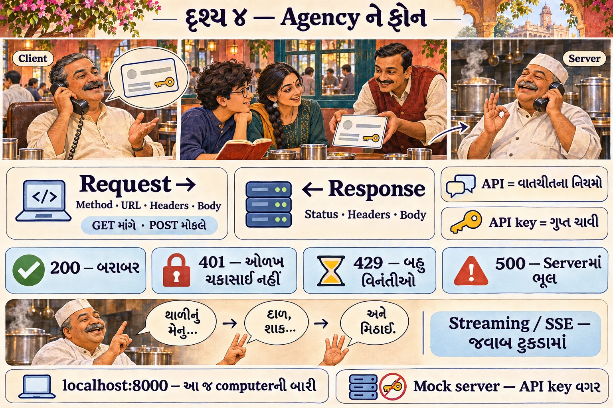

💻 Internet પર programs આ જ રીતે વાત કરે છે, અને દરેક જવાબ સાથે એક **આંકડો** આવે છે.

- **Client / Server** = માંગનાર / આપનાર. ભોજનાલય client; agency server.
- **HTTP request** = client નો સંદેશ: **method** (`GET` = માંગો, `POST` = કંઈક મોકલો), **URL** (સરનામું), **headers** (પરબીડિયા પરની નોંધો), **body** (અંદરનો પત્ર, ઘણી વાર JSON).
- **HTTP response** = server નો જવાબ: **status code** + headers + body.

| Code | અર્થ | આજના ફોનમાં | પ્રકરણ |
|---|---|---|---|
| `200` | બરાબર | "બરાબર, બોલો" | 1, 3 |
| `401` | તમે કોણ છો તે સાબિત નથી (authentication) | "તમારું card ખોટું છે" | 5 (`AUTH`) |
| `429` | બહુ ઝડપથી બહુ માંગણીઓ (rate limit) | "લાઈન વ્યસ્ત છે, થોડી વાર પછી" | 5 (retry) |
| `500` | server ની અંદર ભૂલ | "અમારે ત્યાં ગડબડ છે" | 5 (`SERVER`) |

- **API** (Application Programming Interface) = એક program બીજા program સાથે કેવી રીતે વાત કરે તેના નિયમો. ઉદાહરણ: "DeepSeek ને `POST https://api.deepseek.com/...` પર આ આકારનું JSON મોકલો."
- **API key** = API વાપરવાની ગુપ્ત ચાવી, account અને બિલ સાથે જોડાયેલી — membership card. **આ આખું પુસ્તક API key વગર ચાલે છે**: આપણે "રિહર્સલ મહારાજ" (mock server) વાપરીશું.
- **localhost અને port** = `localhost` એટલે "આ જ computer"; port એક computer પરના ઘણા servers ના બારી નંબર. પ્રકરણ 1 માં mock server `localhost` ના port `8000` પર બેસશે.
- **Streaming / SSE** = આખો જવાબ એકસાથે નહીં, ટુકડે ટુકડે. SSE (Server-Sent Events) માં server `data: {...}` lines મોકલતું જાય — મહારાજ ફોન પર રેસીપી એક-એક વાક્ય બોલતા જાય. તેથી જ AI નો જવાબ screen પર ધીમે ધીમે લખાતો દેખાય છે.

🔬 **Expert નજર.** `429` અને `401` બંને "ના" છે, પણ સાચો પ્રતિભાવ ઊલટો છે. `429` માં થોડી રાહ જોઈ **ફરી પ્રયત્ન** કરવો યોગ્ય છે; `401` માં સો વાર ફરી ફોન કરો તો પણ card ખોટું જ રહે. પ્રકરણ 5 માં harness બરાબર આ ભેદ પાડે છે: કઈ નિષ્ફળતા retry ને લાયક છે અને કઈ નથી.

## દૃશ્ય 5 — રસોડાની ભાષા: JavaScript, જરૂર પૂરતું

🎬 મીરાદીદી laptop ખોલે છે: "હવે આ જ ભોજનાલય code માં લખીએ. ભાષા JavaScript; ચલાવનાર **Node.js**."

**Node.js** = browser વગર JavaScript ચલાવતો program. `node file.mjs` લખો એટલે file ચાલે. Node ન હોય તો પ્રકરણ 0 નું setup (Node 24) પહેલાં કરી લો, પછી અહીં પાછા આવો. આ પ્રકરણનાં ઉદાહરણો કોઈ પણ નવા Node પર ચાલે છે; 🧪 અમે Node v22.23 પર ચલાવ્યાં છે.

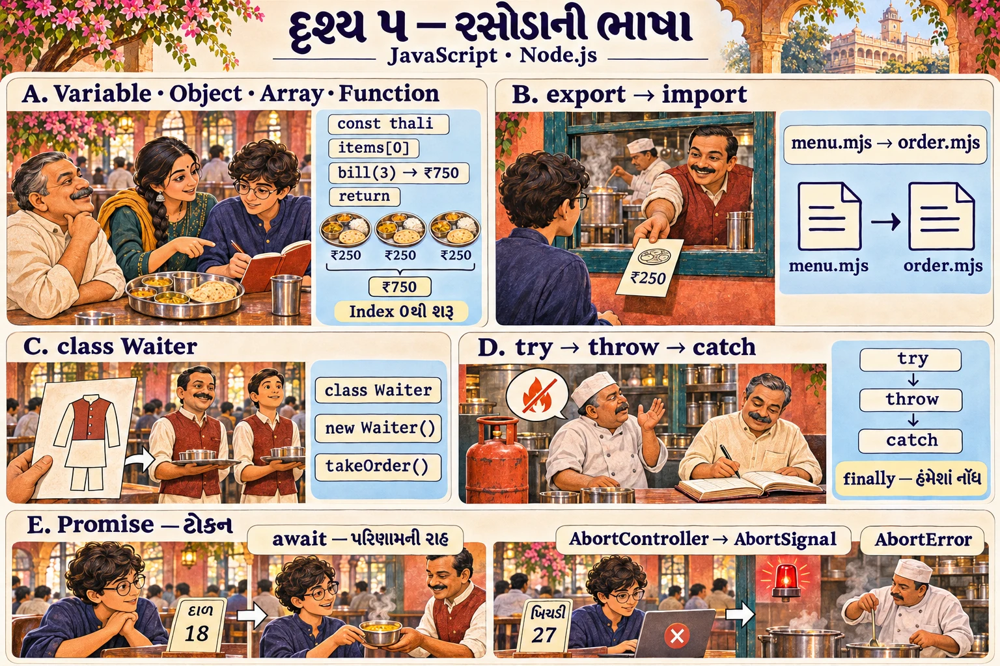

### (a) થાળી code માં: variable, object, array, function

💻 Book lab code: [`labs/pravesh/thali.mjs`](../labs/pravesh/thali.mjs)

```js
const thali = {
  name: 'ગુજરાતી થાળી',
  price: 250,
  items: ['રોટલી', 'દાળ', 'ભાત', 'શાક'],
}

function bill(qty) {
  return thali.price * qty
}

console.log(thali.name)          // object નું એક field
console.log(thali.items.length)  // array માં કેટલી વસ્તુ
console.log(thali.items[0])      // પહેલી વસ્તુ: index 0 થી ગણતરી
console.log(bill(3))             // function ને બોલાવ્યું
console.log(JSON.stringify(thali))
```

| શબ્દ | અર્થ | અહીં |
|---|---|---|
| `const` | નામ, જેની value બદલાશે નહીં | `thali` |
| **Object** `{ }` | નામ-value જોડીઓનો સમૂહ | `thali` |
| **Array** `[ ]` | ક્રમવાળી યાદી; ગણતરી **0** થી | `items` |
| **Function** | નામવાળું કામ; input (**parameter**) લે, `return` થી output આપે | `bill(qty)` |
| `//` | comment — computer માટે નહીં, માણસ માટે | |

દીદીનો નિયમ, જે આખા પુસ્તકમાં ચાલશે: **"પહેલાં ધાર, પછી ચલાવ."** શું છપાશે તે લખો. પછી:

```bash
node labs/pravesh/thali.mjs
```

🧪 Output:

```text
ગુજરાતી થાળી
4
રોટલી
750
{"name":"ગુજરાતી થાળી","price":250,"items":["રોટલી","દાળ","ભાત","શાક"]}
```

છેલ્લી line: `JSON.stringify` એ object ને JSON text બનાવ્યું — રસોડાની કડક ચિઠ્ઠી (દૃશ્ય 3). Harness દરેક session event ને આ જ રીતે JSON બનાવીને file માં લખે છે.

### (b) દરેક કાઉન્ટરની પોતાની file: `import` અને `export`

મોટો program ઘણી files માં વહેંચાય છે. એક file `export` કરે, બીજી `import` કરે:

```js
// teaching pseudocode
// menu.mjs
export const price = 250
// order.mjs
import { price } from './menu.mjs'
```

આ પુસ્તકનો દરેક plugin એક module છે, જે `export const name = …` અને `export function apply(ctx) { … }` કરે છે (પ્રકરણ 0).

### (c) એક ઢાંચો, ઘણા વેઈટર: class

```js
// teaching pseudocode
class Waiter {
  constructor(name) { this.name = name }
  takeOrder(dish) { return `${this.name} એ ${dish} નો ઓર્ડર લીધો` }
}
const ramesh = new Waiter('રમેશભાઈ')
```

`class` ઢાંચો છે; `new Waiter(...)` તેમાંથી બનેલી એક વસ્તુ (**instance**). Harness નો agent loop `ReactLoopAgent` નામનો class છે (પ્રકરણ 1).

### (d) ગેસનો બાટલો ખાલી થયો: `throw`, `try`, `catch`, `finally`

🎬 ખીચડી અધવચ્ચે છે અને ગેસનો બાટલો ખાલી થઈ જાય છે. મહારાજ બૂમ પાડે છે. રમેશભાઈ ગ્રાહકને જાણ કરે છે. પણ એક કામ એવું છે જે **બાટલો ખાલી થાય કે ન થાય, થવું જ જોઈએ**: ચોપડામાં ઓર્ડરનો અંત લખવો.

💻

```js
// teaching pseudocode
try {
  cook()                       // કદાચ ભૂલ ફેંકે (throw)
} catch (error) {
  console.log('ભૂલ:', error.message)
} finally {
  console.log('ચોપડામાં નોંધ: ઓર્ડર પૂરો')   // ગમે તે થાય, આ ચાલે જ
}
```

**`finally`** = "સફળતા, ભૂલ કે રદ — ગમે તે થાય, આ code ચાલશે જ." પ્રકરણ 1 માં harness `turn/end` (ઓર્ડરનો અંત) `finally` માં જ લખે છે.

### (e) ટોકન, રાહ, અને "ખીચડી રદ": Promise, `await`, `AbortController`

🎬 ગ્રાહક ઓર્ડર આપે એટલે રમેશભાઈ તેને **ટોકન** આપે છે: "નં. 12, તૈયાર થાય ત્યારે બોલાવીશું." રમેશભાઈ ત્યાં ઊભા રહીને રાહ નથી જોતા; બીજા ટેબલ પર જાય છે. પછી એક ગ્રાહક ઊભો થાય છે: "મારી ખીચડી **રદ** કરો, મારે નીકળવું છે." રમેશભાઈ રસોડાની બારી પર **લાલ દીવો** ચાલુ કરે છે. મહારાજ દરેક પગલા પછી દીવો જુએ છે; લાલ દેખાય એટલે અટકી જાય.

❓ "મહારાજ વચ્ચે વચ્ચે દીવો ન જુએ તો?"

"તો ખીચડી બની જ જાય, અને ગ્રાહક વગર પડી રહે. રદ કરવું એ **બે જણનું કામ** છે: એક સંકેત આપે, બીજો તે જોતો રહે."

💻 Model નો જવાબ, file વાંચવી, network — બધું **સમય લે છે**.

- **Promise** = ભવિષ્યમાં આવનારા પરિણામનું વચન — ટોકન.
- **`await`** = "આ વચન પૂરું થાય ત્યાં સુધી અહીં રાહ જુઓ." `async` function ની અંદર (અથવા `.mjs` file ના top level પર) વપરાય.
- **`AbortController` / `AbortSignal`** = ચાલુ કામ રદ કરવાનો સંકેત. Controller "રદ" બટન છે; signal એ બટન સાથે જોડાયેલો લાલ દીવો, જે કામ કરનાર જોતો રહે.

Book lab code: [`labs/pravesh/rasoi-async.mjs`](../labs/pravesh/rasoi-async.mjs)

```js
function cook(dish, ms, signal) {
  return new Promise((resolve, reject) => {
    const timer = setTimeout(() => resolve(`${dish} તૈયાર`), ms)
    signal?.addEventListener('abort', () => {
      clearTimeout(timer)
      reject(signal.reason)
    })
  })
}

console.log('1. ઓર્ડર લીધો')
const dal = await cook('દાળ', 300)
console.log('2.', dal)

const controller = new AbortController()
setTimeout(() => controller.abort(), 100) // 100ms પછી "રદ" નો સંકેત
try {
  await cook('ખીચડી', 1000, controller.signal)
  console.log('3. ખીચડી તૈયાર (આ line નહીં છપાય)')
} catch (error) {
  console.log('3. રદ થયું:', error.name)
}
console.log('4. રસોડું ફરી તૈયાર')
```

**પહેલાં ધારો:** ખીચડીને 1000ms જોઈએ, પણ 100ms પર "રદ" દબાય છે. કઈ lines છપાશે?

```bash
node labs/pravesh/rasoi-async.mjs
```

🧪 Output:

```text
1. ઓર્ડર લીધો
2. દાળ તૈયાર
3. રદ થયું: AbortError
4. રસોડું ફરી તૈયાર
```

🔬 **Expert નજર.** આ 20 lines પ્રકરણ 5 નો નકશો છે. ત્યાં Ctrl+C દબાવશો ત્યારે harness નો agent loop પોતાના `AbortController` થી બરાબર આ જ રીતે ચાલુ model call રદ કરશે, `catch` માં કારણ `aborted` નક્કી કરશે, અને `finally` માં ચોપડામાં `turn/end` લખશે. અને line 4 જુઓ: રદ થયા પછી **રસોડું ફરી તૈયાર** છે. સારું રદ કરવું એટલે ફક્ત અટકવું નહીં; પાછળ કશું અધૂરું ન છોડવું.

## દૃશ્ય 6 — ખાંડના ડબ્બામાં મીઠું: TypeScript

🎬 ગયા અઠવાડિયે નવા છોકરાએ "ખાંડ" લખેલા ડબ્બામાં મીઠું ભરી દીધું. કોઈને ખબર ન પડી — **ચા પીરસાઈ ત્યાં સુધી**. ભૂલ ગ્રાહકના મોંમાં પકડાઈ.

હવે ભીખાભાઈ ડબ્બો ભરાય તે જ વખતે લેબલ સાથે મેળવે છે. ખોટું હોય તો ત્યાં જ રોકે.

❓ "Code માં પણ ભૂલ 'ગ્રાહકના મોંમાં' પકડાય તેના કરતાં વહેલી પકડાય?"

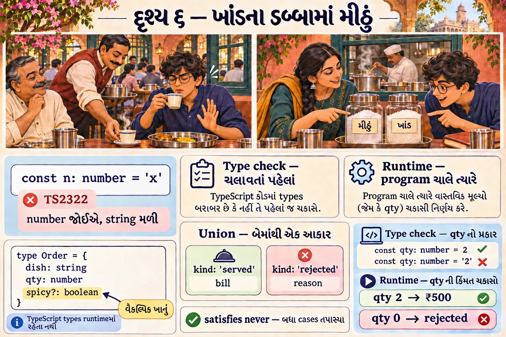

💻 **TypeScript** = JavaScript + **types**. Type એટલે value કેવા પ્રકારની છે તેની નોંધ: `number`, `string`, `boolean`, અથવા પોતે બનાવેલો આકાર — ડબ્બા પરનું લેબલ. તપાસનાર (**compiler**, `tsc`) program ચલાવતા **પહેલાં** જ ભૂલ પકડે:

```ts
const n: number = 'x'
```

🧪 TypeScript 6.0.3 નું `tsc --noEmit` આ file પર:

```text
bad.ts(1,7): error TS2322: Type 'string' is not assignable to type 'number'.
```

⚠️ **વાર્તા અને technical વચ્ચે ફરક:** ભીખાભાઈ આખો દિવસ તપાસે છે. Types ફક્ત compile વખતે તપાસાય છે; program ચાલે ત્યારે ભૂંસાઈ જાય છે.

DeepSeek Harness નો આખો code TypeScript માં છે. તેને વાંચવા આ ત્રણ આકાર પૂરતા છે (પ્રકરણ 0 માં વધુ બે ઉમેરાશે):

Book lab code: [`labs/pravesh/types.ts`](../labs/pravesh/types.ts)

```ts
type Order = { dish: string; qty: number; spicy?: boolean }   // spicy? = વૈકલ્પિક field

type Result =
  | { kind: 'served'; bill: number }
  | { kind: 'rejected'; reason: string }                     // discriminated union

function serve(order: Order): Result {
  if (order.qty <= 0) return { kind: 'rejected', reason: 'qty શૂન્યથી મોટી જોઈએ' }
  return { kind: 'served', bill: order.qty * 250 }
}

function describe(result: Result): string {
  switch (result.kind) {
    case 'served': return `બિલ ₹${result.bill}`
    case 'rejected': return `નકાર: ${result.reason}`
    default:
      result satisfies never   // બધા કેસ handle થયા એવું compiler પાસે સાબિત કરાવવું
      throw new Error('unreachable')
  }
}
```

| આકાર | અર્થ | ભોજનાલયમાં |
|---|---|---|
| `type Order = {…}` | object નો આકાર | ઓર્ડર-ફોર્મનાં ખાનાં |
| `spicy?: boolean` | `?` = ભરવું ફરજિયાત નથી | "વૈકલ્પિક: તીખાશ" |
| `A \| B` (**union**) | આ અથવા પેલું | લાલ કે લીલી ચિઠ્ઠી |
| **Discriminated union** | એક `kind` field જોઈને નક્કી થાય કે કયો આકાર | ચિઠ્ઠી પરનો સિક્કો: "પીરસ્યું" કે "નકાર્યું" |
| `satisfies never` | "કોઈ કેસ બાકી નથી" નો compiler પુરાવો | ચેકલિસ્ટ પર દરેક ખાનું ✔ |

```bash
node labs/pravesh/types.ts
```

🧪 Output (Node v22.23 પર; Node 24 પર પણ `node file.ts` સીધું ચાલે છે, કારણ કે Node types ભૂંસીને ચલાવે છે):

```text
બિલ ₹500
નકાર: qty શૂન્યથી મોટી જોઈએ
```

🧪 આ જ file `tsc --strict` તપાસમાં પણ exit 0 આપે છે.

🔬 **Expert નજર.** `satisfies never` નાનો લાગે છે, પણ મોટા codebase ને જીવતો રાખે છે. કાલે કોઈ ત્રીજો સિક્કો ઉમેરે — `{ kind: 'cancelled' }` — અને `describe` માં તેનો case લખવાનું ભૂલી જાય, તો program compile જ નહીં થાય. ભૂલ ગ્રાહકના મોં સુધી પહોંચતી નથી. Harness માં `{ kind: 'enter' } | { kind: 'reject' }` જેવા આકાર દરેક જગ્યાએ છે; પ્રકરણ 1 માં પહેલો મળશે.

## દૃશ્ય 7 — ભૂલકણો ચોકીદાર: event, listener, waterfall

🎬 ઓર્ડર રસોડામાં પહોંચે તે પહેલાં બે જણના હાથમાંથી પસાર થાય છે: **ચોકીદાર** નોંધ કરે, **મેનેજર** જરૂર હોય તો સુધારે ("ઓછું તીખું"), અને દરેક જણ ચિઠ્ઠી **આગળ આપે**. એક દિવસ નવો ચોકીદાર ચિઠ્ઠી વાંચીને ખિસ્સામાં મૂકી દે છે. આગળ આપવાનું ભૂલી જાય છે. રસોડું રાહ જુએ છે; ગ્રાહક રાહ જુએ છે; કોઈને ખબર નથી કે ઓર્ડર ક્યાં અટક્યો.

❓ "એક જણ ભૂલે એમાં આખો ઓર્ડર ગાયબ?"


💻

- **Event** = કંઈક થયું તેની જાહેરાત. ઉદાહરણ: "નવો ઓર્ડર આવ્યો", "tool નું પરિણામ આવ્યું".
- **Listener** = event થાય ત્યારે ચાલતું function.
- **Waterfall** (ધોધ) = listeners એક સાંકળમાં ઊભા છે; દરેક ઓર્ડર જુએ, ઇચ્છે તો બદલે, અને **`next()`** બોલાવી આગળ મોકલે. છેલ્લે ખરું કામ (default) થાય.

Book lab code (રમકડું — Cordis નો code **નથી**): [`labs/pravesh/waterfall.mjs`](../labs/pravesh/waterfall.mjs)

```js
function waterfall(listeners, value, last) {
  const run = (i, v) => (i === listeners.length ? last(v) : listeners[i](v, next => run(i + 1, next ?? v)))
  return run(0, value)
}

const kitchen = order => `${order} → રસોડામાં બન્યું`

const listeners = [
  (order, next) => { console.log('  [ચોકીદાર] ઓર્ડર જોયો:', order); return next() },
  (order, next) => { console.log('  [મેનેજર] તીખાશ ઓછી કરી'); return next(order + ' (ઓછું તીખું)') },
]
console.log('A:', waterfall(listeners, 'દાળ-ભાત', kitchen))

// next() ભૂલી જાઓ તો સાંકળ અટકે: રસોડા સુધી ઓર્ડર પહોંચતો જ નથી.
const forgetful = [(order, next) => { console.log('  [ભૂલકણો] ઓર્ડર જોયો:', order) }]
console.log('B:', waterfall(forgetful, 'દાળ-ભાત', kitchen))
```

```bash
node labs/pravesh/waterfall.mjs
```

🧪 Output:

```text
  [ચોકીદાર] ઓર્ડર જોયો: દાળ-ભાત
  [મેનેજર] તીખાશ ઓછી કરી
A: દાળ-ભાત (ઓછું તીખું) → રસોડામાં બન્યું
  [ભૂલકણો] ઓર્ડર જોયો: દાળ-ભાત
B: undefined
```

**B જુઓ:** ભૂલકણા listener એ `next()` ન બોલાવ્યું, તેથી રસોડા સુધી ઓર્ડર પહોંચ્યો જ નહીં — પરિણામ `undefined`. કોઈ error નથી; ફક્ત ચૂપકીદી.

🔬 **Expert નજર.** Waterfall ની શક્તિ અને જોખમ એક જ વાતમાં છે: સાંકળનો દરેક સભ્ય ઓર્ડર **બદલી કે રોકી** શકે. એટલે harness માં તમે loop ના code ને અડ્યા વગર વર્તન બદલી શકો. પણ "ફક્ત જોવા" બેઠેલો plugin `next()` ભૂલે, તો તે ચૂપચાપ આખું વર્તન તોડી નાખે. પ્રકરણ 6 ની "મારો observer plugin વર્તન બદલી નાખે છે" નિષ્ફળતા બરાબર આ જ છે. **યાદ-ચાવી: "ચિઠ્ઠી આગળ આપો — `next()` બોલાવો."**

## દૃશ્ય 8 — મહારાજની ત્રણ ખાસિયત: AI model

🎬 આરવ પહેલી વાર રસોડામાં મહારાજને ધ્યાનથી જુએ છે, અને ત્રણ વિચિત્ર વાત નોંધે છે.

**ખાસિયત 1: તે વાક્ય પૂરું કરવામાં ઉસ્તાદ છે.** તમે "દાળમાં વઘાર માટે રાઈ, જીરું અને…" કહો, અને તે તરત "હિંગ" કહે. તેમણે લાખો રેસીપી વાંચી છે.

**ખાસિયત 2: દરેક વાતચીત પછી તે બધું ભૂલી જાય છે.** પાંચ મિનિટ પહેલાં શું કહ્યું હતું, તેમને યાદ નથી. તેમની સામે જે કાગળ હોય, એટલું જ તેમનું જગત.

**ખાસિયત 3: તે રસોડાની બહાર પગ નથી મૂકતા.** કોઠારમાંથી કંઈ જોઈએ તો ચિઠ્ઠી લખે, અને રાહ જુએ.

❓ "આટલી મર્યાદા સાથે ભોજનાલય ચાલે છે કેવી રીતે?"

"કારણ કે બાકીનું બધું તેમની **આસપાસ** ગોઠવ્યું છે. એ ગોઠવણનું નામ જ harness."

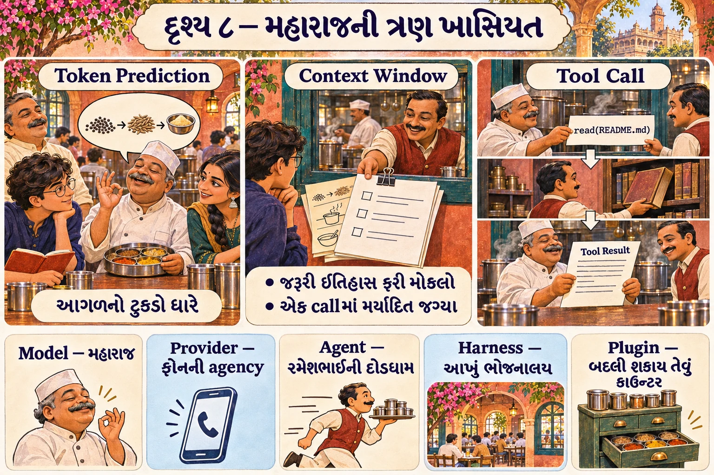

💻 **(1) Model = આગળનો ટુકડો ધારનાર.**

- **Token** = model text ને નાના ટુકડામાં તોડે છે; દરેક ટુકડો token. એક English શબ્દ આશરે 1–2 token; ગુજરાતી શબ્દ ઘણી વાર વધુ.
- **AI model (LLM — Large Language Model)** = અત્યાર સુધીના tokens જોઈને "આગળ કયો token આવે" તે ધારતું ગણિતીય મોડેલ. આ ધારણા વારંવાર કરવાથી આખો જવાબ બને છે. Mobile keyboard નું "next word suggestion" એ જ વિચારનું નાનું રૂપ છે.

**(2) Model ને યાદ રહેતું નથી.**

- **Context window** = model એક વખતમાં કેટલા tokens જોઈ શકે તેની મર્યાદા — મહારાજ સામેના કાગળનું કદ. પ્રકરણ 1 ના અમારા run માં ચોપડામાં `"contextWindow":1048576` નોંધાયું છે (આશરે દસ લાખ tokens) — 🧪 [evidence/two-calls.session.txt](../evidence/two-calls.session.txt).

Model દરેક call વખતે **શૂન્યથી** શરૂ કરે છે. પાછલી વાત જોઈતી હોય તો **આખો ઇતિહાસ ફરીથી મોકલવો** પડે. પ્રકરણ 1 માં આ આંકડામાં દેખાશે: પહેલા call માં 5 messages, બીજામાં 7.

**(3) Model પાસે હાથ નથી: tool call.**

- **Tool** = harness પાસેનું એક કામ (function), જે model માંગી શકે. ઉદાહરણ: `read` (file વાંચો), `write`, `edit`, `bash`.
- **Tool call** = model ની લેખિત માંગ: "આ tool, આ arguments સાથે ચલાવો" — મહારાજની કોઠાર-ચિઠ્ઠી.

પ્રકરણ 1 ના અમારા run માં model એ ખરેખર આ ચિઠ્ઠી લખી હતી (🧪 stored session માંથી):

```json
{"type":"tool-call","id":"mock-call-1","name":"read","arguments":"{\"file_path\":\"README.md\"}"}
```

Harness આ ચિઠ્ઠી વાંચે, `read` tool ચલાવે, README ની સામગ્રી **tool result** તરીકે ઇતિહાસમાં ઉમેરે, અને model ને **ફરી** પૂછે. હવે model સામેના કાગળ પર README છે, એટલે તે સાર લખે.

**પાંચ શબ્દો — અંદરથી બહાર:**

| શબ્દ | એક વાક્ય | ભોજનાલયમાં |
|---|---|---|
| **Model** | text વાંચી text કે tool call લખે; હાથ નથી, યાદ નથી | મહારાજ |
| **Provider** | model ને network પર પહોંચાડતી સેવા (HTTP API) | રસોઈ-સેવા agency, ફોન પર |
| **Agent** | model ↔ tools નો loop, કામ પૂરું થાય ત્યાં સુધી | રમેશભાઈની દોડધામ |
| **Harness** | agent + tools + ચોપડો + સુરક્ષા + UI — આખું તંત્ર | આખું ભોજનાલય |
| **Plugin** | harness ની એક બદલી શકાય તેવી ઈંટ | દરેક કાઉન્ટર/કર્મચારી |

**યાદ-ચાવી "મો-પ્રો-એ-હા-પ્લ" — "મોટો પ્રોફેસર એક હાથે પ્લેટ":** **મો**ડેલ, **પ્રો**વાઇડર, **એ**જન્ટ, **હા**ર્નેસ, **પ્લ**ગિન.

🔬 **Expert નજર.** મહારાજની ત્રણ ખાસિયત એ harness ના ત્રણ મોટા ભાગનું કારણ છે. યાદ નથી → **ચોપડો** (session log) જોઈએ. હાથ નથી → **કોઠાર અને કોઠારી** (tools) જોઈએ. અને તે ફક્ત ધારે છે, જાણતા નથી → તેમની ચિઠ્ઠી આંધળી રીતે ન મનાય: **તપાસ, મંજૂરી, સીમા** (pipeline, approval, sandbox) જોઈએ. Harness નો કોઈ પણ ભાગ જુઓ ત્યારે પૂછો: "આ model ની કઈ મર્યાદા પૂરી કરે છે?"

## દૃશ્ય 9 — 40 lines નું ભોજનાલય: રમકડા-agent

🎬 "હવે," દીદી કહે છે, "આજે જોયેલું બધું એક file માં: ગ્રાહક, રમેશભાઈ, મહારાજ, કોઠાર, ચોપડો."

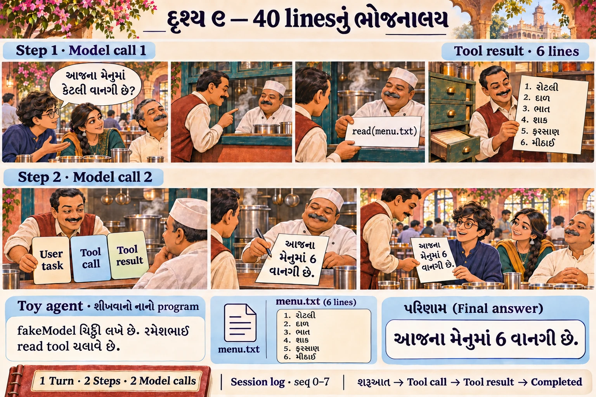

💻 નીચેનો program **DeepSeek Harness નથી** — રમકડું છે, જેમાં નકલી model છે. પણ તેનો આકાર ખરા harness જેવો જ છે, અને event નામો જાણીજોઈને ખરા harness જેવાં રાખ્યાં છે.

Book lab code: [`labs/pravesh/toy-agent.mjs`](../labs/pravesh/toy-agent.mjs) (મુખ્ય ભાગ)

```js
const log = []                                      // ચોપડો: ફક્ત ઉમેરાય, ભૂંસાય નહીં
const append = (type, data = {}) => {
  const event = Object.freeze({ seq: log.length, type, ...data })
  log.push(event)
  console.log(`#${event.seq} ${type}`, JSON.stringify(data))
}

// નકલી model: છેલ્લો message tool result ન હોય તો tool માંગે, નહીં તો જવાબ લખે.
function fakeModel(messages) {
  const last = messages[messages.length - 1]
  if (last.role !== 'tool') return { toolCall: { name: 'read', args: { file_path: 'menu.txt' } } }
  return { text: `આજના મેનુમાં ${last.content.split('\n').length} વાનગી છે.` }
}

function turn(task) {
  const messages = [{ role: 'user', content: task }]  // history: દરેક વખતે આખી મોકલાય
  append('turn/start')
  for (let step = 1; ; step++) {
    append('step/start', { step })
    const reply = fakeModel(messages)                // model call
    if (reply.toolCall) {
      append('tool/call', reply.toolCall)
      const result = tools[reply.toolCall.name](reply.toolCall.args)
      append('tool/result', { chars: result.length })
      messages.push({ role: 'assistant', toolCall: reply.toolCall }, { role: 'tool', content: result })
      append('step/end', { step })
      continue                                       // tool વપરાયો → turn પૂરો નથી
    }
    append('step/end', { step })
    append('turn/end', { reason: 'completed', modelCalls: step, messagesSentLast: messages.length })
    return reply.text
  }
}
```

**પહેલાં ધારો:** model કેટલી વાર બોલાવાશે? છેલ્લા call માં કેટલા messages જશે?

```bash
node labs/pravesh/toy-agent.mjs
```

🧪 Output:

```text
#0 turn/start {}
#1 step/start {"step":1}
#2 tool/call {"name":"read","args":{"file_path":"menu.txt"}}
#3 tool/result {"chars":29}
#4 step/end {"step":1}
#5 step/start {"step":2}
#6 step/end {"step":2}
#7 turn/end {"reason":"completed","modelCalls":2,"messagesSentLast":3}
જવાબ: આજના મેનુમાં 6 વાનગી છે.
```

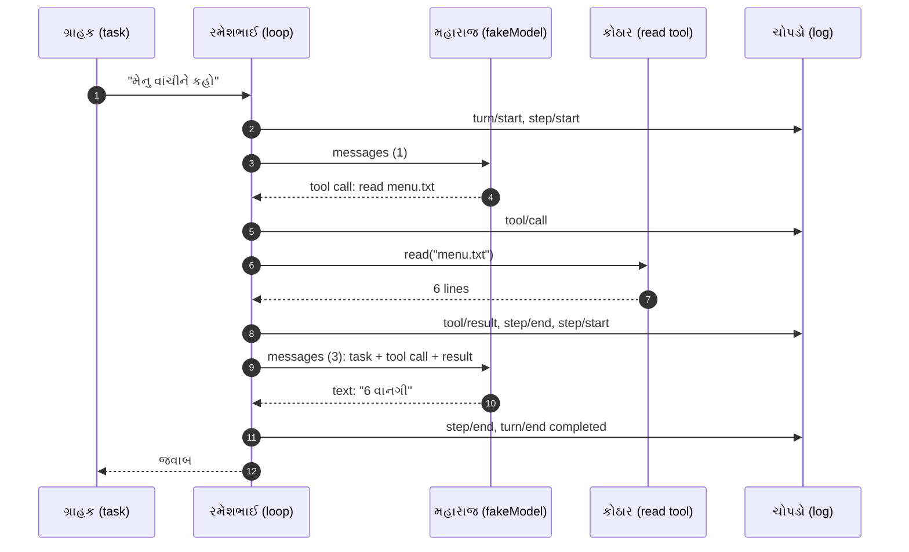

આરવ output માં મહારાજની ત્રણેય ખાસિયત શોધે છે:

- **હાથ નથી** → `#2 tool/call`: મહારાજે ચિઠ્ઠી લખી; `read` રમેશભાઈએ ચલાવ્યું.
- **યાદ નથી** → `messagesSentLast: 3`: બીજી વાર આખો ઇતિહાસ ફરી ગયો (task + tool call + result).
- **બે વાર પૂછવું પડ્યું** → `modelCalls: 2`.

અને ત્રણ નવા શબ્દ:

- **Turn** = ગ્રાહકના એક ઓર્ડરથી "હવે કંઈ બાકી નથી" સુધીનું આખું કામ. અહીં 1 turn.
- **Step** = મહારાજ સાથેની **એક** વાતચીત + તેમણે માંગેલા tools. અહીં 2 steps.
- **Session log (ચોપડો)** = દરેક ઘટનાની ક્રમાંક (`seq`) વાળી નોંધ; ફક્ત ઉમેરાય. `Object.freeze` એટલે લખેલી લીટી કોઈ બદલી ન શકે.

| રમકડામાં | ખરા DeepSeek Harness માં (પ્રકરણ 1) |
|---|---|
| `fakeModel` | DeepSeek API (lab માં mock server) |
| `turn()` નો `for` loop | `ReactLoopAgent.turn()` અને `step()` |
| `tools.read` | `read` tool, `ctx.fs` દ્વારા |
| `log` array | session log, JSONL file માં સચવાય |
| 2 model calls, છેલ્લે 3 messages | 2 model calls, છેલ્લે **7** messages (system prompt અને ત્રણ વધારાના user context messages સાથે) |
| કોઈ સુરક્ષા નહીં | sandbox, approval, retries, cancellation (પ્રકરણ 5) |
| એક જ file | ~100 plugins (પ્રકરણ 2) |

⚠️ **રમકડું અને ખરું harness:** ખરા harness માં model ને બધા tools નું વર્ણન (schema) મોકલાય છે, જવાબ streaming માં ટુકડે ટુકડે આવે છે, ચોપડો disk પર સચવાય છે, અને દરેક ભાગ plugin છે. પણ **turn → steps → tool call → tool result → ફરી model** નો આકાર બરાબર એ જ છે.

🔬 **Expert નજર.** રમકડામાં એક નબળાઈ જાણીજોઈને રાખી છે: history `messages` નામના array માં છે અને ચોપડો `log` નામના **બીજા** array માં. બે જગ્યાએ સત્ય હોય, તો ક્યારેક બંને અલગ પડે. ખરું harness આ નથી કરતું: ત્યાં history દર વખતે ચોપડામાંથી જ **ફરી બને** છે. પ્રકરણ 1 નું દૃશ્ય 7 આખું આ એક ફરક પર છે.

## દૃશ્ય 10 — રસોડાનો ફોટો-આલ્બમ: Git

🎬 પપ્પા દર મહિને રસોડાનો ફોટો પાડીને આલ્બમમાં ચોંટાડે છે, પાછળ તારીખ અને નંબર લખે છે. કોઈ કહે "પહેલાં તંદૂર ક્યાં હતું?" તો આલ્બમ ખોલે. અને ભોજનાલય એક chain ની શાખા છે: નિયમો **મુખ્ય કચેરી** ઘડે છે, અને શાખા સુધારો સૂચવી શકે છે.

❓ "Software રોજ બદલાય છે. તો પુસ્તક કયા દિવસના software વિશે છે?"


💻

- **Repository (repo)** = project ની બધી files + તેમનો આખો ઇતિહાસ. ઉદાહરણ: GitHub પરનું `deepseek-ai/deepseek-harness`.
- **Git** = દરેક ફેરફારનો ઇતિહાસ રાખતું tool — આલ્બમ.
- **Commit** = ઇતિહાસનો એક ફોટો, જેની પાછળ એક અનન્ય નંબર — **SHA** — લખેલો હોય. ઉદાહરણ: `fcc0ad4…`.
- **Clone** = repository ની પૂરી નકલ પોતાના computer પર.
- **Branch** = ઇતિહાસની એક શાખા, જેમાં નવા ફોટા ઉમેરાતા જાય. `master`/`main` મુખ્ય શાખા.
- **Pull request (PR)** = "મારો આ ફેરફાર તમારા repository માં લો" એવી વિનંતી, review માટે.
- **Upstream** = મૂળ project, જેમાં આપણે સુધારો સૂચવીએ — મુખ્ય કચેરી.

**આ પુસ્તક એક જ ફોટા પર બંધાયેલું છે** (`fcc0ad4`). Software રોજ બદલાય છે; ફોટો બદલાતો નથી. તેથી પુસ્તકની દરેક source link એ ફોટાની ચોક્કસ lines બતાવે છે.

🔬 **Expert નજર.** "મારા machine પર ચાલે છે" અને "તારા પર નથી ચાલતું" એ ઝઘડાનો અંત SHA છે. બે જણ એક જ SHA પર ઊભા હોય, તો બંને એક જ code જુએ છે — line number સુધી. Expert bug report માં પહેલી line આ લખે છે: કયો commit.

---

## 15 દિવસનું સમયપત્રક

| દિવસ | પ્રકરણ | ભોજનાલયમાં | Lab નો સમય (આશરે) |
|---|---|---|---|
| 1 | પ્રવેશ (આ) | પરિણામનો દિવસ | 1–2 કલાક |
| 2 | [0 પાયો](00-paayo-ane-pratham-run.md) | ભોજનાલયની ચાવીઓ | 2–3 કલાક (install + build) |
| 3–4 | [1 મુસાફરી](01-request-ni-musafari.md) | એક ઓર્ડર દરવાજાથી થાળી સુધી | 2 કલાક |
| 5–6 | [2 Cordis](02-cordis-plugin-architecture.md) | સવારે ભોજનાલય ખૂલે | 2 કલાક |
| 7 | [3 અંદર](03-tools-sessions-adapters.md) | ત્રણ ઓરડા અંદરથી | 2 કલાક |
| 8–9 | [4 પોતાનો plugin](04-potano-plugin.md) | આરવનું પોતાનું કાઉન્ટર | 3 કલાક |
| 10–11 | [5 તૂટે તો](05-debugging-permissions-reliability.md) | ખરાબ દિવસ | 3 કલાક |
| 12–13 | [6 Maintainer](06-maintainer-architecture.md) | મુખ્ય કચેરીને સૂચન | 3 કલાક |
| 14–15 | [7 અંતિમ પ્રોજેક્ટ](07-antim-project-mastery.md) | મુનીમજીનો હિસાબ + પરીક્ષા | 4 કલાક |

દરેક પ્રકરણ દૃશ્યોમાં ચાલે છે (🎬 → ❓ → 💻 → 🔬), પછી 🧪 lab, 🔮 આગાહી કસોટી, 🩺 એક ખરી નિષ્ફળતા અને તેનું નિદાન, ✅ સાર, અને 🧠 mastery check (જવાબો [પરિશિષ્ટ D](../appendix/D-lab-solutions.md) માં). ઉતાવળ નથી: પહેલી વાંચનમાં 🔬 ઝડપથી વાંચો, બીજી વાંચનમાં ત્યાં અટકો.

## 🔮 આગાહી કસોટી

`toy-agent.mjs` માં `fakeModel` ને એવો બદલો કે તે **પહેલી જ વાર** text આપે (tool ન માંગે): `if (last.role !== 'tool')` વાળી line ને comment કરી દો. ભોજનાલયની ભાષામાં: મહારાજ ચિઠ્ઠી લખ્યા વગર, કોઠારમાંથી કશું મંગાવ્યા વગર સીધો જવાબ આપી દે.

**ચલાવતા પહેલાં લખો:** (1) કેટલા steps? (2) `tool/call` event આવશે? (3) `messagesSentLast` શું હશે? (4) જવાબમાં શું છપાશે? (સંકેત: `last.content` હવે tool result નહીં, તમારું task છે.)

જવાબ: [પરિશિષ્ટ D — પ્રવેશ](../appendix/D-lab-solutions.md#pravesh).

## 🩺 નિષ્ફળતા: ફરી "બીજું ખાનું"

🎬 આરવ પુસ્તકના folder માં `node labs/pravesh/thali.mjs` ચલાવે છે — બરાબર ચાલે છે. પછી `cd ~/bhojanalay` કરીને એ જ command ફરી ચલાવે છે:

```text
Error: Cannot find module '/home/aarav/bhojanalay/labs/pravesh/thali.mjs'
  code: 'MODULE_NOT_FOUND',
```

(🧪 path ટૂંકાવ્યો છે.) Exit code `1`.

"દીદી, file તો છે! હમણાં જ ચાલી."

"સવારની બિલ-બુક યાદ કર. તું બીજા ઓરડામાં ઊભો છે અને 'બીજું ખાનું' ખોલે છે."

💻 **નિદાન:**

1. **સંદેશ ધ્યાનથી વાંચો.** Node કયો **પૂરો path** શોધતું હતું તે તેમાં લખેલું છે.
2. **Path ની શરૂઆત જુઓ:** `/home/aarav/bhojanalay/…` — એટલે relative path `labs/pravesh/thali.mjs` ને Node એ **હાલના folder** (`pwd`) સામે જોડ્યો.
3. **ઉપાય:** પુસ્તકના folder માં પાછા જાઓ (`cd`), અથવા absolute path આપો.
4. **પુરાવો:** ફરી ચલાવો; exit code `0` અને `ગુજરાતી થાળી` થી શરૂ થતું output.

🔬 **Expert નજર.** ભૂલ સંદેશ શત્રુ નથી, નકશો છે. દરેક પ્રકરણના 🩺 વિભાગમાં આ જ ક્રમ ચાલશે: **લક્ષણ → સંદેશ વાંચો → કારણ → ઉપાય → ફરી ચલાવીને પુરાવો.** છેલ્લું પગલું શિખાઉ છોડી દે છે; expert કદી નહીં. અને આ જ પ્રશ્ન પ્રકરણ 2 માં મોટો થઈને આવશે: overlay માં લખેલો plugin path harness **કોની સામે** શોધે છે?

<a id="saral-samaj"></a>

## ✅ સાર — આરવની નોટબુકનું પહેલું પાનું

**એક વાક્યમાં:** computer files અને processes થી ચાલે, terminal થી આપણે તેને આદેશ આપીએ, programs JSON/YAML/CSV માં વાત કરે, internet પર HTTP થી, JavaScript માં `await` થી રાહ જોવાય અને `AbortController` થી રદ થાય — અને AI agent એ "model પૂછો → tool ચલાવો → ફરી પૂછો" નો loop છે, જેની દરેક ઘટના ચોપડામાં લખાય છે.

### દસ ઘટના, દસ નિયમ

| ઘટના | નિયમ |
|---|---|
| "બીજું ખાનું" | Relative path હાલના folder સામે ગણાય; absolute ગમે ત્યાંથી એક જ |
| રસોડાની બારી | Terminal; `0` = સફળ; થાળી stdout માં, બૂમો stderr માં |
| એક ઓર્ડર, ત્રણ કાગળ | JSON program માટે, YAML માણસ માટે, CSV table માટે, JSONL ચોપડા માટે |
| agency ને ફોન | HTTP status: `429` = ફરી પ્રયત્ન; `401` = ફરી પ્રયત્ન નકામો |
| ગેસનો બાટલો ખાલી | `finally` ગમે તે થાય, ચાલે જ |
| "ખીચડી રદ" | `AbortController` સંકેત આપે; કામ કરનારે signal જોતા રહેવું પડે |
| ખાંડના ડબ્બામાં મીઠું | Types ભૂલને ચલાવતા પહેલાં પકડે |
| ભૂલકણો ચોકીદાર | Waterfall માં `next()` ન બોલાવો તો સાંકળ ચૂપચાપ અટકે |
| મહારાજની ત્રણ ખાસિયત | Model ધારે છે; યાદ નથી; હાથ નથી → ચોપડો, tools, તપાસ |
| ફોટો-આલ્બમ | આખું પુસ્તક એક commit (`fcc0ad4`) પર |

### યાદ-ચાવીઓ

- **"0 = બધું બરાબર"** — exit code.
- **"થાળી stdout માં, બૂમો stderr માં."**
- **"મો-પ્રો-એ-હા-પ્લ"** — model, provider, agent, harness, plugin.
- **"મહારાજ પાસે હાથ નથી, યાદ નથી"** — tool call અને આખો ઇતિહાસ ફરી મોકલવો.
- **"ચિઠ્ઠી આગળ આપો"** — waterfall માં `next()`.
- **"`finally` ગમે તે થાય, ચાલે જ."**
- **"પહેલાં ધાર, પછી ચલાવ."**

### સામાન્ય ગેરસમજો

| ગેરસમજ | સાચું |
|---|---|
| "AI model પોતે file ખોલે છે." | Model ફક્ત tool call લખે; file harness ખોલે. |
| "Model ને પાછલી વાત યાદ છે." | દરેક call માં આખો ઇતિહાસ ફરી મોકલાય છે. |
| "Exit code 0 નહીં, તો computer બગડ્યું." | Exit code ફક્ત "આ process સફળ થયો કે નહીં" કહે છે; કારણ stderr માં વાંચો. |
| "API key વગર AI શીખી ન શકાય." | આ આખું પુસ્તક key વગર mock provider સાથે ચાલે છે. |
| "TypeScript ના types program ચાલે ત્યારે તપાસાય છે." | Types ફક્ત compile વખતે (`tsc`) તપાસાય; ચાલતી વખતે ભૂંસાઈ જાય. |

### પુનરાવર્તન કાર્ડ

જવાબ જોયા પહેલાં મોટેથી બોલો, પછી ખોલો.

<details><summary>1. Absolute અને relative path માં શું ફરક?</summary>

Absolute `/` થી શરૂ થાય અને ગમે ત્યાંથી એક જ જગ્યા બતાવે; relative "હું જ્યાં છું ત્યાંથી" ગણાય. પ્રકરણ 2 અને 4 માં overlay માં absolute path કેમ જોઈએ તે આ ફરક પર આધારિત છે.
</details>

<details><summary>2. `O=$(bash make-overlay.sh)` શું કરે?</summary>

Script ચલાવી તેનું stdout (અહીં એક file નો path) variable `O` માં મૂકે; પછી `$O` થી વાપરાય.
</details>

<details><summary>3. HTTP 429 અને 401 માં ફરક?</summary>

429 = બહુ ઝડપથી માંગણીઓ (થોડી રાહ જોઈ ફરી પ્રયાસ યોગ્ય); 401 = ઓળખ/ચાવી ખોટી (ફરી પ્રયાસથી કંઈ નહીં સુધરે). પ્રકરણ 5 માં harness બરાબર આ ભેદ પાડે છે.
</details>

<details><summary>4. રમકડા-agent માં 2 steps કેમ થયા?</summary>

Step 1 માં model એ text ને બદલે tool call આપ્યો, તેથી turn પૂરો ન થયો; tool result ઉમેરી step 2 માં ફરી પૂછ્યું, ત્યારે text આવ્યું.
</details>

<details><summary>5. `AbortController` અને `finally` નું જોડાણ શું?</summary>

Controller "રદ" નો સંકેત આપે; `await` વાળું કામ ભૂલ ફેંકે; `catch` કારણ નક્કી કરે; `finally` ગમે તે થાય તો પણ અંતિમ નોંધ લખે.
</details>

### મિત્રને સમજાવો (3 મિનિટ)

પહેલાં મહારાજની ત્રણ ખાસિયત વાર્તા તરીકે કહો. પછી એ જ વાત વાર્તા વગર, ફક્ત model, context window, tool call, tool result, loop શબ્દોથી કહો: "AI agent README કેવી રીતે વાંચે છે, જ્યારે model ને હાથ જ નથી?" જ્યાં અટકો ત્યાં દૃશ્ય 8–9 ફરી વાંચો.

<a id="swa-kasoti"></a>

## 🧠 સ્વ-કસોટી / Mastery check

આ પાંચેયના જવાબ સહેલાઈથી આવડે તો તમે પ્રકરણ 0 માટે તૈયાર છો:

1. `cd ~/bhojanalay && ls nofile; echo $?` — છેલ્લે શું છપાશે, અને `&&` ને બદલે `;` હોત તો શો ફરક પડત?
2. એક જ ઓર્ડરને JSON અને YAML બંનેમાં લખો.
3. `await` શું કરે છે, અને model call જેવા કામ માટે તે કેમ જરૂરી છે?
4. `{ kind: 'served' } | { kind: 'rejected' }` જેવા type માં `satisfies never` કેમ ઉપયોગી છે?
5. Waterfall listener `next()` ન બોલાવે તો શું થાય? `waterfall.mjs` ના output થી સમજાવો.

જવાબો: [પરિશિષ્ટ D — પ્રવેશ](../appendix/D-lab-solutions.md#pravesh).

## 🎬 આગળ શું

રાત્રે ભોજનાલય બંધ થતાં પપ્પા ચાવીનો ઝૂડો ખીંટી પર ટાંગે છે. મીરાદીદી કહે છે: "આજે તેં computer ની ભાષા શીખી અને રમકડું ચલાવ્યું. કાલે સવારે એ ઝૂડો તારા હાથમાં આવશે. આપણે **ખરા** DeepSeek Harness ને તારા computer પર લાવીશું — એ જ ફોટા (`fcc0ad4`) પર — અને તેમાં તારો પહેલો plugin ચલાવીશું. API key વગર."

---

આગળ: [પ્રકરણ 0 — પાયો અને પ્રથમ run](00-paayo-ane-pratham-run.md) · આખો નકશો: [સમગ્ર નકશો](overview-samagra-naksho.md)
